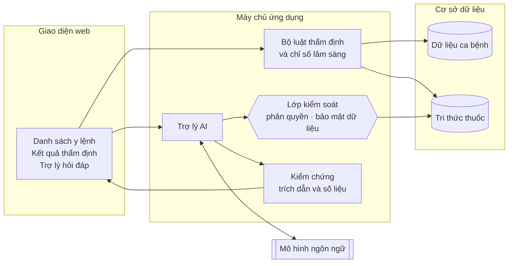

<div align="center">

# bvienx-PharmProject

**Hệ thống hỗ trợ dược sĩ lâm sàng thẩm định y lệnh**

Luật chạy bằng code · Trích dẫn có kiểm chứng · Dược sĩ là người quyết định


</div>

---

## 📌 Tổng quan

Thẩm định y lệnh là công việc hằng ngày của dược sĩ lâm sàng: kiểm tra liều theo chức năng thận, phát hiện tương tác nguy hiểm, trùng lặp điều trị, dị ứng chéo và nhiều yếu tố khác trên từng đơn thuốc. Khối lượng lớn và thông tin phân tán khiến việc rà soát dễ bỏ sót.

**bvienx-PharmProject** đọc hồ sơ ca bệnh, tự động rà soát y lệnh theo **7 yếu tố thẩm định** và trình bày kết quả kèm căn cứ rõ ràng. Dược sĩ có thể đặt câu hỏi bổ sung bằng tiếng Việt; trợ lý AI chỉ tra cứu và tổng hợp từ nguồn tin cậy, mọi câu trả lời đều được kiểm chứng trước khi hiển thị.

> [!IMPORTANT]
> Hệ thống chỉ đóng vai trò hỗ trợ. Hệ thống không duyệt y lệnh thay dược sĩ, không ghi vào hồ sơ bệnh án và không gửi thông tin ra ngoài quy trình. Toàn bộ hồ sơ người bệnh trong repository là **dữ liệu giả lập**.

## ✨ Tính năng chính

**Thẩm định 7 yếu tố**
Dị ứng, quá mẫn · Trùng lặp thuốc · Chỉ định, liều, đường dùng · Tương tác thuốc · Độc tính · Cơ địa và xét nghiệm · Lịch dùng và yếu tố khác. Mỗi yếu tố được trình bày thành một mục riêng, kèm căn cứ từ dữ liệu ca, phép tính và tài liệu nguồn.

**Kết luận minh bạch theo 4 trạng thái**
`Đạt` · `Cần xem` · `Không đủ dữ liệu` · `Ngoài hướng dẫn sử dụng`. Khi thiếu dữ liệu, hệ thống nêu rõ thông tin còn thiếu thay vì đưa ra kết luận "đạt".

**Chỉ số lâm sàng tính bằng code**
Độ thanh thải creatinin, eGFR, BMI, diện tích da, QTc… được cài đặt theo công thức gốc có trích dẫn. Mô hình ngôn ngữ không tham gia tính toán.

**Trợ lý hỏi đáp có kiểm chứng**
Trợ lý AI tra cứu tương tác thuốc và tài liệu thuốc để trả lời câu hỏi của dược sĩ. Mọi trích dẫn phải khớp nguyên văn nguồn, mọi con số phải có trong dữ liệu ca hoặc tài liệu được trích; câu trả lời không đạt kiểm chứng sẽ không được hiển thị.

**Tra cứu thuốc và tương tác**
Gợi ý tên thuốc khi gõ, tự sửa lỗi chính tả, quy đổi biệt dược sang hoạt chất, ma trận tương tác cho nhiều thuốc cùng lúc.

**Bảo mật dữ liệu người bệnh**
Thông tin định danh người bệnh được ẩn trước khi xử lý bằng dịch vụ AI và chỉ khôi phục khi hiển thị cho người dùng có quyền. Người dùng được xác thực và phân quyền theo vai trò; hội thoại và phản hồi gắn với người tạo. Mỗi lần trợ lý AI tra cứu đều được ghi nhật ký kiểm toán, nhật ký không chứa nội dung câu hỏi hay hồ sơ.

## 🏗️ Kiến trúc



Hệ thống theo **kiến trúc lai**: bộ luật và công thức đưa ra kết luận; truy xuất tài liệu cung cấp căn cứ; mô hình ngôn ngữ chỉ đọc văn bản tự do và diễn giải. Phát hiện của bộ luật không bị mô hình ngôn ngữ xoá hay hạ mức cảnh báo.

<details>
<summary><b>Quy trình xử lý một câu hỏi</b></summary>

1. Ẩn thông tin định danh trong câu hỏi, lịch sử hội thoại và dữ liệu ca.
2. Chặn các câu hỏi vượt phạm vi hoặc có dấu hiệu thao túng hệ thống.
3. Chuẩn bị ngữ cảnh: kết quả bộ luật, hồ sơ ca đã ẩn định danh, các chỉ số đã tính.
4. Trợ lý AI tra cứu nguồn tri thức qua lớp kiểm soát (phân quyền, giới hạn tham số, giới hạn số lượt và thời gian).
5. Kiểm chứng trích dẫn và số liệu; không đạt thì trả lời "không đủ căn cứ".
6. Khôi phục thông tin hiển thị cho dược sĩ.

</details>

## 🚀 Bắt đầu nhanh

**Yêu cầu:** Python 3.13 với [uv](https://docs.astral.sh/uv/), Node.js và npm. PostgreSQL có pgvector là tùy chọn; khi không có cơ sở dữ liệu, ứng dụng đọc dữ liệu tệp cục bộ.

```bash
# Cài đặt
uv sync
npm --prefix web install
cp .env.example .env        # điền cấu hình trên máy cá nhân, không commit

# Chạy máy chủ ứng dụng (cổng 8000) và giao diện (cổng 5173)
uv run uvicorn app.api.main:app --port 8000 --reload --reload-dir app
npm --prefix web run dev -- --port 5173 --strictPort
```

Mở `http://localhost:5173`, chọn một ca bệnh, xem kết quả ở tab **Thẩm định** và đặt câu hỏi ở ô trợ lý.

<details>
<summary><b>Đóng gói và triển khai</b></summary>

```bash
# Một tiến trình: giao diện và máy chủ ứng dụng
npm --prefix web run build
uv run uvicorn app.api.main:app --port 8000

# Máy chủ: ứng dụng và reverse proxy HTTPS
docker compose up -d --build
```

Cấu hình bí mật trên máy chủ nằm ngoài image và ngoài repository.

</details>

## Kiểm thử

```bash
uv run ruff check app tests && uv run ruff format --check app tests
uv run pytest -q -p no:cacheprovider

npm --prefix web run lint
npm --prefix web run build
cd web && npx vitest run
```

Bộ kiểm thử chạy được không cần mạng và không cần cơ sở dữ liệu, gồm kiểm thử bộ luật trên ca giả lập, kiểm thử phân quyền, truy cập chéo và các tình huống tấn công chèn lệnh.

## Cấu trúc thư mục

```text
bvienx-PharmProject/
├── app/
│   ├── api/            # máy chủ ứng dụng và hợp đồng dữ liệu
│   ├── rules/          # bộ luật thẩm định 7 yếu tố
│   ├── calc/           # chỉ số lâm sàng
│   ├── agent/          # trợ lý AI và lớp kiểm soát
│   ├── orchestration/  # điều phối hỏi đáp
│   ├── retrieval/      # truy xuất tài liệu
│   ├── verify/         # kiểm chứng trích dẫn và số liệu
│   ├── deid/           # bảo mật dữ liệu người bệnh
│   └── kb/ · db/       # tri thức thuốc và truy cập cơ sở dữ liệu
├── web/                # giao diện web
├── config/             # cấu hình và chính sách phân quyền
├── db/                 # lược đồ cơ sở dữ liệu
├── data/               # ca giả lập và bảng luật
├── tests/              # kiểm thử
└── docs/               # ghi chép kỹ thuật về hệ thống
```

## Nguồn tri thức

Thứ tự ưu tiên: văn bản quy định của Bộ Y tế, Dược thư Quốc gia, nhãn thuốc được cơ quan quản lý phê duyệt, sau đó là cơ sở dữ liệu tương tác thuốc dùng cho sàng lọc. Hệ thống không sao chép nội dung từ các cơ sở dữ liệu thương mại.

## Nguyên tắc vận hành

- **Dược sĩ quyết định.** Hệ thống chỉ đưa ra gợi ý có căn cứ.
- **Chỉ đọc.** Trợ lý AI không thể ghi dữ liệu, không truy cập ca bệnh ngoài phạm vi.
- **Không suy diễn nguồn và số liệu.** Chỉ căn cứ được tra cứu trong lượt hỏi mới được trích dẫn.
- **Không dùng dữ liệu thật.** Repository, prompt và nhật ký không chứa dữ liệu người bệnh thật.

---

<div align="center">
<sub>Dự án demo / MVP · Dữ liệu giả lập · Không sử dụng cho quyết định lâm sàng thực tế</sub>
</div>
