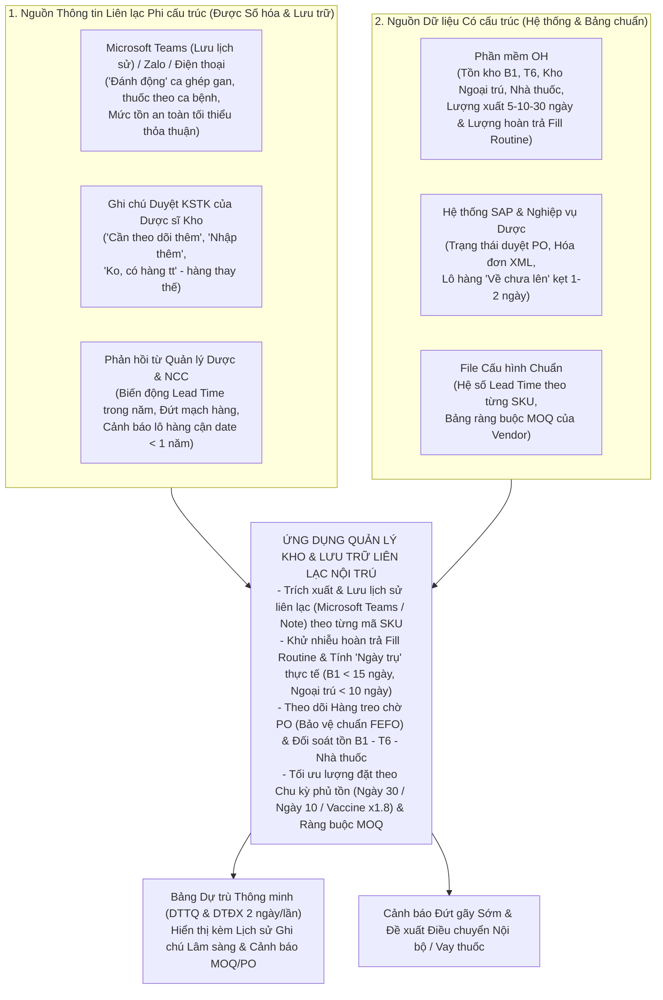
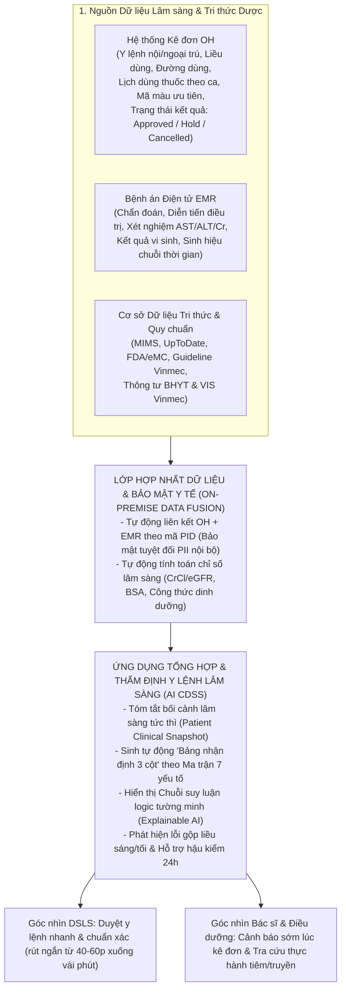

# BÁO CÁO TUẦN 2
## BÁO CÁO 2 NHU CẦU ƯU TIÊN, BẰNG CHỨNG THỰC ĐỊA & PHẢN HỒI XÁC NHẬN

**Chương trình:** Vinmec AI Exploration Sprint 6 Tuần (VinUni x Vinmec)  
**Đơn vị thực tập:** Khoa Dược (S10) – Bệnh viện Đa khoa Quốc tế Vinmec Times City  
**Danh sách thành viên:**
- Đỗ Trương Thành Ân – 2A202602899
- Vũ Gia Khải – 2A202602786

**Mentor phụ trách:** ThS.DS Nguyễn Lê Trang (Trưởng khoa Dược)  
**Lead cơ sở phụ trách:** Nguyễn Xuân Tài  
**Thời gian khảo sát & xác thực:** Tuần 1 & Tuần 2 (29/10/2026 – 11/11/2026)

> [!IMPORTANT]
> **Nguyên tắc bảo mật & ghi nhận:** Toàn bộ nội dung báo cáo tuân thủ nghiêm ngặt quy định bảo mật y tế của Vinmec — tuyệt đối không ghi họ tên bệnh nhân, mã định danh bệnh án thực tế (PII) và ghi nhận nhân sự theo đúng **vai trò chuyên môn**, không nêu tên cá nhân.

---

## PHẦN 1: TỔNG QUAN QUÁ TRÌNH SÀNG LỌC & XÁC ĐỊNH 2 NHU CẦU ƯU TIÊN

Qua 2 tuần khảo sát thực địa (Shadowing trực tiếp tại bàn làm việc và phỏng vấn sâu theo nguyên tắc *The Mom Test* từ ngày 29/10 đến 11/11/2026), nhóm đã rà soát toàn bộ các điểm nghẽn vận hành, đối chiếu chéo với lộ trình phát triển phần mềm bệnh viện mới **SMH (do VSF phát triển)** và kiểm chứng thực tế tại các bộ phận để **loại bỏ các giả định không còn phù hợp**:

1. **Loại bỏ bài toán Cân mã `AA` / `AY` độc lập (`BN09`):** Phản hồi xác nhận từ tài liệu tiến độ dự án **SMH (VSF)** cho thấy vấn đề phân mảnh một mặt hàng vật lý thành nhiều mã hạch toán (`AA` dịch vụ, `AY` bảo hiểm, `Daycare`) gây hiện tượng *"âm ảo"* sẽ được giải quyết triệt để ở tầng cơ sở dữ liệu của phần mềm mới.
2. **Loại bỏ bài toán Bóc tách Hóa đơn độc lập – Invoice OCR (`BN12`):** Qua quan sát trực tiếp ngày `09/11` tại Phòng Nghiệp vụ Dược, nhóm xác nhận bệnh viện **đã sử dụng file hóa đơn điện tử định dạng `.xml` kết hợp bảng ánh xạ (`sheet mapping`)** để tự động hóa phần lớn hóa đơn từ các nhà cung cấp lớn; phần nhập tay còn lại chỉ khoảng `>20 hóa đơn nhỏ lẻ/ngày` (mỗi hóa đơn chỉ gồm 1–2 mặt hàng). Điểm nghẽn thực sự làm hàng về kho B1 từ ngày `06/11` nhưng đến `09/11` vẫn chưa lên tồn kho `OH` (*"hàng treo"*) được xác nhận là do **chờ phê duyệt Purchase Order (PO) trên `SAP` và lỗi lệch đơn giá / lệch tên thuốc trong bảng mapping**. Do đó, nhu cầu theo dõi trạng thái *"hàng treo / kẹt PO"* được tích hợp thẳng vào bài toán Quản lý kho.
3. **Dừng đề xuất Kênh theo dõi bệnh nhân ngoại trú riêng biệt:** Xác nhận ngày `04/11` cho thấy bệnh viện chưa có luồng để Dược sĩ lâm sàng theo dõi sau bán cho khối ngoại trú (mọi phản hồi của người bệnh được chuyển trực tiếp cho Bác sĩ điều trị xử lý).

Từ kết quả sàng lọc và xác thực thực tế trên, nhóm chính thức chốt **02 Nhu cầu Ưu tiên Trọng tâm** có tác động lớn nhất, tần suất lặp lại hàng ngày cao nhất và đã có đầy đủ bằng chứng xác nhận từ nhân viên y tế:

| Tiêu chí | Nhu cầu Ưu tiên 1: Ứng dụng Quản lý Kho kết hợp Lưu trữ Thông tin Liên lạc Phi cấu trúc từ Kho Nội trú | Nhu cầu Ưu tiên 2: Ứng dụng Tổng hợp & Thẩm định Lâm sàng Hỗ trợ Dược Lâm Sàng |
| :--- | :--- | :--- |
| **Bộ phận trọng tâm** | Kho Dược Nội trú (Kho trung tâm B1 & Kho vệ tinh T6), Kho Ngoại trú, kết nối Phòng Quản lý Dược, Nghiệp vụ Dược, Nhà thuốc & Bác sĩ lâm sàng | Phòng Dược Lâm Sàng (DSLS Nội trú & Ngoại trú), kết nối Bác sĩ điều trị & Điều dưỡng nội trú |
| **Điểm nghẽn gốc rễ giải quyết** | `BN08`, `BN12`, `BN15` – Công thức dự trù Excel tĩnh bị lệch xa thực tế; thông tin điều hành sống còn (bác sĩ báo ca mổ lớn qua Microsoft Teams/Zalo/điện thoại, ghi chú hoãn/thay thế thuốc, kẹt PO, MOQ vendor, đứt hàng) nằm ở dạng **liên lạc phi cấu trúc** rời rạc, chưa được tích hợp trực tiếp vào công cụ tính dự trù | `BN01`, `BN02`, `BN03`, `BN04` – Dữ liệu bệnh án và thuốc phân mảnh trên 5–6 hệ thống (`OH`, `EMR`, `MIMS`, `UpToDate`, `Calculate`, `Excel`); DSLS mất 5–60 phút/y lệnh để gom thông tin thủ công và đang phải tự tham khảo tương tác thuốc qua công cụ AI bên ngoài (không để lộ PII) để hỗ trợ sàng lọc đơn |
| **Giá trị cốt lõi mang lại** | Chuẩn hóa và số hóa toàn bộ thông tin liên lạc phi cấu trúc (đặc biệt là lịch sử trao đổi được lưu trên Microsoft Teams) gắn với từng mã thuốc (`SKU`); dự báo "ngày trụ" tồn kho động chính xác (đã khử nhiễu hàng trả về); chống đứt gãy thuốc lâm sàng và xóa bỏ tình trạng sửa tay từng dòng Excel | Hợp nhất dữ liệu `OH` + `EMR` trên một màn hình thẩm định thông minh; hỗ trợ Dược sĩ lâm sàng duyệt y lệnh nhanh hơn thông qua bảng nhận định lâm sàng bằng AI nội bộ bảo mật PII kèm chuỗi suy luận tường minh (Explainable AI) |

---

## PHẦN 2: NHU CẦU ƯU TIÊN 1 – ỨNG DỤNG QUẢN LÝ KHO KẾT HỢP LƯU TRỮ THÔNG TIN LIÊN LẠC PHI CẤU TRÚC TỪ KHO NỘI TRÚ

### 2.1. Bản chất bài toán & Phát hiện cốt lõi từ thực địa

Tại hệ thống Kho Dược (trọng tâm là Kho nội trú trung tâm hầm B1, Kho vệ tinh tầng 6 – T6 và Kho ngoại trú), quy trình Kiểm soát tồn kho (KSTK), lập Dự trù thường quy (DTTQ) và Dự trù đột xuất (DTĐX) hiện đang phụ thuộc vào việc trích xuất dữ liệu từ phần mềm `OH` ra nhiều file bảng tính `Excel`, dùng hàm `VLOOKUP` nối dữ liệu giữa các sheet để chạy công thức tính **Số lượng nhập dự kiến**.

Tuy nhiên, quá trình quan sát trực tiếp và phỏng vấn sâu trong Tuần 2 đã chỉ ra một sự thật quan trọng: **Công thức tính toán cơ học trên Excel hoàn toàn bất lực trước biến động lâm sàng thực tế**. Dược sĩ kho bắt buộc phải duyệt và **sửa tay hầu hết các dòng mặt hàng** vì những thông tin quyết định việc *"Đặt thêm / Hoãn đặt / Đẩy số lượng"* không nằm trên phần mềm `OH`, mà nằm trong **luồng thông tin liên lạc phi cấu trúc (Unstructured Communication)** diễn ra hàng ngày qua **Microsoft Teams** (kênh giao tiếp chính có lưu trữ lịch sử), Zalo, điện thoại, email, đường link phản hồi và các ghi chú văn bản tự do (`free-text notes`). Khi các thông tin liên lạc này không được tổng hợp và gắn kết trực tiếp vào hệ thống quản lý kho theo từng mã thuốc, dược sĩ phải tự tra tìm hoặc ghi nhớ bằng kinh nghiệm cá nhân và xử lý thủ công lại từ đầu ở mỗi kỳ dự trù.

---

### 2.2. Hệ thống Bằng chứng Thực địa & Phản hồi Xác nhận đã có

#### A. Bằng chứng & Xác nhận về Cơ chế kích hoạt dự trù và Chu kỳ phủ tồn thực tế
*(Nguồn xác nhận: Phỏng vấn sâu Dược sĩ Kho Nội trú B1, Kho Ngoại trú & Phòng Quản lý Dược ngày `10/11` và `11/11/2026`)*

* **Ngưỡng kích hoạt dự trù tại Kho Nội trú và Kho Ngoại trú:**
  * **Tại Kho Nội trú (Kho B1):** Ngưỡng kích hoạt dự trù luôn là chỉ số **"Ngày trụ" < 15 ngày** (được tính toán dựa trên tốc độ xuất kho thực tế của **5 – 10 ngày gần nhất**). Để bắt kịp các mặt hàng có nguy cơ đứt gãy, Dược sĩ kho thực hiện rà soát và lập **Dự trù đột xuất (DTĐX) với tần suất cách ngày làm 1 lần (chu kỳ 2 ngày/lần)**.
  * **Tại Kho Ngoại trú:** Ngưỡng kích hoạt cảnh báo nguy cơ đứt hàng là khi lượng tồn kho thực tế giảm xuống dưới mức **< 10 ngày sử dụng**.
* **Xác nhận quy tắc tính lượng phủ tồn (Coverage Horizon):**
  * **Dự trù thường quy (DTTQ):** Tính toán lượng đặt để phủ đủ nhu cầu sử dụng dự kiến đến **ngày 30 (hết tháng)**; riêng đối với nhóm **Vaccine** bắt buộc phải nhân thêm **hệ số an toàn cố định là `1.8`**.
  * **Dự trù đột xuất (DTĐX):**
    * Nếu lập trong nửa đầu tháng (**từ ngày 01 đến ngày 15**): Tính lượng đặt để phủ đủ dùng đến **ngày 30 của tháng hiện tại**.
    * Nếu lập trong nửa cuối tháng (**từ ngày 15 đến ngày 30**): Tính lượng đặt để phủ gối đầu đến **ngày 10 của tháng tiếp theo**.

#### B. Bằng chứng & Xác nhận về Luồng Thông tin Liên lạc Phi cấu trúc (Unstructured Communication) đang chi phối quyết định tồn kho
*(Nguồn xác nhận: Quan sát trực tiếp file KSTK ngày `09/11` và phỏng vấn xác thực ngày `11/11/2026`)*

1. **Liên lạc phi cấu trúc giữa Bác sĩ lâm sàng $\leftrightarrow$ Kho Nội trú qua Microsoft Teams, Zalo và Điện thoại:**
   * **Thực tế vận hành:** Các trao đổi điều phối giữa bác sĩ lâm sàng và dược sĩ kho diễn ra chủ yếu qua **Microsoft Teams** (công cụ làm việc chính nên toàn bộ nội dung trao đổi đều được lưu lại), bên cạnh tin nhắn Zalo hoặc gọi điện thoại trực tiếp. Đối với các ca bệnh đặc biệt hoặc đại phẫu (điển hình như **ca Ghép gan**), bác sĩ lâm sàng sẽ liên hệ **"đánh động" (báo trước)** cho kho để kho chủ động rà soát danh mục thuốc sống còn và lập DTĐX ngay lập tức, bất chấp lượng tồn kho trên sổ sách lúc đó vẫn còn nhiều.
   * **Mức tồn an toàn tối thiểu (`Min Safety Stock`):** Là ngưỡng tồn kho sàn an toàn bắt buộc kho phải duy trì đối với các mặt hàng thuốc cấp cứu/đặc trị gắn với từng ca bệnh hoặc chuyên khoa đặc thù (như ghép tạng), được bác sĩ chuyên khoa trao đổi và thỏa thuận riêng với dược sĩ kho để đảm bảo luôn có sẵn thuốc ngay khi phát sinh ca bệnh.

2. **Các ghi chú văn bản tự do (`Free-text Notes`) của Dược sĩ trên bảng tính Kiểm soát tồn kho:**
   * **Bằng chứng quan sát ngày `09/11` & Xác nhận ngày `11/11`:** Khi duyệt từng dòng trên file Excel KSTK, dược sĩ kho ghi lại lý do chỉnh sửa số lượng bằng các cụm từ viết tắt/ghi chú ngắn hạn:
     * Ghi chú **`"Cần theo dõi thêm"`**: Dược sĩ quyết định chưa nhập ngay dù công thức báo thiếu, căn cứ vào việc so sánh lượng xuất 5–10 ngày xem biến động có thực sự bất thường không và lượng tồn hiện tại có dùng đều để trụ tiếp được không.
     * Ghi chú **`"Nhập thêm"`**: Dược sĩ tự điều chỉnh số lượng thực nhập (thường ít hơn rất nhiều hoặc khác biệt lớn so với con số công thức dự kiến) dựa trên kinh nghiệm về tính chất thuốc và ngân sách.
     * Ghi chú **`"Ko, có hàng tt"`**: Đánh dấu không đặt nhập vì đã có **hàng thay thế** hoặc liên quan đến thỏa thuận hạn dùng với nhà cung cấp.
   * **Hệ quả:** Các ghi chú quý giá này nằm rải rác trên từng file Excel của từng đợt kiểm kho, chưa được cấu trúc hóa vào cơ sở dữ liệu lịch sử của mã thuốc (`SKU`), khiến người mới rất khó tiếp cận và thông tin dễ bị trôi mất qua các kỳ.

3. **Thông tin "Đóng băng Lead Time" và Ghi chú giao hàng từ Nhà cung cấp (NCC):**
   * **Bằng chứng xác nhận ngày `11/11`:** Trong bảng tính DTTQ, mỗi mặt hàng (`SKU`) đều có một cột **"Hệ số"** phản ánh số ngày `Lead Time` trung bình từ lúc gửi dự trù đến khi nhận hàng thực tế (được cấu hình chi tiết đến từng mã thuốc chứ không gom chung theo nhóm hàng).
   * Tuy nhiên, hệ số `Lead Time` này **không được cập nhật động liên tục mà chỉ cập nhật định kỳ 1 năm/lần**. Trong suốt cả năm, mọi biến động giao hàng thực tế chỉ được bổ sung dưới dạng **dòng ghi chú (`note`) rời rạc** khi Phòng Quản lý Dược nhận được phản hồi chính thức từ nhà cung cấp.

4. **Thông tin phản hồi Đứt mạch hàng, Cảnh báo Cận date (`< 1 năm`) và Ràng buộc `MOQ`:**
   * **Theo dõi đứt hàng & Vay nợ thuốc (Xác nhận `11/11`):** Thông tin thuốc đứt mạch cung ứng hoặc giao chậm (do trình dược viên quên đặt đơn, NCC chờ xuất kho rồi quên xuất, hoặc NCC chặn đơn do công nợ/hạn mức) được truyền đạt qua **đường link file phản hồi riêng** từ Phòng Quản lý Dược. Khi Quản lý Dược đôn đốc nhưng NCC vẫn không giao kịp, giải pháp tình thế bắt buộc của kho là phải liên hệ **đi vay nợ thuốc** từ các bệnh viện/cơ sở y tế khác.
   * **Xử lý ràng buộc Đơn hàng tối thiểu – `MOQ` (Xác nhận `10/11` & `11/11`):** Quy định `MOQ` của từng nhà cung cấp hiện được lưu tại **01 file Excel dùng chung giữa Phòng Quản lý Dược và Kho B1** (chưa tích hợp vào công thức tính dự trù). Khi lâm sàng cần gấp 1 mặt hàng nhưng số lượng dự trù chưa đạt ngưỡng tối thiểu của vendor, dược sĩ kho xác nhận phải **chủ động đẩy tăng số lượng đặt lên cho đủ mức `MOQ`** để đơn hàng được kích hoạt giao khẩn cấp.
   * **Thỏa thuận lô hàng cận date `< 1 năm` (Xác nhận `11/11`):** Quy định bắt buộc là nếu lô hàng giao mới có **hạn dùng còn dưới 1 năm**, nhà cung cấp phải thông báo trước và chỉ khi Kho xác nhận đồng ý (dựa trên ước lượng tốc độ tiêu thụ thực tế) thì mới được phép giao hàng.

#### C. Bằng chứng & Xác nhận về Nhiễu dữ liệu Hệ thống ("Fill Routine", "Hàng treo / Kẹt PO", Lệch FEFO)
*(Nguồn xác nhận: Quan sát trực tiếp ngày `09/11`, `10/11` và phỏng vấn ngày `11/11/2026`)*

* **Bằng chứng 1 – Nhiễu số liệu xuất kho ảo tại Kho Ngoại trú do cơ chế `"Fill Routine"` trên phần mềm `OH` (Xác nhận `11/11`):**
  * **Ca điển hình đã xác nhận – Mặt hàng Sữa dinh dưỡng tại Kho Ngoại trú:** Trên phần mềm `OH`, doanh số xuất (`sales`) của mặt hàng sữa dinh dưỡng hiển thị rất cao do bác sĩ kê đơn và hệ thống `OH` chạy cơ chế tự động đẩy đơn (`fill routine`). Tuy nhiên, trên thực tế tại Kho ngoại trú, **khách hàng không lấy hoặc lấy rồi trả về kho với số lượng lớn**.
  * **Điểm nghẽn:** Công thức Excel chỉ lấy chiều số liệu xuất kho trên phần mềm mà không tự động khấu trừ lượng hàng khách không lấy / trả về từ cơ chế `fill routine`, dẫn đến nguy cơ dự trù dư thừa một lượng hàng rất lớn nếu dược sĩ không tự điều chỉnh tay.
* **Bằng chứng 2 – Độ trễ "Hàng treo" do kẹt duyệt PO kéo dài 1–3 ngày gây Xuất âm & Phá vỡ chuẩn `FEFO` (Quan sát thực tế ngày `09/11` & Xác nhận `10/11`, `11/11`):**
  * **Sự cố thực tế ghi nhận ngày `09/11`:** Khi đối chiếu giữa Kho B1 và Phòng Nghiệp vụ Dược ngày `09/11`, nhóm phát hiện các lô hàng vật lý đã giao về cửa kho B1 từ ngày **`06/11`** nhưng đến ngày **`09/11` (sau 3 ngày)** vẫn chưa lên tồn kho trên phần mềm `OH` (báo trạng thái *"Về chưa lên"*), khiến bác sĩ không thể kê đơn bình thường. Nguyên nhân được xác nhận là do các **PO trên hệ thống mới chỉ được duyệt đến hết ngày `06/11`** (hoặc bị giữ lại – `put on hold` do lệch đơn giá / lệch tên mặt hàng trong `sheet mapping` XML), nên Nghiệp vụ Dược chưa thể đẩy hóa đơn lên `SAP` $\rightarrow$ `OH`.
  * **Hệ quả dây chuyền đã xác nhận:**
    1. Thời gian kẹt PO trung bình kéo dài **1 – 2 ngày**, ảnh hưởng đồng thời tới cả Kho trung tâm B1 và Kho vệ tinh T6 (vì T6 chỉ nhận hàng điều chuyển từ B1).
    2. Khi lâm sàng cần thuốc gấp trong lúc hàng đang kẹt PO, hệ thống ghi nhận **xuất âm**; các đơn xuất âm này **bị mất thông tin số lô và hạn dùng**, dẫn đến sai lệch số lô thực tế trên kệ và làm phần mềm `OH` **xuất hàng vi phạm nguyên tắc bắt buộc `FEFO` (First Expired, First Out)**.
* **Bằng chứng 3 – Thiếu màn hình đối soát tồn kho tự động giữa Kho B1 và Nhà thuốc (Xác nhận `09/11` & `11/11`):**
  * Phản hồi xác nhận Kho B1 có quyền xem tồn kho của Nhà thuốc trên hệ thống, nhưng hiện tại chỉ có thể **tra cứu thủ công từng mặt hàng một** hoặc phải xuất file Excel ra lọc, chưa có bảng tổng hợp đối soát tự động để hỗ trợ điều chuyển nội bộ nhanh trước khi quyết định đặt mua mới.

---

### 2.3. Kiến trúc Đề xuất cho Nhu cầu Ưu tiên 1

**Các tính năng cốt lõi đáp ứng trực tiếp bằng chứng thực địa:**
1. **Sổ nhật ký Liên lạc Phi cấu trúc tích hợp Microsoft Teams gắn theo mã thuốc (`SKU-linked Unstructured Communication Log`):**
   * Tận dụng việc nhân sự trao đổi chính qua **Microsoft Teams** (nơi toàn bộ lịch sử tin nhắn được lưu giữ) kết hợp nhập nhanh các cuộc gọi/tin nhắn Zalo để AI tự động bóc tách thực thể (*Tên thuốc, Khoa/Ca bệnh như Ghép gan, Bác sĩ yêu cầu, Mức tồn an toàn tối thiểu mong muốn, Thời hạn hiệu lực*) ngay khi nhận thông tin "đánh động" từ bác sĩ lâm sàng.
   * Lưu trữ có cấu trúc toàn bộ các ghi chú quyết định của dược sĩ (`"Cần theo dõi thêm"`, `"Có hàng thay thế"`, ghi chú thay đổi `Lead Time` đột xuất trong năm của NCC, xác nhận nhận hàng cận date `< 1 năm`) thành dòng thời gian lịch sử (`Audit & Context Trail`) hiển thị trực tiếp bên cạnh mỗi dòng thuốc khi lập KSTK, không bao giờ bị mất đi khi sang file Excel kỳ mới.
2. **Động cơ Tính toán "Ngày trụ" Động & Khử nhiễu Hoàn trả (`Net Consumption & Dynamic Runway Engine`):**
   * Tự động tính tốc độ tiêu thụ thực tế trong 5–10 ngày gần nhất bằng cách lấy `Lượng xuất OH` trừ đi `Lượng khách không lấy / trả về thực tế` (giải quyết triệt để sai số ảo do cơ chế `Fill Routine` ở các mặt hàng như *Sữa dinh dưỡng* tại Kho ngoại trú).
   * Tự động phát cảnh báo lập DTĐX (chu kỳ 2 ngày/lần) theo ngưỡng riêng của từng kho (`Ngày trụ < 15 ngày` tại Kho nội trú B1 và `< 10 ngày` tại Kho ngoại trú) hoặc ngay khi có cờ "Đánh động ca bệnh đặc biệt" từ nhật ký liên lạc lâm sàng.
3. **Bảng Điều khiển Liên thông Tồn kho & Giám sát "Hàng treo chờ PO" (`Cross-Store Visibility & PO Hold Tracker`):**
   * Hiển thị đồng thời tồn kho khả dụng của **Kho B1 + Kho T6 + Nhà thuốc** trên cùng một dòng mặt hàng để gợi ý điều chuyển nội bộ ngay lập tức trước khi đặt mua.
   * Liên kết trạng thái các lô hàng đã về cửa kho B1 nhưng đang chờ duyệt PO / vướng mapping XML tại Phòng Nghiệp vụ Dược (1–2 ngày), cảnh báo sớm nguy cơ xuất âm để bảo vệ dữ liệu số lô và thuật toán xuất kho `FEFO`.
4. **Bộ Tối ưu hóa Số lượng Đặt hàng theo Chu kỳ Phủ tồn & Ràng buộc `MOQ` (`Coverage & MOQ Optimizer`):**
   * Tự động áp dụng công thức phủ tồn chuẩn xác theo ngày lập phiếu (phủ đến ngày 30 cho DTTQ và DTĐX nửa đầu tháng; phủ gối đầu đến ngày 10 tháng sau cho DTĐX nửa cuối tháng; nhân hệ số `1.8` cho Vaccine).
   * Tự động đối chiếu với bảng `MOQ` của từng nhà cung cấp: khi một mặt hàng cần gấp chưa đủ `MOQ`, hệ thống tự động gợi ý đẩy số lượng lên vừa đủ ngưỡng `MOQ` hoặc gợi ý gom thêm các mặt hàng cùng nhà cung cấp đang có `Ngày trụ` thấp.

---

## PHẦN 3: NHU CẦU ƯU TIÊN 2 – ỨNG DỤNG TỔNG HỢP & THẨM ĐỊNH LÂM SÀNG HỖ TRỢ DƯỢC LÂM SÀNG

### 3.1. Bản chất bài toán & Phát hiện cốt lõi từ thực địa

Trong quy trình an toàn sử dụng thuốc 3 lớp tại bệnh viện (**Bác sĩ kê đơn $\rightarrow$ Dược sĩ lâm sàng thẩm định $\rightarrow$ Điều dưỡng đối chiếu thực hiện**), Dược sĩ lâm sàng (DSLS) đóng vai trò là "bộ lọc chuyên môn" quyết định tính an toàn và hiệu quả điều trị của mọi y lệnh nội trú và đơn thuốc ngoại trú phức tạp trước khi đánh dấu kết quả thẩm định trên phần mềm `OH` (*Thông qua – `Approved`, Tạm giữ – `Hold`, hoặc Hủy – `Cancelled`*).

Tuy nhiên, khảo sát thực địa trong cả 2 tuần cho thấy tốc độ duyệt y lệnh của DSLS đang bị kìm hãm nghiêm trọng bởi **sự phân mảnh dữ liệu giữa phần mềm kê đơn `OH`, hồ sơ bệnh án điện tử `EMR` và các công cụ tra cứu/tính toán ngoại vi**. Để thẩm định một y lệnh, DSLS buộc phải làm công việc "đọc gom thủ công" qua 5–6 cửa sổ phần mềm khác nhau. Đặc biệt, trong Tuần 2 (ngày `10/11`), nhóm đã ghi nhận bằng chứng thực tế là **các Dược sĩ lâm sàng đã chủ động tham khảo tương tác thuốc qua Claude / ChatGPT và không để lộ thông tin định danh người bệnh (PII)** để hỗ trợ sàng lọc y lệnh — minh chứng rõ ràng nhất cho nhu cầu cấp bách về một ứng dụng Tổng hợp & Thẩm định Lâm sàng nội bộ, an toàn bảo mật và kết nối trực tiếp dữ liệu bệnh viện nhằm giúp DSLS duyệt y lệnh nhanh hơn.

---

### 3.2. Hệ thống Bằng chứng Thực địa & Phản hồi Xác nhận đã có

#### A. Bằng chứng & Xác nhận về Thời gian Thẩm định Y lệnh và Áp lực Hàng đợi
*(Nguồn xác nhận: Quan sát trực tiếp và phỏng vấn sâu tại Phòng Dược Lâm Sàng ngày `30/10`, `03/11`, `04/11` và `10/11/2026`)*

* **Đo lường thời gian thẩm định thực tế theo độ phức tạp ca bệnh (Xác nhận ngày `10/11`):**
  * **Khối Nội trú (Thẩm định chuyên sâu):**
    * *Ca nhanh (đơn thường quy, ít thuốc):* Mất **5 – 10 phút / y lệnh**.
    * *Ca trung bình:* Mất khoảng **20 phút / y lệnh**.
    * *Ca phức tạp (bệnh nhân nặng, đa bệnh nền, suy gan/suy thận, hậu phẫu thần kinh/ghép tạng, phối hợp nhiều thuốc):* Mất tới **40 – 60 phút / y lệnh** do phải lật tìm toàn bộ lịch sử bệnh án và tra cứu đa nguồn.
  * **Khối Ngoại trú (Ưu tiên tốc độ giải phóng hàng đợi):**
    * Trung bình mất khoảng **5 phút / đơn**, tập trung rà soát nhanh tương tác thuốc nghiêm trọng và xung đột với sinh hoạt/ăn uống để người bệnh kịp lấy thuốc.
    * *Cơ chế điều phối đã xác nhận (`10/11`):* Hàng đợi đơn ngoại trú được phân phát linh hoạt cho toàn bộ dược sĩ trong phòng DLS cùng duyệt; các ca nhẹ do Dược sĩ Nhà thuốc tự thẩm định trực tiếp, các ca từ mức trung bình trở lên bắt buộc chuyển lên DSLS thẩm định.
* **Cơ chế phân quyền duyệt & Hậu kiểm 24 giờ (Xác nhận ngày `03/11`):**
  * *Trong giờ hành chính:* DSLS trực tiếp duyệt toàn bộ thuốc lĩnh từ Kho Dược và nhóm **thuốc nguy cơ cao** lấy từ Tủ trực khoa; Điều dưỡng được duyệt thuốc thông thường tại Tủ trực nhưng **DSLS bắt buộc phải duyệt hậu kiểm lại trong vòng tối đa 24 giờ**.
  * *Ngoài giờ hành chính:* Bác sĩ chuyên môn duyệt thuốc nguy cơ cao, Điều dưỡng duyệt thuốc thường quy, và **DSLS bắt buộc phải rà soát hậu kiểm lại 100% các y lệnh này trong vòng tối đa 24 giờ**.

#### B. Bằng chứng & Xác nhận về Sự phân mảnh Dữ liệu trên 5–6 Hệ thống và Hạn chế của Công cụ hiện tại
*(Nguồn xác nhận: Shadowing tại bàn làm việc ngày `29/10`, `30/10`, `03/11` và `10/11/2026`)*

1. **Đứt gãy thông tin giữa phần mềm kê đơn `OH` và Bệnh án điện tử `EMR`:**
   * Để kiểm tra 1 y lệnh theo **Ma trận 7 yếu tố thẩm định chuyên môn** *(1. Dị ứng/quá mẫn; 2. Trùng lặp hoạt chất/nhóm điều trị; 3. Phù hợp chỉ định/liều/đường dùng; 4. Tương tác thuốc-thuốc/thức ăn; 5. Độc tính theo sinh lý; 6. Đối chiếu chẩn đoán, cơ địa mang thai/cho con bú/suy gan/suy thận & xét nghiệm `AST`, `ALT`, `Creatinine`; 7. Các yếu tố chống kê đơn khác)*, DSLS phải lấy mã định danh bệnh nhân (`PID`) trên `OH` rồi nhập tay sang `EMR`. Phần mềm `OH` chỉ ghi nhận trạng thái kết quả duyệt (`Approved` / `Hold` / `Cancelled`) chứ không tích hợp sẵn ngữ cảnh bệnh án.
   * **Các bất cập dữ liệu đã xác nhận:**
     * Y lệnh trên `OH` **chưa thể hiện trực tiếp nguyên nhân/mục đích kê thuốc** của bác sĩ. *(Bằng chứng quan sát thực tế: Bệnh nhân được kê kháng sinh trên `OH` nhưng chẩn đoán bệnh chính trên hồ sơ không ghi nhiễm khuẩn; DSLS phải mở tìm qua hàng loạt phiếu xét nghiệm rời rạc trên `EMR` mới thấy kết quả xét nghiệm vi sinh có vi khuẩn để làm căn cứ phê duyệt)*.
     * **Chưa liên kết được thông tin dị ứng giữa `OH` và `EMR`** (hồ sơ `EMR` hiện bị thiếu thông tin dị ứng của người bệnh).
     * Hệ thống duyệt thuốc có trường hợp **tự động gộp/dùng lại đơn sáng và đơn tối** khi thấy y lệnh kê sáng hôm nay và sáng hôm sau sát nhau, dẫn đến **thiếu liều của người bệnh** (`BN03`) mà bác sĩ không để ý; DSLS phải dò thủ công từng mốc giờ trên *Phiếu điều trị* để phát hiện và nhắc bác sĩ kê bổ sung đơn tối.

2. **Hạn chế của tính năng Auto-test trên `OH` và Công cụ tính liều ngoại vi (`Calculate` / `MDCalc`):**
   * **Hệ thống Auto-test (4–6 ticks) trên `OH` bị cũ (Outdated):** Mặc dù `OH` có chạy kiểm tra tự động dựa trên cơ sở dữ liệu `MIMS` và `MS` (trùng hoạt chất, tương tác thuốc, dị ứng, thuốc vs. bệnh lý) kèm 4 mã màu hàng đợi (*Đỏ – Khẩn cấp, Vàng – Trễ, Xanh lá – Bình thường, Xanh da trời – Chờ kiểm tra lại*), nhưng DSLS xác nhận **dữ liệu liều lượng trên hệ thống hiện đã cũ (outdated)** và không giải quyết được bài toán phối hợp đa thuốc trên nền bệnh nhân suy gan/thận phức tạp.
   * **Công cụ tính toán ngoại vi (`Calculate` / `MDCalc` / `Excel`) thiếu dữ liệu đầu vào:** DSLS đang dùng ứng dụng `Calculate` (và bảng Excel tính công thức dinh dưỡng) làm giải pháp tình thế để tính liều (`CrCl`/`eGFR`). Tuy nhiên, phản hồi xác nhận ngày `10/11` chỉ rõ: với nhiều ca lâm sàng phức tạp, **`Calculate` không có đủ dữ liệu đầu vào để xử lý**, buộc DSLS phải "đào bới" thủ công sâu trong các ghi chú bệnh án `EMR` và tra cứu thêm các nguồn y văn chuyên sâu bên ngoài (`UpToDate`, `FDA`, `UK's eMC`, `vis.vinmec.com`).
   * **Điểm mù về Thực phẩm chức năng – TPCN (Xác nhận `30/10` & `03/11`):** Các mặt hàng ngoài danh mục thuốc chính thức (như sữa dinh dưỡng dạng bột kê trong phiếu tư vấn) bị thiếu hụt thông tin ở cả 2 chiều: vừa không được ghi nhận trên `OH`/`EMR` nếu bác sĩ không ghi chú, vừa thiếu cơ sở dữ liệu lâm sàng chuẩn hóa khiến DSLS mất rất nhiều thời gian rà soát nguồn tin cậy.

#### C. Bằng chứng Thực nghiệm Đắt giá nhất: Dược sĩ Lâm sàng tham khảo tương tác thuốc qua Claude / ChatGPT
*(Nguồn xác nhận: Quan sát và phỏng vấn trực tiếp tại Phòng Dược Lâm Sàng ngày `10/11/2026`)*

> [!TIP]
> **Bằng chứng xác thực nhu cầu (Validated User Behavior):** Không dừng lại ở mong muốn lý thuyết, các Dược sĩ lâm sàng tại Vinmec đã chủ động ứng dụng AI làm giải pháp tình thế (workaround) hàng ngày để đẩy nhanh tốc độ sàng lọc đơn:
> 1. **Cách thực hiện hiện tại:** **Dược sĩ tham khảo tương tác thuốc qua Claude / ChatGPT và không để lộ thông tin định danh người bệnh (PII)**, sử dụng bộ câu lệnh (`prompt/skills`) chuyên biệt để hỗ trợ rà soát các phác đồ nhiều thuốc.
> 2. **Đầu ra phục vụ thẩm định:** AI trả về một **Bảng nhận định gồm `3 cột × Số lượng thuốc trong đơn`** (Cột 1: Tên thuốc; Cột 2: Phân loại thông tin dược lý; Cột 3: Nhận xét/nhận định chuyên môn).
> 3. **Rào cản của cách làm tự phát:** Việc tham khảo rời rạc trên công cụ bên ngoài có độ chính xác chưa đồng nhất khi xét đến các chỉ số xét nghiệm chuyên sâu, mất thời gian thao tác thủ công cho từng ca bệnh và không thể kết nối tự động với toàn bộ hồ sơ diễn tiến trên `EMR`.

#### D. Bằng chứng & Xác nhận từ Bác sĩ và Điều dưỡng trong Mô hình An toàn 3 Lớp
*(Nguồn xác nhận: Phỏng vấn Bác sĩ & Điều dưỡng Khoa Lâm sàng ngày `02/11/2026`)*

* **Phản hồi xác nhận từ Bác sĩ điều trị:**
  * Bác sĩ đánh giá Dược sĩ lâm sàng *"hiểu thuốc hơn bác sĩ"* và xác nhận vai trò không thể thay thế của DSLS ở 2 nhiệm vụ trọng tâm: **(1) Thẩm định, kiểm tra tổng thể đơn thuốc đa tương tác** và **(2) Tư vấn, tối ưu hóa phác đồ kháng sinh** theo phổ kháng khuẩn và độ nhạy cảm.
  * Khi gặp thuốc mới (chiếm khoảng **~5%** trường hợp kê đơn), bác sĩ chủ động liên hệ hỏi trực tiếp DSLS về liều lượng và cách dùng.
* **Phản hồi xác nhận từ Điều dưỡng nội trú:**
  * Khi tiếp nhận y lệnh sau bước duyệt của DSLS, Điều dưỡng phải thực hiện bước kiểm tra chéo (double-check) bằng cách tra cứu trên 4 nguồn rời rạc: *(1) Sổ tay thuốc in giấy của khoa, (2) UpToDate, (3) Phiếu cảnh báo tương tác đi kèm từ Kho Dược, và (4) Công cụ tính toán `Calculate`* trước khi thực hiện tiêm/truyền và ghi nhận vào `EMR`.

---

### 3.3. Kiến trúc Đề xuất cho Nhu cầu Ưu tiên 2

**Các tính năng cốt lõi đáp ứng trực tiếp bằng chứng thực địa:**
1. **Hợp nhất Bối cảnh Lâm sàng Tức thì & Tự động Tính chỉ số (`Patient Clinical Snapshot & Auto-Calculators`):**
   * Tự động kết nối `OH` và `EMR` theo mã định danh bệnh nhân (`PID`) để hiển thị trên cùng một màn hình: Y lệnh thuốc đang chờ duyệt + Chẩn đoán bệnh chính/bệnh kèm + Tiền sử dị ứng (hợp nhất từ cả `OH` và `EMR`) + Kết quả xét nghiệm bất thường gần nhất (`AST`, `ALT`, `Creatinine`, kết quả cấy vi sinh) + Ghi chú diễn tiến điều trị mới nhất.
   * Tự động tính toán ngay lập tức độ thanh thải thận (`CrCl`/`eGFR`), diện tích da (`BSA`) và công thức dinh dưỡng nội trú từ kết quả xét nghiệm trên `EMR`, thay thế hoàn toàn thao tác nhập tay sang app `Calculate` / `MDCalc` / `Excel`.
2. **Trợ lý AI Thẩm định Y lệnh Nội bộ theo Ma trận 7 Yếu tố (`On-Premise Explainable AI Verification`):**
   * Chính thức hóa và tự động hóa **"Bảng nhận định 3 cột $\times$ số lượng thuốc"** (hiện dược sĩ đang tham khảo qua Claude/ChatGPT bên ngoài) thành tính năng tích hợp sẵn trên hệ thống nội bộ bệnh viện (đảm bảo **100% bảo mật thông tin định danh người bệnh – PII**).
   * Rà soát tự động theo Ma trận 7 yếu tố và **3 trụ cột thẩm định của DSLS** (*Bằng chứng y khoa + Guideline điều trị + Quy tắc kinh nghiệm nội bộ*), đồng thời kiểm tra chéo lịch dùng thuốc trên phiếu điều trị để bắt lỗi tự gộp đơn sáng – tối gây thiếu liều (`BN03`).
   * **Hiển thị "Chuỗi suy luận logic tường minh" (`Explainable AI`):** Trình bày rõ ràng ngay từ đầu: *[Dấu hiệu bất thường từ chỉ số xét nghiệm/ghi chú bệnh án nào, ngày giờ nào] $\rightarrow$ [Thuốc và liều đang kê trên OH] $\rightarrow$ [Căn cứ điều khoản nào trong Guideline/Dược thư] $\rightarrow$ [Đề xuất chỉnh sửa liều/đổi thuốc cụ thể]* để DSLS ra quyết định `Approved` hoặc `Hold` (kèm phản hồi chuẩn hóa cho Bác sĩ) chỉ bằng 1 cú click, phục vụ hiệu quả cả luồng duyệt trực tiếp và luồng **hậu kiểm 24 giờ**.

---

## PHẦN 4: MA TRẬN ĐỐI CHIẾU BẰNG CHỨNG & TRẠNG THÁI XÁC NHẬN (EVIDENCE TRACEABILITY MATRIX)

Bảng dưới đây tổng hợp toàn bộ các bằng chứng thực địa, số liệu đo lường và phản hồi xác nhận từ nhân viên y tế trong 2 tuần khảo sát làm cơ sở vững chắc cho 2 nhu cầu ưu tiên:

| Nhu cầu Ưu tiên | Khía cạnh Nghiệp vụ / Điểm nghẽn | Bằng chứng Thực địa & Số liệu Ghi nhận | Nguồn & Thời điểm Xác nhận | Trạng thái |
| :--- | :--- | :--- | :--- | :---: |
| **1. Ứng dụng Quản lý Kho & Lưu trữ Liên lạc Phi cấu trúc** | **Ngưỡng kích hoạt dự trù & Tần suất thực tế** | Kho nội trú B1 luôn áp dụng ngưỡng **"Ngày trụ" < 15 ngày** (tính theo tốc độ xuất 5–10 ngày), lập **DTĐX cách ngày 1 lần (2 ngày/lần)**. Kho ngoại trú áp dụng ngưỡng tồn **< 10 ngày**. Phủ tồn đến ngày 30 (nửa đầu tháng) hoặc ngày 10 tháng sau (nửa cuối tháng); Vaccine nhân hệ số `1.8`. | Phỏng vấn sâu Dược sĩ Kho Ngoại trú, Kho B1 & Quản lý Dược (`10/11`, `11/11/2026`) | **Đã xác nhận 100%** |
| **1. Ứng dụng Quản lý Kho & Lưu trữ Liên lạc Phi cấu trúc** | **Liên lạc phi cấu trúc Bác sĩ $\leftrightarrow$ Kho qua Microsoft Teams / Zalo / Điện thoại** | Nhân sự dùng chính là **Microsoft Teams** (toàn bộ thông tin liên lạc được lưu lại), kèm Zalo/điện thoại. Bác sĩ liên hệ **"đánh động"** trước các ca lớn (như **Ghép gan**) để kho dự trù ngay và thỏa thuận **Mức tồn an toàn tối thiểu** (ngưỡng tồn sàn an toàn theo ca bệnh/chuyên khoa). | Phỏng vấn Dược sĩ Kho B1 (`11/11/2026`) | **Đã xác nhận 100%** |
| **1. Ứng dụng Quản lý Kho & Lưu trữ Liên lạc Phi cấu trúc** | **Sửa tay công thức Excel & Ghi chú rời rạc trên file KSTK** | Dược sĩ phải sửa tay hầu hết các dòng dự trù dự kiến trên Excel và ghi chú text tự do: `"Cần theo dõi thêm"`, `"Nhập thêm"`, `"Ko, có hàng tt"` (hàng thay thế/cận date). Hệ số `Lead Time` theo từng `SKU` chỉ cập nhật **1 năm/lần**, biến động trong năm chỉ ghi bằng `note`. | Quan sát trực tiếp file KSTK (`09/11`) & Phỏng vấn Kho B1 (`11/11/2026`) | **Đã xác nhận 100%** |
| **1. Ứng dụng Quản lý Kho & Lưu trữ Liên lạc Phi cấu trúc** | **Nhiễu số liệu xuất kho ảo tại Kho Ngoại trú do cơ chế `"Fill Routine"`** | Tại **Kho ngoại trú**, mặt hàng **Sữa dinh dưỡng** có doanh số xuất trên `OH` rất cao do bác sĩ kê và hệ thống tự động fill đơn, nhưng thực tế **khách hàng không lấy hoặc lấy rồi trả về kho nhiều** $\rightarrow$ Công thức Excel thuần túy tính sai lệch lớn. | Phỏng vấn sâu Dược sĩ Kho (`11/11/2026`) | **Đã xác nhận 100%** |
| **1. Ứng dụng Quản lý Kho & Lưu trữ Liên lạc Phi cấu trúc** | **Độ trễ "Hàng treo" do kẹt PO (1–3 ngày) & Lỗi xuất `FEFO`** | Ghi nhận thực tế lô hàng về kho từ `06/11` đến `09/11` chưa lên `OH` do PO mới duyệt đến `06/11`. Kẹt PO trung bình **1–2 ngày** gây **xuất âm**, mất số lô/hạn dùng và làm `OH` vi phạm quy tắc xuất `FEFO`. | Quan sát chéo Kho B1 & Nghiệp vụ Dược (`09/11`, `10/11`, `11/11/2026`) | **Đã xác nhận 100%** |
| **1. Ứng dụng Quản lý Kho & Lưu trữ Liên lạc Phi cấu trúc** | **Ràng buộc `MOQ` nhà cung cấp & Xử lý đứt hàng** | Bảng `MOQ` lưu ở 1 file Excel dùng chung giữa Quản lý Dược & Kho B1. Khi cần gấp 1 thuốc chưa đủ `MOQ`, dược sĩ chủ động **đẩy tăng số lượng đặt cho đủ `MOQ`**. Khi NCC trễ/đứt hàng không kịp giao, kho phải **đi vay nợ thuốc** từ viện khác. | Phỏng vấn Kho Ngoại trú, Kho B1 & Quản lý Dược (`10/11`, `11/11/2026`) | **Đã xác nhận 100%** |
| **2. Ứng dụng Tổng hợp & Thẩm định Lâm sàng (DSLS)** | **Thời gian thẩm định y lệnh & Phân tầng độ khó** | Nội trú: Ca nhanh **5–10 phút**, ca trung bình **~20 phút**, ca phức tạp **40–60 phút/y lệnh**. Ngoại trú: **~5 phút/đơn** (phân tải toàn phòng DLS). Ngoài giờ hành chính DSLS bắt buộc **hậu kiểm 100% trong vòng 24h**. | Quan sát & Phỏng vấn DSLS Nội/Ngoại trú (`03/11`, `10/11/2026`) | **Đã xác nhận 100%** |
| **2. Ứng dụng Tổng hợp & Thẩm định Lâm sàng (DSLS)** | **Phân mảnh dữ liệu `OH` – `EMR` & Hạn chế của Auto-test / `Calculate`** | Phải chuyển qua lại 5–6 tab (nhập mã `PID`) để rà soát **Ma trận 7 yếu tố** trước khi đánh dấu kết quả (`Approved`/`Hold`/`Cancelled`) trên `OH`. `OH` không hiện lý do kê đơn, thiếu liên kết dị ứng với `EMR`, có lỗi tự gộp đơn sáng – tối gây thiếu liều (`BN03`). Dữ liệu liều MIMS trên `OH` bị **cũ (outdated)**; app `Calculate` thiếu dữ liệu đầu vào cho ca phức tạp. | Shadowing tại Phòng Dược Lâm Sàng (`29/10`, `30/10`, `03/11`, `10/11/2026`) | **Đã xác nhận 100%** |
| **2. Ứng dụng Tổng hợp & Thẩm định Lâm sàng (DSLS)** | **Bằng chứng hành vi: DSLS tham khảo tương tác thuốc qua Claude / ChatGPT** | **Dược sĩ tham khảo tương tác thuốc qua Claude / ChatGPT và không để lộ thông tin định danh người bệnh (PII)** để xuất **Bảng nhận định 3 cột $\times$ số thuốc** hỗ trợ sàng lọc đơn; chứng minh nhu cầu thực tế về công cụ AI nội bộ kết nối sẵn `OH` + `EMR`. | Quan sát trực tiếp tại Phòng Dược Lâm Sàng (`10/11/2026`) | **Đã xác nhận 100%** |
| **2. Ứng dụng Tổng hợp & Thẩm định Lâm sàng (DSLS)** | **Phản hồi từ Bác sĩ & Điều dưỡng về vai trò thẩm định của DSLS** | Bác sĩ xác nhận DSLS *"hiểu thuốc hơn bác sĩ"*, cần nhất ở khâu **rà soát tổng thể đơn đa tương tác** và **tư vấn kháng sinh** (~5% ca thuốc mới bác sĩ hỏi trực tiếp DSLS). Điều dưỡng phải tra 4 nguồn rời rạc để double-check trước khi tiêm truyền. | Phỏng vấn Bác sĩ & Điều dưỡng Khoa Lâm sàng (`02/11/2026`) | **Đã xác nhận 100%** |

---

## 6. KẾ HOẠCH TUẦN 3 (ĐẾN 20/11)
*Tuần 3: so sánh 2–3 phương án và làm bản thử đơn giản trên dữ liệu giả lập hoặc dữ liệu công khai.*

| # | Việc | Người làm | Hạn |
| :---: | :--- | :--- | :--- |
| **1** | **Chuẩn bị dữ liệu giả lập (Mock/Synthetic Data) & Cơ sở tri thức thuốc mẫu:** - Tạo bộ dữ liệu giả lập gồm 50–100 dòng y lệnh nội trú gắn với các kịch bản bệnh án đa dạng (bệnh nhân suy thận/suy gan cần chỉnh liều, đa bệnh nền có tương tác thuốc – thuốc, trùng lặp hoạt chất, tiền sử dị ứng, kê kháng sinh cần đối chiếu vi sinh, lỗi gộp liều sáng – tối). - Thu thập dữ liệu thông tin thuốc công khai (tờ hướng dẫn sử dụng, Dược thư Quốc gia, MIMS/FDA công khai) cho danh mục thuốc trong bộ giả lập. | Đỗ Trương Thành Ân & Vũ Gia Khải | 14/11/2026 |
| **2** | **Thiết kế và so sánh thực nghiệm 3 phương án kỹ thuật cho bài toán Tổng hợp & Thẩm định Y lệnh:** - **Phương án 1 (Rule-based Engine + Auto-Calculators):** Tự động gộp bảng dữ liệu `OH` + `EMR`, tính công thức lâm sàng (`CrCl`/`eGFR`, `BSA`) và kiểm tra tương tác/liều dùng bằng tập luật cố định. - **Phương án 2 (Prompt-based LLM trực tiếp):** Đưa ngữ cảnh bệnh án gộp (`OH` + `EMR`) vào mô hình ngôn ngữ lớn (LLM) với cấu trúc prompt chuẩn hóa để sinh *"Bảng nhận định 3 cột"* theo Ma trận 7 yếu tố. - **Phương án 3 (Hybrid: Auto-Calculators + Rule Engine + RAG + Explainable LLM):** Kết hợp bộ tính toán chỉ số chính xác, truy xuất ngữ nghĩa tài liệu dược thư/guideline (RAG) và LLM sinh *"Bảng nhận định 3 cột"* kèm chuỗi suy luận logic tường minh có trích dẫn nguồn. | Đỗ Trương Thành Ân (Phương án 2 & 3) Vũ Gia Khải (Phương án 1 & Bộ tiêu chí so sánh) | 17/11/2026 |
| **3** | **Xây dựng bản thử nghiệm đơn giản (Simple Prototype / PoC) trên dữ liệu giả lập:** - Lập trình giao diện màn hình thẩm định hợp nhất hiển thị đồng thời: *(1) Tóm tắt bối cảnh lâm sàng bệnh nhân (`Patient Clinical Snapshot` nối từ `OH` + `EMR` qua `PID`), (2) Các chỉ số `CrCl`/`eGFR`, `BSA` tự động tính, và (3) Bảng nhận định thẩm định 3 cột kèm chuỗi suy luận tường minh*. | Đỗ Trương Thành Ân & Vũ Gia Khải | 19/11/2026 |
| **4** | **Kiểm thử kết quả trên 50–100 dòng dữ liệu giả lập & Lấy phản hồi chuyên môn:** - Đánh giá độ chính xác, tốc độ xử lý và khả năng chống "ảo giác" (hallucination) của 3 phương án. - Demo bản thử nghiệm với Dược sĩ lâm sàng / Mentor để ghi nhận phản hồi và chốt phương án kiến trúc tối ưu cho Báo cáo Tuần 3. | Cả nhóm | 20/11/2026 |

### Trường dữ liệu cần giả lập
*Chỉ ghi tên trường và ý nghĩa, không ghi giá trị thật.*

| Tên trường | Ý nghĩa | Hiện nằm ở đâu (phần mềm, biểu mẫu) |
| :--- | :--- | :--- |
| `PID` | Mã định danh bệnh nhân dùng làm khóa liên kết giữa y lệnh và hồ sơ bệnh án (được tạo giả lập ẩn danh hoàn toàn) | Phần mềm kê đơn `OH` & Hồ sơ bệnh án điện tử `EMR` |
| `Tuoi_Gioi_tinh` | Tuổi và giới tính của người bệnh (đầu vào bắt buộc để tự động tính độ thanh thải thận `CrCl`/`eGFR` và kiểm tra liều theo tuổi) | Hồ sơ hành chính / Bệnh án điện tử `EMR` |
| `Can_nang_Chieu_cao` | Cân nặng (`kg`) và chiều cao (`cm`) của người bệnh (dùng để tính tự động chỉ số `CrCl`, diện tích da `BSA`, cân nặng hiệu chỉnh và liều thuốc theo `mg/kg`) | Phiếu đánh giá ban đầu / Tab Sinh hiệu trên phần mềm `EMR` |
| `Khoa_dieu_tri` | Chuyên khoa lâm sàng người bệnh đang điều trị nội trú (phục vụ phân luồng dược sĩ phụ trách và đối chiếu phác đồ khoa) | Phần mềm kê đơn `OH` & Hồ sơ bệnh án `EMR` |
| `Priority_Tag_mau` | Mức độ ưu tiên của y lệnh và nhãn màu hàng đợi (*Đỏ – Khẩn cấp, Vàng – Trễ, Xanh lá – Bình thường, Xanh da trời – Chờ kiểm tra lại*) | Danh sách hàng đợi y lệnh trên phần mềm `OH` |
| `Trang_thai_duyet` | Trạng thái xử lý và kết quả thẩm định y lệnh (`Approved` – Thông qua, `Hold` – Tạm giữ, `Cancelled` – Hủy, hoặc chờ hậu kiểm 24h) | Phần mềm kê đơn `OH` |
| `Ten_thuoc_Hoat_chat` | Tên thương mại của thuốc, hoạt chất gốc và hàm lượng (dùng để kiểm tra trùng lặp hoạt chất, trùng nhóm điều trị và đối chiếu dược thư) | Màn hình chi tiết y lệnh trên phần mềm `OH` |
| `Lieu_dung_Tan_suat` | Liều lượng dùng mỗi lần, số lần dùng trong ngày và tổng liều/ngày (dùng để thẩm định quá liều, thiếu liều hoặc hiệu chỉnh liều) | Màn hình chi tiết y lệnh trên phần mềm `OH` |
| `Duong_dung_Cach_dung` | Đường dùng thuốc (uống, tiêm tĩnh mạch, truyền tĩnh mạch...) và hướng dẫn cách pha/tốc độ truyền | Màn hình chi tiết y lệnh trên `OH` & Phiếu điều trị `EMR` |
| `Lich_dung_theo_gio` | Các mốc giờ dùng thuốc cụ thể trong ngày và thời gian bắt đầu – kết thúc y lệnh (dùng để phát hiện lỗi hệ thống tự gộp đơn sáng – tối gây thiếu liều) | Phiếu điều trị điện tử trên `EMR` & Phần mềm `OH` |
| `Nguon_thuoc` | Nguồn lấy thuốc cấp phát (lĩnh từ Kho Dược nội trú hay lấy từ Tủ trực khoa lâm sàng – quyết định luồng duyệt trực tiếp hay hậu kiểm 24h) | Phần mềm kê đơn `OH` |
| `Chan_doan_Benh_kem` | Chẩn đoán bệnh chính và các bệnh lý nền mắc kèm (dùng để đối chiếu mục đích kê thuốc và kiểm tra chống chỉ định theo bệnh lý) | Bệnh án nội khoa / Phiếu điều trị trên phần mềm `EMR` |
| `Co_dia_dac_biet` | Tình trạng sinh lý/cơ địa đặc biệt của người bệnh (mang thai, cho con bú, suy thận, suy gan, hậu phẫu) | Hồ sơ bệnh án điện tử `EMR` |
| `Tien_su_di_ung` | Ghi nhận tiền sử dị ứng thuốc, dị ứng thức ăn hoặc phản ứng có hại của thuốc (`ADR`) của người bệnh | Mục `Allergies / Side Effects` trên `OH` & Phiếu khám ban đầu trên `EMR` |
| `Xet_nghiem_Gan_Than` | Kết quả xét nghiệm chức năng thận (`Creatinine` huyết thanh) và chức năng gan (`AST`, `ALT`, `Bilirubin`) kèm đơn vị đo, cờ cảnh báo (*Bình thường/Vàng/Đỏ*) và dấu thời gian (`timestamp`) | Tab Kết quả xét nghiệm trên phần mềm `EMR` |
| `Xet_nghiem_Vi_sinh_Viem` | Kết quả nuôi cấy vi sinh, kháng sinh đồ và các chỉ số nhiễm khuẩn (`WBC`, `CRP`, `Procalcitonin`) dùng để xác minh lý do kê kháng sinh khi chẩn đoán chính chưa thể hiện rõ | Tab Kết quả xét nghiệm trên phần mềm `EMR` |
| `Sinh_hieu_Dien_bien` | Dấu hiệu sinh tồn chuỗi thời gian (`SpO2`, nhiệt độ, huyết áp, nhịp tim) và văn bản tự do ghi nhận diễn biến lâm sàng hàng ngày của bác sĩ | Tab Sinh hiệu & Phiếu điều trị trên phần mềm `EMR` |
| `Thuoc_dang_dung_dong_thoi` | Danh sách toàn bộ các thuốc người bệnh đang sử dụng song song (bao gồm cả thực phẩm chức năng/sữa dinh dưỡng trong phiếu tư vấn) để rà soát tương tác đa thuốc | Kế hoạch sử dụng thuốc nội bộ / Tab thuốc đang active trên `OH` & `EMR` |

*Trước ngày kết thúc Tuần 2, nhóm chuẩn bị sẵn 1 file Excel/CSV chứa tối thiểu **50 đến 100 dòng dữ liệu giả lập (Mock/Synthetic Data)** theo đúng các trường thông tin đã liệt kê, đảm bảo dữ liệu ẩn danh hoàn toàn theo tiêu chí bảo mật.*
