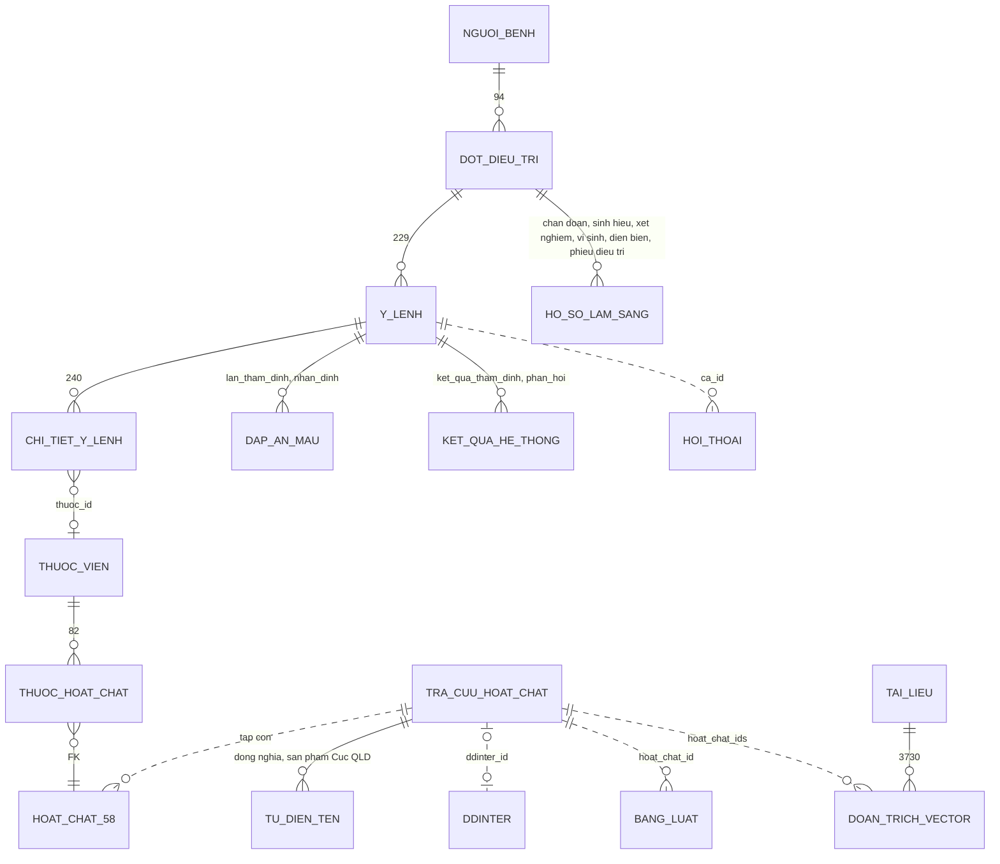
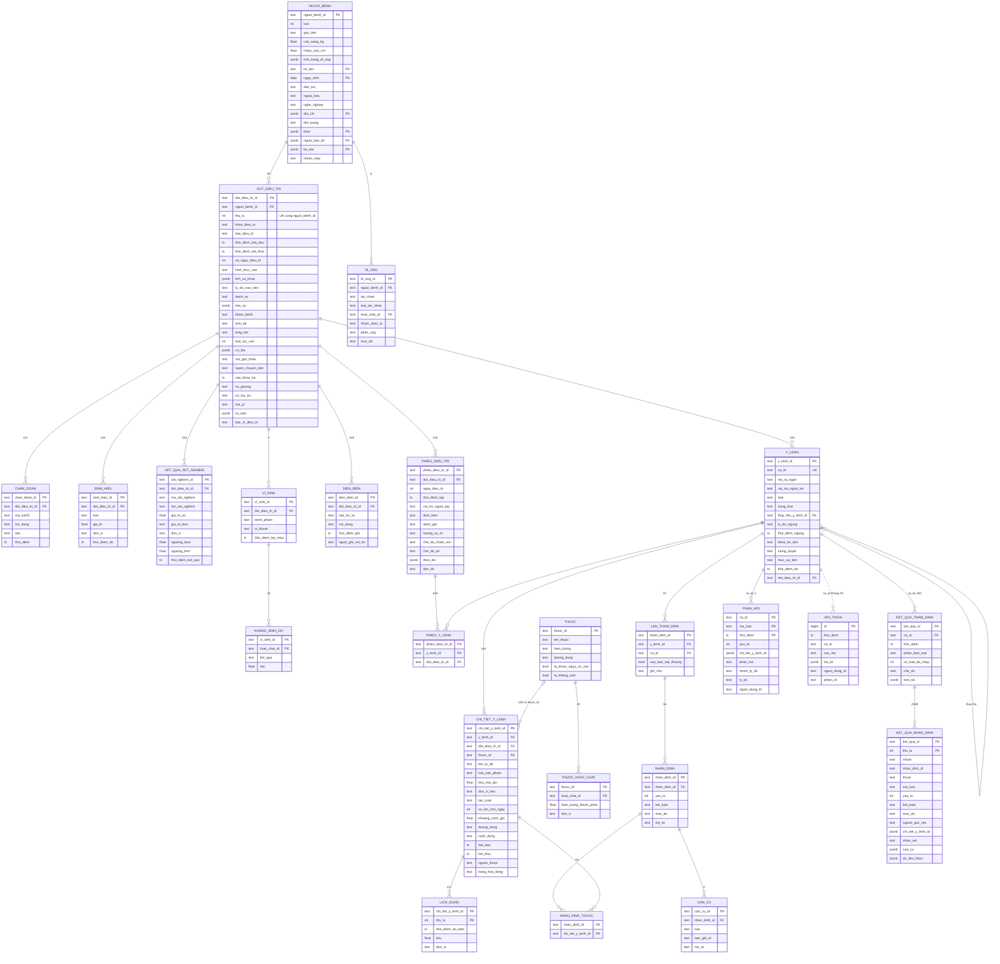
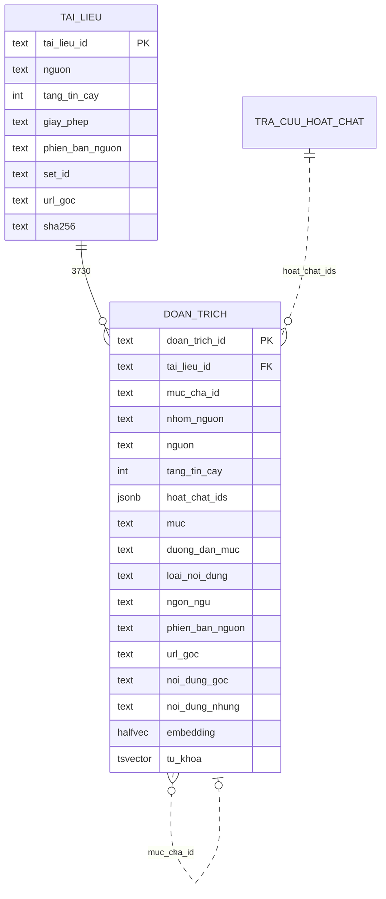
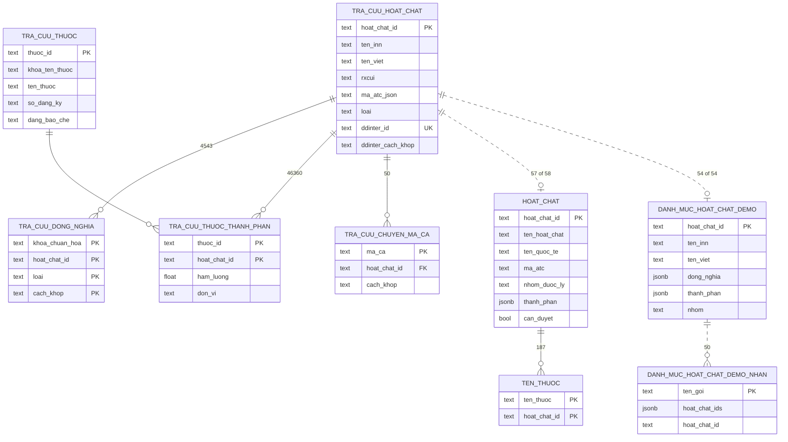
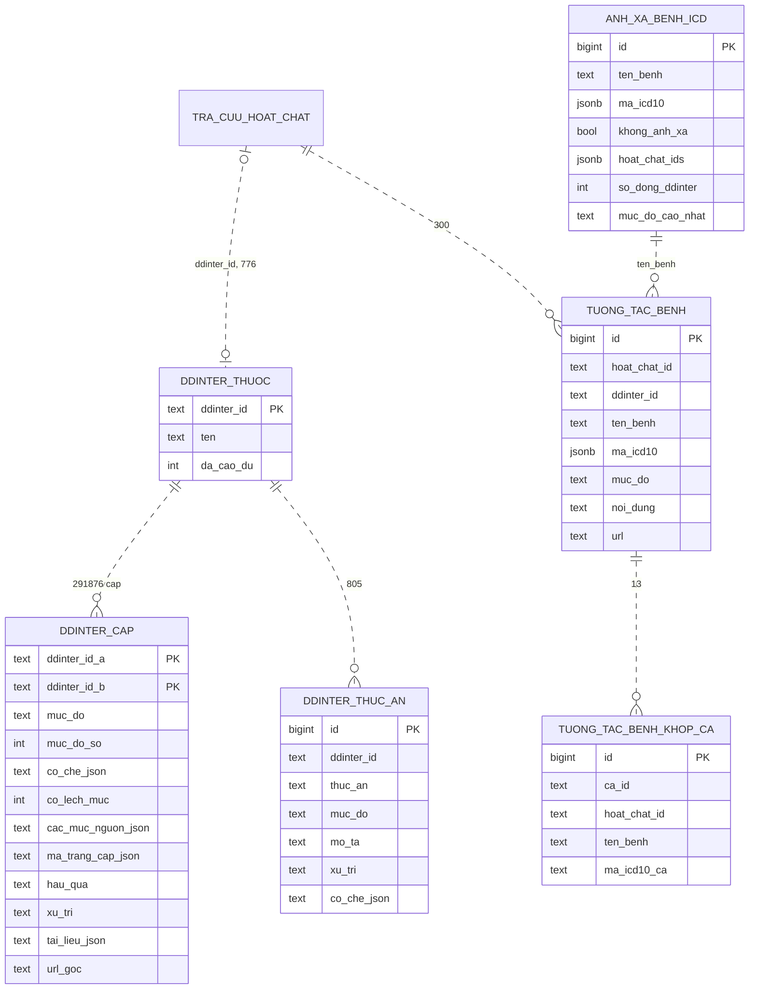
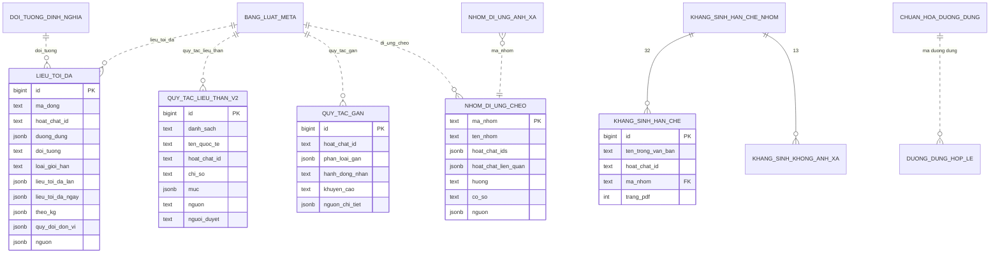

# Cơ sở dữ liệu hiện tại: ERD và giải thích chi tiết

Đọc trực tiếp từ RDS `bvienx-pharm-db`, database `bvienx`, role `bvienx_app`, ngày **21/11/2026**. Thông tin lấy từ:
- `pg_constraint`: khoá chính, khoá ngoại, ràng buộc duy nhất;
- `pg_attribute`: cột, kiểu, NOT NULL;
- truy vấn đếm trên dữ liệu thật: số dòng, số giá trị khác nhau, giá trị mẫu.

Tài liệu liên quan:
- `docs/erd.md`: ERD **thiết kế** ban đầu, có trường `source_system`, `duoc_si`… chưa làm.
- `plan/plan-1.3-du-lieu-thu-thap-tong-hop-tien-xu-ly.md`: tầng xử lý và tầng tin cậy.
- `plan/plan-1.6-du-lieu-tong-hop-len-supabase-va-chuyen-doi.md`: quy trình nạp.
- `plan/plan-1.9-agentic-rag-cong-cu-va-phan-quyen.md`: tool dùng dữ liệu này.
- Tệp mô tả từng nguồn trong `docs/du-lieu/`: `ddinter.md`, `dav.md`, `rxnav.md`, `openfda-rag.md`, `tu-dien-tra-cuu.md`…

Số liệu là ảnh chụp ngày 21/11. Khi nạp lại dữ liệu phải chạy lại phép đo và cập nhật tệp này.

---

## 0. Cách đọc

**Quy ước trong sơ đồ Mermaid**

| Ký hiệu | Nghĩa |
| :--- | :--- |
| Nét liền `--` | Có khoá ngoại thật trên DB |
| Nét đứt `..` | Liên kết logic: cùng mã nhưng **không có khoá ngoại**, DB không bảo đảm toàn vẹn |
| `PK`, `FK`, `UK` | Khoá chính, khoá ngoại, ràng buộc duy nhất |
| Số trong nhãn quan hệ | Số dòng của bảng con |

**Quy ước trong bảng cột**

| Cột | Nghĩa |
| :--- | :--- |
| Kiểu | `text`, `int`, `bigint`, `float` (double precision), `bool`, `ts` (timestamp with time zone), `date`, `jsonb`, `halfvec(2048)`, `tsvector` |
| Bắt buộc | ✓ là NOT NULL |
| Thực tế | Số dòng có giá trị trên tổng, các giá trị gặp nhiều nhất, hoặc ví dụ |

**Các cột kỹ thuật lặp lại ở nhiều bảng.** Giải thích một lần ở đây, các mục sau không nhắc lại.

| Cột | Có ở | Ý nghĩa |
| :--- | :--- | :--- |
| `nap_luc` | Hầu hết bảng | Thời điểm dòng được nạp vào DB (lần nạp gần nhất ngày 19/11) |
| `nguon_tep` | Hầu hết bảng | Tệp nguồn trong kho mã đã sinh ra dòng, ví dụ `data/mock/demo/DEMO-01.json`. Dùng để truy vết và nạp lại |
| `phien_ban` | Bảng luật `tri_thuc` | Mã đợt dữ liệu theo plan 1.8, ví dụ `D4-v2`, `D5-v1`, `0.3` |
| `trang_thai` | Bảng luật `tri_thuc` | Gần như toàn bộ là `cho_duoc_si_duyet`: **chưa dòng nào được dược sĩ duyệt** |
| `thu_tu` | Bảng nạp từ YAML/JSON | Thứ tự dòng trong tệp gốc, để xuất lại đúng thứ tự |
| `bo_sung` | Bảng luật `tri_thuc` | JSON kỹ thuật: thứ tự khoá, trường phụ của tệp gốc (`_khoa`, `_khac`). Không mang nghĩa nghiệp vụ |
| `hoat_chat_id` + `hoat_chat_ids` | Nhiều bảng luật | `hoat_chat_ids` (mảng JSON) là danh sách đầy đủ; `hoat_chat_id` là bản đơn khi chỉ có một chất, để lọc nhanh. Dòng phối hợp nhiều chất thì `hoat_chat_id` rỗng |

**Mã hoạt chất.** Toàn DB dùng **một không gian mã**: tên INN viết thường, nối bằng `_`, ví dụ `amiodarone`, `valproic_acid`, `piperacillin`. Danh mục gốc là `tri_thuc.tra_cuu_hoat_chat` (1255 mã). Kiểm ngày 21/11:
- mọi bảng luật đều dùng mã có trong danh mục gốc;
- `hoat_chat` (58) khớp 57/58;
- `danh_muc_hoat_chat_demo` khớp 54/54.

---

## 1. Tổng quan

### 1.1. Hai lược đồ

| Lược đồ | Bảng | Nội dung | Ai ghi |
| :--- | ---: | :--- | :--- |
| `nghiep_vu` | 24 | Bệnh án giả lập (67 ca), y lệnh, đáp án mẫu; kết quả thẩm định, chat, phản hồi do hệ thống ghi khi chạy | Bộ nạp (`app/db`) cho dữ liệu ca; API cho kết quả và chat |
| `tri_thuc` | 39 | Tri thức thuốc: đoạn văn nhãn FDA có vector, từ điển tên, DDInter, bảng luật 7 yếu tố | Bộ nạp tri thức (plan 1.6, 1.8) |

**100% dữ liệu là giả lập hoặc nguồn công khai.** Không có dữ liệu người bệnh thật.

### 1.2. Dữ liệu chảy thế nào

```
data/mock/demo/*.json, data/mock/hoso_gia_lap/*.json ──nạp──► nghiep_vu (bệnh án, y lệnh)
data/gold/demo/*.json ─────────────────────────────────nạp──► nghiep_vu (đáp án: lan_tham_dinh, nhan_dinh)
data/kb_curated/*, data/kb/*, YAML bảng luật ──────────nạp──► tri_thuc
                                                                  │
API khi chạy: đọc nghiep_vu + tri_thuc ──► chạy luật, AI, chat ──► ghi nghiep_vu.ket_qua_*, hoi_thoai, phan_hoi
```

### 1.3. Sơ đồ tổng (mức bảng, cả hai lược đồ)



`HO_SO_LAM_SANG`, `DAP_AN_MAU`, `KET_QUA_HE_THONG`, `TU_DIEN_TEN`, `DDINTER`, `BANG_LUAT` là nhóm bảng; xem chi tiết ở mục 2 và 3.

---

## 2. Lược đồ `nghiep_vu`

### 2.1. ERD đầy đủ cột



### 2.2. Khái niệm "ca"

Một **ca** là một lần dược sĩ cần thẩm định, định danh bằng `ca_id` (ví dụ `DEMO-02`, `HS-014`).

- Mỗi ca ứng với **đúng một y lệnh chờ duyệt**: `y_lenh.ca_id` là UNIQUE và chỉ 67/229 dòng `y_lenh` có `ca_id`.
- Các y lệnh còn lại không có `ca_id`. Đó là y lệnh đang dùng, đã xong hoặc đã ngưng của cùng người bệnh; chúng là **bối cảnh** của ca.
- `ket_qua_tham_dinh`, `phan_hoi`, `lan_tham_dinh` nối vào `y_lenh.ca_id`. `hoi_thoai.ca_id` cùng mã nhưng không có khoá ngoại, và có thêm giá trị đặc biệt `__global__` cho câu hỏi không gắn ca.

Có 67 người bệnh, 94 đợt điều trị. Người bệnh có thể có 1–3 đợt (`dot_dieu_tri.thu_tu`), nên có lịch sử nhiều lần vào viện.

### 2.3. Người bệnh và đợt điều trị

**`nguoi_benh` (67)**: thông tin hành chính và nhân trắc của người bệnh.

| Cột | Kiểu | Bắt buộc | Ý nghĩa | Thực tế |
| :--- | :--- | :-: | :--- | :--- |
| `nguoi_benh_id` | text | ✓ | Mã người bệnh (PK) | `NB-DEMO-01`, `NB-HS-010` |
| `tuoi` | int | | Tuổi | 67/67 |
| `gioi_tinh` | text | | `nam` / `nu` | nam 38, nữ 29 |
| `can_nang_kg`, `chieu_cao_cm` | float | | Dùng tính CrCl, BSA, BMI | 65/67, 66/67 |
| `tinh_trang_di_ung` | jsonb | ✓ | Trạng thái khai thác dị ứng: `co_di_ung`, `khong_di_ung`, `chua_khai_thac`, kèm nguồn và thời điểm | Phân biệt "không dị ứng" với "chưa hỏi" |
| `ho_ten`, `ngay_sinh`, `dia_chi`, `bhyt`, `nguoi_bao_tin`, `bo_me` | text, date, jsonb | | **Định danh (giả lập)** theo mẫu bệnh án, ví dụ `Nguyễn Văn 61`, thẻ BHYT `GD40100000000xx` | 66/67 |
| `dan_toc`, `nghe_nghiep`, `doi_tuong` | text | | Hành chính; `doi_tuong`: `bhyt` / `thu_phi` | |
| `ngoai_kieu`, `nhom_mau` | text | | Chưa có dữ liệu | 0/67 |

**`dot_dieu_tri` (94)**: một lần vào viện hoặc một lần khám ngoại trú.

| Cột | Kiểu | Bắt buộc | Ý nghĩa | Thực tế |
| :--- | :--- | :-: | :--- | :--- |
| `dot_dieu_tri_id` | text | ✓ | PK | `DT-DEMO-01`, `DT-HS-012-2` |
| `nguoi_benh_id` | text | ✓ | FK → `nguoi_benh` | |
| `thu_tu` | int | | Lần vào viện thứ mấy; UNIQUE cùng `nguoi_benh_id` | 1: 60, 2: 22, 3: 5 |
| `loai_dieu_tri` | text | ✓ | `noi_tru` / `ngoai_tru` | 80 / 14 |
| `khoa_dieu_tri` | text | ✓ | Khoa | 19 khoa |
| `thoi_diem_bat_dau`, `thoi_diem_ket_thuc`, `so_ngay_dieu_tri` | ts, int | | Thời gian đợt; chỉ đợt đã kết thúc mới có ngày ra | Kết thúc 27/94 |
| `hinh_thuc_vao`, `noi_gioi_thieu`, `tuyen_chuyen_den`, `vao_khoa_luc` | text, ts | | Cách vào viện: `cap_cuu` 44, `kham_benh` 42… | |
| `lich_su_khoa` | jsonb | | Các khoa đã nằm, mỗi phần tử `{khoa, tu, den}` | |
| `ly_do_vao_vien`, `benh_su`, `kham_benh`, `tom_tat`, `tong_ket` | text | | **Văn bản tự do** của bệnh án | 87/94; `tong_ket` 27 |
| `tien_su` | jsonb | | Tiền sử bản thân, gia đình… | |
| `co_dia` | jsonb | ✓ | **Cơ địa lâm sàng dùng cho luật**: danh sách `{loai, gia_tri, nguon, thoi_diem}`, ví dụ `suy_than` "Bệnh thận mạn giai đoạn 4" | 94/94 |
| `ra_vien` | jsonb | | Tình trạng và lý do ra viện | 27/94 |
| `so_giuong`, `so_luu_tru`, `ma_yt`, `bac_si_dieu_tri` | text | | Hành chính bệnh án; `bac_si_dieu_tri` chỉ ghi vai trò | |
| `tuoi_luc_vao` | int | | Chưa có dữ liệu | 0/94 |

**`di_ung` (6)**: dị ứng đã ghi nhận.

| Cột | Kiểu | Bắt buộc | Ý nghĩa | Thực tế |
| :--- | :--- | :-: | :--- | :--- |
| `di_ung_id` | text | ✓ | PK | |
| `nguoi_benh_id` | text | ✓ | FK → `nguoi_benh` | |
| `tac_nhan` | text | ✓ | Tên tác nhân như bệnh án ghi | Penicillin 4, Sulfonamid 2 |
| `loai_tac_nhan` | text | ✓ | `thuoc` / thức ăn… | toàn `thuoc` |
| `hoat_chat_id` | text | | FK → `tri_thuc.hoat_chat`, khi tác nhân là một hoạt chất cụ thể | 3/6 |
| `nhom_duoc_ly` | text | | Nhóm, khi tác nhân là cả nhóm | `penicillin`, `sulfonamid` |
| `phan_ung`, `muc_do` | text | | Biểu hiện; `nang` / `trung_binh` | |

### 2.4. Hồ sơ lâm sàng (con của `dot_dieu_tri`)

**`chan_doan` (127)**

| Cột | Kiểu | Bắt buộc | Ý nghĩa | Thực tế |
| :--- | :--- | :-: | :--- | :--- |
| `chan_doan_id` | text | ✓ | PK | |
| `dot_dieu_tri_id` | text | ✓ | FK | |
| `ma_icd10` | text | | Mã ICD-10 | 124/127, 53 mã; `I10`, `J18.9` |
| `noi_dung` | text | ✓ | Tên chẩn đoán | |
| `loai` | text | ✓ | `chinh` / `kem` | 94 / 33 |
| `thoi_diem` | ts | | Thời điểm ghi | |

**`sinh_hieu` (442)**

| Cột | Kiểu | Bắt buộc | Ý nghĩa | Thực tế |
| :--- | :--- | :-: | :--- | :--- |
| `sinh_hieu_id` | text | ✓ | PK | |
| `dot_dieu_tri_id` | text | ✓ | FK | |
| `loai` | text | ✓ | `can_nang`, `nhiet_do`, `mach`, `huyet_ap_tam_thu`, `huyet_ap_tam_truong`, `spo2`, `chieu_cao` | |
| `gia_tri`, `don_vi` | float, text | ✓ | Giá trị số và đơn vị | `mmHg`, `kg`, `°C`, `lần/phút`, `%`, `cm` |
| `thoi_diem_do` | ts | ✓ | Thời điểm đo | |

**`ket_qua_xet_nghiem` (228)**

| Cột | Kiểu | Bắt buộc | Ý nghĩa | Thực tế |
| :--- | :--- | :-: | :--- | :--- |
| `xet_nghiem_id` | text | ✓ | PK | |
| `dot_dieu_tri_id` | text | ✓ | FK | |
| `ma_xet_nghiem` | text | ✓ | Mã chuẩn hoá luật dùng: `creatinin`, `egfr`, `kali`, `inr`, `alt`… | 17 mã |
| `ten_xet_nghiem` | text | ✓ | Tên hiển thị | |
| `gia_tri_so` | float | | Giá trị số | 228/228 |
| `gia_tri_text` | text | | Kết quả dạng chữ | Chưa dùng |
| `don_vi` | text | | Đơn vị **như bệnh án ghi**, chưa chuẩn hoá | `umol/L` 111, `G/L` 29, `mmol/L` 24… |
| `nguong_duoi`, `nguong_tren` | float | | Khoảng tham chiếu của phòng xét nghiệm | |
| `thoi_diem_ket_qua` | ts | ✓ | Thời điểm có kết quả | |

**`vi_sinh` (8)** và **`khang_sinh_do` (16)**

| Bảng.cột | Kiểu | Ý nghĩa | Thực tế |
| :--- | :--- | :--- | :--- |
| `vi_sinh.vi_sinh_id` | text | PK | |
| `vi_sinh.benh_pham` | text | Bệnh phẩm | nước tiểu, đờm, máu, dịch mủ |
| `vi_sinh.vi_khuan` | text | Vi khuẩn mọc; rỗng là không mọc | MRSA, A. baumannii, E. coli ESBL, K. pneumoniae, P. aeruginosa |
| `vi_sinh.thoi_diem_lay_mau` | ts | | |
| `khang_sinh_do.(vi_sinh_id, hoat_chat_id)` | PK | Một dòng mỗi kháng sinh thử; `hoat_chat_id` FK → `tri_thuc.hoat_chat` | 10 kháng sinh |
| `khang_sinh_do.ket_qua` | text | `S` nhạy / `R` kháng | S 11, R 5 |
| `khang_sinh_do.mic` | float | Nồng độ ức chế tối thiểu | 9/16 |

**`dien_bien` (228)**: ghi chép diễn biến dạng văn bản.

| Cột | Kiểu | Bắt buộc | Ý nghĩa | Thực tế |
| :--- | :--- | :-: | :--- | :--- |
| `dien_bien_id` | text | ✓ | PK | |
| `dot_dieu_tri_id` | text | ✓ | FK | |
| `loai_ho_so` | text | ✓ | Loại phiếu | Tờ điều trị 146, Phiếu khám 77, Phiếu điều trị 5 |
| `noi_dung` | text | ✓ | **Văn bản tự do**. Một số ca cố ý chứa câu chèn lệnh để thử bảo mật | |
| `thoi_diem_ghi` | ts | ✓ | | |
| `nguoi_ghi_vai_tro` | text | | Chưa có dữ liệu | 0/228 |

**`phieu_dieu_tri` (333)**: tờ điều trị theo ngày, có cấu trúc hơn `dien_bien`. Có ở 87/94 đợt.

| Cột | Kiểu | Bắt buộc | Ý nghĩa | Thực tế |
| :--- | :--- | :-: | :--- | :--- |
| `phieu_dieu_tri_id` | text | ✓ | PK; UNIQUE cùng `dot_dieu_tri_id` | `PDT-HS-012-2-06` |
| `dot_dieu_tri_id` | text | ✓ | FK | |
| `ngay_dieu_tri` | int | ✓ | Ngày thứ mấy của đợt | 1–14 |
| `thoi_diem_lap`, `vai_tro_nguoi_lap` | ts, text | ✓ | `bac_si_dieu_tri` 310, `bac_si_truc` 23 | |
| `dien_bien`, `danh_gia`, `huong_xu_tri` | text | ✓ | **Văn bản tự do**: diễn biến, đánh giá đáp ứng, hướng xử trí | |
| `che_do_cham_soc`, `che_do_an`, `dan_do` | text | | Chăm sóc cấp 1–3, chế độ ăn, dặn dò | |
| `theo_doi` | jsonb | ✓ | Danh sách việc cần theo dõi | `["Cân nặng và phù", …]` |

**`phieu_y_lenh` (625)**: bảng nối nhiều–nhiều giữa phiếu điều trị và y lệnh ra trong ngày đó. Khoá ngoại ghép kèm `dot_dieu_tri_id` bảo đảm phiếu và y lệnh thuộc cùng một đợt.

### 2.5. Y lệnh và thuốc

**`y_lenh` (229)**: một đơn y lệnh, gồm nhiều dòng thuốc.

| Cột | Kiểu | Bắt buộc | Ý nghĩa | Thực tế |
| :--- | :--- | :-: | :--- | :--- |
| `y_lenh_id` | text | ✓ | PK | `YL-DEMO-01` |
| `ca_id` | text | | Mã ca; **chỉ y lệnh chờ duyệt có**, UNIQUE | 67/229 |
| `mo_ta_ngan` | text | | Mô tả ca cho danh sách (chỉ y lệnh có `ca_id`) | "Nữ 75 tuổi, viêm phổi, suy giảm chức năng thận…" |
| `trang_thai` | text | ✓ | `cho_duyet` 67, `dang_thuc_hien` 95, `hoan_tat` 51, `ngung` 11, `da_duyet` 5 | |
| `loai` | text | | `thuong_quy` 169, `cap_cuu` 33, `khi_can` 27 | |
| `vai_tro_nguoi_ke`, `khoa_ke_don` | text | | Ghi vai trò, không ghi tên | |
| `thay_the_y_lenh_id` | text | | FK tự trỏ: y lệnh này thay y lệnh nào (đổi kháng sinh…) | 7/229 |
| `ly_do_ngung`, `thoi_diem_ngung` | text, ts | | Lý do ngưng, ví dụ "Phản vệ độ 2 sau truyền ceftriaxon" | 11/229 |
| `luong_duyet` | text | ✓ | `truc_tiep` / `hau_kiem` | 227 / 2 |
| `muc_uu_tien` | text | | Chưa có dữ liệu | 0/229 |
| `thoi_diem_ke` | ts | ✓ | | |
| `dot_dieu_tri_id` | text | ✓ | FK; UNIQUE cùng `y_lenh_id` để `phieu_y_lenh` nối ghép | |

**`chi_tiet_y_lenh` (240)**: một dòng thuốc (hoặc dịch, xét nghiệm…) trong y lệnh.

| Cột | Kiểu | Bắt buộc | Ý nghĩa | Thực tế |
| :--- | :--- | :-: | :--- | :--- |
| `chi_tiet_y_lenh_id` | text | ✓ | PK | `CT-DEMO02-01` |
| `y_lenh_id`, `dot_dieu_tri_id` | text | ✓ | FK | |
| `thuoc_id` | text | | FK → `thuoc` (danh mục viện) | **159/240**; 81 dòng không có |
| `ten_tu_do` | text | | Tên ghi tự do khi không có `thuoc_id` | 81/240; "Natri clorid 0,9% 500 mL", cả dòng xét nghiệm |
| `loai_san_pham` | text | ✓ | `thuoc` 159, `khac` 79, `dinh_duong` 1, `tpcn` 1 | |
| `lieu_moi_lan`, `don_vi_lieu` | float, text | | Liều mỗi lần; đơn vị chưa chuẩn hoá | `mg`, `mL`, `g`, `lần`, `IU`, `UI`, `triệu đơn vị`… |
| `tan_suat`, `so_lan_moi_ngay`, `khoang_cach_gio` | text, int, float | | Tần suất dạng chữ, số lần/ngày và khoảng cách giờ đã tách | |
| `duong_dung` | text | | Đường dùng **như bệnh án ghi**, chưa chuẩn hoá | `uống`, `uong`, `truyền tĩnh mạch`, `tiem tinh mach`… |
| `cach_dung` | text | | Hướng dẫn dùng | |
| `bat_dau` | ts | ✓ | Bắt đầu dùng | |
| `ket_thuc` | ts | | Kết thúc dùng | 66/240 |
| `nguon_thuoc` | text | | Kho nội trú, tủ trực, nhà thuốc, tự mua | |
| `trang_thai_dong` | text | ✓ | `pending` 63 (dòng chờ duyệt), `active` 112, `completed` 54, `discontinued` 11 | Luật xét cả `pending` và `active` |

**`lich_dung` (217)**: các lần dùng dự kiến của một dòng thuốc. PK `(chi_tiet_y_lenh_id, thu_tu)`; có `thoi_diem_du_kien`, `lieu`, `don_vi`. Dùng cho yếu tố 7 (lịch dùng).

**`thuoc` (74)**: danh mục thuốc của viện (giả lập).

| Cột | Kiểu | Bắt buộc | Ý nghĩa | Thực tế |
| :--- | :--- | :-: | :--- | :--- |
| `thuoc_id` | text | ✓ | Mã thuốc nội viện | `T-MEROPENEM-1G` |
| `ten_thuoc`, `ham_luong`, `duong_dung` | text | | | "Meropenem 1 g", "1 g" |
| `la_thuoc_nguy_co_cao` | bool | ✓ | Thuốc nguy cơ cao | 16/74 |
| `la_khang_sinh` | bool | ✓ | | 25/74 |

**`thuoc_hoat_chat` (82)**: thuốc → hoạt chất. Một thuốc phối hợp có nhiều dòng. PK `(thuoc_id, hoat_chat_id)`; `hoat_chat_id` FK → `tri_thuc.hoat_chat`; kèm `ham_luong_thanh_phan`, `don_vi`. 44 hoạt chất khác nhau.

### 2.6. Đáp án mẫu (bộ vàng để đánh giá)

Nạp từ `data/gold/demo/*.json`. Đây là **đáp án do nhóm soạn** để so với kết quả hệ thống, không phải kết quả hệ thống.

| Bảng | Dòng | Cột chính | Ý nghĩa |
| :--- | ---: | :--- | :--- |
| `lan_tham_dinh` | 67 | `tham_dinh_id` (`dap_an:DEMO-01`), `y_lenh_id`, `ca_id`, `van_ban_bat_thuong`, `ghi_chu` | Một lần thẩm định mẫu mỗi ca. `van_ban_bat_thuong = true` (6 ca) là ca có câu chèn lệnh trong hồ sơ |
| `nhan_dinh` | 55 | `nhan_dinh_id`, `tham_dinh_id`, `yeu_to` (1–7), `ket_luan`, `muc_do`, `mo_ta` | Nhận định đúng mà hệ thống phải tìm ra. `ket_luan`: `can_xem` 44, `khong_du_du_lieu` 7, `ngoai_hdsd` 3, `dat` 1 |
| `nhan_dinh_thuoc` | 55 | `(nhan_dinh_id, chi_tiet_y_lenh_id)` | Nhận định gắn với dòng thuốc nào |
| `can_cu` | 0 | `can_cu_id`, `nhan_dinh_id`, `loai`, `ban_ghi_id`, `mo_ta` | Thiết kế để ghi căn cứ của đáp án; **chưa dùng** |

### 2.7. Dữ liệu hệ thống ghi khi chạy

**`ket_qua_tham_dinh` (264)**: mỗi lần chạy bộ luật cho một ca ghi một dòng.

| Cột | Kiểu | Ý nghĩa | Thực tế |
| :--- | :--- | :--- | :--- |
| `ket_qua_id` | text | PK (UUID) | |
| `ca_id` | text | FK → `y_lenh.ca_id` | 67 ca |
| `thoi_diem` | ts | Lúc chạy | |
| `phien_ban_luat` | text | Mã băm phiên bản bảng luật đã dùng | 1 phiên bản |
| `so_luat_da_chay` | int | | 14 |
| `che_do` | text | Nguồn dữ liệu ca | toàn `db` |
| `tom_tat` | jsonb | Đếm theo mức: `dat`, `can_luu_y`, `nghiem_trong`, `ngoai_hdsd`, `thieu_du_lieu` | |

**`ket_qua_nhan_dinh` (2599)**: từng nhận định của một lần chạy. PK `(ket_qua_id, thu_tu)`, xoá dây chuyền theo `ket_qua_tham_dinh`.

| Cột | Kiểu | Ý nghĩa | Thực tế |
| :--- | :--- | :--- | :--- |
| `nhom` | text | `dat` / `can_chu_y` | 1546 / 1053 |
| `nhan_dinh_id` | text | Mã ổn định `ma_luat\|chi_tiet_y_lenh_id` | `lieu_than_can_chinh\|CT-DEMO02-01` |
| `thuoc` | text | Mô tả dòng thuốc để hiển thị | |
| `ma_luat` | text | Luật sinh ra nhận định | 44 luật |
| `yeu_to`, `yeu_to_nhan` | int, text | Yếu tố 1–7 và nhãn | |
| `ket_luan`, `ket_luan_nhan` | text | `dat`, `can_xem`, `khong_du_du_lieu` | |
| `muc_do`, `muc_do_nhan` | text | `nghiem_trong`, `can_luu_y` (khi `can_xem`) | |
| `nguon_goc_ma`, `nguon_goc_nhan` | text | `luat`. Nhận định AI chưa lưu ở đây | toàn `luat` |
| `chi_tiet_y_lenh_id` | jsonb | Mảng dòng thuốc liên quan | |
| `nhan_xet` | text | Lời giải thích do luật sinh | "meropenem: CrCl = 16.0 mL/min, cần xem xét chỉnh liều…" |
| `can_cu` | jsonb | Căn cứ: bản ghi ca, dòng bảng luật | |
| `du_lieu_thieu` | jsonb | Dữ liệu còn thiếu để kết luận | |

**`phan_hoi` (2)**: dược sĩ đồng ý hay không với một nhận định. PK `(ca_id, ma_luat, thoi_diem)`; cột `phan_hoi` (`dong_y`…), `nhom_ly_do`, `ly_do`, `nguoi_dung_id`, `chi_tiet_y_lenh_id`.

**`hoi_thoai` (13 lúc đọc)**: lịch sử chat.

| Cột | Kiểu | Ý nghĩa |
| :--- | :--- | :--- |
| `id` | bigint | PK tự tăng |
| `thoi_diem` | ts | |
| `ca_id` | text | Mã ca, hoặc `__global__` khi hỏi chung. **Không có khoá ngoại** |
| `cau_hoi` | text | **Câu hỏi nguyên văn** của dược sĩ |
| `tra_loi` | jsonb | Câu trả lời đã kiểm chứng, gồm `noi_dung` và trích dẫn |
| `nguoi_dung_id` | text | Mã người dùng Supabase (UUID) hoặc `dev-local` |
| `phien_id` | text | Phiên chat |

---

## 3. Lược đồ `tri_thuc`

### 3.1. Tầng tin cậy của nguồn (plan 1.3)

| Tầng | Nguồn | Có trong DB hiện tại |
| :-: | :--- | :--- |
| 1 | Văn bản Bộ Y tế | Chỉ danh mục kháng sinh hạn chế (QĐ 5631/QĐ-BYT), dạng bảng |
| 2 | Dược thư Quốc gia | Chưa có |
| 3 | Nhãn FDA (openFDA, DailyMed) | 50 nhãn; nguồn chính của đoạn văn và bảng luật liều |
| 4 | DDInter | Tương tác; chỉ sàng lọc, giấy phép phi thương mại |

### 3.2. Văn bản nguồn và vector



**`tai_lieu` (50)**: một nhãn thuốc gốc.

| Cột | Ý nghĩa | Thực tế |
| :--- | :--- | :--- |
| `tai_lieu_id` | PK, dạng `openfda:<set_id>` | |
| `nguon`, `tang_tin_cay`, `giay_phep` | Nguồn, tầng, giấy phép | `openfda_drug_label`, 3, "Public domain (FDA)" |
| `phien_ban_nguon` | Ngày phiên bản nhãn | 27 ngày khác nhau |
| `set_id`, `url_goc` | Mã nhãn DailyMed và đường dẫn | |
| `sha256` | Mã băm tệp gốc để phát hiện thay đổi | |

**`doan_trich` (3730)**: đoạn đã chia từ nhãn, **bảng duy nhất có vector**.

| Cột | Kiểu | Ý nghĩa | Thực tế |
| :--- | :--- | :--- | :--- |
| `doan_trich_id` | text | PK | `DT-003ab338a914` |
| `tai_lieu_id` | text | FK → `tai_lieu` | 50 tài liệu |
| `muc_cha_id` | text | Nhóm các đoạn cùng một mục của nhãn; dùng để mở rộng khi đoạn bị cắt | 1551 nhóm |
| `nhom_nguon`, `nguon`, `tang_tin_cay` | text, text, int | Phân loại nguồn để lọc | toàn `nhan_thuoc`, `openfda`, 3 |
| `hoat_chat_ids` | jsonb | Hoạt chất của đoạn; **bộ lọc chính trước khi tìm** | `["amiodarone"]` |
| `muc` | text | Mục đã chuẩn hoá | `canh_bao` 819, `duoc_ly` 599, `tac_dung_phu` 481, `lieu` 404, `khac` 362, `tuong_tac` 276, `thai_ky_cho_bu` 237, `chi_dinh` 195, `nhi_cao_tuoi` 113, `lieu_than` 81, `qua_lieu` 73, `chong_chi_dinh` 65, `lieu_gan` 25 |
| `duong_dan_muc` | text | Đường dẫn mục gốc trong nhãn | "Use in Specific Populations > 8.6 Renal Impairment" |
| `loai_noi_dung` | text | `van_ban` / `bang` | 3483 / 247 |
| `ngon_ngu` | text | | toàn `en` |
| `noi_dung_goc` | text | **Văn bản gốc để trích nguyên văn** và kiểm chứng | |
| `noi_dung_nhung` | text | Văn bản đem nhúng: thêm tiền tố hoạt chất, tên nhãn, ngày, đường dẫn mục để vector mang ngữ cảnh | "[amiodarone \| Nhãn FDA AMIODARONE… \| Adverse Reactions…" |
| `embedding` | halfvec(2048) | Vector `gemini-embedding-2`, 3730/3730. Chỉ mục HNSW `doan_trich_embedding_hnsw` (cosine) | |
| `tu_khoa` | tsvector | Chỉ mục toàn văn của Postgres, **có sẵn nhưng app không dùng**; BM25 hiện dựng trong bộ nhớ | |

### 3.3. Từ điển và phân giải tên thuốc



**`tra_cuu_hoat_chat` (1255)**: **danh mục hoạt chất gốc** của toàn DB.

| Cột | Ý nghĩa | Thực tế |
| :--- | :--- | :--- |
| `hoat_chat_id` | PK, mã INN dạng `snake_case` | |
| `ten_inn`, `ten_viet` | Tên quốc tế, tên Việt | "6-aminocaproic acid" / "Aminocaproic acid" |
| `rxcui` | Mã RxNorm | 1254/1255 |
| `ma_atc_json` | Mã ATC (mảng JSON trong cột text) | `["J05AF"]`; 537 giá trị khác nhau |
| `loai` | `thuoc` 1213, `vitamin_khoang` 37, `duoc_lieu` 3, `dich_truyen_dien_giai` 2 | |
| `ddinter_id`, `ddinter_cach_khop` | Mã DDInter tương ứng, UNIQUE; cách khớp | **776/1255** có mã DDInter, toàn `ten_chinh_xac` |

**`tra_cuu_dong_nghia` (4543)**: tên viết kiểu khác → hoạt chất. **Không có tên thương mại hay viết tắt.**

| Cột | Ý nghĩa | Thực tế |
| :--- | :--- | :--- |
| `khoa_chuan_hoa` | Tên đã chuẩn hoá (thường, bỏ dấu, bỏ ký tự đặc biệt) | "13c urea", "suxamethonium" |
| `hoat_chat_id` | FK → `tra_cuu_hoat_chat` | |
| `loai` | `viet` 1727, `muoi` 1502 (dạng muối), `inn` 1314 | |
| `cach_khop` | `rxnav_chinh_xac` 3704, `them_e_cuoi` 414, `ma_chuan` 321, `bang_viet_quoc_te` 99, `bang_vitamin` 5 | |

PK là cả bốn cột: một tên có thể trỏ nhiều hoạt chất.

**`tra_cuu_thuoc` (54910)** và **`tra_cuu_thuoc_thanh_phan` (46360)**: sản phẩm đã đăng ký tại Cục Quản lý Dược.

| Bảng.cột | Ý nghĩa | Thực tế |
| :--- | :--- | :--- |
| `tra_cuu_thuoc.thuoc_id` | PK, `dav:<số đăng ký>` | |
| `tra_cuu_thuoc.khoa_ten_thuoc` | Tên thương mại chuẩn hoá để khớp | "azopt", "betmiga" |
| `tra_cuu_thuoc.ten_thuoc`, `so_dang_ky`, `dang_bao_che` | Tên, số đăng ký, dạng bào chế | "Betmiga 50 mg", "Viên nén phóng thích kéo dài" |
| `tra_cuu_thuoc_thanh_phan.(thuoc_id, hoat_chat_id)` | PK; cả hai là FK | 1182 hoạt chất |
| `tra_cuu_thuoc_thanh_phan.ham_luong`, `don_vi` | Hàm lượng | 41509/46360 |

Khoảng 15700 sản phẩm chưa có dòng thành phần nào, tức chưa phân giải được hoạt chất.

**`tra_cuu_chuyen_ma_ca` (50)**: mã hoạt chất dùng trong tệp ca cũ (`HC-ACETAMINOPHEN`) → mã chuẩn, kèm cách khớp.

**`tra_cuu_meta` (1)**: phiên bản chỉ mục tra cứu (`T53-v1`, 18/11), danh sách và mã băm tệp nguồn.

**`hoat_chat` (58)**, **`ten_thuoc` (187)**, **`danh_muc_hoat_chat_demo` (54)**, **`danh_muc_hoat_chat_demo_nhan` (50)**: danh mục nhỏ của giai đoạn demo, đều là tập con của danh mục gốc.
- `hoat_chat` là đích khoá ngoại của `nghiep_vu`.
- Hầu hết `ma_atc` rỗng (4/58 có).
- `nhom_duoc_ly` dạng mã riêng (`giam_dau_ha_sot`…).
- Ứng viên gộp vào danh mục gốc (plan 1.9, mục 4.5).

### 3.4. Tương tác



**`ddinter_thuoc` (1971)**: thuốc trong DDInter. `ddinter_id` (`DDInter1`…), `ten` (tiếng Anh), `da_cao_du` (đã cào đủ trang chi tiết, toàn 1).

**`ddinter_cap` (291876)**: cặp tương tác thuốc–thuốc.

| Cột | Ý nghĩa | Thực tế |
| :--- | :--- | :--- |
| `(ddinter_id_a, ddinter_id_b)` | PK, cặp mã DDInter | 2170 mã A; nhiều hơn 1971 dòng của `ddinter_thuoc` |
| `muc_do`, `muc_do_so` | `Major` (3), `Moderate` (2), `Minor` (1), `Unknown` (0) | Moderate 186830, Major 50402, Unknown 42415, Minor 12229 |
| `co_che_json` | Cơ chế (mảng): `Synergy`, `Metabolism`, `Absorption`… | |
| `co_lech_muc`, `cac_muc_nguon_json` | Các tệp nguồn ghi mức khác nhau thì giữ mức cao nhất và đánh dấu | 293 cặp lệch |
| `hau_qua`, `xu_tri` | Văn bản hậu quả và xử trí (tiếng Anh) | **Chỉ khoảng 16900 cặp (5,8%) có** |
| `ma_trang_cap_json`, `url_goc`, `tai_lieu_json` | Mã trang, đường dẫn, tài liệu tham khảo | |

Mức `Unknown` nghĩa là DDInter có ghi cặp nhưng không xếp mức. **Không được hiểu là "không tương tác".**

**`ddinter_thuc_an` (805)**: thuốc–thức ăn. `ddinter_id`, `thuc_an` (29 loại: green tea, high-fat foods…), `muc_do` (Moderate 677, Major 92, Minor 36), `mo_ta`, `xu_tri`, `co_che_json`.

**`tuong_tac_benh` (300)**: thuốc–bệnh của 40 hoạt chất. `hoat_chat_id`, `ddinter_id`, `ten_benh` (tên MeSH tiếng Anh: "Peptic Ulcer"), `ma_icd10` (mảng, có thể là khoảng `K25-K27`), `muc_do` (Major 153, Moderate 147), `noi_dung`, `url`.

**`anh_xa_benh_icd` (119)**: tên bệnh DDInter → mã ICD-10, để khớp với `chan_doan.ma_icd10` của ca. Có `khong_anh_xa` (2 bệnh không ánh xạ được), `so_dong_ddinter`, `muc_do_cao_nhat`, `ghi_chu`.

**`tuong_tac_benh_khop_ca` (13)**: cặp thuốc–bệnh đã khớp sẵn cho các ca giả lập. Dùng để kiểm luật yếu tố 4, không phải tri thức chung.

**`tuong_tac_sang_loc` (0)**: thiết kế cho bảng tương tác đã sàng lọc theo plan 1.3 mục 6.2. **Rỗng**; luật đọc thẳng `ddinter_cap`.

### 3.5. Bảng luật 7 yếu tố

Các bảng này là **đầu vào của bộ luật** (`app/rules`), sinh từ YAML trong kho qua plan 1.8. Đặc điểm chung:
- hầu hết dòng có `nguon` hoặc `nguon_chi_tiet` trỏ về tệp nhãn FDA và URL DailyMed;
- **toàn bộ `trang_thai = cho_duoc_si_duyet`**;
- không bảng nào có khoá ngoại sang danh mục hoạt chất.



**Liều tối đa (yếu tố 3)**

| Bảng | Dòng | Cột chính | Ý nghĩa |
| :--- | ---: | :--- | :--- |
| `lieu_toi_da` | 40 | `ma_dong` (`hoat_chat\|duong\|doi_tuong`), `hoat_chat_id`, `duong_dung` (mảng), `doi_tuong`, `dieu_kien`, `loai_gioi_han` (`toi_da_ro` 36, `tran_up_to` 3, `gioi_han_thiet_bi` 1), `lieu_toi_da_lan` / `_ngay` / `_tuan` (`{gia_tri, don_vi}`), `theo_kg` (`{lan_mg_kg, ngay_mg_kg}`), `thuoc_dung_cung_hoat_chat_ids`, `quy_doi_don_vi`, `nguon` | Liều tối đa theo nhãn FDA cho 21 hoạt chất. `quy_doi_don_vi` cho biết cách đổi đơn vị nhãn sang đơn vị của ca |
| `lieu_toi_da_khong_ghi` | 22 | `hoat_chat_id`, `ly_do`, `co_dong_theo_nhom_dac_biet` | Hoạt chất **cố ý không có** liều tối đa, kèm lý do (nhãn chỉ giới hạn tốc độ truyền…). Để luật trả "không đủ dữ liệu" thay vì im lặng |
| `lieu_toi_da_khong_ghi_duong_ca` | 21 | `hoat_chat_ids`, `duong_dung` | Cặp hoạt chất–đường dùng gặp trong ca mà bảng chưa có dòng |
| `doi_tuong_dinh_nghia` | 21 | `ma` (`nguoi_lon`, `nguoi_lon_child_pugh_c`…), `tuoi_tu/den`, `can_nang_tu/den`, `dieu_kien_khac` | Định nghĩa máy đọc được của cột `doi_tuong` |

**Chỉnh liều thận và gan (yếu tố 3, 6)**

| Bảng | Dòng | Cột chính | Ý nghĩa |
| :--- | ---: | :--- | :--- |
| `quy_tac_lieu_than_v2` | 18 | `ten_quoc_te`, `hoat_chat_id`, `chi_so` (CrCl Cockcroft-Gault…), `muc` (mảng bậc `{crcl_tu, crcl_den, can_chinh, khuyen_cao}`), `danh_sach` (`quy_tac` 1 / `quy_tac_cho_duyet` 17), `phoi_hop`, `bi_danh`, `nguoi_duyet` (rỗng) | **Bản đang dùng.** Mỗi dòng một hoạt chất, các bậc CrCl trong `muc` |
| `quy_tac_lieu_than` | 4 | `crcl_tu`, `crcl_den`, `can_chinh`, `khuyen_cao` | Bản cũ 0.3, chỉ meropenem, mỗi bậc một dòng. Thay bởi `_v2` |
| `quy_tac_lieu_than_khong_nguong` | 28 | `hoat_chat_id`, `loai` (`khong_can_chinh` 8, `chi_noi_chung` 8, `bang_hoac_cong_thuc` 5, `co_nguong_o_tep_khac` 5, `chua_co_nhan` 2), `ly_do`, `set_id`, `url` | Hoạt chất không có ngưỡng CrCl rõ, kèm lý do |
| `quy_tac_gan` | 24 | `hoat_chat_id`, `phan_loai_gan` (`child_pugh_A/B/C`), `hanh_dong_nhan` (`giam_lieu` 7, `khong_chinh_lieu` 5, `theo_doi` 4, `chong_chi_dinh` 3, `tranh_khong_khuyen_cao` 3…), `khuyen_cao`, `nguon_chi_tiet` | Khuyến cáo theo mức suy gan |

**Xét nghiệm và độc tính (yếu tố 5, 6)**

| Bảng | Dòng | Cột chính | Ý nghĩa |
| :--- | ---: | :--- | :--- |
| `nguong_xet_nghiem` | 15 | `hoat_chat_id`, `xet_nghiem` (`egfr`, `inr`, `creatinin`, `digoxin`, `kali`…), `dieu_kien` (mảng `{ma_xet_nghiem, toan_tu, gia_tri, don_vi}`), `kieu_dieu_kien`, `muc_do_de_xuat`, `hanh_dong_nhan`, `don_vi_nhan`, `don_vi_trong_ca`, `nguon_chi_tiet` | Ngưỡng xét nghiệm cần cảnh báo cho 9 hoạt chất. Hai cột đơn vị ghi rõ cách đổi giữa nhãn và ca |
| `canh_bao_doc_tinh` | 90 | `loai` (`doc_gan_livertox` 38, `khong_co_nguon` 36, `doc_than` 7, `khoang_dieu_tri_hep` 5, `keo_dai_qt` 4), `hoat_chat_id`, `nhom`, `likelihood_score` (A–E của LiverTox), `ma_xet_nghiem_nong_do`, `danh_sach`, `ly_do`, `nguon` | Độc tính cần theo dõi của 43 hoạt chất. Dòng `khong_co_nguon` ghi lý do không tìm được nguồn |

**Đường dùng (yếu tố 3)**

| Bảng | Dòng | Cột chính | Ý nghĩa |
| :--- | ---: | :--- | :--- |
| `duong_dung_hop_le` | 62 | `ma_dong`, `hoat_chat_id`, `nhom_dang_bao_che` (`dang_uong` 26, `dang_tiem_truyen` 25…), `duong_dung_hop_le` (mảng mã), `muc_chac_chan` (`dav_va_fda` 48, `chi_fda` 7…), `nguon`, `ghi_chu` | Đường dùng hợp lệ theo hoạt chất và nhóm dạng bào chế, đối chiếu Cục QLD và FDA |
| `chuan_hoa_duong_dung` | 94 | `loai` (`khoa_sang_ma` 57, `ma_fda_sang_ma_chuan` 15, `ma_chuan` 15, `cach_viet_trong_66_ca` 6, `tu_mo_ho` 1), `khoa`, `duong_dung`, `gia_tri` (`{ma, ten_viet}`) | Từ điển chuẩn hoá đường dùng: "tiem tinh mach", "IV" → `tiem_tinh_mach` |

**Dị ứng và trùng nhóm (yếu tố 1, 2)**

| Bảng | Dòng | Cột chính | Ý nghĩa |
| :--- | ---: | :--- | :--- |
| `nhom_di_ung_cheo` | 26 | `ma_nhom` (`BL01_PENICILLIN_NOI_NHOM`…), `ten_nhom`, `hoat_chat_ids`, `hoat_chat_lien_quan` (mảng `{hoat_chat, ly_do}`), `huong` (`hai_chieu` 15, `mot_chieu` 11), `co_so`, `nguon`, `ghi_chu` | Nhóm dị ứng chéo, cơ sở hoá học (chuỗi bên R1…) và nguồn |
| `nhom_di_ung_anh_xa` | 8 | `ten_alias` (`penicillin`, `sulfonamid`, `nsaid`…), `hoat_chat_ids`, `ma_nhom` | Tên nhóm dị ứng như bệnh án ghi → nhóm chéo |
| `nhom_dieu_tri_trung` | 8 | `ma_nhom` (`statin`, `ppi`, `nsaid`, `chong_dong`, `uc_che_ras`…), `tien_to_atc`, `tien_to_atc_loai_tru`, `muc_do`, `ly_do`, `ngoai_le` | Trùng nhóm điều trị nhận theo tiền tố ATC |
| `atc_bo_sung` | 1 | `hoat_chat_id`, `ma_atc` | Mã ATC bổ sung khi danh mục thiếu; chỉ có `valproic_acid` |

**Kháng sinh cần quản lý (yếu tố 7)**

| Bảng | Dòng | Cột chính | Ý nghĩa |
| :--- | ---: | :--- | :--- |
| `khang_sinh_han_che_nhom` | 2 | `ma_nhom` (`phe_duyet_truoc`, `theo_doi_giam_sat`), `ten_nhom_van_ban`, `yeu_cau`, `trang_pdf` | Hai nhóm theo QĐ 5631/QĐ-BYT |
| `khang_sinh_han_che` | 32 | `ten_trong_van_ban`, `hoat_chat_id`, `ma_nhom` (FK), `trang_pdf` | Kháng sinh thuộc từng nhóm (20 cần phê duyệt trước, 12 theo dõi) |
| `khang_sinh_khong_anh_xa` | 13 | `ten_trong_van_ban`, `ma_nhom`, `ly_do` | Tên trong văn bản chưa ánh xạ được về hoạt chất (dạng bào chế đặc biệt, chất chưa có trong danh mục) |

**`bang_luat_meta` (12)**: mỗi bảng luật một dòng.
- `ma` (`lieu_toi_da`, `quy_tac_gan`, `di_ung_cheo`…), `ten`, `phien_ban`, `ngay`, `trang_thai`, `ghi_chu`, `nguon`.
- `sha256_tep`: mã băm tệp YAML gốc, dùng để biết bảng trên DB có khớp tệp trong kho không.
- `phan_khac`: phần đầu tệp YAML.

---

## 4. Vector và tìm kiếm

| Thành phần | Hiện trạng |
| :--- | :--- |
| Cột vector | Chỉ `tri_thuc.doan_trich.embedding`, `halfvec(2048)`, `gemini-embedding-2`, 3730/3730 |
| Chỉ mục vector | `doan_trich_embedding_hnsw` (HNSW, `halfvec_cosine_ops`). **App không dùng**: nạp cả 3730 vector lên bộ nhớ rồi tìm tại đó |
| Toàn văn | `doan_trich.tu_khoa` (`tsvector`) có sẵn. App không dùng; BM25 dựng trong bộ nhớ |
| Lọc trước khi tìm | `hoat_chat_ids`, `muc`, `nhom_nguon`, `ngon_ngu`, `tang_tin_cay` |
| Văn bản đem nhúng | `noi_dung_nhung`. Văn bản để trích là `noi_dung_goc` |
| Không có vector | Mọi bảng còn lại, kể cả văn bản DDInter (`hau_qua`, `xu_tri`) và hồ sơ người bệnh |

Nguyên tắc chọn SQL hay vector, và lý do không nhúng hồ sơ: plan 1.9, mục 4.3.

---

## 5. Chất lượng dữ liệu và vấn đề đã thấy

| # | Vấn đề | Ảnh hưởng | Đề xuất |
| :-: | :--- | :--- | :--- |
| 1 | Văn bản nguồn chỉ có 50 nhãn FDA, toàn tiếng Anh; chưa có tầng 1–2 dạng văn bản | Câu hỏi về phần lớn thuốc không có đoạn để trích | Nạp Dược thư, văn bản BYT; mở rộng openFDA (plan 1.9, P3) |
| 2 | Toàn bộ bảng luật `cho_duoc_si_duyet`, `nguoi_duyet` rỗng | Theo plan 1.3, dòng chưa duyệt chỉ được hiển thị kèm "chưa được dược sĩ duyệt" | Đợt duyệt với Khoa Dược |
| 3 | Khoá ngoại `nghiep_vu → tri_thuc.hoat_chat` (58 mã) | Dữ liệu thật có hoạt chất ngoài 58 mã sẽ bị chặn khi nạp | Trỏ sang `tra_cuu_hoat_chat` |
| 4 | Bảng luật không có khoá ngoại sang danh mục hoạt chất | Mã gõ sai không bị phát hiện | Thêm khoá ngoại hoặc kiểm toàn vẹn khi nạp |
| 5 | Ba danh mục hoạt chất song song (`tra_cuu_hoat_chat`, `hoat_chat`, `danh_muc_hoat_chat_demo`) | Dễ lệch khi sửa một nơi | Giữ một danh mục gốc |
| 6 | Chỉ 776/1255 hoạt chất có mã DDInter; `ddinter_cap` có 2170 mã A, nhiều hơn 1971 dòng `ddinter_thuoc` | Thuốc không có mã DDInter dễ bị hiểu nhầm là "không tương tác" | Tool và luật phải báo riêng trường hợp không có mã |
| 7 | `ddinter_cap.hau_qua` / `xu_tri` chỉ có ở 5,8% số cặp | Phần lớn cặp chỉ có mức độ, không có giải thích | Ghi rõ khi trả kết quả |
| 8 | 81/240 dòng y lệnh không có `thuoc_id` | Phải phân giải tên tự do | Chuỗi phân giải ở plan 1.9, mục 4.4 |
| 9 | Đơn vị và đường dùng trong ca chưa chuẩn hoá (`uong`/`uống`, `IU`/`UI`) | Luật phải chuẩn hoá khi đọc | Giữ `chuan_hoa_duong_dung`; thêm chuẩn hoá đơn vị |
| 10 | Cột chưa có dữ liệu: `y_lenh.muc_uu_tien`, `dot_dieu_tri.tuoi_luc_vao`, `nguoi_benh.nhom_mau`, `ngoai_kieu`, `dien_bien.nguoi_ghi_vai_tro`, `ket_qua_xet_nghiem.gia_tri_text` | Không ảnh hưởng luật hiện tại | Giữ, chờ dữ liệu thật |
| 11 | Bảng rỗng hoặc gần rỗng: `tuong_tac_sang_loc` (0), `can_cu` (0), `atc_bo_sung` (1), `quy_tac_lieu_than` bản cũ (4) | Gây hiểu nhầm khi đọc lược đồ | Bỏ sau khi chắc không còn code đọc |
| 12 | Mã ATC nằm trong cột text chứa JSON (`ma_atc_json`) | Khó lọc theo nhóm bằng SQL | Tách bảng `hoat_chat_atc(hoat_chat_id, ma_atc)` |
| 13 | `doan_trich.muc = khac` có 362 đoạn | Lọc theo mục bỏ sót | Gán lại mục |
| 14 | Khoảng 15700/54910 sản phẩm Cục QLD chưa có thành phần | Tên thương mại đó không phân giải được | Bổ sung khi cào lại |

---

## 6. Ghi chú bảo mật

- **Cột định danh (giả lập) trong `nguoi_benh`:** `ho_ten`, `ngay_sinh`, `dia_chi`, `bhyt`, `nguoi_bao_tin`, `bo_me`. Mọi tool, prompt, log không được đọc hay trả các cột này. Bộ che PII (T48) thay chúng bằng mã tạm trước khi đưa vào LLM.
- **Văn bản tự do có thể chứa định danh hoặc câu chèn lệnh:** `dien_bien.noi_dung`, `phieu_dieu_tri.dien_bien/danh_gia/huong_xu_tri/dan_do`, `dot_dieu_tri.benh_su/kham_benh/tom_tat/tong_ket`. 6 ca có `lan_tham_dinh.van_ban_bat_thuong = true` cố ý chứa câu chèn lệnh để thử.
- **`hoi_thoai.cau_hoi` lưu câu hỏi nguyên văn,** có thể chứa tên người bệnh nếu dược sĩ gõ vào. Bảng này cần cùng mức bảo vệ như hồ sơ.
- **`nguoi_dung_id`** trong `hoi_thoai`, `phan_hoi` là mã Supabase, không phải tên.
- **Không nhúng vector cho dữ liệu `nghiep_vu`:** nhúng nghĩa là gửi văn bản sang dịch vụ nhúng bên ngoài.
- Hai role tách quyền: ứng dụng chạy bằng `bvienx_app`, bộ nạp dữ liệu dùng `bvienx_loader`.
