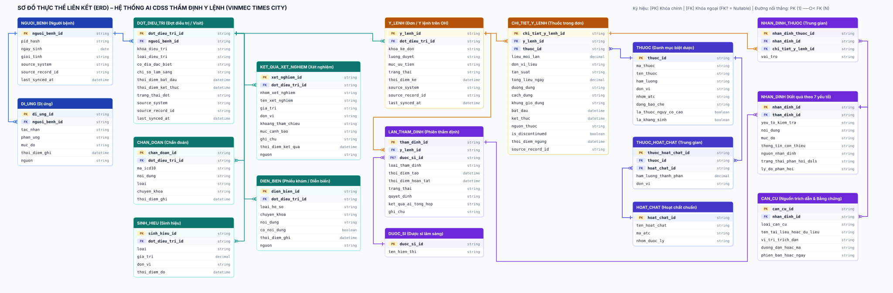
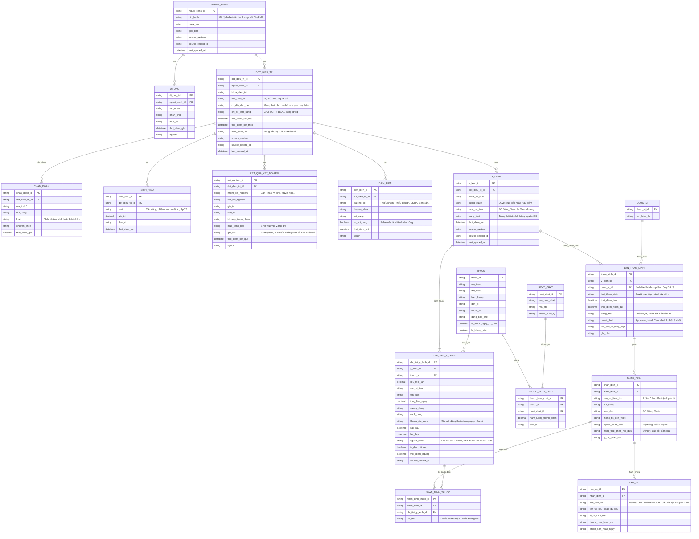

# Sơ đồ Thực thể Liên kết (ERD) – Hệ thống AI CDSS Thẩm định Y lệnh

> **Ghi chú kiến trúc:**
> - **Phi xâm lấn (Read-Only Shadow Schema):** Các bảng nguồn đồng bộ từ `OH` / `EMR` (`NGUOI_BENH`, `DOT_DIEU_TRI`, `Y_LENH`, `CHI_TIET_Y_LENH`, dữ liệu bệnh án) sử dụng `source_system`, `source_record_id`, `last_synced_at` để ánh xạ 1 chiều, không ghi đè vào cơ sở dữ liệu lõi của bệnh viện.
> - **Chuẩn hóa bảng trung gian:** Tách cấp đơn `Y_LENH` và dòng thuốc `CHI_TIET_Y_LENH`; tách `THUOC` – `THUOC_HOAT_CHAT` – `HOAT_CHAT` để bắt trùng lặp/cộng dồn liều trên thuốc phối hợp; bổ sung `NHAN_DINH_THUOC` để trỏ cảnh báo tới đúng cặp/dòng thuốc liên quan.

## Mã Mermaid tham chiếu

