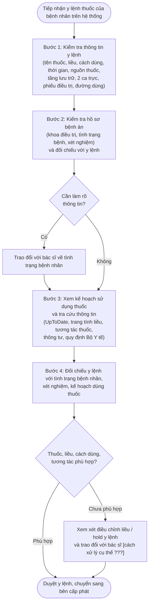
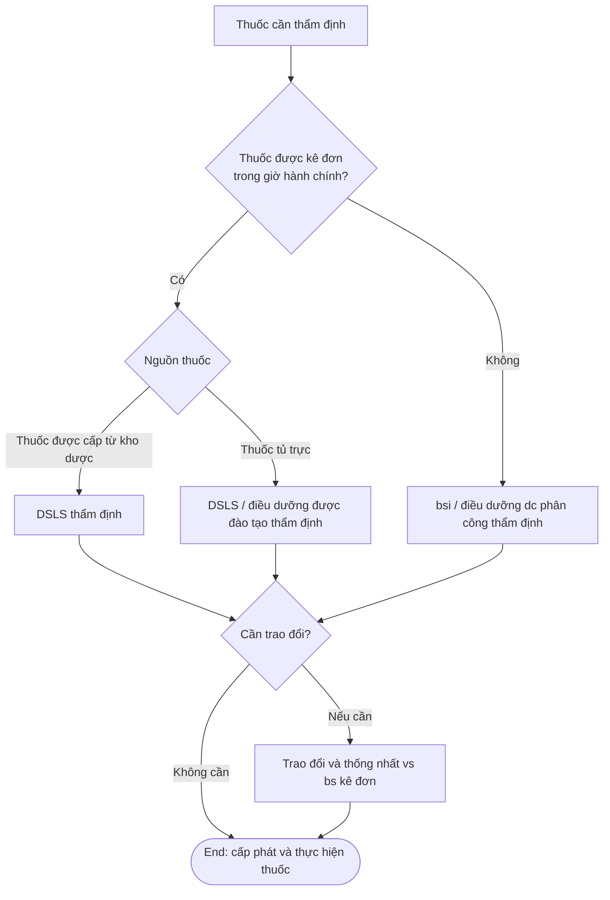
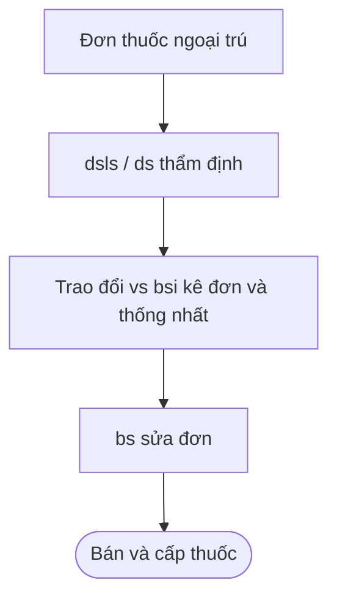

# BÁO CÁO TUẦN 1
## KHẢO SÁT HIỆN TRƯỜNG & ĐẶC TẢ BÀI TOÁN

**Chương trình:** Vinmec AI Exploration Sprint 6 Tuần (VinUni x Vinmec)

**Đơn vị thực tập:** Khoa / Phòng / Trung tâm: S10 - Khoa dược

**Danh sách thành viên:**

- Đỗ Trương Thành Ân - MSHV - Vai trò trong nhóm
- Vũ Gia Khải - 2A202602786 - Vai trò trong nhóm

**Mentor phụ trách:** Ths.DS Nguyễn Lê Trang (Trưởng khoa/Dược sĩ trưởng)

**Lead cơ sở phụ trách:** [Điền tên Lead]

## Hướng dẫn quan trọng cho các nhóm

- Mỗi nhóm vào **Tệp (File) → Tạo bản sao (Make a copy)** về Google Drive riêng của nhóm mình để thực hiện báo cáo.
- Đổi tên tệp thành: **[BÁO CÁO TUẦN 1] - [Tên Khoa] - [Tên viết tắt cơ sở]**.
- Hạn cuối nộp đường link (quyền Xem): **23:59 Thứ Năm (05/11/2026)** qua Google Form của Ban điều hành cơ sở.
- Tuyệt đối tuân thủ bảo mật y tế: Không ghi họ tên bệnh nhân, không ghi mã bệnh án thực tế (PII).
- Tuần 1 chỉ tập trung vào quan sát và làm rõ vấn đề; tuyệt đối **không đề xuất giải pháp công nghệ** như “dùng AI”, “làm chatbot” trong báo cáo này.

## PHẦN 1: NHẬT KÝ QUAN SÁT LÂM SÀNG (TỐI THIỂU ≥ 2 BUỔI)

### Buổi quan sát 1 | ngày 29-10

**Thời gian:** [Từ 10 giờ đến 6 giờ, ngày 29/10/2026]  
**Địa điểm / Phòng chức năng:** 
- Kho dược nội trú 
- Phòng nghiệp vụ
- Phòng dược lâm sàng

**Người thực hiện quan sát:** 
- Đỗ Trương Thành Ân
- Vũ Gia Khải

**Mô tả bối cảnh:** Do khoa dược khá đặc thù, nên không quan sát được bệnh nhân. Trong ngày đầu ở VMEC, nhóm được các anh chị dẫn qua các phòng để làm quen dần với từng phòng và giới thiệu sơ qua về quy trình, cách thức làm việc

**Dòng thời gian hoạt động (Timeline log):**

- 10:00-10:30: Nhóm được chị dược sĩ kho nội trú dẫn lên phòng để hướng dẫn sơ qua về kho nội trú tầng 6. Các đầu việc của kho nội bộ được giới thiệu gồm:
   - kiểm soát tồn kho (xuất kho nội bộ, dự trù hàng, theo dõi tồn kho, theo dõi hàng hết)
   - kiểm soát thuốc cận hạn
   - luân chuyển thuốc
   - làm phiếu (cho người bệnh, cho bàn tủ trực đêm)
   - cân mã AA - AY
   - kiểm tra thuốc hoàn trả
   - kiểm kê
   - kiểm soát vỏ, thuốc dư gây nghiện, hướng thần. Kiểm tra, kiểm đếm, đối chiếu, tiếp nhận vỏ thuốc và thuốc dư tại các khoa lâm sàng; lập, lưu chứng từ; phát hiện, báo cáo sai lệch và phối hợp xử lý, tiêu hủy theo quy định; có liên quan đến tổ nghiệp vụ
- 10:40-11:10: Nhóm vào phòng nghiệp vụ dược, được hướng dẫn sơ qua về các công việc bên nghiệp vụ làm hằng ngày, gồm:
   - pha chế thuốc: chia 2 giai đoạn (tiền pha chế: thông tin giấy tờ, nhãn, phiếu; pha chế: do dược sĩ làm thủ công). Y lệnh là bản mềm từ hệ thống báo cáo của VMEC, dùng excel xử lý ra nhãn, phiếu để dán vào thành phẩm pha chế
   - giấy tờ hành chính
   - hóa đơn và thanh toán: nhận hóa đơn và thanh toán chiếm nhiều khối lượng công việc, chủ yếu nhập tay lên hệ thống của bệnh viện (hệ thống chung của cả Vingroup là SAP)
   - báo cáo thống kê: nhiều loại, chủ yếu làm tay, nặng nhất là báo cáo tổng kết khoa (1 file slide gồm khoảng 100 chỉ số hoạt động trong tháng), báo cáo với toàn khoa, giữa các bệnh viện, hàng tháng với giám đốc dược
   - bảo hiểm thuốc: có 1 trang riêng để đưa thuốc bảo hiểm lên, thông tin nhập tay, khi trúng thầu phải xây dựng danh mục thuốc để đẩy lên hệ thống
   - kiểm tra công tác dược: kiểm tra tủ thuốc riêng của từng khoa theo checklist, mỗi quý tổng hợp lỗi để báo cáo giám đốc. Quan sát thấy mỗi khoa có 1 tủ thuốc riêng để dùng ngay khi cần; kiểm tra việc bảo quản, ghi chép sổ sách (ví dụ lấy thuốc gây nghiện phải ghi sổ, độ ẩm hằng ngày, thuốc cận hạn có dán nhãn); kiểm tra lúc đổi ca giữa các điều dưỡng, mỗi phòng có cơ số thuốc riêng, thiếu so với cơ số thì kho bù
   - hồ sơ tiêu chuẩn của bệnh viện: hằng năm bệnh viện được chấm điểm theo các tiêu chí, gồm hồ sơ cứng và hồ sơ mềm (có minh chứng)
   - quản lý thuốc gây nghiện, hướng thần: báo cáo, xin phê duyệt với Sở Y tế, 1 năm 2 lần, làm tay bằng excel
   - dự trù thuốc: hồ sơ gồm công văn, hồ sơ, báo cáo nhập xuất tồn; phải ghi theo form của nhà cung cấp, sai số sẽ bị gửi trả về
   - ngoài ra được giới thiệu sơ về phần mềm sắp tới của VFS (module pha chế, tính liều lượng pha chế, điều phối giấy tờ)
- 11:10-16:30: Nhóm vào phòng dược lâm sàng để quan sát, được dược sĩ lâm sàng giới thiệu về:
   - Sơ qua dược lâm sàng: mỗi dược sĩ đi 1 khoa lâm sàng, khi bác sĩ kê đơn thì dược sĩ kiểm định theo các điều kiện phù hợp với bệnh nhân (chức năng gan thận, kiêng kỵ thuốc, đánh giá thuốc bác sĩ kê đúng chưa), nếu đúng thì phê duyệt và chuyển sang bên cấp phát
   - Tổ dược lâm sàng và thông tin thuốc liên quan đến các hoạt động chăm sóc bệnh nhân
   - Giới thiệu app quản lý hồ sơ bệnh án bệnh nhân ERM và app quản lý thuốc OH
   - Giới thiệu sơ qua quy trình của dược lâm sàng, cả trực tiếp như chăm sóc bệnh nhân, duyệt thuốc (tìm hiểu bệnh nhân, tiền sử thuốc, dị ứng; tư vấn dựa theo thuốc trước đó; chia nhóm bệnh nhân như bệnh nhân phẫu thuật) cho đến gián tiếp như xây dựng quy trình, cung cấp thông tin thuốc, báo cáo theo quy định, nghiên cứu khoa học và đào tạo cán bộ
   - Phiếu điều trị gồm: ngày, theo dõi diễn biến, ai kê đơn và kê như thế nào, người duyệt ký tên. Dược sĩ xem lại vì sao đơn thuốc được duyệt như vậy (thiếu liều, sai liều, dữ liệu theo từng giờ bị lệch). Ví dụ 1: bệnh nhân được kê kháng sinh nhưng hồ sơ bệnh án chỉ ghi chẩn đoán khác; dược sĩ phải tìm nhiều tài liệu rời rạc mới thấy kết quả xét nghiệm có vi khuẩn nên kháng sinh được duyệt. Ví dụ 2: y lệnh kê đơn sáng và sáng hôm sau, hệ thống duyệt thuốc tự dùng đơn sáng và tối do thấy liều sát nhau quá, gây thiếu liều mà bác sĩ có khi không để ý; dược sĩ phải nhắc bác sĩ bổ sung đơn tối
- 16:30-18:00: Nhóm tổng hợp lại thông tin trong ngày đầu tiên và kết thúc ngày làm việc

**Hành vi phi ngôn ngữ & thao tác vật lý:** 
- Thao tác file excel khá nhiều
- Chuyển đổi qua lại giữa nhiều tab để tra cứu thông tin
- Thông tin bệnh nhân, thuốc, tra cứu rời rạc
- Nhiều việc bên nghiệp vụ (hóa đơn, báo cáo, bảo hiểm, thuốc gây nghiện) đang làm tay bằng excel hoặc nhập tay lên hệ thống
- Dược sĩ lâm sàng phải đọc và đối chiếu nhiều tài liệu rời rạc (phiếu điều trị, hồ sơ bệnh án, xét nghiệm) trước khi duyệt thuốc

### Buổi quan sát 2 | ngày 30-10

**Thời gian:** [Từ 8 giờ đến 5 giờ, ngày 30/10/2026]  
**Địa điểm / Phòng chức năng:**:
- Phòng dược lâm sàng
- Nhà thuốc
- Phòng quản lý dược 
**Người thực hiện quan sát:** 
- Đỗ Trương Thành Ân
- Vũ Gia Khải

**Mô tả bối cảnh:** Trong ngày thứ 2, nhóm muốn tập trung hơn vào phòng dược lâm sàng để quan sát cụ thể quy trình làm việc của dược sĩ nội trú, đồng thời quan sát những vấn đề bất cập của dược sĩ trong quá trình duyệt thuốc. Đến chiều nhóm qua bên nhà thuốc và phòng quản lý dược để làm quen, hỏi 1 chút về phòng quản lý dược như làm gì? ở công đoạn nào? do ai làm chính? quy trình?,...

**Dòng thời gian hoạt động (Timeline log):**

- 08:00-13:30: Nhóm tập trung vào phòng dược lâm sàng:
   - Quan sát dược sĩ lâm sàng nội trú duyệt từ khi bắt đầu y lệnh đến khi y lệnh được duyệt, theo các bước:
      - Tiếp nhận y lệnh thuốc của từng bệnh nhân trên hệ thống, kiểm tra thông tin y lệnh (tên thuốc, liều lượng, cách dùng, thời gian bắt đầu và kết thúc, nguồn thuốc, tầng lưu trữ, phân chia theo hai ca trực), phiếu điều trị, đường dùng thuốc (ví dụ đường truyền tĩnh mạch)
      - Xem hồ sơ bệnh án (khoa điều trị, tình trạng bệnh, kết quả xét nghiệm), đối chiếu với y lệnh; trao đổi với bác sĩ nếu cần làm rõ
      - Xem kế hoạch sử dụng thuốc của từng bệnh nhân trên hệ thống nội bộ Vinmec; tra cứu thông tin thuốc, tính liều, tương tác thuốc, quy định của Bộ Y tế
      - Đối chiếu y lệnh với tình trạng bệnh nhân, kết quả xét nghiệm, kế hoạch dùng thuốc; kiểm tra tính phù hợp của thuốc, liều, cách dùng, tương tác; xem xét điều chỉnh liều khi cần
   - Ví dụ quan sát: với bệnh nhân cần phẫu thuật thần kinh sọ não, dược sĩ kiểm tra tình trạng bệnh, đối chiếu thông tin phẫu thuật với bệnh án và tra cứu các quy định liên quan đến thuốc sử dụng
   - Làm việc với các công cụ tra cứu, tổng hợp thông tin (UpToDate và các trang chuyên ngành, trang tính liều, tra cứu tương tác thuốc, luật/thông tư)
   - Quan sát y lệnh, phiếu điều trị, và bệnh án bệnh nhân được lấy từ đâu, gồm những trường gì. Y lệnh hiện thể hiện: tên thuốc, liều lượng, cách dùng, thời gian bắt đầu và kết thúc, nguồn thuốc, tầng lưu trữ, chia theo hai ca trực; chưa thể hiện trực tiếp nguyên nhân kê thuốc (chưa xác định thông tin này nằm ở đâu)
   - Dược sĩ lâm sàng mong muốn công cụ hỗ trợ trong việc sàng lọc y lệnh và hồ sơ bệnh án của bệnh nhân, giúp họ duyệt nhanh hơn
   - Dược sĩ lâm sàng mong muốn được tổng hợp thông tin từ các nguồn tra cứu thuốc, liều, tương tác thuốc, và hồ sơ bệnh án, y lệnh, phiếu điều trị
   - Ghi nhận khó khăn: thuốc chưa quen thì phải rà hết nhiều nguồn; phải xem lại từng y lệnh để kiểm tra thiếu liều hoặc điểm bất thường; hệ thống chưa phân cấp mức độ y lệnh theo mức độ bệnh nhân (ví dụ bệnh nhân cấp cứu, nguy kịch nên được duyệt sớm hơn); UpToDate không dùng được trên điện thoại (cần thiết bị công ty) và app tra cứu thuốc đang là tiếng Anh
   - Nghe được (chưa xác nhận): điều dưỡng không được trực tiếp fill thuốc của nhà thuốc, phải báo qua nhà thuốc để tạo vé báo trước

- 13:40 - 15:00: Nhóm xin phép vào nhà thuốc để quan sát, hỏi đáp chị dược sĩ nhà thuốc 1 số vấn đề như:
   - Dự trù thường quy, đột xuất của kho nhà thuốc: nhập hàng thường theo lô; 1 tháng có 1-2 lần dự trù thường quy (mùng 1 và 15), số ngày tồn kho không quá 39 ngày (30 ngày trong tháng và 9 ngày chờ hàng)
   - Kiểm soát tồn kho: đang được nói là phức tạp
   - Những giờ hay bị quá tải trong nhà thuốc: nghe nói khoảng 10-12h sáng và 15h-17h30 chiều (lúc phát thuốc)
   - Công thức tính dự trù hàng của nhà thuốc (SLDT = xuất trung bình 1 tháng x 1,3 - tồn - hàng chưa về - hàng chưa lên hệ thống, làm tròn theo quy cách). Dự trù đột xuất: SLDT = xuất trung bình 10 ngày x (40 - i) - tồn - hàng chưa về - hàng chưa lên hệ thống, i là ngày dự trù (hệ số 30 - i trước ngày 15 hàng tháng, từ ngày 15 dùng 40 - i); số ngày dự trù thường quy tối đa 15 ngày, đột xuất tối đa 10 ngày; hàng chia nhỏ dự trù, trên 50 triệu thì chia 3 lần/tháng
   - Một ngày trung bình khoảng 750 lượt khách (khách bên ngoài khoảng 5%), mở cửa 24/7
   - Hiện trạng khác: hệ thống bán thuốc quốc gia chưa ổn định nên viện chưa liên thông; Zalo OA là tài khoản chính để liên lạc với khách; thanh toán trên phần mềm riêng của bệnh viện
   - Việc chia thuốc thành túi ZIP làm thủ công (nhãn, công dụng, cách dùng) nhưng theo trao đổi sau thì hiếm khi có đơn chia thuốc 
   - Cấp phát thuốc không theo đơn tương tự cấp theo đơn nhưng dược sĩ phải hỏi bệnh và duyệt để bán thuốc thay bác sĩ
   - OH (phần mềm bán thuốc của bệnh viện) chưa liên thông lên hệ thống quốc gia, vẫn cần 1 bên thứ 3 để mở liên thông
- 15:00-15:30: Nhóm ngồi tổng hợp lại thông tin quan sát được, và chờ hẹn với phòng quản lý dược
- 15:00-17:12: Nhóm vào tòa VMEC bên cạnh, lên phòng quản lý dược để quan sát và hỏi về 1 số vấn đề
   - Vai trò, phạm vi công việc của phòng quản lý dược: mua sắm, cung ứng cho toàn bộ Times City VMEC; quản lý danh mục, hợp đồng, đơn mua, đơn bán; triển khai hoạt động ngành dọc mang tính dự án; setup bệnh viện mới và quản lý quy định. => Quản lý dược chỉ có vai trò hỗ trợ, tham gia vào quy trình ở kho như luân chuyển chậm, luân chuyển giữa các cơ sở
   - Quy trình cung ứng và dự trù đặt hàng: xây dựng danh mục, quản lý giá, chọn nhà cung cấp, đấu thầu, hợp đồng nguyên tắc; khoa dược tính công thức dự trù rồi xin quản lý dược duyệt; 1 tháng có 1-2 lần dự trù thường quy
   - Danh mục, giá và hợp đồng: đặc tính sản phẩm thay đổi liên tục (ví dụ đổi xuất xứ); hợp đồng ghi nhiều khoản, theo năm tài chính
   - Phân biệt với nghiệp vụ dược: nghiệp vụ dược quản lý hóa đơn, nhập kho, phối hợp kiểm toán, thanh toán; quản lý dược liên quan đến việc mua do ai, phạm vi kinh doanh, mã số thuế, giá bán
   - Kiểm soát chi phí và điều phối mua sắm dược: cần tối ưu chi phí dự trù, chia nhỏ từng đợt; cung ứng chịu ảnh hưởng của ngân sách, xuất nhập tồn, mùa vụ, dịch bệnh, ngày lễ, chiến tranh, thuốc hiếm; thời gian giao hàng khác nhau theo vùng (Hà Nội giao nhanh hơn Phú Quốc, Cần Thơ); tài liệu nằm ở nhiều nguồn khác nhau
   - Quản lý dược nêu vấn đề cần theo dõi thời gian giao hàng (lead time) của nhà cung cấp và cảnh báo sớm cho người dự trù về mùa vụ, hàng chậm luân chuyển, hàng ship chậm
**Hành vi phi ngôn ngữ & thao tác vật lý:** 
- Tài liệu tra cứu rời rạc
- Nguồn tra cứu của bệnh nhân cũng bị rời rạc
- Dược sĩ chuyển qua lại giữa hệ thống y lệnh, hồ sơ bệnh án và nhiều trang tra cứu thuốc, tương tác, liều, quy định
- Dược sĩ xem từng y lệnh một, tự rà thiếu liều hoặc điểm bất thường
- Nhà thuốc: chia thuốc zip làm thủ công (theo trao đổi sau thì hiếm khi có đơn chia), nghe nói cao điểm quá tải vào buổi sáng và cuối chiều

### Buổi quan sát 3 | ngày 31-10

**Thời gian:** [Từ 8 giờ đến 2 giờ, ngày 31/10/2026]  
**Địa điểm / Phòng chức năng:**:
- Kho dược nội trú B1
**Người thực hiện quan sát:** 
- Đỗ Trương Thành Ân
- Vũ Gia Khải

**Mô tả bối cảnh:** Ngày thứ 3, nhóm tập trung làm rõ phần nhập xuất, quản lý, gán nhãn thuốc và phân phối giữa các tầng từ kho. Chị dược sĩ khi bận nên giao cho file excel để phân tích thử và được trao đổi 1 chút vào cuối giờ

**Dòng thời gian hoạt động (Timeline log):**

- 08:00-11:30: Nhóm được cho phép quan sát ở kho dược nội trú B1, được phân công 1 số file dữ liệu excel để phân tích vấn đề và quan sát các việc:
   - Làm rõ cách hoạt động kho hiện tại (kiểm soát kho, dữ liệu và thao tác kiểm soát tồn kho, kiểm soát thuốc cận hạn): từng tầng có kho riêng, có giới hạn số lượng tồn lớn nhất cho từng kho; hiện có 2 loại file là kiểm soát tồn kho và dự trù thường quy
   - Được cho xem ví dụ dữ liệu kiểm soát tồn kho của tầng 6 và thống kê tồn, xuất của tầng B1 và tầng 6
   - Phân tích các trường nhập, xuất, tồn,... trong file dữ liệu của dược sĩ: có 1 file checklist mà người kiểm kho phải làm, tổng hợp thông tin vào file excel (hiện là copy tay) rồi mới tính toán, nhập thống kê bằng excel rất tốn công sức và thời gian, công thức hard code
   - Làm rõ công việc của dược sĩ kho nội trú phải làm, như làm phiếu người bệnh, cân mã AA-AY, quản lý nhập xuất, điều phối thuốc giữa các kho, quản lý vỏ thuốc dư gây nghiện, hướng thần và 1 số khó khăn như hiện tượng âm ảo của phần mềm khi cân mã:
      - Mỗi hàng hóa có thể có nhiều mã (aa, ay, ad,...), thuốc có ít nhất 1 mã, nhiều nhất 4 mã (mã aa thanh toán dịch vụ, ay thanh toán bảo hiểm, daycare có mã riêng)
      - Ví dụ: nhập vào 100 mã aa nhưng kho vẫn phải xuất lên tầng 6 30 mã ay, 70 mã aa; nếu xuất lên mà không cập nhật thì hệ thống coi như lấy 30 mã ay nên bị âm 30 mã ay dưới kho (âm ảo)
   - Giải thích 1 số trường ảnh hưởng đến nhập xuất như hệ số nhóm hàng (hệ số càng thấp thì hàng về càng nhanh; hàng cung cấp lâu, khó mua thì hệ số cao, phải dự trù trước và nhiều, ví dụ hệ số 2 khả năng dự trù 2 tháng)
   - Kiểm soát thuốc cận hạn: nhận biết lô sắp hết hạn ở khâu nhận hàng; hàng có hạn trên 1 năm hay không sẽ có cách xử lý khác nhau (cần xác nhận lại)
   - Luân chuyển: chậm luân chuyển cần làm rõ thêm; luân chuyển khẩn cấp giữa các cơ sở là hiếm (ví dụ điều chuyển huyết thanh kháng nọc rắn), thủ tục phức tạp vì mỗi cơ sở có 1 ID riêng
- 11:30-12:00: Nhóm tổng hợp lại thông tin trong buổi sáng làm việc
- [hh:mm - 14:00]: Trao đổi 1 chút với chị dược sĩ vào cuối giờ về quy trình làm việc (file kiểm soát tồn kho / dự trù thường quy) và các việc lặp lại hằng ngày của dược sĩ kho nội bộ: làm theo checklist, upload, parse dữ liệu, gắn công thức tính toán hard code, check lại; cùng các nhu cầu đột xuất (ví dụ tầng 6 yêu cầu thêm thuốc)
**Hành vi phi ngôn ngữ & thao tác vật lý:** 
- File dữ liệu làm việc là excel, được trích xuất từ phần mềm quản lý kho OH xuống, sau đó mới có thể thực hiện cân đối thuốc và cân mã (lặp lại khá nhiều)
- Copy tay dữ liệu vào file excel rồi mới tính toán, công thức hard code
- Làm theo checklist, upload, parse dữ liệu, check lại mỗi ngày (lặp đi lặp lại)

### Buổi quan sát 4 | ngày 2-11

**Thời gian:** [Từ 8 giờ đến 15 giờ, ngày 02/11/2026]  
**Địa điểm / Phòng chức năng:**:
- Kho dược nội trú B1
- Khoa miễn dịch, dị ứng
**Người thực hiện quan sát:** 
- Đỗ Trương Thành Ân
- Vũ Gia Khải

**Mô tả bối cảnh:** Ngày thứ 4, nhóm tiếp tục quan sát kho nội trú B1, do được chị dược sĩ kho sắp xếp 1 khoảng thời gian đầu để trao đổi, làm rõ quy trình. Sau đó, nhóm dành 1 chút thời gian chiều để đi làm rõ lại quy trình ra y lệnh và quy trình tra cứu của bác sĩ trong các khoa khác, cụ thể là khoa miễn dịch, dị ứng

**Dòng thời gian hoạt động (Timeline log):**
- 08:00 - 08:40: Nhóm xem lại các vấn đề quan sát được trong các ngày trước, đề ra 1 số vấn đề và câu hỏi dành cho dược sĩ kho nội trú
- 08:50-10:30: Nhóm xuống kho nội trú B1 để trao đổi với dược sĩ như đã hẹn, xem tiếp file kiểm soát tồn kho tầng 6. Trao đổi để làm rõ hơn các vấn đề, như:
   - Dự trù thường làm cho bao nhiêu ngày (5-10 ngày dự trù), có những thuốc phải xuất lên ngay
   - Các loại mã hàng có trong hệ thống (aa, ay, cả aa-ay, bộ mã của daycare; mỗi bảo hiểm y tế có loại mã khác nhau)
   - Cách tính dự trù (nói dạng cơ bản), giải thích 1 số trường trong file dữ liệu (file kiểm soát tồn kho gồm: ngày trụ thực tế của tổng lượng thuốc, số lượng xuất dự kiến = cơ số max thuốc của kho - tổng tồn, quy cách, tỉ lệ tồn/xuất; số lượng chuyển thực tế được làm tròn theo quy cách, ví dụ dự kiến 17, quy cách 4 thì chuyển 16) 
   - Phải xác thực có cần xuất thuốc lên các tầng thật không hay chỉ cần cân mã, cân mã nào; có ghi chú thuốc có 2 mã không?
   - Thuốc có 2 mã (ví dụ thuốc phòng mổ) thì nội trú chỉ dùng mã ay dù khi lọc tồn ở tầng vẫn có aa; thuốc chỉ có 1 mã thì chỉ quan tâm tồn/xuất có dưới 5 ngày hay không
   - Quy trình kiểm kê thuốc
   - Làm rõ lại pain point mà dược sĩ kho đang vướng phải: mất thời gian nhất ở khâu cân mã, cân đối mã để xuất thuốc lên; cân mã hiện chủ yếu theo cảm tính, đã có công thức nhưng vẫn cần kinh nghiệm (Ví dụ: có ngày toàn bệnh nhân nội trú nên mã bảo hiểm hết và dư mã dịch vụ). 
   - Cân mã phải phù hợp với tần suất dùng gần đây để đảm bảo bác sĩ có đủ thuốc
   - Các trường trên phần mềm OH: item code, item name, stock uom, bin location, on hand, pending in, pending out, min, max, target
- 10:40 - 12:00: Nhóm tổng hợp, thảo luận lại thông tin đã thu nhập được
- 13:00 - 14:00: Nhóm gặp bác sĩ bên khoa miễn dịch dị ứng:
   - Làm rõ về quy trình tạo y lệnh, gửi xuống cho dược sĩ, phụ thuộc y lệnh: y lệnh phụ thuộc thăm khám bệnh nhân, hồ sơ bệnh án; kê thuốc phụ thuộc tương tác thuốc (thuốc mới kê và theo thời gian, đơn thuốc trước có tương tác không)
   - Làm rõ những công cụ, cách thức mà bác sĩ phải tra cứu liều lượng, tên thuốc, cách dùng, tương tác thuốc trước khi kê y lệnh và gửi cho dược sĩ và tần suất tra cứu thuốc, liều của bác sĩ
   - Làm rõ pain của bác sĩ: xung đột trong việc kê đơn cho bệnh nhân (ví dụ bệnh nhân khám 2 khoa, 2 bác sĩ cùng vào kê đơn cùng lúc trên OH thì không kê được)
   - Bác sĩ nắm rõ tình trạng bệnh nhân hơn, dược sĩ nắm rõ phổ thuốc hơn; có khi bác sĩ kê kháng sinh hơi quá tay hoặc phiếu chưa rõ nên cần dược sĩ phản hồi

**Hành vi phi ngôn ngữ & thao tác vật lý:** 
- Dữ liệu kho rải rác nhiều file, mặc dù tính toán đã có công thức, nhưng việc nhập xuất dữ liệu rất lâu, khó làm quen với người mới
- Dữ liệu bảng excel gây nhầm lẫn. Cùng 1 thuốc, mã AA = tổng mã AA + AY, mã AY chỉ có AY. Chưa kể còn có 2 cột AA, AY. Gây khó khăn cho người đọc và người mới học
- Phần mềm cũ (eHost, năm 2012) chỉ có ô tick bảo hiểm hoặc không, tồn quản lý chung; hiện nay nhiều mã hơn và OH tính tồn riêng cho từng mã (aa, ay) dù là cùng 1 loại thuốc, nên dễ nhầm và gây âm ảo (xem BN09 ở Phần 4)
- Quá trình tra cứu thuốc của bác sĩ gần tương tự như bên dược lâm sàng, nhưng với tần suất ít hơn 

### Buổi quan sát 5 | ngày 3-11

**Thời gian:** [Từ 8 giờ đến 15 giờ, ngày 03/11/2026]  
**Địa điểm / Phòng chức năng:**:
- Phòng dược lâm sàng
**Người thực hiện quan sát:** 
- Đỗ Trương Thành Ân
- Vũ Gia Khải

**Mô tả bối cảnh:** Ngày thứ 5, nhóm tiếp tục ở phòng dược lâm sàng, tập trung quan sát cách dược sĩ lấy thông tin bệnh nhân từ phần mềm kê đơn OH sang phần mềm hồ sơ bệnh án ERM, cách tra cứu thông tin thuốc ở nhiều nguồn, và làm rõ quy trình thẩm định y lệnh (nội trú, ngoại trú) cũng như việc dược sĩ phỏng vấn, theo dõi bệnh nhân. Phần dữ liệu bệnh nhân chỉ ghi tên trường, không ghi thông tin thật

**Dòng thời gian hoạt động (Timeline log):**

- [08:30 - 14:20]: Quan sát dược sĩ lâm sàng tra hồ sơ bệnh án và làm rõ các quy trình duyệt thuốc lần nữa. Gồm:
   - Làm rõ các trường có trong y lệnh
   - Quan sát thấy OH có 5 bước chạy tự động (như CI/CD) để kiểm tra các điều kiện của y lệnh, như kiểm tra trùng hoạt chất, tương tác thuốc, phản ứng dị ứng, thuốc có đủ điều kiện chẩn đoán hay không (dùng cơ sở dữ liệu MIMS)
   - Quan sát việc tra cứu thuốc ngoài danh mục, ví dụ thực phẩm chức năng (sữa dinh dưỡng dạng bột): tra khá lâu, thường chưa có dữ liệu lâm sàng, không có tương tác, tác dụng với bệnh nhân, không có bằng chứng khẳng định tác dụng, và không nằm trong đơn thuốc mà chỉ có trong phiếu tư vấn. Dược sĩ chỉ tin các nguồn đủ tin cậy, tránh thông tin thuốc bị copy, tự soạn. 
   - UpToDate dùng để tra thuốc và phác đồ điều trị nhưng còn thiếu 1 chút (ví dụ trang thuốc có FDA)
   - Trao đổi về phỏng vấn, theo dõi bệnh nhân: mỗi dược sĩ phụ trách 1 khoa, lên khoa phỏng vấn bệnh nhân khi cần; nếu bệnh nhân dùng thuốc khác thì bác sĩ phải hỏi lại nguyên nhân đổi thuốc, kiểm tra lại thuốc, điều chỉnh cho phù hợp; khi cho thuốc cần đánh giá bệnh nhân có dùng đúng không, giải thích khi chưa hiểu thuốc, xử trí tác dụng phụ, hướng dẫn cách dùng (ví dụ thuốc xịt)
   - Có hỏi về báo cáo tháng của dược lâm sàng (bộ chỉ số chuyên môn bác sĩ đã đăng ký), hẹn tìm hiểu kỹ ở buổi sau (xem buổi 6)

**Hành vi phi ngôn ngữ & thao tác vật lý:** 
- Chuyển qua lại giữa OH và ERM: lấy mã bệnh nhân ở OH rồi nhập sang ERM để xem hồ sơ
- Tra cứu từ nhiều nguồn rời rạc: MIMS, UpToDate, thông tư/công bố của Cục quản lý dược, bảo hiểm y tế
- Dược sĩ tập trung đọc hồ sơ bệnh án rất nhiều, chỉ tra cứu thêm khi cần; quy trình trên không phải lúc nào cũng theo đúng luồng
- Với thực phẩm chức năng và thuốc ngoài danh mục: phải tra lâu và cân nhắc độ tin cậy của nguồn

### Buổi quan sát 6 | ngày 4-11

**Thời gian:** [Từ 8 giờ đến 17 giờ 10 phút, ngày 04/11/2026]  
**Địa điểm / Phòng chức năng:**:
- Phòng nghiệp vụ dược
- Phòng dược lâm sàng (ngoại trú)
- Nhà thuốc 

**Người thực hiện quan sát:** 
- Đỗ Trương Thành Ân
- Vũ Gia Khải

**Mô tả bối cảnh:** Ngày thứ 6, nhóm theo dõi bên nghiệp vụ dược (mã aa/ay, kiểm tra tồn kho, báo cáo lỗi), quan sát hoạt động dược lâm sàng ngoại trú vào đầu giờ chiều, tìm hiểu quy trình làm báo cáo tổng kết hàng tháng của dược lâm sàng, và ghi lại 1 số vấn đề ở nhà thuốc (chia thuốc, kiểm kê)

**Dòng thời gian hoạt động (Timeline log):**
- [08:00 - 10:00]: Nhóm liệt kê ra những vướng mắc, tổng hợp lại và đề ra các câu hỏi, khúc mắc trước khi đi quan sát, trao đổi các phòng
- [10:00 - 11:30]: Nhóm theo dõi bên nghiệp vụ dược:
   - Mã aa, ay: kho nội trú phải nói lại với bên nghiệp vụ để biết đó là mã gì, nghiệp vụ không biết được số lượng thuốc chứa các mã; nội trú 1 mặt hàng có mã thường và mã bảo hiểm, cần làm rõ dựa vào dự trù kho như thế nào
   - Kiểm tra tồn kho: phân công theo từng nơi (ví dụ khoảng 80 tủ, mỗi người phụ trách khoảng chục tủ); ở cơ sở khác có khoảng mười mấy khoa, rất khó để 1 người duyệt hết
   - Có phần mềm riêng để điền theo dõi tồn, nhiều cơ sở dùng chung 1 form, mỗi quý có nhiều đợt; xong thì convert sang excel (phần mềm thuộc microsoft, chưa biết chính xác)
   - Các lỗi tìm được phải tự nhập hoặc chụp ảnh, sau đó làm báo cáo (khoa phòng bị lỗi, chi tiết lỗi, tổng số lỗi, mức độ lỗi, số lỗi nghiêm trọng theo quý, lỗi lặp lại)
   - Mã daycare mới có từ khi đổi phần mềm; OH mang tính hệ thống hơn eHost, quản lý trên toàn hệ thống thay vì từng bệnh viện; OH không hiểu mã aa, ay nên phải chia mã riêng và các phần tồn khác nhau
- [14:00 - 14:30]: Trao đổi dược lâm sàng ngoại trú: dùng OH (kê đơn, thanh toán) và ERM (hồ sơ bệnh án). Hiện không giám sát trực tiếp bệnh nhân ngoại trú. Ghi nhận:
   - Không giám sát trực tiếp bệnh nhân
   - Đơn thuốc cần dược sĩ duyệt xong mới mua thuốc; thuốc mua ngoài thì không tính đến kho
   - Nếu bệnh nhân gặp vấn đề, tổng đài nối máy đến bác sĩ, dược sĩ ở phía sau
   - Duyệt đơn ngoại trú trung bình 5 phút nhưng không theo thứ tự: ai đến trước ưu tiên trước, có đơn bị delay 1 tiếng do người bệnh chưa đến; y lệnh bác sĩ thì theo thứ tự, hoặc ưu tiên các đơn đã chờ lâu. Thời gian chờ 30 phút có thể do ra viện, bảo hiểm,...
   - Hiện chưa liên kết được tình trạng dị ứng của bệnh nhân giữa OH và ERM (ERM thiếu thông tin dị ứng)
   - Ghi nhận có độ ưu tiên của bệnh nhân nhưng hầu hết là ngoại trú; chưa theo dõi được việc dùng thuốc của bệnh nhân ngoại trú, chỉ theo dõi qua bệnh án khoa lâm sàng, khi người bệnh có yêu cầu thì thông tin được chuyển cho bác sĩ điều trị chứ không phải dược sĩ lâm sàng
   - Bác sĩ in đơn trực tiếp cho người bệnh, có thể kê thuốc không có tồn kho và ghi "Thuốc mua ngoài"; người bệnh cầm đơn xuống nhà thuốc, dược sĩ lâm sàng ngoại trú duyệt đơn rồi fill đơn vào billing của người bệnh và trừ thẳng trên kho; nếu người bệnh không lấy đủ theo đơn thì nhà thuốc đổi số trên billing và tồn kho được hồi phục; dùng bảo hiểm y tế thì hoàn thành thủ tục trước (thu ngân, điều dưỡng), đến nhà thuốc chỉ lấy thuốc; nguyên nhân có thể gây delay: chờ duyệt, bảo hiểm y tế chưa xong, số đơn chờ duyệt lớn
- [~14:30 - 15:10] : Tìm hiểu cách làm báo cáo tổng kết của dược lâm sàng:
   - Hàng tháng làm 1 bộ báo cáo theo bộ chỉ số của dược lâm sàng (các cơ sở làm không giống nhau, ví dụ có mục cơ sở Times City không làm) . Báo cáo chứa khoảng 17 chỉ số dược lâm sàng, đánh giá tỉ lệ được tư vấn/hội chẩn đúng quy trình của khoa, tập trung theo từng khoa được đánh giá (tương đương dược sĩ lâm sàng phụ trách khoa đó)
   - Cuối tháng phải thu thập dữ liệu từ nhiều nguồn, nhiều link khác nhau (OH, ERM, excel, thông tin từ bên khác), không có 1 hệ thống chung nên mất nhiều thời gian
   - Ví dụ: cuối tháng xuất từ OH tất cả thuốc đã kê rồi tự xử lý để ra chỉ số; muốn xác nhận hội chẩn kháng sinh phải mở ERM xem hồ sơ bệnh án có phiếu hội chẩn đủ tiêu chuẩn theo quy định bệnh viện hay không
   - Chỉ số do dược sĩ phụ trách từng khoa xử lý: dược sĩ phụ trách khoa nào (ví dụ khoa tim) thì gửi file excel chỉ số thống kê của khoa đó cho người tổng hợp, người tổng hợp mở từng file và gộp ra số cuối vào bản chính; làm báo cáo mất trung bình khoảng 2 ngày; báo cáo gửi cấp trên check trước khi hoàn tất
   - Có hệ thống quản lý sự cố thuốc, tác dụng phụ thuốc'
   - Báo cáo có quy mô toàn phòng dược lâm sàng, dược sĩ lâm sàn nào cũng phải làm báo cáo và gửi cho 1 người tổng hợp
- [15:30 - 16:30]: Tại nhà thuốc:
   - Chia thuốc zip theo đơn dài hạn: hiếm khi có đơn chia. Giá khoảng 300.000 đồng cho 1 tháng (khoảng 90 gói thuốc tương ứng 30 ngày, tức khoảng 10.000 đồng cho 3 túi zip/ngày), chia mất khoảng 2–3 tiếng, không nhanh. Chưa xác định được nguyên nhân hiếm khi có: có thể do giá cả và thời gian chia lâu ảnh hưởng đến trải nghiệm nên khách không cần, hoặc khách đã mua thuốc, có đơn rồi, tự bóc thuốc ra uống thì đơn giản hơn 
   - Kiểm kê hiện tại chưa ổn: Phần mềm kiểm kê của nhà thuốc hiện tại mỗi lần kiểm kê tạo 1 bảng, sau đó hệ thống chốt lại kho, nếu có thay đổi số lượng phải nhập lại từ đầu; phát hiện thừa thiếu có khi mất 1–2 ngày; nếu lệch phải tự đi kiểm (phát thiếu, phát sai cho khách; giao thừa thì lấy lại thuốc, giao thiếu thì phải bù)

- [16:30 - 17:10]: Nhóm dánh thời gian tổng hợp lại tài liệu, thảo luận xem còn những gì vướng mắc và lên câu hỏi cho ngày kế

**Hành vi phi ngôn ngữ & thao tác vật lý:** 
- Báo cáo kiểm tra và báo cáo dược lâm sàng đều phải làm tay từ bảng theo dõi / file excel xuất từ OH, dữ liệu rải ở nhiều nguồn, mất thời gian chuyển đổi và nhập lại
- Mở OH và ERM cùng lúc, tra cứu thủ công từng bệnh nhân (ví dụ phiếu hội chẩn, dị ứng) để đối chiếu
- Dược sĩ ngoại trú duyệt đơn lần lượt, thứ tự phụ thuộc người bệnh đến quầy
- Nhà thuốc: chia thuốc zip làm thủ công nhưng hiếm khi có; kiểm kê phải nhập lại nhiều lần

### Buổi quan sát 7 | ngày 5-11

**Thời gian:** [Từ 8 giờ đến 12 giờ 10 phút, ngày 05/11/2026]  
**Địa điểm / Phòng chức năng:**:
- Phòng nghiệp vụ dược

**Người thực hiện quan sát:** 
- Đỗ Trương Thành Ân

**Mô tả bối cảnh:** Ngày thứ 7, dược sĩ nghiệp vụ dược đang lên format mẫu bảo hiểm y tế cho năm tới, đa nguồn thông tin đối chiếu, mặc dù làm cho form nguyên 1 năm nhưng làm khá lâu

**Dòng thời gian hoạt động (Timeline log):**
- [08:00 - 12:00]: Nhóm xin phép quan sát phòng nghiệp vụ dược để tìm hiểu về các thao tác, quá trình mà nghiệp vụ dược cần làm. Trong lúc quan sát, nhóm nhận thấy:
   - Việc tạo template điền thông tin bảo hiểm y tế cho 1 năm hiện tại khá lâu, thông tin tra cứu để tạo template phụ thuộc nhiều yếu tố (nhà thầu, nhà thuốc). Template này chứa rất nhiều mặt hàng, khoảng 700-1200 mặt hàng thuốc
   - Hiện tại phòng nghiệp vụ dược đang dùng VIS Vmec để tra cứu số lượng đã gửi của BHYT
   - Nắm được quy trình tạo form điền BHYT:
      - Nhận file thông tin hàng hóa từ nhà thầu
      - File excel đã có đủ thông tin từ nhà cung cấp (NCC), gồm: nhà thầu, mã HIS; mã BHYT (nếu có, là mã chuẩn của Bộ đã được public); tên thuốc, đơn vị tính, hoạt chất (lấy từ dữ liệu nội bộ); mã đường dùng, tên đường dùng (cũng là mã chuẩn); tỷ lệ hưởng bảo hiểm y tế (thông tư 20 - cũng là thông tin chuẩn, tức là public: dữ liệu của Bộ đã được public); thông tin khác (lấy từ file nhà thầu nội bộ)
      - Tra cứu hoạt chất trên thông tư 20: nếu không có thì bỏ qua; nếu có thì ghi lại tỷ lệ % được BHYT chi trả
      - Tra cứu mã BHYT trong danh sách của Bộ
      - Ghi lại các thông tin: mã BHYT, tỷ lệ hưởng BHYT, mã + tên đường dùng

**Hành vi phi ngôn ngữ & thao tác vật lý:** 
- Tạo form BHYT từ nhiều nguồn: file của nhà thầu, dữ liệu nội bộ, thông tư, danh sách mã của Bộ
- Tra cứu và ghi lại từng mặt hàng (mã, tỷ lệ, đường dùng)
- Tổng hợp lại báo cáo cuối cùng cho 700-1200 sản phẩm

## PHẦN 2: GHI CHÉP PHỎNG VẤN (3–5 NGƯỜI, ≥ 2 VAI TRÒ)

(Áp dụng nguyên tắc The Mom Test: Chỉ hỏi về các sự việc, hành vi cụ thể đã xảy ra trong quá khứ, không hỏi ý kiến hay gợi ý giải pháp tương lai.)

### Người được phỏng vấn 1

**Vai trò chuyên môn:** [Ví dụ: Bác sĩ điều trị / Bác sĩ nội trú]  
**Thời lượng trao đổi:** [Ví dụ: 20 phút]

**Các câu hỏi & phản hồi thực tế:**

1. **Câu hỏi (về công việc tốn thời gian nhất):** [Ghi câu hỏi nhóm đã hỏi]  
   **Phản hồi:** [Tóm tắt câu trả lời của nhân viên y tế]
2. **Câu hỏi (về sự cố/trục trặc cụ thể đã xảy ra gần nhất):** [Ghi câu hỏi]  
   **Phản hồi:** [Tóm tắt câu trả lời]
3. **Câu hỏi (về cách họ đang tự khắc phục hiện tại):** [Ghi câu hỏi]  
   **Phản hồi:** [Tóm tắt câu trả lời]

**Trích dẫn nguyên văn ấn tượng:** “[Trích dẫn câu nói bộc lộ nỗi đau/điểm nghẽn lớn nhất của họ]”

### Người được phỏng vấn 2

**Vai trò chuyên môn:** [Ví dụ: Điều dưỡng trưởng / Điều dưỡng viên]  
**Thời lượng trao đổi:** [...]

**Các câu hỏi & phản hồi thực tế:** [...]

**Trích dẫn nguyên văn ấn tượng:** “[...]”

### Người được phỏng vấn 3

**Vai trò chuyên môn:** [Ví dụ: Kỹ thuật viên / Dược sĩ / Bác sĩ khác]  
**Thời lượng trao đổi:** [...]

**Các câu hỏi & phản hồi thực tế:** [...]

**Trích dẫn nguyên văn ấn tượng:** “[...]”

## PHẦN 3: BẢN ĐỒ QUY TRÌNH (CLINICAL PROCESS MAP)

Mô tả luồng vận hành công việc và luồng dữ liệu từ lúc bắt đầu đến khi kết thúc ca làm việc / ca khám bệnh tại khoa.

### 3.1. Dược lâm sàng

Dược lâm sàng có 2 nhóm quy trình đã quan sát: (1) quy trình kiểm tra và duyệt thuốc của dược sĩ cho từng y lệnh (ngày 30/10 và 03/11), (2) quy trình thẩm định y lệnh và cấp phát thuốc, tùy nội trú hay ngoại trú (ngày 03/11 và 04/11). Mỗi dược sĩ phụ trách 1 khoa lâm sàng. Hệ thống, công cụ liên quan: OH (kê đơn, y lệnh), ERM (hồ sơ bệnh án), hệ thống nội bộ Vinmec (kế hoạch sử dụng thuốc), MIMS, UpToDate, thông tư/quy định của Bộ Y tế.

#### 3.1.1. Quy trình kiểm tra và duyệt thuốc của dược sĩ

**Ranh giới quy trình:**  
**Điểm bắt đầu:** Dược sĩ tiếp nhận y lệnh thuốc của từng bệnh nhân trên hệ thống  
**Điểm kết thúc:** Y lệnh được duyệt và chuyển sang bên cấp phát

**Sơ đồ quy trình (Flowchart):**

**Phân rã các bước chính:**

1. **Bước 1 – Tiếp nhận và kiểm tra y lệnh:** Dược sĩ tiếp nhận y lệnh thuốc của từng bệnh nhân trên hệ thống. Kiểm tra thông tin y lệnh: tên thuốc, liều lượng, cách dùng, thời gian bắt đầu và kết thúc, nguồn thuốc, tầng lưu trữ, phân chia theo hai ca trực. Kiểm tra thông tin phiếu điều trị và đường dùng thuốc (ví dụ đường truyền tĩnh mạch và các yếu tố có thể ảnh hưởng đến việc sử dụng thuốc).
2. **Bước 2 – Kiểm tra hồ sơ bệnh án:** Xem chi tiết hồ sơ bệnh án (khoa điều trị, tình trạng bệnh, kết quả xét nghiệm và thông tin liên quan), đối chiếu với y lệnh. Trao đổi với bác sĩ về tình trạng bệnh nhân nếu cần làm rõ. Bệnh nhân được lấy mã từ OH rồi tra tiếp qua ERM.
3. **Bước 3 – Kiểm tra kế hoạch sử dụng thuốc và tra cứu thông tin:** Truy cập hệ thống nội bộ Vinmec để xem kế hoạch sử dụng thuốc của từng bệnh nhân; kiểm tra tên thuốc, thành phần, liều lượng, cách dùng, lịch sử dùng thuốc. Khi có nội dung chưa rõ thì tra UpToDate và các trang chuyên ngành, dùng các trang chuyên biệt để tính liều, tra tương tác thuốc, tra luật, thông tư và quy định của Bộ Y tế.
4. **Bước 4 – Kiểm tra và điều chỉnh thuốc:** Đối chiếu y lệnh với tình trạng bệnh nhân, kết quả xét nghiệm và kế hoạch dùng thuốc; kiểm tra tính phù hợp của thuốc, liều lượng, cách dùng, tương tác thuốc; xem xét điều chỉnh liều khi cần. Nếu thấy không phù hợp thì hold y lệnh và trao đổi với dược sĩ/bác sĩ.

**Lưu ý khi quan sát:** Các dược sĩ thường chỉ tra cứu thêm khi cần và tập trung đọc rất nhiều hồ sơ bệnh án, nên quy trình trên không phải lúc nào cũng được thực hiện theo đúng thứ tự. Một số điểm chưa rõ cần xác nhận: dược sĩ có ưu tiên duyệt 1 số bệnh nhân hơn không (hiện hệ thống chưa phân cấp mức độ y lệnh), và "hold y lệnh" cụ thể là từ chối và báo lại bác sĩ hay điều chỉnh liều rồi báo bác sĩ.

**Thời gian chu kỳ (Cycle Time):** [Chưa có số liệu đo cho quy trình này]

#### 3.1.2. Quy trình thẩm định y lệnh và cấp phát thuốc (nội trú, ngoại trú)

**Ranh giới quy trình:**  
**Điểm bắt đầu (nội trú):** Thuốc cần thẩm định  
**Điểm kết thúc (nội trú):** Cấp phát và thực hiện thuốc  
**Điểm bắt đầu (ngoại trú):** Đơn thuốc ngoại trú  
**Điểm kết thúc (ngoại trú):** Bán và cấp thuốc

**Phạm vi thẩm định:** Ngoại trú thẩm định tất cả thuốc. Nội trú chỉ thẩm định 1 số loại thuốc (ví dụ thuốc dùng lần đầu cho người bệnh); 1 số thuốc có chu kỳ cấp phát 2 lần, như thuốc phòng mổ, phòng sinh, không cần thẩm định y lệnh `[cần xác nhận lại ý này ???]`.

**Sơ đồ quy trình (Flowchart) – Nội trú:**

**Sơ đồ quy trình (Flowchart) – Ngoại trú:**

**Phân rã các bước chính:**

*Nội trú*

1. **Bước 1 – Xác định thuốc cần thẩm định, và thời điểm kê:** Xét thuốc có thuộc nhóm cần thẩm định không, và thuốc được kê trong giờ hành chính hay không.
2. **Bước 2 – Thẩm định:**
   - Trong giờ hành chính: thuốc được cấp từ kho dược thì dược sĩ lâm sàng (DSLS) thẩm định; thuốc tủ trực thì DSLS hoặc điều dưỡng được đào tạo thẩm định.
   - Ngoài giờ hành chính: bác sĩ hoặc điều dưỡng được phân công thẩm định.
3. **Bước 3 – Trao đổi và thống nhất:** Nếu cần, trao đổi và thống nhất với bác sĩ kê đơn.
4. **Bước 4 – Kết thúc:** Cấp phát và thực hiện thuốc.

*Ngoại trú*

1. **Bước 1:** Dược sĩ lâm sàng/dược sĩ thẩm định đơn thuốc ngoại trú (người bệnh cầm đơn xuống nhà thuốc).
2. **Bước 2:** Trao đổi với bác sĩ kê đơn và thống nhất.
3. **Bước 3:** Bác sĩ sửa đơn.
4. **Bước 4:** Bán và cấp thuốc.

**Thời gian chu kỳ (Cycle Time):** Duyệt đơn ngoại trú trung bình khoảng 5 phút/đơn, nhưng không theo thứ tự: người đến trước được duyệt trước, có đơn bị delay khoảng 1 tiếng do người bệnh chưa đến; y lệnh bác sĩ theo thứ tự hoặc ưu tiên các đơn đã chờ lâu. Thời gian chờ khoảng 30 phút có thể do ra viện, bảo hiểm,... Nội trú: [chưa có số liệu].

*(Các mục 3.2 trở đi cho kho nội trú, nghiệp vụ, nhà thuốc, quản lý dược: bổ sung sau)*

## PHẦN 4: DANH SÁCH ĐIỂM NGHẼN (BOTTLENECK MATRIX)

*Ghi chú: Tần suất và mức độ tác động là đánh giá sơ bộ của nhóm dựa trên quan sát và trao đổi (chưa đo thời gian bằng số liệu), vì vậy các ô chưa có số liệu được ghi là "chưa đo" hoặc "cần xác định". Các điểm nghẽn được xếp theo mức độ ưu tiên: dược lâm sàng, điểm nghẽn chung của toàn khoa, kho nội trú, bác sĩ, sau đó là nghiệp vụ, nhà thuốc và quản lý dược.*

| Mã | Bước trong quy trình | Mô tả chi tiết vấn đề / Điểm nghẽn | Tần suất lặp lại | Mức độ tác động (Cao / Trung bình / Thấp) | Cách khoa đang xử lý tạm thời |
| --- | --- | --- | --- | --- | --- |
| BN01 | Dược lâm sàng – tổng hợp thông tin khi duyệt y lệnh | Thông tin để duyệt 1 y lệnh nằm rời rạc ở nhiều nơi: y lệnh và mã bệnh nhân trên OH, hồ sơ bệnh án trên ERM, kế hoạch dùng thuốc trên hệ thống nội bộ, thông tin thuốc ở MIMS, UpToDate, thông tư/quy định. Dược sĩ phải mở nhiều tab, lấy mã bệnh nhân ở OH rồi nhập sang ERM. Y lệnh chưa thể hiện trực tiếp nguyên nhân kê thuốc nên phải tìm thêm tài liệu rời rạc. Tình trạng dị ứng của bệnh nhân chưa liên kết giữa OH và ERM (ERM thiếu thông tin dị ứng) | Mỗi y lệnh, hằng ngày (chưa đo số y lệnh/ngày) | Cao (mất thời gian đọc, đối chiếu; liên quan thiếu liều, tương tác thuốc) | Tra cứu thủ công từng nguồn, đọc hồ sơ bệnh án, trao đổi trực tiếp với bác sĩ |
| BN02 | Dược lâm sàng – sàng lọc, rà soát y lệnh và hồ sơ bệnh án | Dược sĩ phải xem lại và phân tích từng y lệnh để tìm thiếu liều hoặc điểm bất thường; đối chiếu với tình trạng và thuốc đã dùng trước đó của bệnh nhân; kiểm tra tương tác, xung đột thuốc; xem liều có phù hợp với từng bệnh lý, điều kiện của bệnh nhân hay không `[quan sát chủ yếu thấy các bước này, cần xác nhận thêm]`. OH đã tự chạy 1 số bước kiểm tra (trùng hoạt chất, tương tác, dị ứng, điều kiện chẩn đoán) nhưng dược sĩ vẫn phải rà lại từng y lệnh và bổ sung thông tin cho bác sĩ khi cần. Thông tin nhạy cảm của bệnh nhân (y lệnh, phiếu điều trị, xét nghiệm) chỉ xử lý trong hệ thống bệnh viện, các công cụ bên ngoài chỉ dùng được với thông tin chung như tên thuốc, liều | Mỗi y lệnh, hằng ngày (chưa đo) | Cao (tốn thời gian duyệt, ảnh hưởng đến độ nhanh của việc duyệt thuốc) | Dược sĩ rà thủ công từng y lệnh; nếu không phù hợp thì hold y lệnh và trao đổi với dược sĩ/bác sĩ theo thời gian thực |
| BN03 | Dược lâm sàng – thẩm định liều theo lịch dùng thuốc (phiếu điều trị) | Hệ thống duyệt thuốc có thể tự dùng lại đơn sáng và đơn tối khi thấy liều của các y lệnh sát nhau quá, gây thiếu liều (ví dụ y lệnh kê đơn sáng và sáng hôm sau, hệ thống tự dùng đơn sáng và tối). Bác sĩ có khi không để ý, dược sĩ phải dò ra từ phiếu điều trị rồi nhắc bác sĩ bổ sung, kê thêm đơn tối. Dữ liệu theo từng giờ trong phiếu điều trị cũng có thể bị lệch `[mới ghi nhận 1 ví dụ, chưa xác nhận đủ kỹ cơ chế]` | Chưa biết (mới có 1 ví dụ quan sát) | Cần xác định (nếu xảy ra thì liên quan thiếu liều, an toàn dùng thuốc) | Dược sĩ dò lại phiếu điều trị, điều chỉnh và nhắc bác sĩ bổ sung đơn |
| BN04 | Dược lâm sàng – tra cứu thông tin thuốc | Dược sĩ phải tra nhiều nguồn khi gặp thuốc chưa quen, hoặc khi cần liều, cách dùng cho từng bệnh nhân (web tra cứu có đủ thông tin chung nhưng mỗi bệnh nhân, mỗi điều kiện lại cần liều và cách dùng khác nhau). UpToDate cần tài khoản do bệnh viện cấp và chỉ truy cập được trên thiết bị của bệnh viện, điện thoại cá nhân thì không vào được; app tra cứu thuốc bằng tiếng Anh gây bất tiện trong 1 số trường hợp. Thực phẩm chức năng, thuốc ngoài danh mục thường thiếu dữ liệu lâm sàng, nguồn nhiễu nên phải kiểm tra độ tin cậy. Nhu cầu tra cứu này đã được điều dưỡng xác nhận, còn bác sĩ ở từng khoa riêng thì ít dùng `[cần xác nhận lại]` | Mỗi lần gặp thuốc chưa quen hoặc ca phức tạp (chưa đo) | Trung bình đến Cao | Tra cứu từng nguồn trên máy bệnh viện (UpToDate, MIMS, thông tư), tự cân nhắc nguồn tin cậy |
| BN05 | Dược lâm sàng – phân cấp mức độ ưu tiên y lệnh | Ngoại trú: việc phân cấp đang theo cảm tính, dược sĩ tự sắp xếp thứ tự duyệt, ưu tiên người đến trước hoặc đơn đã chờ lâu; có đơn bị delay khoảng 1 tiếng do người bệnh chưa đến (khảo sát gần nhất). Nội trú: OH có trường độ ưu tiên (hiện thấy mã 1, 2) và nhãn màu mức độ khẩn trương, trì hoãn, cấp cứu của bệnh nhân, nhưng chưa biết dược sĩ có dùng để sắp xếp thứ tự duyệt hay không `[cần xác định]`; ghi nhận ban đầu là hệ thống chưa phân cấp mức độ y lệnh (bệnh nhân cấp cứu, nguy kịch cần duyệt sớm hơn) `[cần xác định lại với dược sĩ nội trú]` | Mỗi đơn/y lệnh; ngoại trú trung bình khoảng 5 phút/đơn | Cần xác định (ngoại trú đã ghi nhận chờ lâu; nội trú chưa biết) | Ngoại trú: dược sĩ tự sắp xếp theo cảm tính. Nội trú: cần xác định |
| BN06 | Dược lâm sàng – báo cáo tổng kết hằng tháng (bộ chỉ số) | Cuối tháng phải thu thập dữ liệu từ nhiều nguồn, nhiều link: file excel xuất từ OH (thuốc đã kê trong tháng), hồ sơ ERM tra thủ công qua mã bệnh nhân để đối chiếu (ví dụ phiếu hội chẩn kháng sinh), Info Vinmec (sự cố thuốc, tác dụng phụ), thông tin truyền miệng. Chỉ số của từng khoa do dược sĩ khác nhau phụ trách: dược sĩ phụ trách khoa nào (ví dụ khoa tim) thì gửi file excel chỉ số thống kê của khoa đó cho người tổng hợp, người tổng hợp phải mở từng file và gộp vào bản chính `[mới khảo sát gần đây]`. Không có hệ thống chung nên dữ liệu rời rạc; mỗi cơ sở làm bộ chỉ số khác nhau | Hằng tháng; mất trung bình khoảng 2 ngày/lần làm báo cáo | Cao (tốn nhiều công sức, nhập và xử lý tay) | Dược sĩ tự xây các công cụ lọc bằng excel; từng dược sĩ phụ trách khoa xử lý chỉ số khoa mình rồi người phụ trách tổng hợp ra số cuối, gửi cấp trên check |
| BN07 | Toàn khoa dược – khối lượng tài liệu, quy trình lớn và rải rác | Tài liệu, quy trình được ghi nhận là quá nhiều và rải rác. Tình trạng này có ở tất cả các phòng chứ không riêng phòng nào, và mỗi phòng lại có các loại tài liệu rời rạc khác nhau (ví dụ dược lâm sàng: phiếu điều trị, hồ sơ bệnh án, thông tư, quy định, tài liệu tra cứu thuốc; kho nội trú: nhiều file excel kiểm soát tồn kho, dự trù; nghiệp vụ: hóa đơn, báo cáo, hồ sơ bảo hiểm). Phòng quản lý dược: `[chưa xác nhận]` | Hằng ngày ở các phòng (chưa đo) | Trung bình đến Cao (chưa đo) | Mỗi người tự tra cứu và tự lưu tài liệu theo cách riêng; chưa có công cụ tích hợp |
| BN08 | Kho nội trú – kiểm soát tồn kho và dự trù thường quy | Dữ liệu tồn/xuất được xuất từ OH ra nhiều file excel rời (file kiểm soát tồn kho, dự trù thường quy, thống kê tầng B1 và tầng 6). Người kiểm kho copy tay dữ liệu vào file checklist/excel rồi mới tính toán, công thức hard code; việc nhập xuất dữ liệu rất lâu, khó làm quen với người mới. Mỗi ngày phải lặp lại: làm theo checklist, upload, parse dữ liệu, gắn công thức, check lại; còn phải đáp ứng nhu cầu đột xuất (ví dụ tầng yêu cầu thêm thuốc) | Hằng ngày (dự trù khoảng 5–10 ngày cho mỗi lần) | Cao (tốn công sức và thời gian, lặp lại nhiều) | Làm theo checklist bằng excel, copy tay dữ liệu, dựa vào kinh nghiệm của dược sĩ kho |
| BN09 | Kho nội trú – cân mã AA - AY để xuất thuốc lên tầng | **Mã thuốc:** 1 thuốc có thể có nhiều mã: aa (thanh toán dịch vụ), ay (thanh toán bảo hiểm), có thể có mã aa-ay và bộ mã riêng của daycare (mỗi bảo hiểm y tế có loại mã khác nhau). Thực tế đây vẫn là cùng 1 loại thuốc dùng chung 1 kho vật lý. **Nguyên nhân âm ảo:** OH tính tồn riêng cho từng mã, không gộp tồn của aa và ay lại (phần mềm cũ eHost chỉ cần tick bảo hiểm hoặc không, tồn quản lý chung). Ví dụ: nhập vào 100 hộp ở mã aa; tầng 6 lại cần 30 hộp theo mã ay và 70 hộp theo mã aa. Nếu không cân mã (chuyển 30 hộp từ mã aa sang mã ay) thì OH trừ 30 hộp ở mã ay vốn không có tồn, nên mã ay bị âm 30 trong khi thuốc thật vẫn đủ: gọi là "âm ảo". **Cách đọc excel:** mã aa hiển thị bằng tổng aa + ay, mã ay chỉ hiện ay, mỗi mã còn có thêm 2 cột aa, ay nên rất dễ nhầm, nhất là với người mới. Có ngày toàn bệnh nhân nội trú nên mã bảo hiểm hết và dư mã dịch vụ. Cân mã là khâu mất thời gian nhất, hiện chủ yếu theo cảm tính (đã có công thức nhưng vẫn cần kinh nghiệm) | Hằng ngày mỗi lần xuất thuốc lên tầng (chưa đo thời gian) | Cao (khâu mất thời gian nhất của kho; dễ sai lệch số liệu) | Cân tay bằng excel, dựa vào kinh nghiệm; nói lại với bên nghiệp vụ để biết mã là mã gì |
| BN10 | Bác sĩ – kê đơn trên OH | Bác sĩ có thể kê kháng sinh hơi quá tay hoặc phiếu chưa rõ, cần dược sĩ phản hồi. Khi bệnh nhân khám 2 khoa, 2 bác sĩ cùng vào kê đơn cùng lúc trên OH thì không kê được (xung đột kê đơn). Tra cứu thuốc, liều, tương tác trước khi kê gần giống bên dược lâm sàng nhưng tần suất ít hơn | Chưa đo (chưa có tần suất cụ thể) | Cần xác định | Bác sĩ tự tra cứu; trao đổi với dược sĩ khi cần |
| BN11 | Nghiệp vụ – báo cáo kiểm tra công tác dược (tồn tủ thuốc các khoa) | Phân công kiểm tra theo từng nơi (ví dụ khoảng 80 tủ, mỗi người phụ trách khoảng chục tủ; cơ sở khác có mười mấy khoa). Kết quả theo dõi tồn điền trên phần mềm riêng, convert ra excel, các lỗi phải tự nhập hoặc chụp ảnh, rồi từ bảng theo dõi phải làm tay sang bảng báo cáo (khoa phòng lỗi, chi tiết lỗi, tổng số lỗi, mức độ lỗi). Báo cáo thay đổi theo từng đợt nên khó, phải nhập tay | Mỗi quý, mỗi quý nhiều đợt | Trung bình | Làm thủ công từ bảng theo dõi excel sang báo cáo |
| BN12 | Nghiệp vụ – hóa đơn, báo cáo thống kê, bảo hiểm, thuốc gây nghiện | Nhiều việc đang làm tay bằng excel hoặc nhập tay lên hệ thống: nhập hóa đơn và thanh toán lên hệ thống bệnh viện (SAP); báo cáo tổng kết khoa là file slide khoảng 100 chỉ số, lắp số liệu vào bằng tay; đưa thuốc bảo hiểm lên trang riêng (nhập tay, xây danh mục khi trúng thầu); báo cáo thuốc gây nghiện, hướng thần cho Sở Y tế làm bằng excel; y lệnh pha chế dùng excel để ra nhãn, phiếu | Hằng ngày đến hằng tháng; báo cáo Sở Y tế 1 năm 2 lần | Trung bình | Excel và nhập tay |
| BN13 | Nhà thuốc – kiểm kê | Mỗi lần kiểm kê tạo 1 bảng, sau đó hệ thống chốt kho; nếu số lượng thay đổi phải nhập lại từ đầu; phát hiện thừa thiếu không kiểm tra ngay được, có khi mất 1–2 ngày; khi lệch phải tự đi kiểm (phát thiếu, phát sai cho khách; giao thừa thì lấy lại thuốc, giao thiếu thì phải bù). Ngoài ra bảng thống kê cứng, chưa theo dõi được số liệu theo thời gian | Mỗi lần kiểm kê (chưa đo) | Trung bình đến Cao (ảnh hưởng tồn kho và bệnh nhân) | Đang thí điểm app kiểm kê: xuất file tồn hệ thống, quét mã QR, điền tồn thực tế, tính chênh lệch rồi xử lý |
| BN14 | Nhà thuốc – chia thuốc zip | Chia thuốc thành các túi zip (nhãn, công dụng, cách dùng làm thủ công, phải đếm từng viên) **hiếm khi có** đơn chia. Giá khoảng 300.000 đồng cho 1 tháng (khoảng 90 gói thuốc tương ứng 30 ngày; tức 3 túi zip/ngày là khoảng 10.000 đồng/ngày), chia 90 gói mất khoảng 2–3 tiếng. Chưa xác định được nguyên nhân hiếm khi có: có thể do giá cả và thời gian chia lâu làm ảnh hưởng đến trải nghiệm nên khách không cần; hoặc khách đã mua thuốc, có đơn rồi, tự bóc thuốc ra uống thì đơn giản hơn `[cần xác định]`. Ngoài ra nghe nói giờ cao điểm phát thuốc (khoảng 10-12h sáng, 15h-17h30 chiều) bị quá tải `[chưa xác nhận]` | Hiếm khi (chưa đo cụ thể) | Thấp đến Cần xác định (hiếm khi xảy ra) | Dược sĩ chia và đếm thuốc thủ công khi có đơn; bệnh nhân tự bóc thuốc khi dùng |
| BN15 | Nhà thuốc – liên thông hệ thống và kiểm soát tồn kho `[chưa xác nhận đủ kỹ]` | Hệ thống bán thuốc quốc gia hiện chưa ổn định nên viện chưa liên thông; OH (phần mềm bán thuốc của bệnh viện) chưa liên thông lên hệ thống quốc gia, vẫn cần 1 bên thứ 3 để mở liên thông. Kiểm soát tồn kho của nhà thuốc được nói là phức tạp. Cần xác nhận lại mức độ ảnh hưởng thực tế trước khi coi đây là điểm nghẽn chính thức | Chưa xác định | Cần xác định | Chưa rõ (chờ bên thứ 3 mở liên thông; kiểm soát tồn kho bằng hệ thống hiện tại) `[chưa xác nhận]` |
| BN16 | Quản lý dược – theo dõi dự trù và cung ứng | Thông tin để điều phối mua nằm ở nhiều nguồn khác nhau: ngân sách, xuất nhập tồn, mùa vụ, dịch bệnh, thời gian giao hàng của từng nhà cung cấp (khác nhau theo vùng), hàng chậm luân chuyển. Việc theo dõi lead time giao hàng và các yếu tố ảnh hưởng chủ yếu do người làm tự theo dõi | 1–2 lần dự trù thường quy/tháng (chưa đo thêm) | Trung bình | Quản lý dược can thiệp chủ động: chia nhỏ từng đợt dự trù, cắt bớt ngân sách, kiểm soát các lần dự trù sau |

**Lựa chọn trọng tâm:** Nhóm đề xuất chọn **BN01 (dược lâm sàng – tổng hợp thông tin khi duyệt y lệnh)** kèm **BN02 (sàng lọc, rà soát y lệnh và hồ sơ bệnh án)** làm bài toán chính cho 5 tuần tiếp theo `[nhóm xác nhận lại]`. Lý do: (1) đây là công việc lặp lại với mỗi y lệnh, hằng ngày, nên tần suất cao nhất trong các điểm nghẽn quan sát được; (2) được ghi nhận ở nhiều buổi (buổi 1, 2, 5, 6) từ nhiều dược sĩ và cả bên bác sĩ; (3) liên quan trực tiếp đến an toàn dùng thuốc (thiếu liều, tương tác, dị ứng) và thời gian chờ của bệnh nhân; (4) dữ liệu nguồn nằm trên OH, ERM và các nguồn tra cứu nên có thể tìm hiểu ở Phần 5. BN08 và BN09 (kho nội trú, cân mã và excel dữ liệu rời) là điểm nghẽn cũng rất nặng và là lựa chọn dự phòng.

## PHẦN 5: BẢNG CẤU TRÚC DỮ LIỆU (DATA SCHEMA & DICTIONARY)

### Hướng dẫn thực hiện Phần 5

Mục này nhằm đánh giá tính khả thi về mặt kỹ thuật trước khi xây dựng giải pháp. Dựa trên bài toán/điểm nghẽn đã chọn ở Phần 4, nhóm cần làm rõ ba câu hỏi cốt lõi:

1. **Nguồn dữ liệu & tính khả thi khi trích xuất (Mục A):** Thông tin phục vụ bài toán đang được lưu trữ ở đâu (phần mềm bệnh viện, máy trạm chuyên dụng, file Excel nội bộ hay sổ ghi chép thủ công)? Dữ liệu đó có thể xuất (export) ra file để phục vụ thử nghiệm hay không?
2. **Đặc tả các trường thông tin cần thiết (Mục B):** Liệt kê 4–6 trường dữ liệu then chốt mà công cụ của nhóm bắt buộc phải đọc hoặc xử lý (ví dụ: tên chỉ số, kết quả đo, nội dung chẩn đoán, mã định danh...).
3. **Ranh giới an toàn & bảo mật (Mục C):** Xác định rõ trường nào chứa thông tin định danh cá nhân (họ tên, SĐT, địa chỉ, mã bệnh nhân) để thực hiện ẩn danh hóa/mã hóa trước khi đưa vào mô hình thử nghiệm.

### MỤC A: Hiện trạng nguồn dữ liệu

*Phạm vi: dữ liệu phục vụ điểm nghẽn BN01 và BN02 (tổng hợp thông tin, sàng lọc khi duyệt y lệnh ở dược lâm sàng), kèm dữ liệu của kho nội trú (BN08, BN09) và báo cáo dược lâm sàng (BN06) vì cùng nằm trên OH, ERM và file excel.*

**Vị trí lưu trữ:**

| Nguồn | Nội dung | Ghi chú |
| --- | --- | --- |
| Phần mềm OH (kê đơn, quản lý thuốc, quản lý kho) | Y lệnh/đơn thuốc bác sĩ kê, danh sách y lệnh cần duyệt, mã bệnh nhân (HN), trạng thái duyệt; tồn kho, mã thuốc | Dược sĩ lấy mã bệnh nhân từ OH. Cuối tháng xuất file excel thuốc đã kê (dược lâm sàng), xuất file tồn/xuất (kho). OH tự chạy 5 bước kiểm tra y lệnh (dùng cơ sở dữ liệu MIMS) |
| Phần mềm hồ sơ bệnh án ERM (còn gọi EMR) | Hồ sơ bệnh án: khoa điều trị, tình trạng bệnh, xét nghiệm, tab thuốc đang dùng, phiếu hội chẩn | Tra từng bệnh nhân qua mã lấy từ OH. Thiếu thông tin dị ứng, chưa liên kết với OH |
| Hệ thống nội bộ Vinmec (kế hoạch sử dụng thuốc) | Kế hoạch dùng thuốc của từng bệnh nhân: thuốc, thành phần, liều, cách dùng, lịch sử dùng thuốc | Dược sĩ truy cập để kiểm tra `[cần xác nhận tên hệ thống và quan hệ với OH/ERM]` |
| Phiếu điều trị | Ngày, theo dõi diễn biến, người kê đơn, người duyệt ký | `[cần xác nhận phiếu điều trị nằm trên OH, ERM hay hệ thống khác, và có bản giấy không]` |
| Info Vinmec | Quản lý sự cố thuốc, tác dụng phụ thuốc (phục vụ báo cáo dược lâm sàng) | |
| Nguồn tra cứu bên ngoài: MIMS, UpToDate, thông tư/quy định Bộ Y tế, Cục quản lý dược | Thông tin thuốc, tương tác, liều, quy định | UpToDate cần tài khoản bệnh viện, truy cập trên thiết bị bệnh viện; đây là dữ liệu tham khảo chung, không chứa thông tin bệnh nhân |
| File excel làm việc của dược sĩ | File xuất từ OH (kiểm soát tồn kho, dự trù thường quy, thuốc đã kê trong tháng), file chỉ số thống kê từng khoa do dược sĩ phụ trách gửi, bảng theo dõi kiểm tra tủ thuốc | Lưu rải rác trên máy từng dược sĩ, nhiều file rời, công thức hard code, dữ liệu phải copy tay |

**Khả năng xuất (export) ra file:** OH xuất được file excel (đã thấy dược sĩ dùng hằng ngày/hằng tháng). ERM hiện dược sĩ chỉ tra từng bệnh nhân bằng tay, chưa xác nhận có xuất được hàng loạt hay không `[cần xác nhận với khoa dược/CNTT]`. Hệ thống nội bộ Vinmec và phiếu điều trị: chưa xác nhận.

**Định dạng dữ liệu:**
- Dạng bảng có cấu trúc: danh sách y lệnh và các trường quản lý trên OH, dữ liệu tồn kho (item code, on hand, min, max...), file excel xuất từ OH.
- Văn bản tự do không cấu trúc: theo dõi diễn biến trong phiếu điều trị, tình trạng bệnh và ghi chú trong hồ sơ bệnh án, nội dung phiếu/biên bản hội chẩn.
- Dạng bảng nhưng cách trình bày dễ nhầm: file excel kho (mã aa hiển thị tổng aa + ay, thêm 2 cột aa, ay).
- Chưa thấy ảnh quét hay chữ viết tay trong phần dược lâm sàng; sổ sách ghi chép thuốc gây nghiện ở kho/khoa là dạng giấy `[cần xác nhận]`.

### MỤC B: Bảng từ điển dữ liệu (Data Dictionary)

*Ghi chú: các trường dưới đây được liệt kê từ những gì nhóm quan sát trực tiếp trên màn hình và trong file của dược sĩ. Kiểu dữ liệu là dự kiến, cần đối chiếu lại khi được xem cấu trúc thật; các giá trị chưa biết được ghi là "chưa xác định". Tên trường viết theo kiểu không dấu để tiện thống nhất.*

*Quy ước: dấu "..." hoặc nhãn `[chưa xem hết]` ở bảng nghĩa là danh sách các trường/giá trị tại đó mới chỉ ghi nhận được một phần qua quan sát; chưa xem hết toàn bộ trường nên không nên hiểu đây là danh sách đầy đủ. Các bảng B1 và B2 là các trường đã quan sát tương đối rõ; B3 đến B7 còn thiếu và sẽ bổ sung khi được xem cấu trúc thật.*

**B1. Y lệnh (nhóm trường dùng để duyệt thuốc)**

| Tên trường dữ liệu | Kiểu dữ liệu | Đơn vị đo | Ý nghĩa lâm sàng | Khả năng trích xuất (Dễ / Khó) | Ghi chú bảo mật / Ẩn danh (PII) |
| --- | --- | --- | --- | --- | --- |
| Ten_thuoc | Chuỗi (String) | N/A | Tên thuốc được kê | Dễ (có trên OH, file excel xuất) | Không chứa PII |
| Lieu_luong | Số + đơn vị (chuỗi hoặc số thực) | mg, ml, viên... (chưa xác định) | Liều dùng mỗi lần/ngày; dược sĩ kiểm tra thiếu liều, sai liều | Dễ (có trên OH) | Không chứa PII |
| Cach_dung / Duong_dung | Chuỗi (String) | N/A | Cách dùng, đường dùng (ví dụ truyền tĩnh mạch) ảnh hưởng đến việc dùng thuốc | Dễ đến Khó (có thể gộp trong ô văn bản) `[cần xác nhận]` | Không chứa PII |
| Thoi_gian_bat_dau, Thoi_gian_ket_thuc | Ngày giờ (Datetime) | N/A | Thời gian bắt đầu và kết thúc y lệnh; liên quan lịch dùng thuốc, liều theo giờ | Dễ | Ngày giờ gắn với bệnh nhân, cần xử lý khi ẩn danh |
| Nguon_thuoc | Chuỗi (String) | N/A | Thuốc cấp từ kho dược hay thuốc tủ trực (quyết định ai thẩm định) | Dễ | Không chứa PII |
| Tang_luu_tru | Chuỗi (String) | N/A | Tầng/kho lưu thuốc | Dễ | Không chứa PII |
| Ca_truc | Chuỗi (String) | N/A | Y lệnh chia theo hai ca trực | Dễ | Không chứa PII |
| Nguyen_nhan_ke_thuoc | Văn bản tự do (Text) | N/A | Lý do bệnh nhân được dùng thuốc; **y lệnh chưa thể hiện trực tiếp**, có thể nằm ở phần theo dõi hằng ngày hoặc ứng dụng khác `[chưa xác định vị trí]` | Khó (chưa rõ nằm ở đâu) | Có thể chứa thông tin cá nhân trong văn bản tự do, cần lọc |
| Nguoi_ke_don | Chuỗi (String) | N/A | Bác sĩ kê đơn, cần để trao đổi/thống nhất khi thẩm định | Dễ | Tên nhân viên: cần mã hóa |

**B2. Phiếu điều trị**

| Tên trường dữ liệu | Kiểu dữ liệu | Đơn vị đo | Ý nghĩa lâm sàng | Khả năng trích xuất (Dễ / Khó) | Ghi chú bảo mật / Ẩn danh (PII) |
| --- | --- | --- | --- | --- | --- |
| Ngay_phieu | Ngày (Date) | N/A | Ngày của phiếu điều trị | Dễ `[cần xác nhận]` | Ngày gắn với bệnh nhân, cần xử lý khi ẩn danh |
| Theo_doi_dien_bien | Văn bản tự do (Text) | N/A | Diễn biến tình trạng bệnh nhân theo ngày; dược sĩ dùng để hiểu vì sao đơn thuốc được kê/duyệt | Khó (văn bản tự do) | Có thể chứa thông tin cá nhân, cần lọc |
| Nguoi_ke_va_cach_ke | Chuỗi / văn bản | N/A | Ai kê đơn và kê như thế nào | Dễ đến Khó `[cần xác nhận]` | Tên nhân viên: cần mã hóa |
| Nguoi_duyet_ky_ten | Chuỗi (String) | N/A | Người duyệt ký tên | Dễ đến Khó `[cần xác nhận]` | Tên nhân viên: cần mã hóa |
| Lieu_theo_gio | Số / bảng theo giờ | Theo giờ (chưa xác định) | Dược sĩ kiểm tra thiếu liều, sai liều, dữ liệu theo giờ bị lệch (ví dụ đơn sáng và tối bị hệ thống gộp, gây thiếu liều) | Khó `[cần xác nhận]` | Không chứa PII riêng, nhưng gắn với bệnh nhân |

**B3. Các trường quản lý y lệnh/bệnh nhân trên OH**

| Tên trường dữ liệu | Kiểu dữ liệu | Đơn vị đo | Ý nghĩa lâm sàng | Khả năng trích xuất (Dễ / Khó) | Ghi chú bảo mật / Ẩn danh (PII) |
| --- | --- | --- | --- | --- | --- |
| Priority (độ ưu tiên) | Số nguyên (Integer) | N/A | Độ ưu tiên (đã thấy mã 1, 2, các giá trị còn lại chưa biết); chưa rõ có dùng để sắp xếp thứ tự duyệt không `[chưa xem hết các giá trị]` | Dễ (hiển thị trên OH) | Không chứa PII |
| Tag_muc_do (nhãn màu) | Chuỗi (String) | N/A | Khẩn trương (vàng), trì hoãn (xanh), cấp cứu (đỏ) | Dễ (hiển thị trên OH) | Không chứa PII |
| Status | Chuỗi (String) | N/A | Trạng thái y lệnh (Locked hoặc để trống, các giá trị khác chưa biết) `[chưa xem hết các giá trị]` | Dễ | Không chứa PII |
| Event | Chuỗi (String) | N/A | Sự kiện y lệnh (ví dụ need approve, các giá trị khác chưa biết) `[chưa xem hết các giá trị]` | Dễ | Không chứa PII |
| Medication_profile_type | Chuỗi (String) | N/A | Loại hồ sơ thuốc (ví dụ IPD prescription, các loại khác chưa biết) `[chưa xem hết các giá trị]` | Dễ | Không chứa PII |
| HN | Chuỗi số, dạng mã 9 số | N/A | Mã bệnh nhân, dùng để tra sang ERM | Dễ | **Mã định danh bệnh nhân: BẮT BUỘC MÃ HÓA** |
| Patient_name | Chuỗi (String) | N/A | Tên bệnh nhân | Dễ (hiển thị trên OH) | **BẮT BUỘC ẨN DANH / MÃ HÓA** (không đưa vào báo cáo hay dữ liệu mẫu) |
| Item | Chuỗi (String) | N/A | Thuốc/mặt hàng trong y lệnh | Dễ | Không chứa PII |
| Truong_khac_tren_OH (chưa xác định tên) | Chưa xác định | N/A | Trong ghi chép quan sát còn ít nhất 1 trường chưa đọc được tên (ghi "???") và có thể còn các trường quản lý y lệnh/bệnh nhân khác `[chưa xem hết trường]` | Chưa xác nhận | Chưa xác định, cần kiểm tra khi xem cấu trúc thật |

*Ghi chú B3: danh sách trường trên chỉ là phần nhìn thấy trên màn hình OH trong buổi quan sát; chưa xem hết toàn bộ trường và các giá trị của từng trường (Priority, Status, Event, Medication_profile_type). Tên trường Status trong ghi chép còn đánh dấu chưa chắc.*

**B4. Hồ sơ bệnh án trên ERM (dược sĩ cần đối chiếu với y lệnh)**

| Tên trường dữ liệu | Kiểu dữ liệu | Đơn vị đo | Ý nghĩa lâm sàng | Khả năng trích xuất (Dễ / Khó) | Ghi chú bảo mật / Ẩn danh (PII) |
| --- | --- | --- | --- | --- | --- |
| Khoa_dieu_tri | Chuỗi (String) | N/A | Khoa điều trị của bệnh nhân (mỗi dược sĩ phụ trách 1 khoa) | Chưa xác nhận (hiện tra tay từng bệnh nhân) | Không chứa PII |
| Tinh_trang_benh / Chan_doan | Văn bản tự do (Text) | N/A | Tình trạng bệnh, dùng đối chiếu với lý do kê thuốc | Khó (văn bản tự do) | Có thể chứa thông tin cá nhân, cần lọc |
| Ket_qua_xet_nghiem | Số / bảng | Theo từng chỉ số | Đối chiếu liều, chỉnh liều theo chức năng gan thận | Chưa xác nhận | Gắn với bệnh nhân, cần ẩn danh khi đưa ra khỏi hệ thống |
| Tien_su_dung_thuoc / Thuoc_dang_active | Danh sách / bảng | N/A | Thuốc đang dùng và đã dùng trước đó, để tư vấn dựa theo thuốc trước đó | Chưa xác nhận | Gắn với bệnh nhân, cần ẩn danh |
| Di_ung | Văn bản / danh sách | N/A | Tình trạng dị ứng của bệnh nhân; **ERM thiếu thông tin dị ứng và chưa liên kết với OH** | Khó | Gắn với bệnh nhân, cần ẩn danh |
| Phieu_bien_ban_hoi_chan | Văn bản / file | N/A | Phiếu, biên bản hội chẩn (ví dụ kháng sinh hạn chế) để kiểm tra đủ tiêu chuẩn theo quy định bệnh viện | Khó (phải mở từng hồ sơ) | Có thể chứa thông tin cá nhân, cần lọc |
| Cac_truong_khac_trong_ho_so | Chưa xác định | N/A | Hồ sơ bệnh án còn nhiều phần khác (dược sĩ đọc "rất nhiều" hồ sơ) mà nhóm chưa xem hết, ví dụ các phần liên quan y lệnh, theo dõi, chỉ định `[chưa xem hết trường]` | Chưa xác nhận | Cần kiểm tra từng trường khi xem cấu trúc thật |

*Ghi chú B4: nhóm mới thấy dược sĩ mở và đọc hồ sơ bệnh án trên màn hình, chưa xem được toàn bộ cấu trúc trường của ERM. Các trường ở trên là phần dược sĩ dùng để đối chiếu với y lệnh. Mức "Chưa xác nhận" ở cột trích xuất nghĩa là chưa biết ERM có xuất ra file được hay không.*

**B5. Kế hoạch sử dụng thuốc và nguồn tra cứu tham khảo**

| Tên trường dữ liệu | Kiểu dữ liệu | Đơn vị đo | Ý nghĩa lâm sàng | Khả năng trích xuất (Dễ / Khó) | Ghi chú bảo mật / Ẩn danh (PII) |
| --- | --- | --- | --- | --- | --- |
| Ke_hoach_su_dung_thuoc | Bảng / văn bản (tên thuốc, thành phần, liều, cách dùng, lịch sử dùng) | Theo từng thuốc | Dược sĩ xem để kiểm tra thuốc đang kế hoạch dùng cho bệnh nhân | Chưa xác nhận | Gắn với bệnh nhân, cần ẩn danh |
| Ket_qua_kiem_tra_OH (5 bước) | Kết quả kiểm tra | N/A | Kết quả OH tự kiểm tra: trùng hoạt chất, tương tác thuốc, phản ứng dị ứng, điều kiện chẩn đoán (dùng cơ sở dữ liệu MIMS) `[bước thứ 5 chưa ghi lại được]` | Chưa xác nhận | Gắn với bệnh nhân |
| Thong_tin_thuoc_tham_khao | Văn bản (tài liệu tham khảo) | N/A | Thông tin thuốc, liều, tương tác, quy định từ MIMS, UpToDate, thông tư | Khó (nguồn bên ngoài, cần tài khoản bệnh viện) | Không chứa PII (dữ liệu chung, được dùng với dữ liệu chung) |
| Cac_buoc_kiem_tra_khac | Chưa xác định | N/A | Ngoài 4 bước đã ghi nhận được, OH còn 1 bước kiểm tra nữa nhưng chưa ghi lại được; chưa biết cách OH hiển thị cảnh báo hoặc chặn y lệnh khi phát hiện vấn đề `[chưa xem hết]` | Chưa xác nhận | Gắn với bệnh nhân |

*Ghi chú B5: nhóm mới xem cách dược sĩ sử dụng kết quả kiểm tra trên màn hình, chưa xem cấu trúc dữ liệu bên trong của kế hoạch sử dụng thuốc và kết quả kiểm tra của OH.*

**B6. Dữ liệu kho nội trú (điểm nghẽn BN08, BN09 – lựa chọn dự phòng)**

| Tên trường dữ liệu | Kiểu dữ liệu | Đơn vị đo | Ý nghĩa lâm sàng | Khả năng trích xuất (Dễ / Khó) | Ghi chú bảo mật / Ẩn danh (PII) |
| --- | --- | --- | --- | --- | --- |
| Item_code | Chuỗi (String) | N/A | Mã thuốc, kèm hậu tố aa, ay (thanh toán dịch vụ / bảo hiểm), có thể có mã daycare | Dễ (xuất từ OH ra excel) | Không chứa PII |
| Item_name | Chuỗi (String) | N/A | Tên thuốc | Dễ | Không chứa PII |
| Stock_uom | Chuỗi (String) | bottle, tablet, vial... | Đơn vị tính tồn | Dễ | Không chứa PII |
| Bin_location | Chuỗi (String) | N/A | Vị trí lưu (vật tư, độc, n1, o.a, tủ lạnh...) `[danh sách vị trí chưa xem hết]` | Dễ | Không chứa PII |
| On_hand / Pending_in / Pending_out | Số (Integer / Float) | Theo Stock_uom | Tồn hiện tại, đang chờ nhập, đang chờ xuất | Dễ | Không chứa PII |
| Min / Max / Target | Số (Integer / Float) | Theo Stock_uom | Mức tồn tối thiểu, tối đa (cơ số max của kho), mục tiêu | Dễ | Không chứa PII |
| Quy_cach, He_so_nhom_hang | Số | Hộp / hệ số | Quy cách làm tròn số lượng chuyển; hệ số nhóm hàng ảnh hưởng dự trù | Dễ (có trong file excel) | Không chứa PII |
| Ngay_tru_thuc_te | Số (Float) | Ngày | File kiểm soát tồn kho: số ngày thuốc có thể trụ được theo tổng tồn và tổng xuất | Dễ (trong file excel) | Không chứa PII |
| Tong_ton, Tong_xuat | Số | Theo Stock_uom | File kiểm soát tồn kho: tổng tồn và tổng xuất trong khoảng 5 đến 10 ngày (khoảng thời gian theo dõi) | Dễ (trong file excel) | Không chứa PII |
| SL_xuat_du_kien | Số | Theo Stock_uom | Số lượng xuất dự kiến = cơ số max của kho - tổng tồn; thực tế làm tròn theo quy cách | Dễ (trong file excel) | Không chứa PII |
| Ti_le_ton_xuat | Số thực | N/A | Tỉ lệ tồn/xuất theo ngày, dưới 1 trong bảng 5 ngày nghĩa là thuốc chỉ xuất đủ dưới 5 ngày nên cần xuất lên | Dễ (trong file excel) | Không chứa PII |
| Cot_AA, Cot_AY | Số | Theo Stock_uom | Các cột tồn theo mã aa, ay; mã aa hiển thị bằng tổng aa + ay nên dễ nhầm (xem BN09) | Dễ nhưng khó đọc | Không chứa PII |
| Ghi_chu_thuoc_2_ma | Chuỗi / cờ | N/A | Ghi chú thuốc có 2 mã không, nếu có thì phải xuất lên; thuốc phòng mổ có 2 mã nhưng nội trú chỉ dùng mã ay | Dễ (trong file excel) `[cần xác nhận tên cột]` | Không chứa PII |

*Ghi chú B6: các trường từ Item_code đến Target là các trường nhóm đã thấy trên OH (danh sách chưa xem hết). Trong ghi chép gốc, file kiểm soát tồn kho chỉ được ghi lại các trường đầu (item code, item name, stock uom); các trường từ Ngay_tru_thuc_te trở đi lấy từ phần giải thích của dược sĩ nên cần đối chiếu lại tên cột trong file thật. Còn file dự trù thường quy chưa ghi lại được danh sách trường `[chưa xem hết trường]`.*

**B7. Dữ liệu cho báo cáo dược lâm sàng (điểm nghẽn BN06)**

| Tên trường dữ liệu | Kiểu dữ liệu | Đơn vị đo | Ý nghĩa lâm sàng | Khả năng trích xuất (Dễ / Khó) | Ghi chú bảo mật / Ẩn danh (PII) |
| --- | --- | --- | --- | --- | --- |
| Danh_sach_thuoc_da_ke_trong_thang | Bảng excel xuất từ OH | N/A | Căn cứ để tính chỉ số (ví dụ kháng sinh hạn chế đã kê trong tháng) | Dễ (xuất từ OH) | Chứa mã bệnh nhân, cần ẩn danh |
| Chi_so_khoa (bộ chỉ số) | Bảng excel do dược sĩ từng khoa gửi | % / số | Chỉ số thống kê của từng khoa (ví dụ khoa tim), người tổng hợp gộp vào bản chính | Khó (nhiều file rời, mỗi người làm một cách) | Không chứa PII (số tổng hợp) |
| Su_co_thuoc_va_tac_dung_phu | Dữ liệu từ Info Vinmec | Số ca | Sự cố thuốc, tỉ lệ ADR | Chưa xác nhận | Có thể chứa thông tin cá nhân nếu lấy chi tiết ca |
| Cac_chi_so_khac (bộ khoảng 17 chỉ số) | Chưa xác định | % / số | Bộ chỉ số dược lâm sàng, mới biết một số ví dụ: tỉ lệ bệnh nhân dùng kháng sinh hạn chế đã được hội chẩn, tỉ lệ bệnh nhân ung bướu được tư vấn chu kỳ đầu, tỉ lệ bệnh nhân phẫu thuật `[chưa xem hết các chỉ số]` | Khó (có chỉ số tính được từ file xuất OH, có chỉ số phải mở ERM) | Không chứa PII khi là số tổng hợp |

*Ghi chú B7: bộ chỉ số có khoảng 17 chỉ số (theo ghi chú thành viên khác) nhưng nhóm chưa xem hết danh sách và công thức của từng chỉ số; cách làm cũng khác nhau giữa các cơ sở.*

**B8. Form điền BHYT (nghiệp vụ, quan sát ngày 05/11)**

*Ghi chú: các tên trường dưới đây do nhóm đặt từ các trường quan sát được trong file thông tin hàng hóa; chưa xác nhận đầy đủ với bên nghiệp vụ.*

| Tên trường dữ liệu | Kiểu dữ liệu | Đơn vị đo | Ý nghĩa | Khả năng trích xuất (Dễ / Khó) | Ghi chú bảo mật / Ẩn danh (PII) |
| --- | --- | --- | --- | --- | --- |
| Nha_thau | Chuỗi (String) | N/A | Nhà thầu cung cấp hàng hóa | Dễ (có trong file NCC) | Không chứa PII |
| Ma_HIS | Chuỗi (String) | N/A | Mã hàng trong HIS | Dễ (có trong file NCC) | Không chứa PII |
| Ma_BHYT | Chuỗi (String) | N/A | Mã chuẩn của Bộ đã được public (nếu có) | Dễ (tra danh sách của Bộ) | Không chứa PII |
| Ten_thuoc | Chuỗi (String) | N/A | Tên thuốc (lấy từ dữ liệu nội bộ) | Dễ | Không chứa PII |
| Don_vi_tinh | Chuỗi (String) | N/A | Đơn vị tính (lấy từ dữ liệu nội bộ) | Dễ | Không chứa PII |
| Hoat_chat | Chuỗi (String) | N/A | Hoạt chất (lấy từ dữ liệu nội bộ) | Dễ | Không chứa PII |
| Ma_duong_dung | Chuỗi (String) | N/A | Mã chuẩn đường dùng | Dễ (mã chuẩn) | Không chứa PII |
| Ten_duong_dung | Chuỗi (String) | N/A | Tên đường dùng (đi kèm mã chuẩn) | Dễ (mã chuẩn) | Không chứa PII |
| Ty_le_huong_BHYT | Số thực (Float) | % | Tỷ lệ hưởng bảo hiểm y tế (theo thông tư 20) | Dễ (có trong file NCC) | Không chứa PII |
| Ty_le_BHYT_chi_tra_hoat_chat | Số thực (Float) | % | Tỷ lệ % được BHYT chi trả theo hoạt chất trên thông tư 20; nếu không có thì bỏ qua | Khó (phải tra từng hoạt chất) | Không chứa PII |
| Thong_tin_khac | Chuỗi / văn bản | N/A | Thông tin khác lấy từ file nhà thầu nội bộ | Chưa xác nhận | Chưa xác định, cần kiểm tra khi xem file thật |

### MỤC C: Kế hoạch tiếp cận & xử lý bảo mật

*(Nội dung dưới đây là phương án nhóm dự kiến để lấy dữ liệu mẫu hợp lệ, cần mentor và khoa dược xác nhận trước khi thực hiện.)*

**Trường chứa thông tin định danh (PII) cần xử lý:** Patient_name, HN (mã bệnh nhân 9 số), tên bác sĩ kê đơn, tên người duyệt ký phiếu điều trị, tên dược sĩ trong các file excel; ngày giờ gắn với từng bệnh nhân; các đoạn văn bản tự do (Theo_doi_dien_bien, Tinh_trang_benh, Nguyen_nhan_ke_thuoc, biên bản hội chẩn) vì có thể lẫn họ tên, số điện thoại, địa chỉ.

**Ràng buộc đã ghi nhận:** hiện dược sĩ không được đưa dữ liệu nhạy cảm của bệnh nhân (y lệnh, phiếu điều trị, xét nghiệm) vào công cụ bên ngoài bệnh viện, chỉ dùng được với thông tin chung như tên thuốc, liều lượng.

**Phương án lấy dữ liệu mẫu:**
1. Xin phép khoa dược (mentor) và đơn vị phụ trách dữ liệu của bệnh viện trước khi lấy bất kỳ dữ liệu bệnh nhân nào; ưu tiên chỉ lấy tập mẫu nhỏ, đúng các trường ở Mục B.
2. Bắt đầu với dữ liệu không chứa PII: thông tin thuốc, liều, tương tác (nguồn tra cứu chung), cấu trúc các trường ở Mục B, và file kho nội trú (B6, không chứa thông tin bệnh nhân).
3. Với dữ liệu y lệnh/phiếu điều trị/hồ sơ bệnh án: nhờ dược sĩ hoặc bộ phận có quyền xuất file từ OH (đã có chức năng xuất excel), loại bỏ cột Patient_name và các cột định danh trước khi chuyển cho nhóm.
4. Ẩn danh hóa: thay HN bằng mã giả (mã ngẫu nhiên không suy ngược được, bảng đối chiếu chỉ do khoa dược giữ), bỏ hoặc mã hóa tên nhân viên, làm tròn hoặc dịch chuyển ngày giờ nếu cần, đọc và lọc các đoạn văn bản tự do để bỏ thông tin cá nhân.
5. Dữ liệu mẫu chỉ được xem và xử lý trong thiết bị/hệ thống của bệnh viện hoặc môi trường do bệnh viện cho phép, không tải lên dịch vụ bên ngoài, không đưa vào báo cáo tuần.
6. Dược sĩ kiểm tra lại tập mẫu đã ẩn danh trước khi nhóm sử dụng.

`[Các điểm cần xác nhận thêm: ERM có xuất được hàng loạt không; vị trí lưu thật của phiếu điều trị; ai là đầu mối cấp quyền dữ liệu]`

## PHẦN 6: BÁO CÁO KAIZEN TUẦN

Kaizen (改善 - Thay đổi để tốt hơn): Mục đích của phần này là để cả nhóm cùng nhìn lại quy trình phối hợp sau mỗi tuần, phát hiện sớm các điểm nghẽn để cải tiến liên tục, hoàn toàn không dùng để chấm điểm hay quy trách nhiệm cá nhân. Hãy tập trung hỏi “Điều gì trong quy trình khiến lỗi/chậm trễ xảy ra?” (áp dụng 5 Whys) thay vì tìm xem “Ai làm sai?”. Một hành động cải tiến nhỏ thử nghiệm được ngay trong tuần tới luôn giá trị hơn một giải pháp hoàn hảo nhưng chậm trễ.

### Cách điền và cách nghĩ

Kaizen là từ tiếng Nhật ghép bởi “kai” (thay đổi) và “zen” (tốt hơn), nghĩa là “thay đổi để tốt hơn”. Trong Toyota Way, Kaizen là một trụ cột; cốt lõi là cải tiến trong công việc mỗi ngày.

| Nguyên tắc | Cách hiểu |
| --- | --- |
| Vấn đề là cơ hội | Nếu vấn đề không nói ra, nó vẫn ở đó. Nêu vấn đề sớm, khi còn nhỏ, tốt hơn đợi đến khi nó trở nên lớn mới xử lý. |
| Nhìn quy trình trước, đừng nhìn con người | Hỏi “Điều gì khiến lỗi này xảy ra được?” thay vì “Ai làm sai?”. |
| Đi xem tận nơi | Dựa vào điều kiện thật tại nơi làm việc (genchi genbutsu), không đoán. |
| Thử nhỏ, học nhanh | Một cải tiến nhỏ thử được ngay có giá trị hơn một giải pháp hoàn hảo nhưng đến muộn. |

**Thế nào là một vấn đề?**

- Việc không đạt như dự kiến (chậm, thiếu, sai).
- Việc làm đi làm lại tốn thời gian hoặc cản trở thao tác.
- Phải chờ người khác hoặc chờ thông tin mới làm tiếp được.
- Có điều làm mình lúng túng, không biết làm thế nào cho đúng.
- Chỉ cần một dấu hiệu là đủ để ghi vào.

**Tìm nguyên nhân: hỏi “vì sao” nhiều lần.**

Kỹ thuật 5 Whys do Taiichi Ohno phổ biến: khi sự cố xảy ra, lặp lại câu hỏi “vì sao” để tìm nguyên nhân gốc. Năm lần là gợi ý; có vấn đề cần hỏi ít hơn hoặc nhiều hơn. Dùng cách này khi câu trả lời dẫn về quy trình, thông tin, công cụ hoặc hướng dẫn. Chưa dừng ở câu trả lời “do thiếu thời gian”, “do quên” hoặc “do bạn A”.

**Câu hỏi gợi ý khi điền:**

| Tìm nguyên nhân | Đề xuất giải pháp tuần sau | Điều làm tốt |
| --- | --- | --- |
| Chuyện xảy ra ở bước nào? Lần đầu hay đã lặp lại? | Tuần sau làm gì để vấn đề không lặp lại? Chọn một việc nhỏ thử được ngay. | Mình đã làm gì mà kết quả tốt hơn bình thường? |
| Vì sao bước đó bị vướng? Hỏi “vì sao” tiếp 2–3 lần. | Ai làm, xong khi nào? Cần ai hỗ trợ? | Vì sao cách đó hiệu quả? |
| Mình thiếu thông tin, hướng dẫn, công cụ hay hệ thống nào? | Cuối tuần sau nhìn vào đâu để biết giải pháp có hiệu quả? | Nhóm hoặc người khác có thể dùng lại cách này không? |
| Nếu làm lại, mình sẽ đổi điều gì ở bước đầu tiên? | | |

**Quy tắc của buổi Kaizen:** Mỗi vấn đề có một dòng riêng và đi đủ mạch **vấn đề → nguyên nhân → giải pháp**. Giải pháp cần là việc cụ thể, có người thực hiện, thời hạn và cách nhận biết kết quả. Không ghi tên người làm sai; chỉ nêu nguyên nhân thuộc quy trình.

### Phần A: Việc làm được, vấn đề, nguyên nhân, giải pháp

| Việc làm được [dự kiến → thực tế] | Vấn đề gặp phải | Nguyên nhân [hỏi “vì sao” đến khi chạm quy trình] | Giải pháp tuần sau [việc nhỏ, ai làm, khi nào] |
| --- | --- | --- | --- |
| [...] | [...] | [...] | [...] |
| [...] | [...] | [...] | [...] |

### Phần B: Điều làm tốt, có thể chia sẻ với mọi người

| Nội dung Kaizen | Chi tiết |
| --- | --- |
| [...] | [...] |
| [...] | [...] |

---

*(Có thể xóa phần mô tả và ảnh hướng dẫn sau khi đã tạo bản sao template về.)*
