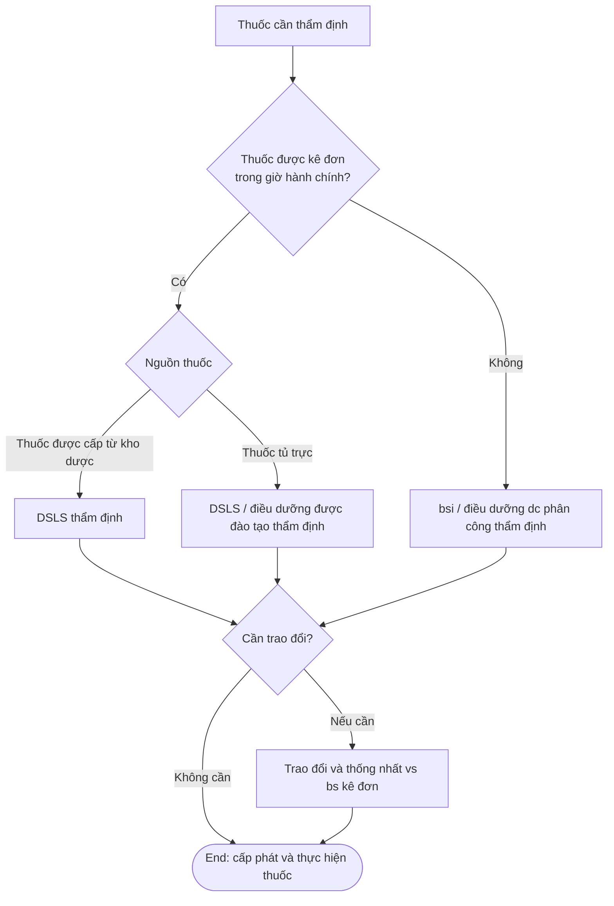
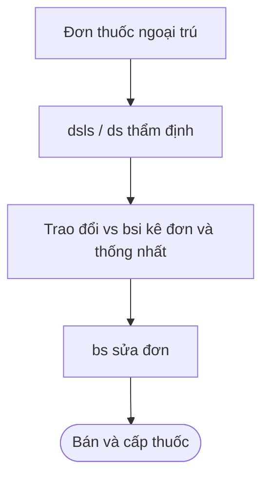

# Khảo sát các tổ trong khoa dược về các vấn đề và quy trình hiện hành

# 1. Công việc kho (kho nội trú)

**Người hướng dẫn: Chị hiền tổ kho nội bộ**

Các đầu việc trong côgn việc kho nội bộ gồm:
#### 1.1. Kiểm soát tồn kho

Gồm các phần con như:
- Xuất kho nội bộ (chưa biết xuất kho cho đâu, cơ chế rõ ràng, hoặc đã quên)
- Dự trù hàng (có thể là dự trù hàng hóa để phân phát thuốc)
- Theo dõi tồn kho, theo dõi hàng hết

##### 1.1.1. Dữ liệu và thao tác kiểm soát tồn kho

--bổ sung-- (Ghi chép ngày 31/10)

- Từng tầng có kho riêng, khả năng giới hạn số lượng lớn nhất có thể tồn cho các kho (đã xác nhận)
- Được cho xem ví dụ dữ liệu về kiểm soát tồn kho của tầng 6. Và thống kê tồn, xuất của tầng B1 và tầng 6
- Trong file chị dược sĩ có lấn cấn [???], giả sử hiện tại ban đầu dữ liệu tồn xuất tầng B1 và tầng 6 đã có. Thì khả năng cao sẽ đến từ việc làm theo checklist với các yêu cầu khác nhau để ra được cột số lượng chuyển
- Nhập thống kê bằng excel, rất tốn công sức và thời gian, hard code
- Đầu tiên có 1 file checklist mà người kiểm kho phải làm. Có thể như tổng hợp thông tin vào file excel (hiện là copy tay) để lấy dữ liệu. Copy xong sẽ thực hiện tính toán. Theo quan sát ở đây, làm việc với thuốc tồn/xuất<=1,...
- Hiện có 2 loại file là kiểm soát tồn kho và dự trù thường quy.

##### 1.1.2. Xác định nhu cầu xuất thuốc lên tầng

--bổ sung-- (Quan sát ngày 02/11)

- Nay được quan sát 1 file tiếp tục của lần trước. Kiểm soát tồn kho trên tầng 6
- Các file xuất khoảng 5 đến 10 ngày, trong đó những th phải xuất lên ngay
- File KSTK gồm:
    - Ngày trụ thực tế của tổng lượng thuốc, như tổng tồn, tổng xuất...(ví dụ tổng tồn là 5 và tổng xuất là 5, vậy trên lý thuyết có thể trụ được 10 ngày, nhưng nếu chỉ có mã aa chẳng hạn thì sẽ cần cân lại) (ví dụ b1 lên t6 7 mã aa, phải nhận về 7 mã ay, nên tổng tồn thực tế k lệch)
- Phải xác thực có cần xuất thật không, hay cần cân mã, cân mã nào
- Có ghi chú thuốc có 2 mã không, nếu có thì phải xuất lên
- Số lượng xuất dự kiến = cơ số max thuốc của kho - tổng tồn
- Thuốc có 2 mã có phòng mổ, trong nội trú chỉ sử dụng mã ay, nhưng khi lọc ra tồn ở tầng vẫn có aa, nên chỉ cần quan tâm mã ay
- Hoặc thuốc có 1 mã, như ac (thực phẩm chức năng) chỉ có 1 mã, nên chỉ quan tâm tồn/xuất có dưới 5 ngày k
- Quy cách ví dụ là 4, vậy đây là 1 hộp
- Ví dụ số lượng chuyển dự kiến là 17, quy cách là 4 vậy chuyển lên thực tế là 16
- Tỉ lệ tồn/xuất phải cân nhắc ngày, ví dụ. Bảng kiểm soát trong 5 ngày, tồn/xuất mà dưới 1 tức thuốc chỉ xuất đủ <5 ngày nên cần xuất lên
- Gồm các file:
    - Kiểm soát tồn kho
        - Có các trường: item code, item name, stock uom,
    - Dự trù thường chú

##### 1.1.3. Hệ số nhóm hàng trong dự trù thường quy

--bổ sung-- (Ghi chép ngày 31/10)

- Hệ số nhóm hàng càng thấp, hàng về càng nhanh, hàng có số như 2 là các hàng có cung cấp lâu, mua khó, nên tăng hệ số lên. Chỉ số (g) là đặt theo yêu cầu. Hàng khó mua. Hệ số cao, phải dự trù trước và nhiều. Hệ số 2 khả năng dự trù 2 tháng

#### 1.2. Kiểm soát thuốc cận hạn

Kiểm soát hạn sử dụng của thuốc nhằm điếu phối nhập xuất, điều phối cho các bên sử dụng thuốc và tiêu hủy nếu hết hạn

--bổ sung-- (Ghi chép ngày 31/10)

- Nhận biết hàng lô sắp hạn sử dụng. Khâu nhận hàng, hạn trên 1 năm sẽ tự nhận, hàng trên 1 năm sẽ nhận quyết định từ cấp trên [???]. Đặt hàng cũng do ảnh hưởng từ cung cầu. Hạn dùng

#### 1.3. Luân chuyển (Cần xác nhận lại nếu cần)
##### 1.3.1. Chậm luân chuyển

- Cần làm rõ hơn 1 chút về phần chậm luân chuyển, vì mục **1.3.2** cũng đang nó về luân chuyển thuốc hiếm, nhưng hiếm khi xảy ra. **Vậy luân chuyển ở đây là luân chuyển cái gì? giữa các cơ sở với nhau?**

- Ví dụ như phân phối hàng hóa giữa các cửa hàng, cửa hàng B có món bim bán chạy nhưng hay hết, cửa hàng A cùng cơ sở cũng món đó nhưng k bán chạy bằng, nên luân chuyển, đieiuf phối món bim qua bên B, giữu lại bên A 1 lượng nhất định

##### 1.3.2. Điều phối, luân chuyển thuốc khẩn cấp giữa các cơ sở (hiếm) 
- Ví dụ: Điều chuyển huyết thanh kháng nọc rắn khi cơ sở có bệnh nhân bị rắn độc cắn nhưng hết thuốc.
- Đã hỏi và phần này khá phức tạp vì mỗi cơ sở có 1 ID riêng, và thủ tục khá phức tạp

#### 1.4. Làm phiếu
Làm phiếu cho:
- Người bệnh
- Bàn tủ trực đêm

#### 1.5. Cân mã AA - AY

Cân mã aa, ay để cân lại thuốc khi sai lệch

Đối chiếu mã thuốc?

##### 1.5.1. Mã thuốc và hiện tượng âm ảo

--bổ sung-- (Ghi chép ngày 31/10)

- Mỗi hàng hóa có thể có nhiều mã khác nhau, như aa, ay, ad
- Dữ liệu có mã [caets???], item code thêm hậu tố AA, AY. Ví dụ như 06.02.01.0176, đại diện cho nội dung như số tầng, kho,... (giả sử). Mã aa có thể là đại diện cho khu vực lưu trữ có vòng đời hàng hóa. Ay có thể là mã số nhà sản xuất
- Thuốc có ít nhất 1 mã, nhiều nhất là 4 mã. Mã aa là thanh toán dịch vụ, thanh toán bảo hiểm là ay, daycare thì có thêm mã daycare. Cũng có daycare aa ay. Ví dụ hàng nhập xuất, nhập vào 100 mã aa. Nhưng kho vẫn phải xuất lên tầng 6 30 mã ay, 70 mã aa, nên gây ra âm ảo khi cập nhật vì 30 mã ay lấy từ 100 mã aa. Nên khi xuất lên mà k cập nhật thì sẽ coi như lấy 30 mã ay, 70 mã aa. Nên bị âm 30 mã ay dưới tầng kho

##### 1.5.2. Khó khăn khi cân mã để xuất thuốc

--bổ sung-- (Quan sát ngày 02/11)

- Khó khăn: mỗi thuốc có nhiều loại mã aa, ay, cả aa, ay. Ngoài ra có bộ mã aa, ay của daycare, tức mỗi bảo hiểm y tế có loại mã khác nhau.
- Phù hợp với tần suất gần đây để đảm bảo bác sĩ có đủ thuốc
- Có ngày toàn bệnh nhân nội trú, nên khi này mã bảo hiểm sẽ hết và dư mã dịch vụ
- Mất thời gian nhất ở phần cân mã, cân đối mã để xuất thuốc lên
- Cân mã hiện chỉ đang dạng cảm tính cân mã
- Có công thức rồi nhưng vẫn cần kinh [nghiệm???]

--bổ sung-- (Khảo sát ngày 04/11 - Theo dõi bên nghiệp vụ)

- Vào phòng nghiệp vụ dược, aa, ay cần kho nội trú [nói???] lại bên nghiệp vụ nói biết là mã gì
- Nội trú, 1 mặt hàng có mã thường và mã bảo hiểm, dựa vào dự trù kho như thế nào

##### 1.5.3. Vì sao dễ nhầm mã aa - ay (cách hiển thị dữ liệu và thiết kế phần mềm) - 02/11

--bổ sung-- (Theo dõi dữ liệu ngày 02/11)

- Khi theo dõi dữ liệu vào ngày 02/11, nhận ra cách hiển thị số lượng của mã aa, ay dễ gây nhầm lẫn (do tính chất dữ liệu trên excel). Ví dụ có 2 mã aa, ay:
    - Mã aa đang hiện = tổng aa + ay
    - Mã ay chỉ hiện đúng số của ay
    - Ngoài ra, mã aa còn có cả cột aa, ay; tương tự mã ay cũng có cả cột aa, ay
    - Vì vậy nhìn vào dữ liệu khó biết số nào là tồn thật của mã nào
- Với app cũ (eHost [tên chưa chắc???]): năm 2012 chỉ có ô tick hay không. Tick là bảo hiểm, không tick thì ngược lại (dịch vụ)
- Hiện nay có nhiều mã (aa, ay, daycare,...) nên việc phân biệt khó hơn nhiều so với chỉ tick / không tick
- OH cũng không nhận diện được aa, ay là 1 mặt hàng (do thiết kế hệ thống), nên mới có hiện tượng nhầm như trên `[bổ sung để xác nhận: hiểu là OH tính tồn riêng cho từng mã aa, ay, không gộp tồn chung dù là cùng 1 loại thuốc vật lý, nên khi cần xuất theo mã ay mà tồn đang nằm ở mã aa thì mã ay bị âm ảo ???]`
    - Liên quan: ghi chú 1.9 "Phần mềm OH k hiểu mã aa, ay…" (04/11)

#### 1.6. Kiểm tra thuốc hoàn trả

Kiểm tra thuốc hoàn trả hiện tại có khả năng theo 1 quy trình phúc tạp từ cả bên tổ bán thuốc đến nghiệp vụ rồi mới kho (cần làm rõ)

#### 1.7. Kiểm kê

#### 1.8. Kiểm soát vỏ, thuốc dư GNHT (Gây nghiện, hướng thần)

Thực hiện kiểm tra, kiểm đếm, đối chiếu, tiếp nhận và quản lý vỏ thuốc, thuốc dư thuộc nhóm thuốc gây nghiện, thuốc hướng thần tại các khoa lâm sàng; theo dõi, lập và lưu trữ chứng từ; phát hiện, báo cáo sai lệch và phối hợp xử lý, tiêu hủy theo quy định
- Các dầu việc này cx có liên quan đến tổ nghiệp vụ 

#### 1.9. Phần mềm OH và các trường dữ liệu kho

--bổ sung-- (Quan sát ngày 02/11)

- OH là phần mềm quản lý kho. Gồm:
    - Item code
    - Item name thuốc
    - Stock uom (bottle, tablet, vial...)
    - Bin location (vật tư, độc, n1, o.a, tủ lạnh hai,...)
    - On hand
    - Pending in
    - Pending out
    - Min
    - Max
    - Target
- [Quản lý tồn thuốc gồm ???] Ghi chú ngày phải làm tay (khó can thiệp)

--bổ sung-- (Khảo sát ngày 04/11 - Theo dõi bên nghiệp vụ)

- Mã daycare mới có từ khi đổi phần mềm
- OH hơn ehost, hệ thống hơn, quản lý trên toàn hệ thống thay vì bệnh viện
- Phần mềm OH k hiểu mã aa, ay. Phần mềm eHost [xuc???] có nút tick, quản lý tồn chung. OH k hiểu nên phải chia ra mã riêng và các phần tồn khác nhau

#### 1.10. Nhu cầu công cụ và các điểm cần làm rõ

--bổ sung--

- Cần tìm hiểu [nữa???]:
    - Hàng chậm luân chuyển cần làm rõ, luân chuyển giữa các cơ sở?
    - Hiện có công cụ hỗ trợ tổng hợp tài liệu nhiều nguồn chưa
    - Xác nhận quy trình làm phiếu cho người bệnh và bàn [thực???] đêm

--bổ sung-- (Ghi chép ngày 31/10)

- Quy trình làm việc. Chị trong này có nhắc file kiểm soát tồn kho/dự trù thường quy. Cần xác nhận lại quy trình để xem có vướng mắc k
- Hiện tại mỗi ngày, dược sĩ kiểm soát kho nội bộ phải làm các công việc lặp đi lặp lại, gồm làm theo checklist, upload, [voph???] parse dữ liệu, gắn các công thức tính toán hard code, check lại. Họ đang muốn 1 công cụ hỗ trợ tổng hợp, hoàn thiện dữ liệu, tránh việc lặp đi lặp lại, và đáp ứng những nhu cầu đột xuất, ví dụ như tầng 6 yêu cầu 2 thuốc a...

# 2. Nghiệp vụ

**Người hướng dẫn: Anh Đạt tổ nghiệp vụ**

Các chức năng nghiệp vụ:
- Hành chính giấy tờ
- Mảng pha chế chuyên thực hành, pha thuốc
- (thiếu do ghi chép chưa đủ)

**Phân làm 2 giai đoạn:**

- Giai đoạn tiền pha chế: có thể tìm những vấn đề thực trạng, như thông tin giấy tờ, nhãn, phiếu liên quan hệ thống 
- Giai đoạn pha chế: Việc pha chế thuốc là việc dược dĩ đảm nhiệm (làm thủ công), không thể can thiệp được bằng AI
2 chức naeng nghiệp vụ duoejc chuyên hành chínhg iaays tòe. Mảng pha chế chueyen theucj hanhg. Pha thuốc

## 2.1. Pha chế thuốc

#### 2.1.1. Pha chế thuốc

Pha chế thuốc cần các bước thủ tục như:
- Chuyển thông tin từ y lệnh thành sản phẩm pha chế. Như nhãn, phiếu để ra cách pha

Pha thuốc gồm có các thông tin như:
- Cách pha
- Số lượng
- Thời gian

#### 2.1.2. Y lệnh

Y lệnh hiện có là bản mềm. sau khi nhận được y lệnh từ hệ thống báo cáo của VMEC, dùng excel xử lý ra nhãn, phiếu để dán vào thành phẩm pha chế

#### 2.1.2. Thực trạng

Nghiệp vụ pha chế hiện:
- Làm chủ yếu thủ công bảng excel 

## 2.2. Hành chính giấy tờ, hóa đơn và thanh toán

#### 2.2.1. Hóa đơn và thah toán

Hiện tại, nhận hóa đơn và thanh toán chiếm nhiều khối lượng công việc:
- Hàng qua phòng nào, số lượng, loại như nào, tồn như nào,... để bác sĩ kê

Chủ yếu là nhập tay lên hệ thống của bệnh viện. Quản lý chung của cả Vingroup là SAP. từ đó kết nối về trang quản lý của bệnh viện.

#### 2.1.2. Báo cáo thống kê

Báo cáo thống kê có rất nhiều loại, và chủ yếu là làm tay, nặng nhất là báo cáo tổng kết khoa

Báo cáo được làm tay, lắp số liệu vào để làm slide báo cáo( như doanh thu, số lượng bán hàng, lỗi sự cố,... (trong tháng))

Hình thức báo cáo:
- Báo cáo toàn khoa với nhau
- Các bệnh viện với nhau
- Hàng tháng báo cáo với giám đốc dược
- một lần nữa với mọi người trong khoa với nhau để rút kinh nghiệm

Báo cáo gồm 1 file slide gồm 100 chỉ số hoạt động trong tháng của khoa.

## 2.3. Bảo hiểm

Bào hiểm có 1 trang riêng (vis.vmec.com (ví dụ)) để đưa thuốc bảo hiểm lên đấy
- Thôgn tin đưa lên đang được nhập tay
- Khi trúng thầu phải xây dựng danh mục thuốc để đẩy lên hệ thống

## 2.4. Kiểm tra công tác dược

Kiewmr tra công tác dược. Xuống kho thâyd thuốc nhìn , tuành khoa phòng có 1 tủ chưa thuốc riêng để dùng ngay khi cần. Đert huốc ở nơi nào cx phải tuân thủ quy trình bảo quản, ghi chéo sổ dách. Phải đảm bảo đúng quy trình nôik bộ, kiểm tra xem đúng theo quy tình k, như thuốc cận hạn vó dãn nhãn cận hạn k, sổ dách ghi chéo nhue lấy viên thuóc gây nghiẹn phải ghi vào trong sỏi, độ ẩm hẳng ngày ... hiệnddang xây dưnhj 1 checklist, 1 quý kiểm tra 1 lâng tổng hợp các lỗi đẻ áo cáo giám đopcs. Checklist gồm nhiều nopij dung. App checklist có nhièu khoa củng tổng hợp vheck, viết excel chấm và tổng hợp. Mỗi ngày hẹn tổ chực để đi kiewmr tra mã thuốc. Tùy nopi jdung tổ chực, ví dụ mỗi ngày ghi chép ư lần,... kiewmr tra luvs đopir ca giữa các điều dưỡng ghi lại thống kê như thuốc ành còn bao nhiêu viên, số lượng ocnf lại đẻ bàn giao. Ví dụ mỗi phongd sẽ có 1 cơ số riêng, nhue mỗi phòng khi bàn giao phải có 5 viên thuốc. Nếu có 4 viên khi bàn giao thù cơ số sẽ là -1 . Việc bù thuốc phòng là việc của kho. Việc check tưnhf phòng chie đếm. 

Hiện trạng:
- Từng khoa có 1 tủ chứa thuốc riêng để dùng khi cần

Quy trình:
- Thuốc để sẽ phải tuân thủ theo quy trình bảo quản, ghi chép sổ sách
- Phải đảm bảo đúng quy trình nội bộ, kiểm tra xem đúng theo quy trình. Ví dụ như:
    - Thuốc cận hạn có dán nhãn cận hạn không
    - Sổ sách ghi chép như lấy viên thuốc gây nghiện phải ghi vào trong sổ
    - Độ ẩm hằng ngày
    - ... 
    
Hiện đang xây dựng 1 checklist, 1 quý kiểm tra 1 lần, tổng hợp các lỗi để báo cáo giám đốc. Checklist gồm nhiều nội dung. App checklist có nhiều khoa cùng tổng hợp, check, viết Excel chấm và tổng hợp. Mỗi ngày hẹn tổ chức để đi kiểm tra mã thuốc. Tùy nội dung tổ chức, ví dụ mỗi ngày ghi chép 1 lần,... kiểm tra lúc đổi ca giữa các điều dưỡng, ghi lại thống kê như thuốc còn bao nhiêu viên, số lượng còn lại để bàn giao. Ví dụ mỗi phòng sẽ có 1 cơ số riêng, như mỗi phòng khi bàn giao phải có 5 viên thuốc. Nếu có 4 viên khi bàn giao thì cơ số sẽ là -1. Việc bù thuốc phòng là việc của kho. Việc check từng phòng chỉ đếm.

--bổ sung-- (Khảo sát ngày 04/11 - Theo dõi bên nghiệp vụ)

- Kiểm tra. Tồn kho, phân công từng nơi, ví dụ còn 80 tủ, mỗi ng dc chục tủ. [Nhưng???] bên riverside thì có mười mấy khoa, có thể 1 người đi duyệt hết.
- Có phần mềm riêng để điền theo dõi tồn, nhiều cơ sở sử dụng chung form, mỗi quý có nhiều đợt. Sau khi xong, đã có convert thành excel
- Có các lỗi phải tự nhập, hoặc chụp ảnh, xong làm báo cáo dựa theo thông tin. Ví dụ khoa phòng a có lỗi như abc,...
- Báo cáo gồm khoa phòng bị lỗi, chi tiết lỗi, tổng số lỗi. Đánh giá mức độ lỗi, số lỗi nghiêm trọng theo quý. Từ bảng track excel phải làm tay để qua bản báo cáo. Báo cáo có thể có các lỗi nghiêm trọng, các lỗi lặp lại
- Pain: từ bảng track hiện đang làm thủ công sang bảng báo cáo. Báo cáo có nhiều vấn đề trong quá trình, đổi theo từng đợt nên đang khó khăn và nhập tay

## 2.5. Hồ sơ tiêu chuẩn của bệnh viện

Hẳng năm, bệnh viện sẽ được chấm điểm với các tiêu chí (như tổ chức hoạt động, cơ sở vật chất, cung ứng, hội đồng thuốc,...). Mỗi mục có điểm từ 1-n để chấm điểm và được tổng kết lại để xếp hàng bệnh viện hẳng năm

Hồ sơ đánh giá bệnh viện hẳng năm sẽ có:
- Dạng hồ sơ cứng có thể cố định, như nội dung đánh giá k đổi theo thời gian
- Hồ sơ mềm, các mục có thể thay đổi theo năm (như đào tạo cán bộ nhân viên,...). Hồ sơ mềm phải có chứng minh để có thể chứng minh với sở

Rất ảnh hưởng đến xếp hạng và lợi ích của bệnh viện

## 2.6. Quản lý thuốc gây nghiện, hướng thần

Kiểm soát thuốc gây nghiện như morphin, các thuốc gây nghiện, hướng thần, thuốc hiếm. Ở dược khâu chính là báo cáo và xin phê duyệt, liên hệ Sở Y tế. Một năm dùng số lượng bao nhiêu, nhập xuất tồn như nào, có 1 form của Sở và gửi lại cho Sở. 1 năm 2 lần. Làm tay bằng Excel. 

## 2.7. Dự trù thuốc

Phần dự trù cũng phức tạp, ví dụ như hồ sơ dự trù gồm công văn, hồ sơ, báo cáo nhập xuất tồn thuốc. Phải ghi theo form nhà cung cấp, sai số sẽ gửi trả về, tức phải tuân theo quy chuẩn Sở Y tế, nhà cung cấp, hồ sơ phải có tính hợp lý. Xuyên suốt cả toàn khoa dược như kho, dược pha chế, bảo quản,...

## 2.8. APP của VFS

Sắp tới, bên VFS cũng có làm phần mềm riêng, gồm:
- Phầm mềm, mobule pha chế, tính toán liều lượng pha chế
- Điều phối giấy tờ 

Cần xem lại, vì:
- Không biết AI có giúp được gì không, cần liên hệ VFS để xem thêm được AI giúp được phần gì, mục nào
- Khi app on live, workflow có khả năng cx thay đổi (chưa làm rõ là thay đổi như nào, theo bệnh viện hay là theo app)

## 2.9. Tạo form điền BHYT (ghi chép ngày 05/11)

--bổ sung-- (Quan sát ngày 05/11, nghiệp vụ dược)

- Ngày hôm nay quan sát thêm các bước tạo form điền BHYT, gồm:
    - Nhận file thông tin hàng hóa từ nhà thầu
    - File excel đã có đủ thông tin từ nhà cung cấp (NCC), gồm các trường như:
        - nhà thầu, mã HIS
        - mã BHYT (nếu có - mã chuẩn của Bộ đã được public)
        - tên thuốc, đơn vị tính, hoạt chất (lấy từ dữ liệu nội bộ)
        - mã đường dùng, tên đường dùng (cũng là mã chuẩn)
        - tỷ lệ hưởng bảo hiểm y tế (thông tư 20 - cũng là thông tin chuẩn, tức là public: dữ liệu của Bộ đã được public)
        - thông tin khác (lấy từ file nhà thầu nội bộ)
    - Tra cứu hoạt chất trên thông tư 20:
        - nếu không có, bỏ qua
        - nếu có: ghi lại tỷ lệ % được BHYT chi trả
    - Tra cứu mã BHYT trong danh sách của Bộ
    - Ghi lại các thông tin: mã BHYT, tỷ lệ hưởng BHYT, mã + tên đường dùng

# 3. Dược lâm sàn và thông tin thuốc

Ngày khảo sát:
- ngày 29/10/2026
- ngày 30/10/2026

Tổ dược lâm sàn và thogn tin thuốc liên quan đến các hoạt động chăm sóc bệnh nhân. Mỗi dược dĩ sẽ đi 1 khoa lâm sàn. Bác sĩ kê đơn thuốc thì dược dĩ sẽ kiểm định theo các điều kiện phụ hợp với bệnh nhân, như:
- Phù hợp chứng năng gan thận
- Kiêng kỵ thuốc
- Đánh giá thuốc bác sĩ đúng chưa. Nếu đúng thì phê duyệt và chuyển sang bên cấp phát.

## 3.0. thông tin sơ lược

#### 3.0.1. Phiếu điều trị

**Phiếu điều trị gồm:** Ngày, theo dõi diễn biến, do ai kê đơn và kê như nào, người duyệt ký tên

Với phiếu điều trị, dược sĩ sẽ duyệt xem tại sao đơn thuốc lại được duyệt như thế, do nguyên nhân nào.
- Thiếu liều, sai liều. 
- Từng giờ, dữ liện bị lệch

- Ví dụ 1: bệnh nhân được bác sĩ kê uống kháng sinh, nhưng hồ sơ bệnh án của bệnh x lại chỉ báo là gãy xương. khi xét ngiệm mới biết là dược sĩ phải tìm nhiều tài liệu rời rạc và cuối cùng phát hiện ra là nước tiểu có vi khuẩn. nên kê kháng sinh được duyệt 
- Ví dụ 2: y lệnh kê đơn sáng và sáng hôm sau. sau khi dược sĩ dò ra thì do hệ thống duyệt thuốc tự dùng đơn sáng và tối, do cảm thấy liều bị sát nhau quá, gay ra tình trạng thiếu liều. Bác sĩ có khi không để ý điều này. Nên dược sĩ cần điều chỉnh lại, nhắc nhở bác sĩ bổ sung, kê thêm đơn tối

#### 3.0.2. Y lệnh

**Thông tin hiện có trong y lệnh:**
- Tên thuốc.
- Liều lượng.
- Cách dùng.
- Thời gian bắt đầu và kết thúc.
- Nguồn thuốc.
- Tầng lưu trữ.
- Phân chia theo hai ca trực.

**Tra cứu nguyên nhân kê thuốc:**

Theo quan sát hiện tại, phần y lệnh đang tra cứu chưa thể hiện trực tiếp nguyên nhân kê thuốc, tức là vì sao bệnh nhân được dùng thuốc đó. Thông tin giải thích có thể nằm ở phần theo dõi hằng ngày, một phần khác hoặc một ứng dụng khác; chưa xác định cụ thể vị trí lưu thông tin này. Chưa có căn cứ để kết luận bác sĩ không ghi nguyên nhân kê thuốc.

Để hiểu căn cứ kê thuốc và duyệt y lệnh, dược sĩ phải tìm, đọc và đối chiếu thông tin, tài liệu từ nhiều nguồn. Ví dụ 1 tại mục **3.0.1. Phiếu điều trị** cũng minh họa tình huống này: cần tra cứu thêm thông tin ngoài y lệnh để làm rõ lý do bệnh nhân được kê thuốc.

**Khó khăn ghi nhận:** Thông tin liên quan đến y lệnh và căn cứ kê thuốc còn **rời rạc**, khiến dược sĩ phải tra cứu nhiều nguồn thay vì xem được đầy đủ tại phần y lệnh.

#### 3.0.3. Hệ thống tra cứu hồ sơ và thông tin bệnh nhân

--bổ sung-- (Quan sát ngày 03/11)

- VIS là hồ sơ bệnh án điện tử [???], anh Trung [???] hết tra hồ sơ bệnh án trong đó có các phần như, VIS chứa y lệnh
- Mỗi bệnh nhân có 1 mã, và 1 tag như khẩn trương (yellow), trì hoãn (green), cấp cứu (red)) OH
- Mã bệnh nhân lấy từ OH. OH chứa đơn thuốc bsi kê (cần xác nhận xem có phải y lệnh không). Hiện trạng OH có các trường về quản lý bệnh nhân như:
    - độ ưu tiên priority mã 1, 2 (còn lại chưa biết)
    - status ??? (Locked hoặc trống)
    - event (need approve, còn lại chưa biết)
    - medication profile type (IPD prescription, còn lại chưa biết)
    - HN (dạng mã 9 số)
    - patient name (tên bệnh nhân)
    - item
    - ???
- Sau khi lấy mã bệnh nhân từ OH, tra cứu qua ERM

## 3.1. Quy trình dược lâm sàn

Quy trình trực tiếp khi có bệnh nhân mới vào sẽ phải:
- Tìm hiểu bệnh nhân, tiền sử thuốc, dị ứng,...
- Bệnh nhân có thuốc rồi thì tư vấn thuốc dựa theo thuốc trước đó
- Chia ra nhiều loại bệnh nhân như bệnh nhân phẫu thuật,...

Quy tình gián tiếp:
- Xây dựng quy trình, cung cấp thông tin thuốc
- Trả loài phòng ban, báo cáo theo quy định luật pháp sử dụng thuốc
- Nghiên cứu khoa học
- Đào tạo cán bộ

#### 3.1.1. Ghi chú quan sát ngày 30/10 – Hoạt động của dược sĩ

##### 3.1.1.1. Quy trình kiểm tra và duyệt thuốc của dược sĩ

**Bước 1. Tiếp nhận và kiểm tra y lệnh**

- Dược sĩ tiếp nhận y lệnh thuốc của từng bệnh nhân trên hệ thống.

- Kiểm tra thông tin y lệnh: tên thuốc, liều lượng, cách dùng, thời gian bắt đầu và kết thúc, nguồn thuốc, tầng lưu trữ và phân chia theo hai ca trực.
- Kiểm tra thông tin về phiếu điều trị, đường dùng thuốc (ví dụ đường truyền tĩnh mạch và các yếu tố có thể ảnh hưởng đến việc sử dụng thuốc)

**Bước 2. Kiểm tra hồ sơ bệnh án**

- Xem chi tiết hồ sơ bệnh án, bao gồm khoa điều trị, tình trạng bệnh, kết quả xét nghiệm và các thông tin liên quan.
- Đối chiếu thông tin bệnh án với y lệnh thuốc.
- Trao đổi với bác sĩ về tình trạng bệnh nhân nếu cần làm rõ thông tin.

**Bước 3. Kiểm tra kế hoạch sử dụng thuốc và tra cứu thông tin**
- Truy cập hệ thống nội bộ Vinmec để xem kế hoạch sử dụng thuốc của từng bệnh nhân.
- Kiểm tra tên thuốc, thành phần, liều lượng, cách dùng và lịch sử dụng thuốc.
- Tra cứu thông tin thuốc trên UpToDate và các trang chuyên ngành khi có nội dung chưa rõ.
- Sử dụng các trang chuyên biệt để tính toán liều lượng thuốc cho bệnh nhân.
- Tra cứu tương tác thuốc (Drug Interaction) để kiểm tra xung đột giữa các thuốc.
- Tra cứu luật, thông tư và quy định của Bộ Y tế liên quan đến việc sử dụng thuốc.

*Ví dụ quan sát:* Với bệnh nhân xuất huyết não cần phẫu thuật, dược sĩ kiểm tra tình trạng bệnh, đối chiếu thông tin phẫu thuật thần kinh sọ não với bệnh án và tra cứu các quy định liên quan đến thuốc được sử dụng.

**Bước 4. Kiểm tra và điều chỉnh thuốc**

- Đối chiếu y lệnh với tình trạng bệnh nhân, kết quả xét nghiệm và kế hoạch sử dụng thuốc.
- Kiểm tra tính phù hợp của thuốc, liều lượng, cách dùng và tương tác thuốc.
- Xem xét điều chỉnh liều lượng thuốc khi cần thiết.

##### 3.1.1.2. Ghi chú riêng – Hoạt động của điều dưỡng và nhà thuốc

Nội dung nghe được trong quá trình quan sát, chưa xác nhận quy trình cụ thể và không thuộc luồng duyệt thuốc của dược sĩ nêu trên.

- Điều dưỡng không được trực tiếp fill thuốc của nhà thuốc.
- Điều dưỡng phải báo qua nhà thuốc để tạo vé báo trước (cần xác minh lại cách gọi và thao tác thực tế).

#### 3.1.2. Cách làm việc thực tế khi rà soát hồ sơ

--bổ sung-- (Quan sát ngày 03/11)

- Anh Trung cần xem từng hồ sơ kỹ cũ bệnh nhân, xem qua tab thuốc đang active, tra thông tư, công bố thuốc cục quản lý dược
- Tra bảo hiểm y tế của imdur 60mg,
- Sau khi quan sát, chị Mai và các anh chị khác thì thường cần tra cứu mới tra, và lại tập trung đọc hồ sơ bệnh nhân, bệnh án rất nhiều, quy trình cứng ở trên là k sai, nhưng sẽ k phải lúc nào cx theo luồng đó

#### 3.1.3. Thẩm định y lệnh và cấp phát thuốc

--bổ sung-- (Quan sát ngày 03/11)

- Quy trình, vướng mắc trong quá trình fill thuốc
- Ngoại trú phải thẩm định tất cả thuốc, nội trú chỉ thẩm định 1 số loại, thuốc dùng lần đầu cho người bệnh, chu kỳ cấp phát thuốc 2 lần và k cần thẩm định y lệnh thuốc đó, như thuốc phòng mổ, phòng sinh,...
- Quy trình thẩm định y lệnh thuốc nội trú gồm:
    - Thuốc cần thẩm định
    - Thuốc được kê đơn trong giờ hành chính
    - Nếu có => thuốc tủ trực và thuốc được cấp từ kho dược
    - Thuốc được cấp từ kho dược => DSLS thẩm định => trao đổi và thống nhất vs bs kê đơn nếu cần
    - Thuốc tủ trực => DSLS/điều dưỡng được đào tạo thẩm định => trao đổi và thống nhất vs bs kê đơn (nếu cần)
    - Trao đổi và thống nhất bs kê đơn nếu cần => end cấp phát thuốc và thực hiện thuốc.
    - Nếu không, thuốc dc kê đơn trong giờ hành chính => không => bsi/ điều dưỡng dc phân công thẩm định => trao đổi và thống nhất vs bsi kê đơn nếu cần => end cấp phát và thực hiện thuốc
- Ngoại trú:
    - Đơn thuốc ngoại trú => dsls/ds thẩm định => trao đổi vs bsi kê đơn và thống nhất => bs sửa đơn => bán và cấp thuốc

**Sơ đồ – Quy trình thẩm định y lệnh nội trú** (vẽ lại từ ghi chú 03/11 ở trên; giữ nguyên lời, phần chưa chắc ghi `[???]`)

**Sơ đồ – Quy trình thẩm định đơn thuốc ngoại trú**

> Chú thích (không phải lời của bạn): ghi chú gốc xếp "thuốc tủ trực / thuốc cấp từ kho dược" dưới nhánh "Nếu có", còn nhánh "Nếu không" chỉ có bsi/điều dưỡng được phân công; sơ đồ vẽ đúng theo thứ tự đó. Nhánh "Không cần trao đổi → end" là suy ra từ chữ "nếu cần", ghi chú không nói rõ. `[chỗ này cần bạn xác nhận ???]`

#### 3.1.4. Phỏng vấn, tư vấn và theo dõi việc dùng thuốc

--bổ sung-- (Quan sát ngày 03/11)

- Dược sĩ phỏng vấn bệnh nhân, mỗi dược sĩ sẽ có 1 khoa phụ trách để lên các khoa, phỏng vấn bệnh nhân nếu cần
- Nếu bệnh nhân dùng thuốc khác, bsi sẽ phải hỏi lại nguyên nhân đổi thuốc, kiểm tra lại thuốc, điều chỉnh lại cho phù hợp, khuyên bệnh nhân
- Khi cho thuốc phải đánh giá đáp ứng của bệnh nhân như có dùng đúng k (để connect, tránh leo thang phác đồ khác); chưa hiểu thuốc thì phải giải thích cho bệnh nhân hiểu được; xử trí cho bệnh nhân tác dụng phụ, ví dụ uống thuốc bị cồn ruột, ăn chia nhiều bữa,... ví dụ thuốc tim uống xong tim đập chậm đi, cảm giác k có sức sống nữa, như xịt thuốc phải xem xịt vào họng hết hay vào phổi (vào phổi ms có tác dụng lớn nhất)
- K có thông tin thông báo đơn thuốc

#### 3.1.5. Theo dõi bệnh nhân ngoại trú

--bổ sung-- (Khảo sát ngày 04/11)

- Theo dõi bệnh ngoại trú dược lâm sàng 2h chiều
- OH kê đơn, thanh toán, ERM [arm???] hồ sơ bệnh án
- Quá trình theo dõi bệnh nhân ngoại trú như nào: k giám sát trực tiếp, thường
- Giả sử quy trình hiện tại là bsi, dược sĩ duyệt dc mới mua thuốc. Mua ngoài hoặc k mua thì sẽ k tính toán đến kho
- Nếu bị abc, nhắn zalo, tổng đài sẽ nối máy đến bsi, còn dược sĩ là ở sau
- Về vấn đề chờ 30p, khả năng là ra viện, bảo hiểm,...
- Có độ ưu tiên bệnh nhân, nhưng hầu hết là ngoại trú
- Trung bình duyệt đơn ngoại trú là 5 phút, nhưng k theo thứ tự, có nh[iều???] người đến trc thì sẽ được duyệt trc, có người delay 1 tiếng do k đến. Ưu tiên người đến trc. Y lệnh bsi sẽ ở đây theo thứ tự. Hoặc ưu tiên hơn cho các đơn đã lâu
- `[bổ sung để xác nhận: ngoại trú phân cấp mức độ ưu tiên đơn theo cảm tính của dược sĩ (ưu tiên người đến trước hoặc đơn đã chờ lâu). Nội trú: chưa biết dược sĩ có dùng priority/tag màu trên OH để sắp xếp thứ tự duyệt không, cần xác định]`
- Hiện k link được tình trạng dị ứng của bệnh nhân. OH và ERM, ERM thiếu dị ứng bệnh nhân. K cân [cần???] lại liều mà giám sát tác dụng phụ thuốc

--bổ sung-- (bản của thành viên khác)

Khoa Dược lâm sàng: Bệnh nhân ngoại trú:
- Hiện trạng: Chưa theo dõi dùng thuốc được. Theo dõi thông qua bệnh án khoa y lâm sàng. Khi NB có yêu cầu, thông tin được chuyển tiếp cho bác sĩ điều trị, not DSLS.
- Đề xuất của Ân: Bỏ dự án kênh chăm sóc bệnh nhân ngoại trú.
- Tình huống sự cố trải nghiệm khách hàng: Chưa rõ nguyên nhân. Bổ sung được một số insight về quy trình giữa các phòng:
- Đơn thuốc: Bác sĩ in trực tiếp cho NB, trong đó:
+ Có thể kê thuốc ko có tồn kho. Ghi "Thuốc mua ngoài"
+ NB cầm đơn xuống nhà thuốc // DSLS ngoại trú duyệt đơn
+ DSLS duyệt --> fill đơn vào billing của NB --> Trừ thẳng trên kho
+ NB ko lấy đủ theo đơn --> nhà thuốc thay đổi số trên billing --> tồn kho hồi phục
+ Sử dụng BHYT thanh toán: Hoàn thành trước thủ tục (Thu ngân, điều dưỡng), đến nhà thuốc chỉ lấy.
+ Các nguyên nhân có thể gây delay: Chờ duyệt, BHYT chưa xong, số lượng đơn chờ duyệt lớn.

#### 3.1.6. Báo cáo dược lâm sàng (bộ chỉ số)

--bổ sung-- (Quan sát ngày 03/11)

- Mai chị Mai nhờ xem báo cáo tháng, có nhiều phức tạp, báo cáo theo chỉ số chuyên môn của bsi đã đăng ký, có 1 bộ chỉ số, mai hỏi anh Thạch

--bổ sung-- (Khảo sát ngày 04/11)

- Làm báo cáo tổng kết dược lâm sàng, khảo sát 2.08 chiều [???]
- Anh Thạch cần làm báo cáo
- Hàng tháng làm 1 bộ báo cáo của dược lâm sàng. Bộ chỉ số báo cáo
- Bộ chỉ số, cứ cuối tháng thu thập dữ liệu trong tháng để đem đi báo cáo. Để ra được file cần 1 số [???]. Tổng hợp dữ liệu đang k có 1 hệ thống chung để lấy mà phải thu thập rất nhiều nguồn, nhiều link khác nhau, có những nguồn cả bên khác nữa gây mất thời gian. Ví dụ như OH, cuối tháng xuất ra tất cả thuốc được kê trong đấy, xuất từ phần mềm kê đơn OH xuống,. Từ file được sơ bộ dc xuất, a phải dùng dữ liệu đó để tổng hợp chỉ số của dược lâm sàng
- Có 1 bộ chỉ số chung. Mỗi cơ sở làm khác nhau. Như mục a3, bên time city k làm
- Hiện tại anh tự chế công cụ để lọc ra những kháng sinh hạn chế đã được bs kê trong tháng trong tất cả thuốc dc kê.. thống kê xem bao nhiêu bệnh nhân đã dc hội chẩn. Để xác nhận hội chẩn phải mò vào ERM hồ sơ bệnh án. Xem bệnh nhân đã dc duyệt kháng sinh đó chưa. Thống kê số bệnh nhân k thỏa mãn, tính %. Hoặc tỷ lệ bệnh nhân ung bướu dc tư vấn chu kỳ đầu (giá trị). Những bệnh nhân tư vấn chu kỳ đầu dc 1 mã tư vấn...? Thiếu
- Vấn đề nói chung của anh: thống kê từ nhiều nguồn, ERM, OH, excel chứa bệnh nhân phẫu thuật,... để tổng hợp lại theo 1 file thống kê đã định nghĩa sẵn. Và sau đó tổng hợp lại làm báo cáo
- Ý tưởng a Thạch. Có phần mềm, vào chọn các chỉ số ra, tự list và tổng hợp, dược sĩ chỉ cần điền vào báo cáo
- Ai hỗ trợ xử lý về chuyên môn. Ví dụ bệnh nhân kê kháng sinh hội chẩn phải có biên bản hội chẩn, dược sĩ lên EMR, xem có phiếu hội chẩn k, xem biên bản hội chẩn đó có đủ tiêu chuẩn k (theo quy định bviện)
- Ví dụ tỷ lệ bệnh nhân phẫu thuật abc, k dùng dc file trên. Mà phải xuất ra file dữ liệu bệnh nhân phẫu thuật trong tháng
- Cần ai input bệnh án bệnh nhân. Quy trình của mình và hỗ trợ sàng lọc để [...???]
- Từng chỉ số của bản báo cáo do dược sĩ phụ trách xử lý, ví dụ dược sĩ khoa ngoại. Anh Thạch sẽ xử lý chỉ số cuối cùng, mất trung bình làm báo cáo khoảng 2 ngày
- DS chuyên môn làm luôn báo cáo hay chỉ tổng hợp thông tin và gửi a Thạch?
- A Thạch gửi file excel. DS chuyên môn vào xử lý ra chỉ số cuối để tổng hợp vào bản ghi chính (quy mô toàn bộ dược sĩ phòng dược lâm sàng). Báo cáo sẽ gửi chị Hải để check qua trc khi làm báo cáo
- `[bổ sung để xác nhận (mới khảo sát): file excel nhận từ các dược sĩ khác, tức dược sĩ phụ trách khoa nào (ví dụ khoa tim) thì gửi chỉ số thống kê của khoa đó (không phải nhận qua email từ khoa khác như ghi chú thành viên khác ở trên) ???]`
- Info.vmec quản lý sự cố thuốc, tác dụng phụ thuốc.

--bổ sung-- (bản của thành viên khác)

Khoa Dược lâm sàng: Báo cáo DLS:
- Hiện trạng: Hàng tháng, khoa DLS phải làm báo cáo dựa trên bộ 17 chỉ số Dược lâm sàng, đánh giá Tỉ lệ được tư vấn/hội chẩn đúng quy trình của khoa. Tập trung theo từng khoa đc đánh giá (tương đương với DSLS phụ trách khoa đó)
- Workaround:
+ Sau khi xuất dữ liệu excel từ OH, sử dụng các công cụ excel tự xây dựng nhằm lọc các danh mục theo yêu cầu.
+ Anh Trung đang làm việc với VSF để bổ trợ một số tính năng
- Vấn đề:
+ Gom dữ liệu từ nhiều nguồn:
* Info Vinmec: Sự cố thuốc & tỉ lệ phát thẻ ADR (side effect?)
* OH + tool: Export dữ liệu sử dụng thuốc, lọc theo nhu cầu.
* Truyền miệng: Các thông tin đơn giản, số đếm nhỏ.
* Thông tin đào tạo: Dược sĩ phụ trách (đoán là lấy từ app đào tạo)
+ Dữ liệu nguồn lấy từ khoa khác (xlsx): Nhận qua email, phải mở ra tự xử lý theo format của khoa khác.
+ Mặc dù đã có tool lọc dữ liệu sau khi export từ OH, sau đó thông tin lại cần được đối chiếu lại với hồ sơ EMR theo tra cứu thủ công qua PID.
- Đề xuất: Ứng dụng chưa công thức tính 17 chỉ số (trừ các chỉ số đơn giản), đơn giản hóa tối đa các input đầu vào.
+ Dữ liệu EMR: Tự lấy ra bằng API, sau đó yêu cầu AI/bot đọc bệnh án theo keyword.
+ Dữ liệu OH: Tự lấy ra nếu được. Nếu không, yêu cầu attach phiên bản export trực tiếp từ OH vậy
+ Dữ liệu phòng khoa khác: Xem format, xử lý Excel qua đính kèm
+ Info Vinmec: Giống OH

## 3.2. Hiện trạng của tổ và đề xuất AI

#### 3.2.1. Hiện trạng

| Hiện trạng | Nội dung | Ảnh hưởng |
| --- | --- | --- |
| Áp dụng AI trong tổ | Đã áp dụng AI khá nhiều trong các công việc như tra cứu thông tin thuốc mới, tra cứu thuốc, skill,... | |
| Kiểm tra thuốc theo từng bệnh nhân | Dược sĩ kiểm tra thuốc, liều, dị ứng, cách dùng phù hợp chưa và các thuốc có xung đột nhau không. Nếu phát hiện không phù hợp sẽ hold y lệnh và trao đổi dược sĩ/bác sĩ theo thời gian thực. Muốn đổi thuốc sẽ chủ động liên lạc trực tiếp với người liên quan. | |
| Tra cứu thuốc chưa quen | Nếu thuốc chưa quen sẽ phải rà hết tất cả; tra cứu trên các trang như uptodate.com để tìm thông tin thuốc, liều nếu không nhớ. | |
| Chưa phân cấp mức độ y lệnh | Hệ thống chưa phân cấp mức độ y lệnh tùy theo mức độ bệnh nhân; ví dụ bệnh nhân cấp cứu, nguy kịch phải được duyệt sớm hơn. | |
| Rà soát từng y lệnh | Phải xem lại từng y lệnh, phân tích từng cái để kiểm tra có thiếu liều hoặc điểm bất thường không, bổ sung thông tin để bác sĩ xem khi cần. | |
| Giới hạn sử dụng AI với dữ liệu nhạy cảm | Không được dùng AI như Gemini để kiểm tra dữ liệu nhạy cảm như xét nghiệm bệnh nhân; thiếu công cụ nội bộ và AI nội bộ. | Chỉ dùng được với dữ liệu chung như thuốc, liều lượng. |
| Nhu cầu AI nội bộ cho thông tin bệnh nhân | Việc áp dụng AI với thông tin bệnh nhân nhạy cảm còn hạn chế; cần một hệ thống AI nội bộ để tra cứu, đối chiếu thông tin xét nghiệm bệnh nhân với liều lượng thuốc đề xuất. | |
| Chưa có công cụ tích hợp | Có nhu cầu tra cứu thông tin thuốc, xây dựng luồng nhưng chưa có công cụ tích hợp, chưa có công cụ hỗ trợ chính. | Phải sử dụng AI cá nhân, chỉ tra cứu được thông tin chung như tên thuốc; cá nhân phải tự chủ động làm. |
| Agent workflow | Xây dựng agent workflow đặc biệt như nghiên cứu khoa học, tổng quan công văn,... | |
| Thông tin tra cứu và điều kiện từng bệnh nhân | Các web tra cứu thuốc có đủ thông tin. | Với từng bệnh nhân và điều kiện khác nhau lại cần liều lượng và cách dùng khác nhau. |
| Khối lượng tài liệu, quy trình | Quy trình tài liệu được ghi nhận là quá nhiều; mong muốn có chatbot riêng để đọc và xử lý các vấn đề. | |
| Truy cập UpToDate trên điện thoại | UpToDate không làm việc được trên điện thoại do cần thiết bị công ty. | |
| Ngôn ngữ ứng dụng tra cứu thuốc | App tra cứu thuốc đang là tiếng Anh. | Đôi khi gây bất lợi cho bác sĩ khi tra cứu. |

--bổ sung-- (Quan sát ngày 03/11)

- OH chạy 5 test như CI/CD:
    - Lặp hóa chất [hoạt chất???] (dùng lại hóa chất đang dùng) (CSDL MIMS)
    - Tương tác thuốc (MIMS)
    - Phản ứng dị ứng (MIMS và MS)
    - Thuốc có đủ điều kiện chẩn đoán hay k (MIMS)
- Khi tra cứu thuốc ngoài cần mò. Ví dụ như thực phẩm chức năng sữa fresubin powder fibre (vanilla flavor), check thông tin khá lâu
- Thực phẩm chức năng chưa có dữ liệu lâm sàng, k có tương tác, tác dụng vs bệnh nhân, k có bằng chứng khẳng định có tác dụng. Tra cứu phải lên mạng tra. Chỉ tin cậy ở các nguồn đủ tin cậy, lo lắng về thông tin k tin cậy về thuốc, hoặc là lấy từ kho. Né các phần thông tin thuốc đang copy, tự soạn. Nguồn khá nhiễu loạn, nên cần xác nhận nguồn uy tín
- Thực phẩm chức năng k trong đơn thuốc, chỉ có trong phiếu tư vấn
- UpToDate tra thuốc, cả phác đồ điều trị, nhưng thiếu nhi[ều???] 1 chút trang thuốc có FDA,

#### 3.2.2. Đề xuất AI

##### 3.2.2.a AI hỗ trợ dược sĩ kiểm soát dược

`[bổ sung để xác nhận: ý 1 ở mục này có thể tách thành 2 phần: (1) tổng hợp thông tin (y lệnh, phiếu điều trị, hồ sơ bệnh án, xét nghiệm) và (2) hỗ trợ bác sĩ/dược sĩ sàng lọc y lệnh ???]`

AI có thể ứng dụng trong việc hỗ trợ dược sĩ kiểm soát dược. Cần hệ thống nội bộ dùng trong công ty. AI này có thể giúp:
- Check thông tin nhạy cảm của bệnh nhân (y lệnh, phiếu điều trị, xét nghiệm,...)
- Sàng lọc sơ cua xem đơn thuốc có phù hợp với hiện trạng bệnh nhân không (đề xuất thuốc nếu cần), có thể gồm: 
    - Kiểm tra, tư vấn dựa theo thuốc trước đó của họ
    - Kiểm tra tương tác thuốc, xung đột thuốc
    - Chỉnh liều thuốc cho từng bệnh nhân với từng bệnh lỹ khác nhau và điều kiện khác nhau (đề xuất)
    - việc điều chỉnh liều luộng thuốc và phần tương tác thuốc có thể ảnh hưởng đến nhau. ví dụ như 2 thuốc, nếu thuốc A đến 1 liều lượng nhất định sẽ gây hại ***(trong quan sát, để ý thấy dược sĩ chỉ làm 2 bước trên, nên cần xác nhận lại)***
- Dược sĩ duyệt cuối cùng. Mục đích chính vẫn là HỖ TRỢ dược dĩ kiểm soát, nhận định thuốc, giảm thời gian, duyệt các phần như trên đã nói

##### 3.2.2.b. Công cụ hỗ trợ tổng hợp thông tin thuốc, tra cứu thuốc từ nhiều nguồn, kèm theo xác nhận 

Tổng hợp thông tin thuốc từ nhiều nguồn thành 1 nơi duy nhất, tương tự như uptodate, nhưugn có tiếng việt và có thể làm việc trên điện thoại

`[bổ sung để xác nhận: nhu cầu tra cứu này đã được điều dưỡng xác nhận, nhưng bác sĩ ở các khoa riêng biệt thì ít dùng. Lý do: tiếng Anh hơi bất tiện trong 1 số trường hợp; 1 số trang như UpToDate cần tài khoản do bệnh viện cấp mới truy cập được, tức chỉ dùng trên thiết bị của bệnh viện, còn điện thoại cá nhân không phải thiết bị của bệnh viện ???]`

*Ghi chú:* Tài liệu chủ yếu là thông tin quốc tế được tổng hợp lại; theo ghi nhận của người khảo sát, các tài liệu này không bị vướng bản quyền.

##### 3.2.2.c. Tổng hợp lại

Cần 1 bộ công cụ AI giúp:
- Tổng hợp thông tin về bệnh nhân, bệnh án, đơn thuốc, quá trình đièu trị,...
- Hỗ trợ bác sĩ dược trong việc sàng lọc dược, liều lượng, tương tác thuốc và tương tác thuốc với liều vớ từng bệnh nhân và tình trạng hiện tại/quá khứ của bệnh nhân

AI gõ thể hỗ trợ dược sĩ:
- tiét kiệm, thu gọn lại bước duyệt qua nhiều tài liệu rời rạc, giúp các bước dược sĩ kiểm chứng và hiệu chỉnh nhanh hơn

#####################################
**Cần làm rõ:**
- hiện dược sĩ kiểm tra duyệt y lệnh, có ưu tiên 1 số bệnh nhân hơn không
- Phần hold y lệnh, ở đây là như nào? từ chối và báo lại bsi? hay điều chỉnh lại liều và báo bác sĩ?

#####################################

# 4. Nhà thuốc

**Người hướng dẫn: chị nhàn**

Nhập hàng thường theo lô

Hàng dự trù thường có 2 loại:
- Dự trù thừng quy 
- Dự trù đột suất

Quy tắc dự trù hàng:
- Số ngày tồn kho khôgn quá 39 ngày với lần 1? 30 ngày trong tháng và 9 ngày chờ hàng

Cấp phát thuốc không theo đơn tương tự như cấp phát theo đơn, nhưng dược sĩ phải hỏi bệnh để bán thuốc (thay cho bác sĩ)

1 ngày trung bình 750 lượt khách, trong đó khách bên ngoài chiếm khoảng 5%. mở cửa 24/7

## 4.1. Hiện trạng

- Kiểm soát tồn kho đang được nói là phức tạp, muốn có phần mềm để kiểm soát riêng
- Hệ thống bán thuốc quốc gia hiẹn chưa ổn định, nên viện chưa liên thông
- Zalo OA hiện đang là tài khoản chính để trao đổi, liên lạc với khách hàng thông qua hình thức online
- Hình thức thanh toán vẫn trên phầm mềm riêng của bệnh viện
- App nhắc lịch uống thuốc đnag chư có đủ nguồn lực để thực hiện. nhắc thuốc như liều lượng dùng, cách dùng,... có thểb áo cáo phản ứng thuốc
- App OH (phần mềm riêng bán thuốc của bệnh viện) chưa được liên thông lên hệ thống quốc gia, vẫn cần 1 bên thứ 3 để mở liên thông
- Chia thuốc thành các túi ZIP, hiện đang làm thủ công như thiết kế nhãn, công dụng, cách dùng,...
- Nghe nói quy trình phân phát thuốc vòa khoảng 10-12h sáng và 3-5.30h chiều đang bị quá tải khi phát thuốc.

## 4.2. Mong muốn giải pháp AI

- Tách riêng phần in nhãn thuốc ra khỏi hệ thống lớn

## 4.3. Dự trù hàng

**Giải thích viết tắt, thuật ngữ:**

- **DTTQ:** Dự trù thường quy.
- **DTĐX:** Dự trù đột xuất.
- **DT:** Dự trù.
- **SLDT:** Số lượng dự trù.
- **BC:** Báo cáo.
- **TB:** Trung bình.
- **BN:** Bệnh nhân.
- **TQ:** Thường quy.
- **tr:** Triệu; bảng không ghi rõ đơn vị tiền tệ.
- **i:** Ngày dự trù trong tháng.
- **MF:** Ảnh không giải thích ký hiệu này, chưa xác định ý nghĩa.
- **Xuất nhập tồn:** Số liệu xuất kho, nhập kho và tồn kho.
- **Quy cách:** Quy cách đóng gói của hàng hóa, dùng làm căn cứ làm tròn số lượng dự trù.

| | DTTQ | DTĐX | Ghi chú |
| --- | --- | --- | --- |
| **1. Nguồn dữ liệu** | | | |
| Xuất nhập tồn kho lẻ | 1 tháng | 10 ngày | |
| BC nhập hàng từ ngày 1 đến ngày dự trù | x | x | |
| Quyết toán chưa về | Trong tháng trước liền kề | Trong tháng | |
| Hàng loại trừ | x | x | |
| Hàng chia nhỏ DT | x | x | > 50tr thì chia 3 lần/ tháng |
| MF cập nhật | x | x | |
| Yếu tố khác | Hàng BN đặt mua | Hàng BN đặt mua | |
| **2. Công thức DT** | SLDT =Xuất TB 1 tháng * 1,3 - tồn - hàng chưa về - hàng chưa lên hệ thống ( làm tròn theo quy cách ) | SLDT = Xuất TB 10 ngày*(40 - i) -tồn - hàng chưa về - hàng chưa lên hệ thống | DTĐX lấy hệ số ngày dự trù (30-i) trước ngày 15 hàng tháng, từ ngày 15 lấy hệ số (40-i) Trong đó "i" là ngày dự trù |
| **3. Cập nhật mua hàng** | | | |
| Số ngày dự trù | <=15 ngày | <=10 ngày | Do chia nhỏ 2 lần TQ vào mùng 1 và 15 hàng tháng |

## 4.4. Phòng bán thuốc

--bổ sung-- (Khảo sát ngày 04/11)

- Phòng bán thuốc
- Chị bảo có khi robot chia thuốc trở thành dịch vụ thường quy được
- Dịch vụ đếm thuốc, chia thuốc cho khách hàng cả kho??
- 300000 1 tháng chia thuốc. 1 tháng 90 gói thuốc. Tức chia thuốc dài hạn. Chia mất tầm 2 3 tiếng, k nhanh
- `[bổ sung để xác nhận (ngày 05/11): chia thuốc zip hiếm khi có. 300.000 đồng cho 1 tháng, 90 gói thuốc (khoảng 30 ngày, tức 3 túi zip/ngày, khoảng 10.000 đồng/ngày). Chưa xác định được nguyên nhân hiếm khi có: có thể do giá cả và thời gian dược sĩ chia lâu ảnh hưởng đến trải nghiệm nên khách không cần; hoặc khách đã mua thuốc, có đơn rồi, tự bóc thuốc ra uống thì đơn giản hơn. Vì vậy mô tả "chia thuốc khoảng 100 lần/ngày" ở mục 4.6 (bản thành viên khác) có thể chưa đúng ???]`

## 4.5. Kiểm kê

--bổ sung-- (Khảo sát ngày 04/11)

- [1 mặt hàng trong kho k có 2 mã ???]
- Kiểm kê hiện tại chị bảo chưa ổn lắm. Mặc dù đã có mã thuốc. Hiện có tool kiểm kê nhưng. Có bất tiện như có 1 list sản phẩm, chỉ tạo [???] mã thuốc cho danh sách trên đây rồi. Nhưng có sự thay đổi về số lượng thì phải nhập lên để kiểm lại. Ví dụ data có tên, mã, số tồn kiểm kê, phát hiện lệch, thiếu. Mỗi lần tạo 1 kho kiểm kê, Ở lần thứ 2 kiểm kê k cần
- Muốn hệ thống tương tự siêu thị. Khi kiểm kê có 1 chip. Muốn tạo kho kiểm kê, sau khi nhập số vào có thể tra cứu được luôn, như danh sách kiểm kê lần 1 thiếu như nào, sau khi kiểm lần 2 thiếu như nào, có thể theo dõi quá trình và cập nhật.
- Hiện tại nếu lệch trên hệ thống phải tự đi kiểm, như phát thiếu, phát sai cho khách hàng. Lấy thiếu,.... nếu giao thừa khách phải lấy lại thuốc, giao thiếu phải bù để uống đủ liều
- Hiện tại mỗi lần kiểm kê tạo 1 bảng, sau 1 lần kiểm kê, tool chốt lại kho và phải nhập lại từ đầu. Phát thừa thiếu k kiểm tra ngay được, có khi đến 1 2 ngày. Tự s [???] phải theo dõi

## 4.6. Nhà thuốc (bản của thành viên khác)

--bổ sung-- (bản của thành viên khác)

Nhà thuốc: Có 2 bài toán:
1. Kiểm kê kho:
- Hiện trạng: Đang thí điểm app kiểm kê: Xuất file tồn hệ thống, Quét mã QR --> Điền tồn thực tế --> Tính chênh lệch vs hệ thống --> Tìm & xử lý chênh lệch
- Khó khăn:
+ Hệ thống thống kê cứng dữ liệu, chưa cho phép update sau khi xử lý sai lệch
+ Chưa theo dõi được số liệu theo thời gian.
+ Khi kiểm kê: Xuất tồn kho trước. Trong quá trình kiểm kê: số lượng có thể thay đổi
- Đề xuất giải pháp: Vẫn app cũ, theo dõi số liệu cũ, nhưng:
+ Cho phép sửa đổi hậu update.
+ Theo dõi liên tục theo từng lần kiểm kê
+ Khi kiểm kê: Điền tồn thực tế --> Đối chiếu hệ thống ngay lúc đó.

2. Phân chia thuốc:
- Hiện trạng: 1 ngày, DS nhà thuốc estimate khoảng 100 lần. Trong quá trình phân phát thuốc, DS nhà thuốc cần lấy thuốc từ lọ ra, chia thành túi zip để bệnh nhân đem về.
- Vấn đề: Phải đếm từng viên, đảm bảo đúng số lượng đầu ra. Với số lượng lớn (tự estimate khoảng 20 viên trở lên) dễ gây lẫn, NB nhận ko đúng số lượng, tạo sai lệch ở kho
- Đề xuất: Sử dụng thiết bị chia thuốc (dạng giống máy đếm tiền), đưa vào 1 lượng thuốc, nhập số viên muốn lấy, máy tự đẩy ra số viên đó

# 5. Quản lý dược

## 5.1. Vai trò và phạm vi công việc

--bổ sung--

- Quản lý dược có chức năng mua sắm, cung ứng. Thuộc cty VMEC, có chức năng mua sắm có chức năng cung ứng cho toàn bộ Time City VMEC
- Vai trò như quản lý danh mục như mua sắm toàn bộ hệ thống, mua sắm được gồm nhiều bước, quản lý danh mục, hợp đồng, đơn mua, đơn bán
- Mảng thứ 3 là triển khai 1 số hoạt động ngành dọc, mang tính dự án
- Mục 4 là setup các bệnh viện mới và quản lý quy định
- Quản lý dược chỉ có vai trò hỗ trợ, tham gia vào quy trình trong phần 1 trong kho, như luân chuyển chậm, luân chuyển giữa các cơ sở

## 5.2. Quy trình cung ứng và dự trù đặt hàng

--bổ sung--

- Quy trình cung ứng có [cai tèo???] như xây dựng danh mục, danh mục gì, mua sắm trong nhiều năm, như quản lý giá, mua nhà cung cấp nào, đấu thầu thuốc,... và tiến hành mua sắm thuốc như hợp đồng nguyên tắc, trong đó có giá và mua bán được nhiều lần, có các công thức mua sắm, công thức dự trù đặt hàng, sau đó khoa dược tính toán công thức dự trù đặt hàng xem cần bao nhiêu, xin quản lý dược duyệt
- 1 tháng gồm 1 đến 2 lần dự trù thường quy
- Cung ứng gồm ngân sách, xuất nhập tồn, mùa vụ, dịch bệnh, ngày lễ

## 5.3. Danh mục, giá và hợp đồng

--bổ sung--

- Quản lý giá, quản lý giá nhập. Bán theo quy định
- Quản lý danh mục, mặt hàng này là về cấu tạo, đặc điểm, xuất xứ,... đặc tính của sp. Vấn đề là đặc tính sp thay đổi liên tục, ví dụ ban đầu hàn quốc, sau đổi thành trung quốc,...
- Giá, quản lý giá của nhà cung cấp này với giá như nào
- Hợp đồng ghi rất nhiều khoản, theo năm tài chính như đầu năm đến cuối năm,... từ đó đề xuất tăng giảm giá

## 5.4. Phân biệt với nghiệp vụ dược

--bổ sung--

- Nghiệp vụ dược khác gì với quản lý dược. Nghiệp vụ dược quản lý hóa đơn, nhập kho, phối hợp kiểm toán và thanh toán. Còn quản lý dược liên quan đến quản lý mua do ai, phạm vi kinh doanh, mã số thuế, bán giá bao nhiêu,...

## 5.5. Kiểm soát chi phí và điều phối mua sắm

--bổ sung--

- Cần tối ưu chi phí nhập dự trù hàng hóa. Chia nhỏ từng đợt dự trù. Can thiệp chủ động của quản lý dược để cắt bớt ngân sách, kiểm soát cho các lần dự trù lần sau, kiểm soát hàng hóa, tìm cách xử lý
- Vấn đề [ngưu???] cần cảnh báo trc, như mùa vụ sắp tới, cung cầu như nào,... để điều phối mua, tài liệu đang ở nhiều nguồn khác nhau, cảnh báo hàng luân chuyển, chậm luân chuyển, dùng chậm, hàng ship chậm,
- Chiến tranh của thế giới ảnh hưởng, thuốc hiếm,...
- Hà Nội còn giao thuốc luôn được, nhưng phú quốc hay cần thơ thì lâu hơn

## 5.6. Mong muốn công cụ hỗ trợ

--bổ sung--

- Cần công cụ ai theo dõi lead time giao của nhà cung cấp, nhập. [Ucar???] dữ liệu. Cảnh báo người dự trù

# 6. Khảo sát bác sĩ khoa Dị ứng

--bổ sung--

- Y lệnh phụ thuộc thăm khám bệnh nhân, hồ sơ bệnh án. Kê thuốc phụ thuộc tương tác thuốc, ví dụ thuốc mới kê và theo thời gian, đơn thuốc trc xem có tương tác không
- Bác sĩ có thể kê kháng sinh hơi quá tay, hoặc phiếu chưa rõ, cần dược feedback. Bác sĩ sẽ nắm rõ tình trạng bệnh nhân hơn, dược sẽ nắm rõ phổ thuốc hơn
- Nên hỏi các thuốc bác sĩ dễ bị nhầm
- OH, bsi đang kê đơn cho bệnh nhân đi khám 2 khoa, bác sĩ bên kia cx đang kê, 2 người cùng vào cùng lúc thì k kê được

# 7. Ghi chú chưa sắp xếp được (cần xem lại thủ công)

- [Tool hiện nay gặp chị Mến ???] (cuối ghi chép kiểm kê nhà thuốc ngày 04/11, mục 4.5)
- [Quản lý tồn thuốc gồm ??? / Ghi chú ngày phải làm tay (khó can thiệp)] (đã đặt tạm ở mục 1.9, ghi chép 02/11; câu "Quản lý tồn thuốc gồm" bị bỏ trống)
