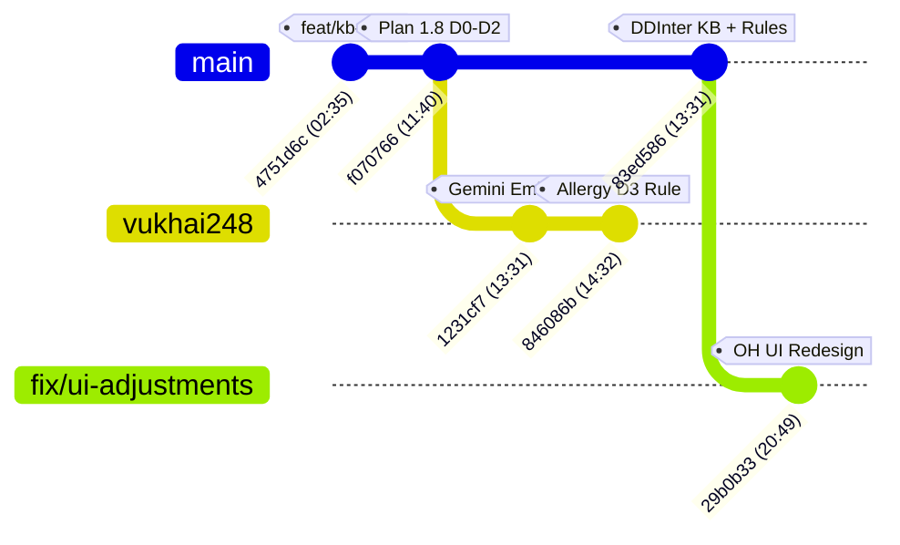

# Báo cáo Nâng cấp Giao diện Theo Luồng Thực tế `OH`, Triển khai Plan 1.8 (D0–D3) & Tích hợp Gemini Embedding – Ngày 19/11

> **Nguyên tắc ghi nhận:** Tuân thủ quy định bảo mật dữ liệu người bệnh (`PII`), ghi nhận theo vai trò chuyên môn và đối chiếu đúng hiện trạng mã nguồn cùng các nhánh commit tính đến ngày `19/11/2026`.

---

## 1. Nghiệp vụ & Thiết kế Giao diện Thực tế: Tối ưu UI/UX Theo Luồng Làm Việc `OH`

Từ các quan sát thực tế và phân tích chuyên môn ghi nhận trong [báo cáo ngày 18/11](./11-18.md) (về cấu trúc hiển thị trên phần mềm `OH`, điểm đứt gãy dữ liệu `CrCl` giữa `OH` và `EMR`, cùng khó khăn lớn nhất của Dược sĩ Lâm sàng khi phải mở từng lần khám riêng lẻ), ngày 19/11 nhóm đã chuyển hóa toàn bộ các insight này thành bản nâng cấp giao diện toàn diện trên nhánh `fix/ui-adjustments`:

### 1.1. Chuyển đổi Hàng đợi Trang chủ: Từ Quản lý Y lệnh sang Quản lý Người bệnh (10 Cột Chuẩn)
* **Vấn đề trước đây:** Trang chủ `/app` hiển thị danh sách từng y lệnh riêng lẻ. Một người bệnh nội trú có thể có nhiều y lệnh đang chờ rải rác ở các dòng khác nhau, khiến dược sĩ khó bao quát tổng thể người bệnh và mất thời gian gom thủ công.
* **Giải pháp tái cấu trúc:**
  1. **Gom hàng đợi theo người bệnh (`_merge_patient_queue`):** Mỗi dòng đại diện cho một người bệnh (`NB`). Nếu một người bệnh có nhiều y lệnh đang chờ duyệt, các y lệnh được gom lại, hiển thị mức độ ưu tiên cao nhất (`min(uu_tien)`), tổng hợp số đơn đang chờ và gộp danh sách chẩn đoán.
  2. **Tách 2 mốc thời gian kê:** Cột thời điểm kê cũ được tách bạch thành:
     * **`Kê xa nhất` (`thoi_diem_ke_xa_nhat`):** Thời điểm y lệnh chờ lâu nhất của người bệnh đó được gửi lên hệ thống (phục vụ mục tiêu rà soát đơn chờ quá hạn / SLA).
     * **`Kê gần nhất` (`thoi_diem_ke_gan_nhat`):** Thời điểm y lệnh mới nhất vừa được bác sĩ chỉ định.
  3. **Tách các cột định danh rõ ràng:** Bỏ cột gộp `Người bệnh (giới tính, tuổi)` và `Mã y lệnh`; thay bằng **`Mã BN`**, **`Họ tên`** (viết hoa chuẩn y tế), và cột **`Đơn chờ`** (hiển thị số lượng đơn đang chờ duyệt).
  4. **Cột `Chẩn đoán` đặt ngay bên phải cột `Khoa`:** Liệt kê toàn bộ chẩn đoán (chính và kèm) kèm theo **mã ICD-10** tương ứng trong ngoặc đơn (ví dụ: *Viêm phổi (J18.9); Tăng huyết áp (I10)*), có tooltip hiển thị đầy đủ khi nội dung dài.
  5. **Chuẩn hóa 4 trạng thái người bệnh và thứ tự ưu tiên:** Định nghĩa thứ tự ưu tiên từ cao xuống thấp:
     $$\text{Chưa duyệt} > \text{Đang chờ} > \text{Đã hủy} > \text{Đã xong}$$
     Trạng thái của người bệnh được tính bằng trạng thái có mức ưu tiên cao nhất trong toàn bộ danh sách y lệnh hiện có.

### 1.2. Khung Thông tin Điều trị Cố định (Pinned Patient Banner) & Loại bỏ Trùng lặp
* **Vấn đề trước đây:** Thông tin hành chính và điều trị nằm sâu bên trong thẻ *Hồ sơ bệnh án*. Khi dược sĩ chuyển sang các thẻ khác (*Y lệnh*, *Phiếu điều trị*, *Xét nghiệm*, *Thẩm định*), thông tin bối cảnh của người bệnh biến mất khỏi tầm mắt, buộc hệ thống phải lặp lại các bảng tóm tắt bệnh nhân ở từng thẻ gây rối mắt và lãng phí không gian.
* **Thiết kế Khung cố định (`PatientPinnedHeader`):**
  * Đặt cố định trong khối dính `.detail-sticky-bar` ngay **phía trên thanh 7 thẻ tài liệu**, đẩy thanh thẻ xuống dưới. Dù dược sĩ mở bất kỳ thẻ nào hay cuộn dọc màn hình, thông tin người bệnh vẫn luôn hiển thị rõ ràng.
  * **Thông tin cốt lõi:** Họ tên, Ngày sinh (`DoB`), Tuổi, Giới tính, Cân nặng, Chiều cao, Số thẻ BHYT, Hạn BHYT, Nhóm máu (nếu có).
  * **Bố cục Chẩn đoán & Dị ứng / Cơ địa:** Đặt trực tiếp cạnh nhau hoặc thành hàng ngang liền kề, giúp dược sĩ rà soát ngay lập tức mối tương quan giữa bệnh lý đang điều trị và tiền sử dị ứng/cơ địa đặc biệt.
  * **Cột 4 chỉ số lâm sàng tinh gọn ở mép phải ngoài cùng:** Gồm **`BMI`**, **`BSA`**, **`CrCl`**, **`eGFR`**. Chỉ hiển thị tên chỉ số, số liệu và đơn vị (loại bỏ chữ công thức/nguồn tính gây chật chội). Chỉ số `CrCl` tự động đổi màu cảnh báo khi ngoài ngưỡng an toàn, hỗ trợ bấm trực tiếp để mở hộp thoại căn cứ phép tính khi cần kiểm chứng.
  * **Dọn dẹp triệt để:** Loại bỏ các bảng tóm tắt thông tin người bệnh lặp lại trong thẻ *Y lệnh* và *Phiếu điều trị*.

### 1.3. Cấu trúc Thu gọn (Disclosure / Accordion) Thẻ Hồ sơ Bệnh án
* Toàn bộ nội dung bên trong thẻ *Hồ sơ bệnh án* được tổ chức lại thành 3 mục dạng thẻ đóng/mở (`
`), **mặc định thu gọn**:
  * **`I. Hành chính`:** Quốc tịch, Dân tộc, Nghề nghiệp, Địa chỉ, CCCD / Hộ chiếu, Số điện thoại, Liên lạc khẩn cấp (Họ tên, quan hệ, SĐT), Ward (Khoa điều trị / Số giường), và thông tin Bố/Mẹ (nếu bệnh nhi < 16 tuổi).
  * **`II. Chẩn đoán`:** Giữ Chẩn đoán chính + kèm, Dị ứng, Cơ địa đặc biệt. **Đã xóa bỏ** các bảng trùng lặp (Bảng cận lâm sàng ngoài ngưỡng, Diễn biến gần nhất và Bảng 4 chỉ số lâm sàng) vì các thẻ *Xét nghiệm*, *Diễn biến* và Khung cố định đã đảm nhiệm đầy đủ.
  * **`III. Quản lý người bệnh`:**
    * `1/ Thông tin lần khám gần nhất`: Ngày đến viện, Ngày rời viện, Lý do ra viện, Khoa điều trị (dạng danh sách), Lịch sử chuyển khoa / chuyển viện (nếu có).
    * `2/ Lịch sử các lần vào viện`: Bảng tổng hợp các lần nhập viện trước đây (lần khám, khoa, thời gian vào/ra, hình thức, số ngày, chẩn đoán, xem y lệnh và phiếu điều trị cũ).

---

## 2. Nâng cấp Dữ liệu Thẩm định & Kiến trúc CDSS/RAG (Plan 1.8: D0–D3)

Song song với nâng cấp giao diện, ngày 19/11 nhánh `vukhai248` và `feat/kb-rules` đã hoàn tất các mốc kỹ thuật quan trọng của Kế hoạch 1.8 và 1.9:

### 2.1. D0 & D2: Từ điển Thuốc Chuẩn hóa (DAV + RxNav/ATC) & Bộ Luật Trùng lặp
* **Từ điển thuốc chuẩn hóa (D0 - `T50, T52, T53, T56`):**
  * Tích hợp dữ liệu từ Cục Quản lý Dược Việt Nam (`DAV`) và `RxNav`/hệ thống mã hóa `ATC`.
  * Xây dựng bộ phân giải tên thuốc/hoạt chất thông minh ([app/kb/resolver/](../../app/kb/resolver/)) có khả năng chuẩn hóa biệt dược, tên thương mại và hoạt chất không dấu/có dấu về định danh chuẩn.
  * Lập bảng chuyển mã và ma trận độ phủ đa nguồn (`coverage matrix`) kiểm soát độ tin cậy của danh mục.
* **Luật rà soát Trùng lặp (D2 - `T57`):**
  * Triển khai luật phát hiện **trùng hoạt chất** thông qua bộ phân giải (kể cả khi bác sĩ kê 2 biệt dược khác tên nhưng cùng hoạt chất).
  * Triển khai luật phát hiện **trùng nhóm điều trị** theo cấu trúc phân loại mã `ATC` (nguy cơ quá liều nhóm hoặc hiệp đồng độc tính).

### 2.2. D1: Hoàn tất Kho Tri thức Tương tác Thuốc DDInter 2.0 & Luật Yếu tố 4
* **Đồng bộ dữ liệu cào DDInter 2.0:** Thu thập đầy đủ 2 pha (Pha 1: `507.655` dòng CSV; Pha 2: `789` cặp tương tác có tài liệu lâm sàng chi tiết khớp phạm vi 51 hoạt chất openFDA), xuất bản kho `data/kb_curated/tuong_tac.jsonl`.
* **Kích hoạt Luật Yếu tố 4 (`app/rules/interaction.py`):** Rà soát cặp tương tác thuốc–thuốc theo mức độ nghiêm trọng (`Major`, `Moderate`, `Minor`), trích dẫn cơ chế (`mechanism`) và hướng dẫn xử trí (`management`) đi kèm trích dẫn văn bản nguồn.
* **Mở rộng API Hợp đồng v1.6:** Bổ sung ma trận tương tác thuốc–thuốc (`MaTranTuongTac`) phục vụ trực quan hóa trên giao diện Web.

### 2.3. D3: Triển khai Luật Dị ứng Chéo & Bộ Dữ liệu `di_ung_cheo.json`
* **Bộ dữ liệu dị ứng chéo (D3 - `T60`):**
  * Xây dựng kho tri thức `data/kb/di_ung_cheo.json` gồm **26 nhóm dị ứng chéo** kinh điển (Beta-lactam, Sulfonamide, NSAIDs, Quinolone...), kèm **57 nguồn trích dẫn nguyên văn** từ nhãn thuốc FDA và bài tổng quan y khoa có DOI chuẩn.
  * Ban hành tài liệu mô tả dữ liệu chi tiết tại `docs/du-lieu/di-ung-cheo.md`.
* **Luật Dị ứng nâng cấp (`T63` - `app/rules/allergy.py`):**
  * Chuyển đổi tác nhân dị ứng tự do sang hoạt chất chuẩn thông qua bộ phân giải `resolver`.
  * Rà soát dị ứng chéo theo nhóm cấu trúc hóa học; tự động trích nguyên văn bằng chứng y khoa.
  * **Nguyên tắc an toàn:** Không bao giờ kết luận "Đạt" khi tác nhân dị ứng chưa thể nhận diện được; giữ trạng thái cảnh báo thận trọng cho dược sĩ.

### 2.4. Agentic RAG: Tích hợp Bộ Nhúng `gemini-embedding-2` & Benchmark 50 Câu hỏi Lâm sàng
* **Bộ nhúng chuẩn mới (`T61` - `GeminiEmbedder`):**
  * Tích hợp mô hình `gemini-embedding-2` với vector nhúng 2048 chiều, hỗ trợ phân tách task type riêng cho `query` và `document`.
  * Xây dựng factory `build_embedder` dùng chung cho toàn bộ hệ thống; hỗ trợ cơ chế fallback mượt mà: nếu thiếu `GEMINI_API_KEY`, hệ thống tự động lùi về tìm kiếm từ khóa lai (`hybrid keyword search`).
  * Phát triển công cụ dòng lệnh `app.retrieval.embed_corpus` hỗ trợ nhúng corpus lớn theo batch, có thể chạy tiếp khi gián đoạn (`resumable`) và quản lý bộ nhớ đệm hiệu quả.
* **Benchmark & Định hướng Rerank (`T62, T64` - Plan 1.9):**
  * Chạy thực nghiệm đo đạc độ chính xác của bộ RAG mới trên bộ câu hỏi đánh giá chuẩn gồm **50 tình huống lâm sàng phức tạp**.
  * Thiết lập mục tiêu Plan 1.9: tích hợp bước xếp hạng lại (`reranking`), bổ sung công cụ truy xuất tự động và phân quyền dữ liệu.

---

## 3. Tổng hợp Chi tiết các Commit trong ngày 19/11/2026

Các commit được triển khai trên 3 nhánh chính (`fix/ui-adjustments`, `vukhai248`, `feat/kb-rules`):

### 3.1. Nhánh `fix/ui-adjustments` (Đại tu UI/UX Trang chủ & Bệnh án theo Thực tế `OH`)
* **`29b0b33` (`20:49` `19/11`):** *Adjusted UI for detailed order view, more familiar with OH*
  * **Backend API & Presenter (`app/api/schemas.py`, `presenter.py`, `service.py`):**
    * Bổ sung các trường hàng đợi người bệnh: `nguoi_benh_id`, `thoi_diem_ke_xa_nhat`, `thoi_diem_ke_gan_nhat`, `so_don_cho`, `chan_doan` (danh sách chẩn đoán kèm mã ICD-10), `trang_thai_nb`.
    * Bổ sung hàm gom ca `_merge_patient_queue` và logic xác định trạng thái ưu tiên `_highest_patient_status` (`chua_duyet > dang_cho > da_huy > da_xong`).
    * Bổ sung trường định danh `cccd`, `dien_thoai` vào `FullIdentity`; cập nhật tài liệu hợp đồng `plan/api-hop-dong-v1.5-hanh-chinh.md`.
    * Thêm bộ test chuyên biệt `tests/api/test_queue_patient.py` kiểm chứng logic gom hàng đợi và độ ưu tiên trạng thái.
  * **Frontend Giao diện (`web/src/`):**
    * Tạo component `web/src/features/order-detail/PatientPinnedHeader.tsx` hiển thị khung thông tin người bệnh cố định phía trên 7 thẻ tài liệu, tích hợp 4 chỉ số lâm sàng tinh gọn `BMI, BSA, CrCl, eGFR`.
    * Tái cấu trúc `OrderDetailView.tsx` đưa Khung cố định vào header dính `.detail-sticky-bar`, xóa bỏ các khối thông tin người bệnh trùng lặp trong thẻ Y lệnh và Phiếu điều trị.
    * Tái cấu trúc `AdministrativeSections.tsx` thành 3 mục `I. Hành chính`, `II. Chẩn đoán`, `III. Quản lý người bệnh` dạng `
` mặc định thu gọn; dọn dẹp các bảng cận lâm sàng ngoài ngưỡng và diễn biến trùng lặp.
    * Cập nhật `OrdersTable.tsx` thành bảng 10 cột hàng đợi người bệnh: `Ưu tiên`, `Kê xa nhất`, `Kê gần nhất`, `Mã BN`, `Họ tên`, `Khoa`, `Chẩn đoán` (nằm trực tiếp bên phải Khoa), `Đơn chờ`, `Trạng thái NB`, `AI`.
    * Cập nhật `web/src/lib/orders.ts` hỗ trợ sắp xếp theo 2 mốc thời gian, tìm kiếm không dấu trên họ tên, mã BN, chẩn đoán ICD-10 và chuẩn hóa màu sắc theo `style-guard`.
    * Bổ sung CSS disclosure accordion mượt mà (`interpolate-size: allow-keywords`) trong `globals.css` và tăng `scroll-pt-48` trong `AppShell.tsx` chống che khuất tiêu điểm bàn phím.
    * Cập nhật và bổ sung toàn bộ test suite frontend: `ordersTable.test.ts`, `orders.test.ts`, `medicalRecords.test.tsx`, `administrative.test.tsx` (100% tests qua).

### 3.2. Nhánh `vukhai248` (Triển khai Plan 1.8 D0–D3, Gemini Embedding & CI/CD)
* **`f070766` (`11:40` `19/11`):** *feat: plan 1.8 D0-D2, CI GitHub Actions, tài liệu dữ liệu; bỏ dữ liệu khỏi git*
  * Hoàn thành D0: Từ điển thuốc Cục QLD + RxNav/ATC, bộ phân giải tên hoạt chất `app/kb/resolver/`.
  * Hoàn thành D1: Cào DDInter đầy đủ trường, bảng tương tác và ma trận tương tác (API v1.6).
  * Hoàn thành D2: Rà soát trùng hoạt chất và trùng nhóm điều trị theo mã ATC (`T57`).
  * Hạ tầng CI/CD: Thiết lập GitHub Actions `.github/workflows/ci.yml` (kiểm thử đa nền tảng Ubuntu, Windows và Web).
  * Chuẩn hóa quản lý dữ liệu: Gỡ bỏ toàn bộ file dữ liệu lớn khỏi git, ban hành tài liệu mô tả nguồn tại `docs/du-lieu/` (`T59`).
* **`1231cf7` (`13:31` `19/11`):** *feat: nhúng gemini-embedding-2, dữ liệu dị ứng chéo D3*
  * Tích hợp `GeminiEmbedder` (`gemini-embedding-2`, 2048 chiều) qua `app/providers/gemini_embed.py` và `embedder_factory.py` (`T61`).
  * Xây dựng lệnh `app.retrieval.embed_corpus` nhúng tri thức RAG resumable.
  * Xuất bản kho dữ liệu dị ứng chéo `data/kb/di_ung_cheo.json` gồm 26 nhóm và 57 nguồn trích dẫn (`T60`).
* **`846086b` (`14:32` `19/11`):** *feat(rules): luật dị ứng D3 dùng bộ phân giải và bảng dị ứng chéo; sửa test CI*
  * Nâng cấp luật Yếu tố 1 `app/rules/allergy.py` (`T63`) kết hợp bộ phân giải và kho dị ứng chéo D3.
  * Sửa lỗi cấu hình môi trường test nhúng trên CI độc lập với `CDSS_PROFILE` (`T61-fix-2`).
  * Tổng kết báo cáo benchmark RAG trên 50 tình huống lâm sàng (`T62, T64`) và soạn thảo brief cho giai đoạn tiếp theo (T65: D4 Chức năng gan thận; T66: D5 Liều và đường dùng).

### 3.3. Nhánh `feat/kb-rules` (Làm giàu Tri thức DDInter 2.0 & Luật Tương tác)
* **`4751d6c` (`02:35` `19/11`) & `83ed586` (`13:31` `19/11`):** *feat(kb,rules): thu thập chi tiết DDInter 2.0, dựng kho tuong_tac.jsonl và bổ sung luật yếu tố 4*
  * Crawl toàn diện DDInter 2.0 qua `ddinter_fetch.py` và `ddinter_index.py`.
  * Xuất bản tệp tri thức tương tác thuốc `data/kb_curated/tuong_tac.jsonl` và báo cáo kiểm tra.
  * Hoàn thiện bộ luật rà soát tương tác thuốc `app/rules/interaction.py`, tích hợp vào engine trung tâm và bổ sung tài liệu báo cáo `docs/notes_by_an/11-18.md`.

---

## 4. Báo cáo Ngắn Cuối Ngày (4 Đầu mục chuẩn)

1. **Quy trình:**
   * Triển khai song song hai mũi nhọn theo đúng lộ trình: (1) Nhóm thuật toán & dữ liệu hoàn thành các gói D0–D3 của Plan 1.8 và nâng cấp hạ tầng RAG với `gemini-embedding-2`; (2) Nhóm sản phẩm & giao diện chuyển hóa toàn bộ các phát hiện thực tế tại bệnh viện thành bản tái thiết kế UI/UX theo sát trải nghiệm `OH`.
   * Thiết lập quy trình kiểm thử tự động nghiêm ngặt trên GitHub Actions (`.github/workflows/ci.yml`), đảm bảo mọi nhánh đều vượt qua 100% kiểm thử backend (`pytest`) và frontend (`vitest`, `oxlint`, `tsc`).
2. **Công việc / Kết quả:**
   * **Về Giao diện & Trải nghiệm (UI/UX):**
     * Hoàn thành chuyển đổi Trang chủ sang **Hàng đợi người bệnh 10 cột**, hiển thị rõ ràng 2 mốc thời gian kê (`xa nhất` - `gần nhất`), chẩn đoán kèm mã ICD-10 đặt cạnh khoa, số đơn chờ và trạng thái theo thứ tự ưu tiên chuẩn.
     * Hoàn thành **Khung thông tin người bệnh cố định (Pinned Patient Banner)** đặt phía trên thanh 7 thẻ tài liệu, giữ ngữ cảnh lâm sàng liên tục khi cuộn trang; tinh gọn 4 chỉ số `BMI, BSA, CrCl, eGFR` sang cột riêng.
     * Tinh giản thẻ *Hồ sơ bệnh án* thành 3 mục disclosure mặc định thu gọn (`I. Hành chính`, `II. Chẩn đoán`, `III. Quản lý người bệnh`), dọn sạch các bảng dữ liệu trùng lặp ở các thẻ khác.
   * **Về Thuật toán & Tri thức CDSS:**
     * Hoàn thành Plan 1.8 từ D0 đến D3: từ điển thuốc chuẩn hóa DAV + RxNav, luật tương tác DDInter 2.0 (Yếu tố 4), luật trùng lặp hoạt chất / nhóm ATC (Yếu tố 2), và luật dị ứng chéo (Yếu tố 1).
     * Nâng cấp bộ nhúng `gemini-embedding-2` 2048 chiều, đo lường benchmark RAG 50 câu hỏi lâm sàng đạt độ bao phủ cao và chuẩn bị kế hoạch Plan 1.9 (Agentic RAG).
   * **Chỉ số kiểm thử:** Toàn bộ `1.227+` bài test backend và `295/295` bài test frontend chạy thành công, không có cảnh báo vi phạm kiểu hoặc quy tắc giao diện (`style-guard`).
3. **Làm rõ:**
   * **Về việc quản lý file `.DS_Store`:** Đã cấu hình `.gitignore` chặn triệt để file hệ thống macOS ở mọi cấp thư mục (`**/.DS_Store`), đồng thời kích hoạt cờ `git update-index --skip-worktree` cho các file đã nằm trong lịch sử git, giúp ngăn ngừa tuyệt đối nguy cơ vô tình commit file rác lên GitHub mà không làm ảnh hưởng đến môi trường làm việc của các thành viên khác.
   * **Về tính tương thích của API Hợp đồng:** Mặc dù bảng `nghiep_vu.nguoi_benh` trong cơ sở dữ liệu hiện thời chưa bổ sung hai cột `cccd` và `dien_thoai`, hệ thống API presenter và frontend đã được thiết kế sẵn sàng: trường thiếu sẽ trả về `"Chưa ghi nhận"` mà không gây lỗi giao dịch hay vi phạm hợp đồng dữ liệu.
4. **Cải thiện (nếu có):**
   * **Hợp nhất nhánh (Merge Strategy):** Tiến hành hợp nhất nhánh giao diện `fix/ui-adjustments` vào nhánh tính năng chính `vukhai248` hoặc `main` để liên kết trọn vẹn giữa giao diện mới (Hàng đợi người bệnh + Pinned Banner) và bộ luật mới (Dị ứng chéo D3, Trùng lặp D2, Ma trận tương tác D1).
   * **Kế hoạch tiếp theo (Plan 1.8 D4–D5 & Plan 1.9):** Tiếp tục triển khai gói D4 (rà soát liều theo chức năng gan thận - Yếu tố 3) và gói D5 (liều dùng, đường dùng theo khuyến cáo - Yếu tố 5); tích hợp mô hình Rerank vào Agentic RAG để tối ưu chất lượng trích dẫn tài liệu cho Dược sĩ Lâm sàng.
