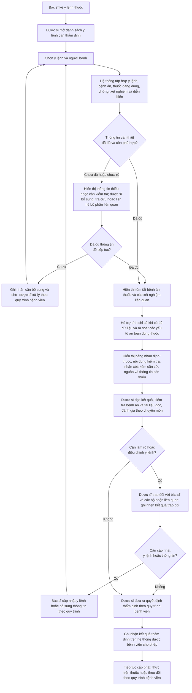
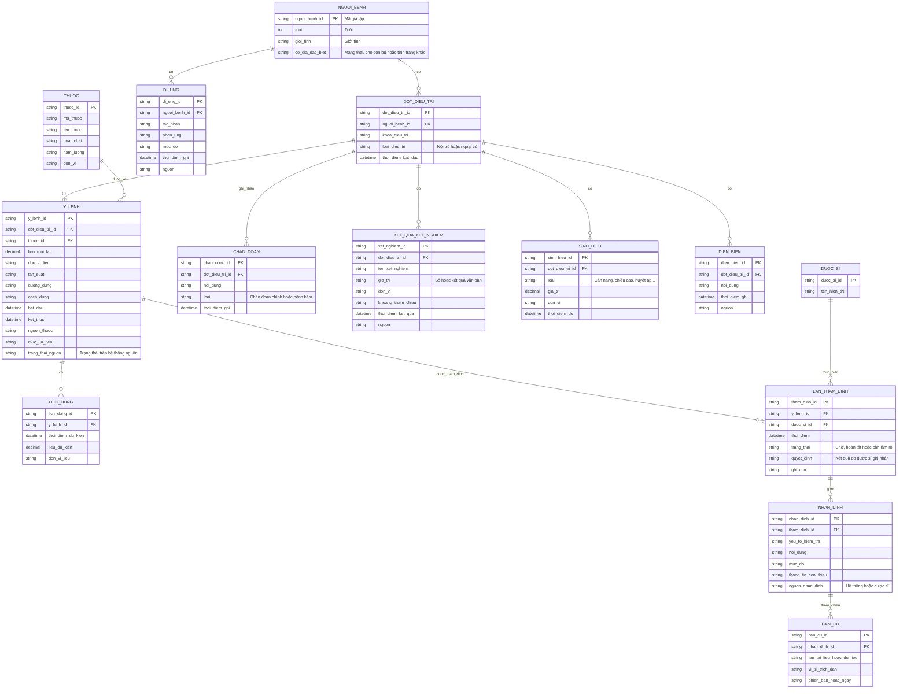

# Sơ đồ hệ thống hỗ trợ thẩm định y lệnh

**Phạm vi:** Bản đề xuất cho bài toán hỗ trợ dược sĩ lâm sàng tổng hợp thông tin và thẩm định y lệnh nội trú, có thể xem xét mở rộng cho đơn ngoại trú phức tạp. Căn cứ: ghi chép khảo sát, báo cáo tuần 2 và đề xuất dự án trong kho. Đây là thiết kế dự kiến, không khẳng định bệnh viện đã có kết nối hay cơ sở dữ liệu như dưới đây. Cách lấy dữ liệu, phạm vi sử dụng và quyền ghi kết quả cần bệnh viện xác nhận.

## 1. Quy trình vận hành dành cho dược sĩ

Hệ thống dự kiến hỗ trợ rà soát dị ứng, trùng thuốc, chỉ định và liều / đường dùng, tương tác, độc tính, chẩn đoán và xét nghiệm, chống chỉ định; đồng thời kiểm tra lịch dùng khi có dữ liệu. Kết quả hỗ trợ có thể thiếu hoặc cần kiểm chứng. **Dược sĩ chịu trách nhiệm đánh giá và quyết định; hệ thống không tự phê duyệt, thay đổi y lệnh hay tự cấp phát.** Việc kết nối OH / EMR và cập nhật kết quả hiện chỉ là đề xuất; trước mắt có thể thử bằng dữ liệu giả lập.

## 2. Sơ đồ dữ liệu dự kiến

Sơ đồ dưới đây mô tả **mô hình dữ liệu đề xuất cho bản thử**, không phải cấu trúc thật của OH hay EMR. `PK` là khóa chính, `FK` là khóa liên kết. Các tên trường, quan hệ, nguồn và quyền truy cập cần đối chiếu với dữ liệu mẫu được phép sử dụng. Có thể không cần lưu bản sao mọi thông tin khi triển khai thực tế.

**Điểm cần xác nhận:** mã liên kết giữa OH và EMR; các trường thật, đơn vị và thời gian cập nhật; dữ liệu dị ứng, thuốc đang dùng và lịch dùng; cách lưu các chỉ số tính toán và trao đổi với bác sĩ; hình thức truy cập và ghi kết quả thẩm định. Một y lệnh có thể được thẩm định lại nhiều lần; bản ghi nhận định gắn với từng lần thẩm định để phân biệt kết quả.
