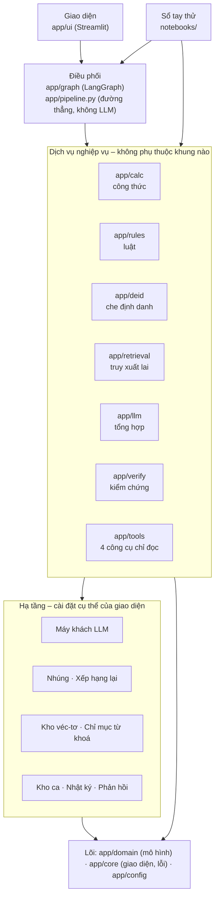
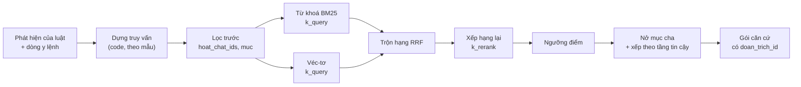
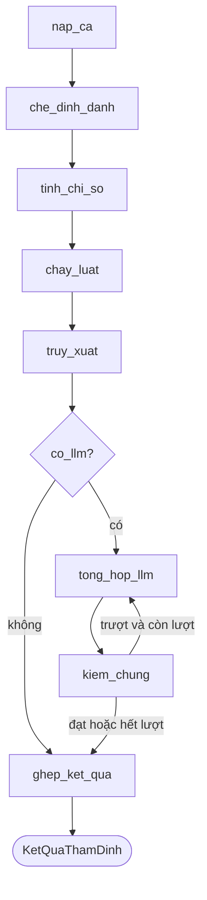
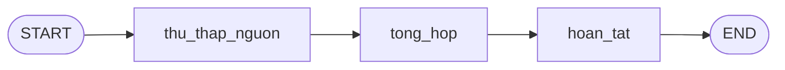

# PLAN 1.1 – KIẾN TRÚC CHI TIẾT

**Ngày viết:** 16/11/2026 · **Trạng thái:** người dùng đã duyệt hướng chung ngày 16/11 và chỉnh D2, D4 (xem mục 1). Giao diện có bản riêng: plan 1.2 (`plan-1.2-giao-dien-ui-ux.md`).
**Quan hệ với plan gốc (plan 1):** `plan-trien-khai-ai-agent-tham-dinh-y-lenh.md` vẫn là bản gốc cho bối cảnh, bảo mật, nguồn tri thức, đánh giá, lộ trình. Bản 1.1 này **thay** mục 4.4 (ngăn xếp) và Phụ lục B (cấu trúc thư mục) của plan 1, và **làm rõ** mục 4.2 (kiến trúc), 6.6 (quy trình nạp). Chỗ nào hai bản lệch nhau thì theo 1.1.

Những nguyên tắc của plan 1 không đổi: LLM không tự tính; phát hiện của luật không bị LLM xoá hay hạ mức; mọi nhận định qua kiểm chứng trích dẫn; dược sĩ quyết định; dữ liệu 100% giả lập; agent chỉ có công cụ đọc.

---

## 1. Các quyết định cần duyệt

| # | Câu hỏi | Đề xuất | Lý do ngắn |
| :-: | :--- | :--- | :--- |
| D1 | Có tổ chức theo đồ thị (LangGraph) không? | **Có, nhưng chỉ ở lớp điều phối.** Dùng `langgraph` cho đồ thị thẩm định và vòng lặp hỏi thêm. Không dùng chuỗi, bộ truy xuất hay bộ nhớ dựng sẵn của LangChain. Giữ `app/pipeline.py` làm đường chạy thẳng không LLM | Luồng B1 → B8 vốn là đồ thị cố định có một nhánh quay lại (kiểm chứng trượt → tổng hợp lại). Đồ thị cho sẵn trạng thái có kiểu, giới hạn số vòng, lưu vết từng nút. Logic nằm ở lớp dịch vụ nên bỏ LangGraph đi vẫn chạy được |
| D2 | Cơ sở dữ liệu | **Người dùng chốt 16/11: một PostgreSQL duy nhất, có `pgvector`, chạy trên Supabase** (người dùng tự cấu hình dự án Supabase). Dữ liệu thay đổi theo thời gian (ca bệnh, y lệnh hằng ngày, xét nghiệm, phiên AI, phản hồi) ở lược đồ `nghiep_vu`. Tri thức ít đổi (đoạn nguồn + véc-tơ, bảng tương tác, bảng liều, dị ứng chéo) ở lược đồ `tri_thuc`. Không dùng kho véc-tơ riêng | Kho chỉ vài nghìn đoạn nên tốc độ không phải tiêu chí; một PostgreSQL dễ phân quyền, sao lưu, kiểm toán và nối được dữ liệu ca với tri thức trong cùng câu truy vấn. Chi tiết ở mục 10 |
| D3 | Dùng mô hình nhúng và xếp hạng lại trên OpenRouter? | **Có, cho MVP**, sau giao diện `Embedder` / `Reranker`, kèm bộ đệm và đường lui BM25 | Đa ngữ, người dùng đã thử, có sẵn khoá. Ba điều kiện ở mục 6.4 |
| D4 | LLM | **DeepSeek gọi thẳng** (`api.deepseek.com`, khoá `DEEPSEEK_API_KEY`), một dòng trong cấu hình. Mặc định `deepseek-flash`; `deepseek-v4-pro` để so sánh | Đã gọi thử 16/11: tài khoản có đúng hai mã `deepseek-flash` và `deepseek-v4-pro` |
| D5 | Đơn vị cắt đoạn | Cắt theo **cấu trúc tài liệu**, không theo số ký tự. Số ký tự chỉ là trần an toàn | Mục 5 |
| D6 | Dữ liệu ca bệnh có đưa vào kho véc-tơ không? | **Không.** Ca bệnh là dữ liệu có cấu trúc, lấy theo mã bản ghi | Mục 5.6 |
| D7 | Phong cách code | Hướng đối tượng theo giao diện (`Protocol`), tiêm phụ thuộc qua một nơi lắp ráp. Hàm tính và luật vẫn là hàm thuần | Mục 3 |
| D8 | Sổ tay `ipynb` | Mỗi tầng một sổ tay để thử tay; `pytest` vẫn là cổng nghiệm thu | Mục 9 |

---

## 2. Kiến trúc phân lớp



Quy tắc phụ thuộc (bắt buộc, kiểm bằng test ở mục 3.4):

1. Mũi tên chỉ đi xuống. `app/domain`, `app/core`, `app/calc`, `app/rules` **không** import `langgraph`, `psycopg`, `streamlit`, hay máy khách HTTP.
2. Dịch vụ chỉ biết **giao diện** ở `app/core/interfaces.py`, không biết lớp cài đặt.
3. Chỉ `app/container.py` được tạo đối tượng hạ tầng. Giao diện, đồ thị và sổ tay đều xin đối tượng từ đây.
4. Chỉ `app/config` được đọc tệp cấu hình và biến môi trường.

---

## 3. Quy ước hướng đối tượng

### 3.1. Giao diện lõi (`app/core/interfaces.py`)

Dùng `typing.Protocol`. Mỗi giao diện nhỏ, một việc.

| Giao diện | Phương thức chính | Cài đặt MVP | Cài đặt về sau |
| :--- | :--- | :--- | :--- |
| `LLMClient` | `complete_json(messages, schema) -> dict` | `DeepSeekLLM`; `FakeLLM` cho test | Mô hình tại chỗ |
| `Embedder` | `embed_documents(texts)`, `embed_query(text)` | `OpenRouterEmbedder` bọc `CachedEmbedder`; `HashEmbedder` cho test | Mô hình tại chỗ |
| `Reranker` | `rerank(query, passages, top_n)` | `OpenRouterReranker`; `NoopReranker` | Mô hình tại chỗ |
| `VectorStore` | `upsert(chunks, vectors)`, `search(vector, k, where)` | `PgVectorStore`; `InMemoryVectorStore` (numpy, cho test và khi chưa bật PostgreSQL) | — |
| `KeywordIndex` | `build(chunks)`, `search(query, k, where)` | `Bm25Index` (trong bộ nhớ) | Tìm toàn văn của PostgreSQL |
| `Chunker` | `split(document) -> list[Chunk]` | Một lớp cho mỗi loại nguồn (mục 5) | Thêm loại nguồn = thêm lớp |
| `Retriever` | `retrieve(query: RetrievalQuery) -> list[RetrievedChunk]` | `HybridRetriever` | — |
| `Rule` | `ma_luat`, `yeu_to`, `check(ca, ctx) -> list[PhatHien]` | Bọc các module luật hiện có | Thêm luật = thêm lớp |
| `Tool` | `name`, `input_model`, `run(args, ctx) -> ToolResult` | 4 công cụ chỉ đọc | — |
| `Verifier` | `verify(nhan_dinh, evidence_pack) -> KetQuaKiemChung` | `CitationVerifier`, `NumberVerifier` | — |
| `CaseRepository` | `list_ids()`, `get(ca_id)` | `JsonCaseRepository` (đã có dữ liệu), `SqlCaseRepository` (PostgreSQL) | — |
| `AuditLog` | `record(event)` | `JsonlAuditLog` (chỉ siêu dữ liệu) | Bảng `PHIEN_AI` |

### 3.2. Quy tắc viết lớp

- **Tiêm phụ thuộc qua hàm khởi tạo.** Lớp không tự tạo máy khách, không đọc cấu hình, không đọc biến môi trường.
- **Một lớp một trách nhiệm.** `HybridRetriever` chỉ ghép kết quả; không tự nhúng, không tự cắt đoạn.
- **Dữ liệu qua ranh giới lớp là mô hình pydantic**, không phải `dict` trần.
- **Ưu tiên ghép hơn kế thừa.** Kế thừa chỉ dùng khi có khung thuật toán chung thật sự (ví dụ `BaseChunker` lo việc gộp mảnh nhỏ, gắn tiêu đề ngữ cảnh; lớp con chỉ lo tách theo cấu trúc nguồn).
- **Hàm tính ở `app/calc` vẫn là hàm thuần**, không bọc lớp. Hướng đối tượng dùng cho thứ có trạng thái hoặc có nhiều cài đặt thay nhau, không dùng cho công thức.
- **Lỗi có kiểu:** `app/core/errors.py` định nghĩa `ConfigError`, `ProviderError` (lỗi nhà cung cấp, thử lại được), `RetrievalError`, `VerificationError`, `DeidError` (đã có). Không nuốt lỗi; đóng khi lỗi ở cổng che định danh.
- **Đăng ký thay vì `if / elif`:** bộ cắt đoạn, luật, công cụ, nhà cung cấp đều đăng ký vào một bảng tra theo tên; cấu hình chọn tên.

### 3.3. Nơi lắp ráp (`app/container.py`)

```python
class Container:
    def __init__(self, settings: Settings) -> None: ...
    @cached_property
    def llm(self) -> LLMClient: ...
    @cached_property
    def embedder(self) -> Embedder: ...
    @cached_property
    def retriever(self) -> Retriever: ...
    @cached_property
    def rules(self) -> list[Rule]: ...
    @cached_property
    def review_graph(self): ...          # đồ thị đã biên dịch

def build_container(profile: str | None = None) -> Container: ...
```

`profile="test"` trả về bản dùng `FakeLLM`, `HashEmbedder`, `NoopReranker`: mọi test và sổ tay chạy được **không cần mạng, không cần khoá**.

### 3.4. Test kiến trúc

Một test tĩnh đọc cây import: `app/domain`, `app/core`, `app/calc`, `app/rules` không được import các gói `langgraph`, `psycopg`, `streamlit`, `httpx`, `openai`. Vi phạm thì test trượt. Đây là cách giữ kỷ luật khi nhiều agent cùng viết.

### 3.5. Xử lý code đã có

Không viết lại trước ngày 20/11. `app/calc`, `app/deid`, `app/domain` giữ nguyên. `app/rules` giữ nguyên các module; thêm lớp bọc mỏng theo giao diện `Rule` và một bảng đăng ký. `app/pipeline.py` giữ làm đường chạy không LLM và làm đường lui khi demo.

---

## 4. Cấu trúc thư mục (thay Phụ lục B của plan 1)

```text
Vinmec-PharmProject/
├─ config/
│  ├─ settings.yaml            # mọi tham số chỉnh được (mục 8)
│  ├─ settings.test.yaml       # ghi đè cho test: nhà cung cấp giả, không mạng
│  └─ prompts/
│     ├─ tong_hop.v1.md        # prompt có phiên bản; đổi nội dung = tệp mới
│     └─ hoi_them.v1.md
├─ app/
│  ├─ config/                  # Settings (pydantic), bộ nạp YAML + .env
│  ├─ core/                    # interfaces.py, errors.py, types.py
│  ├─ domain/                  # mô hình ca bệnh (đã có)
│  ├─ calc/                    # B3 (đã có)
│  ├─ deid/                    # B2 (đã có)
│  ├─ rules/                   # B4 (đã có) + registry.py
│  ├─ kb/
│  │  ├─ sources/              # bộ tải và đọc từng nguồn: openfda.py, byt_5948.py, duoc_thu.py
│  │  ├─ chunking/             # base.py, label_chunker.py, legal_chunker.py, table_chunker.py
│  │  ├─ models.py             # TaiLieu, Chunk, siêu dữ liệu
│  │  └─ build.py              # dựng kho: tải → cắt → nhúng → ghi (chạy bằng python -m app.kb.build)
│  ├─ retrieval/               # query_builder.py, hybrid.py, fusion.py (RRF), evidence_pack.py
│  ├─ providers/               # deepseek_llm.py, openrouter_embed.py, openrouter_rerank.py,
│  │                           # pgvector_store.py, memory_store.py, bm25_index.py, cached_embedder.py, fakes.py
│  ├─ llm/                     # synthesizer.py, schema.py (lược đồ nhận định), prompt_loader.py
│  ├─ verify/                  # citation.py, number.py, merge.py (ghép với phát hiện của luật)
│  ├─ tools/                   # lay_boi_canh.py, tinh_chi_so.py, tra_tuong_tac.py, tim_trong_kho.py
│  ├─ graph/                   # state.py, nodes.py, review_graph.py, ask_graph.py
│  ├─ storage/                 # db.py (kết nối), schema.sql, case_repo.py, kb_repo.py, audit_log.py, feedback
│  ├─ api/                     # FastAPI: hợp đồng ở plan/api-hop-dong-v1.md
│  ├─ container.py
│  ├─ pipeline.py              # đường thẳng không LLM (đã có)
│  └─ ui/                      # Streamlit (đã có)
├─ web/                        # bản web chính: Vite + React + TypeScript (plan 1.2 mục 7)
├─ notebooks/                  # mục 9
├─ data/
│  ├─ mock/  gold/             # ca giả lập và đáp án (đã có)
│  ├─ kb/                      # bảng luật có cấu trúc do dược sĩ duyệt (đã có)
│  ├─ kb_sources/              # tệp nguồn gốc + manifest.json (nguồn, ngày lấy, giấy phép, mã băm)
│  ├─ cache/                   # bộ đệm véc-tơ nhúng (không đưa vào git)
│  └─ runtime/                 # phản hồi, nhật ký (không đưa vào git)
└─ tests/                      # phản chiếu cây app/, thêm tests/architecture/, tests/redteam/
```

---

## 5. Chiến lược RAG – phần cắt đoạn

### 5.1. Trước hết: thứ gì đi qua RAG, thứ gì không

| Loại tri thức | Cách dùng | Lý do |
| :--- | :--- | :--- |
| Ngưỡng liều, mức chỉnh liều thận, cặp tương tác chống chỉ định, nhóm dị ứng chéo | **Bảng có cấu trúc** ở `data/kb/`, luật đọc trực tiếp. Không truy xuất bằng véc-tơ | Con số và cặp thuốc cần khớp tuyệt đối. Tìm theo ngữ nghĩa có thể trả về đoạn "gần đúng", với liều thuốc thì gần đúng là sai |
| Đoạn văn nguồn làm **căn cứ trích dẫn** và giải thích (chỉ định, cảnh báo, cơ chế tương tác, lưu ý nhóm đặc biệt) | **RAG lai** | LLM cần văn bản gốc để viết diễn giải và bước kiểm chứng cần chuỗi gốc để so |
| Dữ liệu ca bệnh | **Lấy theo mã bản ghi**, không nhúng (mục 5.6) | Là dữ liệu có cấu trúc, ít, cần đủ chứ không cần "gần nhất" |

Mỗi dòng trong bảng có cấu trúc đều mang `doan_trich_id` trỏ về đoạn nguồn trong kho, để luật báo phát hiện thì giao diện mở được đúng đoạn văn bản gốc.

### 5.2. Nguyên tắc cắt đoạn

1. **Ranh giới đoạn là ranh giới ý nghĩa của tài liệu**, không phải số ký tự. Mỗi loại nguồn một bộ cắt riêng.
2. **Đơn vị không được cắt** (dù vượt trần kích thước):
   - một bảng, kèm tiêu đề bảng và hàng tiêu đề cột;
   - một câu liều kèm điều kiện của nó (`CrCl 10–25 mL/phút: một nửa liều, mỗi 12 giờ`);
   - một danh sách gạch đầu dòng kèm câu dẫn đứng trước;
   - một mục tương tác (cặp thuốc + hậu quả + xử trí);
   - một cảnh báo đóng khung.
3. **Thông tin ngắn và liền mạch thì gộp, không tách.** Các mảnh anh em trong cùng một mục nhỏ hơn `min_chars` được gộp với nhau cho tới khi đạt cỡ mục tiêu. Một chuyên luận ngắn có thể chỉ thành 3–4 đoạn.
4. **Mục dài mới phải chia**, chia theo đoạn văn, rồi mới tới câu. Chỉ khi chia một mục dài mới có phần gối (`overlap_sentences`); **giữa hai mục khác nhau không gối**, vì gối qua ranh giới mục làm lẫn "chống chỉ định" với "thận trọng".
5. **Mỗi đoạn tự đứng được.** Trước khi nhúng, gắn tiêu đề ngữ cảnh do code sinh:
   `[Meropenem | Nhãn FDA MERREM IV | Dosage and Administration > Renal Impairment]`
6. **Tách hai trường văn bản:**
   - `noi_dung_goc`: nguyên văn từ nguồn, không thêm bớt. Dùng để hiển thị và để bước kiểm chứng so khớp chuỗi trích.
   - `noi_dung_nhung`: tiêu đề ngữ cảnh + `noi_dung_goc`. Chỉ dùng để nhúng và tìm từ khoá.
   Nếu trộn hai trường này, câu trích của LLM sẽ không bao giờ khớp nguyên văn.
7. **Cha – con.** Đoạn con (đơn vị tìm kiếm) mang `muc_cha_id`. Khi đưa cho LLM, có thể nở ra cả mục cha nếu mục cha dưới trần `parent_max_chars`; như vậy tìm thì chính xác mà đọc thì đủ ngữ cảnh.

### 5.3. Bộ cắt theo loại nguồn

| Nguồn | Lớp | Đơn vị đoạn | Ghi chú |
| :--- | :--- | :--- | :--- |
| Nhãn FDA (openFDA JSON, DailyMed SPL) | `LabelChunker` | Một tiểu mục của nhãn. Trường JSON của openFDA đã chia mục sẵn (`indications_and_usage`, `dosage_and_administration`, `contraindications`, `boxed_warning`, `warnings_and_precautions`, `drug_interactions`, `use_in_specific_populations`, …) | Ánh xạ tên trường về bảng `muc` chuẩn ở 5.4. Bảng trong nhãn giữ nguyên khối |
| Dược thư Quốc gia | `MonographChunker` | Một đề mục của chuyên luận (Chỉ định, Chống chỉ định, Thận trọng, Liều lượng và cách dùng, Tương tác thuốc, Thời kỳ mang thai, …) | Chỉ nạp khi có bản chính thức và quyền dùng (plan 1, mục 6.2). Liều theo từng chỉ định là một đơn vị không cắt |
| Văn bản Bộ Y tế dạng điều khoản | `LegalChunker` | Điều → khoản → điểm. Đoạn = một khoản; khoản ngắn gộp trong cùng điều | Tiêu đề ngữ cảnh ghi số hiệu văn bản, điều, khoản |
| Danh mục dạng bảng (QĐ 5948) | `TableRowChunker` | **Một dòng = một đoạn** (cặp hoạt chất + cơ chế + hậu quả + xử trí) | Đồng thời nạp vào bảng `TUONG_TAC` có cấu trúc. Luật dùng bảng; RAG chỉ để lấy nguyên văn làm căn cứ |
| Phác đồ, quy trình nội bộ | `HeadingChunker` | Theo cây đề mục của tài liệu | Chỉ khi khoa cấp; không rời mạng viện |

### 5.4. Siêu dữ liệu của một đoạn

```text
doan_trich_id        mã ổn định: băm của (nguon_id, phien_ban, duong_dan_muc, thứ tự)
tai_lieu_id          mã tài liệu
muc_cha_id           mã mục cha (để nở ngữ cảnh)
nguon                openfda | dailymed | byt_5948 | duoc_thu | noi_bo
tang_tin_cay         1 Bộ Y tế · 2 Dược thư · 3 nhãn FDA · 4 sàng lọc
hoat_chat_ids        danh sách hoạt chất đoạn này nói tới (để lọc trước)
muc                  chi_dinh | chong_chi_dinh | lieu | lieu_than | lieu_gan | tuong_tac |
                     canh_bao | thai_ky_cho_bu | nhi_cao_tuoi | tac_dung_phu | bao_quan_pha_che | khac
duong_dan_muc        "Dosage and Administration > Renal Impairment"
loai_noi_dung        van_ban | bang | danh_sach | dong_bang
ngon_ngu             vi | en
phien_ban_nguon      ngày hiệu lực của nhãn hoặc số hiệu văn bản
ngay_lay, giay_phep, url_goc, ma_bam
noi_dung_goc, noi_dung_nhung
```

`hoat_chat_ids` và `muc` là hai trường quan trọng nhất: chúng cho phép **lọc trước khi tìm**, biến bài toán "tìm trong cả kho" thành "tìm trong vài chục đoạn của đúng thuốc, đúng mục".

### 5.5. Tham số kích thước

Đếm bằng ký tự để không phụ thuộc bộ tách từ của một mô hình. Các số dưới đây là điểm khởi đầu, **phải chốt lại bằng sổ tay `02_test_chunking` và `09_eval`**:

| Tham số | Giá trị đầu | Ý nghĩa |
| :--- | :-: | :--- |
| `target_chars` | 1200 | Cỡ mong muốn khi gộp mảnh nhỏ |
| `max_chars` | 2000 | Trần; vượt thì chia theo đoạn văn. Đơn vị không được cắt được phép vượt |
| `min_chars` | 200 | Dưới mức này thì gộp với anh em cùng mục |
| `overlap_sentences` | 1 | Chỉ khi chia một mục dài |
| `parent_max_chars` | 6000 | Mục cha dài hơn thì không nở |

Phải kiểm trần độ dài đầu vào của mô hình nhúng trước khi chốt `max_chars`.

### 5.6. Ngữ cảnh ca bệnh: không cắt, không nhúng

Ca bệnh không vào kho véc-tơ. `app/retrieval/evidence_pack.py` dựng **gói ngữ cảnh ca** bằng code:

- Mỗi **bản ghi là một khối nguyên vẹn** mang mã của nó: một kết quả xét nghiệm, một dòng y lệnh, một dị ứng, một chẩn đoán, một ghi chép diễn biến. Không bao giờ cắt giữa một bản ghi.
- Các khối được **xếp theo nhóm** (hành chính · chẩn đoán và cơ địa · dị ứng · xét nghiệm · vi sinh · y lệnh chờ duyệt · thuốc đang dùng · diễn biến), mỗi nhóm một tiêu đề. Thông tin ngắn và liền mạch của một người bệnh luôn nằm cạnh nhau trong một khối.
- Ghi chép diễn biến là văn bản tự do duy nhất: đi qua `scrub_text` trước, giữ **nguyên cả ghi chép**. Nếu tổng độ dài vượt `case_context.max_chars`, giữ `notes_latest_n` ghi chép mới nhất cộng các ghi chép có nhắc tên thuốc trong y lệnh; phần bị bỏ được ghi rõ trong gói (`"đã lược 3 ghi chép cũ hơn"`), không lặng lẽ cắt.
- Văn bản ca được bọc trong thẻ dữ liệu và prompt nêu rõ đó là dữ liệu, không phải chỉ thị (phòng chèn lệnh, plan 1 mục 5.2).

---

## 6. Chiến lược RAG – nhúng, lập chỉ mục, truy xuất

### 6.1. Luồng truy xuất



### 6.2. Dựng truy vấn bằng code, không để LLM tự hỏi

Trong luồng thẩm định, truy vấn do `QueryBuilder` sinh theo mẫu cho từng yếu tố, từ hoạt chất và phát hiện của luật. Ví dụ phát hiện "chỉnh liều thận" của meropenem sinh ra:

```text
loc:      hoat_chat_ids ∋ meropenem ; muc ∈ {lieu_than, lieu}
tu_khoa:  "meropenem chỉnh liều suy thận độ thanh thải creatinin"
          "meropenem renal impairment dosage adjustment creatinine clearance"
```

- Mỗi truy vấn có **bản tiếng Việt và bản tiếng Anh**, vì kho có cả hai ngôn ngữ; kết quả hai bản trộn chung bằng RRF.
- Tên hoạt chất được chuẩn hoá qua bảng đồng nghĩa (`amoxicilin` / `amoxicillin`, tên thương mại → hoạt chất) trước khi lọc.
- Mọi hoạt chất trong y lệnh và thuốc đang dùng đều được truy vấn mục `chong_chi_dinh` và `tuong_tac`, kể cả khi luật không báo gì, để LLM có căn cứ nói "đạt".
- LLM chỉ được tự đặt truy vấn ở chế độ **hỏi thêm**, qua công cụ `tim_trong_kho`, và vẫn bị lọc theo các hoạt chất của ca.

### 6.3. Tìm lai và trộn hạng

- **Từ khoá (BM25):** bắt tên thuốc, con số, đơn vị, mã. Tách từ đơn giản: chữ thường, giữ số và đơn vị, lập chỉ mục cả bản có dấu và bản bỏ dấu. Chỉ mục dựng trong bộ nhớ lúc khởi động (kho nhỏ).
- **Véc-tơ:** bắt cách diễn đạt khác nhau và khác ngôn ngữ.
- **Trộn bằng RRF** với `rrf_k = 60`: chỉ dùng thứ hạng, không cần chuẩn hoá điểm của hai bên.
- **Xếp hạng lại:** lấy `k_query` ứng viên, giữ `k_rerank`.
- **Ngưỡng điểm sau xếp hạng lại:** dưới ngưỡng thì trả "không tìm thấy nguồn" cho ý đó. Thà thiếu nguồn và kết luận "không đủ dữ liệu" còn hơn đưa một đoạn lạc đề cho LLM.
- **Sắp xếp cuối:** nguồn tầng cao đứng trước; khi hai tầng nói khác nhau thì giữ cả hai (plan 1 mục 6.1), không tự hoà giải.
- **Trần ngữ cảnh:** tổng độ dài gói căn cứ không vượt `evidence.max_chars`; cắt bớt theo hạng, không cắt giữa đoạn.

### 6.4. Mô hình nhúng và xếp hạng lại

Dùng `nvidia/llama-nemotron-embed-vl-1b-v2:free` (2048 chiều) và `nvidia/llama-nemotron-rerank-vl-1b-v2:free` qua OpenRouter, với ba điều kiện:

1. **Bộ đệm bắt buộc.** `CachedEmbedder` lưu véc-tơ theo khoá `băm(mã mô hình + văn bản)` trong `data/cache/`. Kho được nhúng **một lần lúc dựng**; lúc chạy chỉ nhúng truy vấn, và truy vấn sinh theo mẫu nên lặp lại nhiều, trúng bộ đệm cao. Lý do: bản miễn phí có giới hạn tần suất và có thể bị gỡ bất kỳ lúc nào.
2. **Đường lui.** Nhúng hoặc xếp hạng lại lỗi sau `max_attempts` lần thì hệ thống chạy **chỉ BM25**, giao diện ghi rõ "đang chạy chế độ từ khoá". Trước demo: chạy trước 6 ca để bộ đệm ấm, demo không phụ thuộc mạng ở bước nhúng.
3. **Ranh giới dữ liệu.** Điểm cuối miễn phí có thể lưu và dùng nội dung gửi lên. Chấp nhận được vì thứ gửi đi chỉ gồm: văn bản nguồn công khai (nhãn thuốc, văn bản Bộ Y tế) và truy vấn sinh theo mẫu (tên hoạt chất + tên mục). **Văn bản ca bệnh không bao giờ đi qua bước nhúng.** Khi chuyển sang dữ liệu thật: nhúng tại chỗ, theo plan 1 mục 5.1.

**Đã gọi thử 16/11:** nhúng trả 2048 chiều, véc-tơ đã chuẩn hoá (chuẩn = 1,0); câu Anh và câu Việt cùng nghĩa về chỉnh liều meropenem có cosine 0,60, câu khác chủ đề 0,20; xếp hạng lại cho đoạn đúng 0,994 và đoạn sai 0,0005. Cả hai dùng được.

Việc còn phải kiểm trong sổ tay `03_test_embedding` trước khi chốt: mô hình có phân biệt đầu vào "truy vấn" và "đoạn văn" không; trần độ dài đầu vào; véc-tơ đã chuẩn hoá chưa; tốc độ và giới hạn tần suất thực tế; cặp câu Việt – Anh cùng nghĩa có gần nhau không. Đổi mô hình nhúng thì **phải dựng lại toàn bộ kho**; tên bộ sưu tập trong kho véc-tơ mang mã mô hình và số chiều để không trộn nhầm.

### 6.5. Kho véc-tơ

Dùng `pgvector` trong PostgreSQL (mục 10): bảng `tri_thuc.doan_trich` có cột `vec vector(2048)`, khoảng cách cosine, cột `nhom_nguon` phân biệt `nhan_thuoc` và `van_ban_byt`, các cột siêu dữ liệu ở 5.4 để lọc bằng `WHERE` trước khi so véc-tơ. Kho nhỏ nên **quét toàn bộ, chưa cần chỉ mục gần đúng**; lưu ý chỉ mục HNSW của pgvector cho kiểu `vector` có trần 2000 chiều, nên nếu sau này cần chỉ mục thì dùng kiểu `halfvec` hoặc rút số chiều. Mọi lời gọi qua giao diện `VectorStore`. `InMemoryVectorStore` nạp cùng dữ liệu từ tệp để test, sổ tay và demo vẫn chạy khi PostgreSQL chưa bật. Kho dựng lại được hoàn toàn từ `data/kb_sources/` bằng `python -m app.kb.build`.

### 6.6. Từ đoạn nguồn tới trích dẫn

- Gói căn cứ đưa cho LLM là danh sách `{doan_trich_id, tang_tin_cay, nguon, duong_dan_muc, noi_dung_goc}`.
- LLM chỉ được dẫn `doan_trich_id` có trong gói và phải kèm `trich_nguyen_van`.
- `CitationVerifier`: mã phải thuộc gói đã cấp; `trich_nguyen_van` sau khi chuẩn hoá khoảng trắng phải là chuỗi con của `noi_dung_goc`. `NumberVerifier`: mọi con số trong nhận xét phải có trong `chi_so` đã tính, trong dữ liệu ca, hoặc trong đoạn được dẫn.
- Không đạt thì dòng đó bị gắn "chưa kiểm chứng" hoặc loại; phát hiện của luật luôn được giữ nguyên.

### 6.7. Đo chất lượng truy xuất

Bộ câu hỏi vàng cho truy xuất, 30–40 câu trên các hoạt chất của ca demo, mỗi câu ghi `doan_trich_id` đúng. Chỉ số: tỉ lệ có đoạn đúng trong `k_rerank` (recall@k), hạng nghịch đảo trung bình (MRR), tỉ lệ trả "không tìm thấy" đúng cho câu ngoài kho. So bốn cấu hình: chỉ BM25 · chỉ véc-tơ · lai · lai + xếp hạng lại. Kết quả ghi ở sổ tay `09_eval`; tham số ở `config/settings.yaml` chỉ được đổi khi có số đo.

---

## 7. Điều phối bằng đồ thị

### 7.1. Đồ thị thẩm định (`app/graph/review_graph.py`)



- **Trạng thái có kiểu** (`ThamDinhState`): `ca`, `van_ban_da_che`, `chi_so`, `phat_hien_luat`, `goi_can_cu`, `nhan_dinh_llm`, `ket_qua_kiem_chung`, `so_lan_tong_hop`, `canh_bao_he_thong`, `vet` (thời gian và trạng thái từng nút).
- **Nút mỏng:** mỗi nút chỉ lấy đầu vào từ trạng thái, gọi một dịch vụ, ghi đầu ra. Không có logic nghiệp vụ trong nút.
- **Nhánh quay lại có trần:** `kiem_chung` trượt thì gọi lại `tong_hop_llm` kèm danh sách lỗi, tối đa `agent.max_synthesis_attempts` lần. Hết lượt thì các dòng trượt bị gắn "chưa kiểm chứng".
- **Nhánh không LLM:** thiếu khoá hoặc LLM lỗi thì đi thẳng sang `ghep_ket_qua`; kết quả bằng đúng `app/pipeline.py` hôm nay. Hệ thống không bao giờ trắng màn hình vì LLM.
- **`ghep_ket_qua` là code:** phát hiện của luật vào trước và không bị sửa; nhận định của LLM chỉ được **thêm** dòng mới hoặc thêm diễn giải cho dòng của luật, không được xoá hay hạ mức.
- **Vết:** `vet` ghi thời gian từng nút và siêu dữ liệu (mã mô hình, phiên bản prompt, phiên bản kho, số đoạn truy xuất). Không ghi nội dung ca.

### 7.2. Đồ thị hỏi thêm (`app/graph/ask_graph.py`)

Vòng lặp gọi công cụ có trần `agent.max_turns`, chỉ với 4 công cụ đọc của plan 1: `lay_boi_canh`, `tinh_chi_so`, `tra_tuong_tac`, `tim_trong_kho`. Mỗi công cụ là một lớp theo giao diện `Tool`, đầu vào kiểm bằng pydantic, phạm vi khoá vào ca đang mở (không đọc được ca khác). Câu trả lời đi qua cùng bộ kiểm chứng trích dẫn. Làm sau lát cắt thẩm định (tính năng F7, tuần 4).

### 7.3. Vì sao không để LLM tự điều khiển cả luồng

Luồng thẩm định không có quyết định nào cần LLM đưa ra: ca nào cũng phải tính đủ chỉ số, chạy đủ luật, tra đủ nguồn. Để mô hình tự chọn bước nghĩa là có ngày nó bỏ bước. Vì vậy đồ thị thẩm định là đồ thị cố định; phần "agent" tự chủ chỉ có ở ô hỏi thêm.

### 7.4. Rủi ro của D1 và cách chặn

LangGraph thêm một phụ thuộc và giao diện lập trình của nó thay đổi giữa các phiên bản. Chặn bằng: khoá phiên bản trong `uv.lock`; brief yêu cầu agent đọc tài liệu của đúng phiên bản đã cài, không viết theo trí nhớ; nút mỏng nên nếu đồ thị trục trặc trước demo thì gọi các dịch vụ theo thứ tự trong `app/pipeline.py` là xong.

### 7.5. Bản đã cài của bước AI (T49, 18/11/2026)

Bước AI chạy thực tế (`AiReviewer.run`) hiện có hai đường, chọn bằng `orchestration.engine` trong `config/settings.yaml`: `langgraph` (đồ thị luồng thẳng, mặc định) và `tuan_tu` (hàm tuần tự cũ, giữ làm đường lui). Mã nằm ở `app/orchestration/graph/` (`state.py`, `nodes.py`, `builder.py`, `result.py`).



- Ba nút mỏng: `thu_thap_nguon` gọi `EvidenceCollector.collect`; `tong_hop` gọi `Synthesizer.run` (vòng thử lại kiểm chứng vẫn nằm trong Synthesizer); `hoan_tat` gộp cảnh báo, tính thời gian, dựng `AiRunResult`.
- Lỗi không mong muốn ở bất kỳ nút nào được bọc thành cờ `loi`; các nút sau bỏ qua và `hoan_tat` dựng kết quả chỉ-luật (`trang_thai="loi_llm"`), y hệt nhánh `except` của đường tuần tự.
- Đồ thị biên dịch một lần khi khởi tạo `AiReviewer`, không có checkpointer (không lưu trạng thái chứa dữ liệu ca) và mỗi lượt chạy nằm trong `tracing_context(enabled=False)` (không gửi vết ra LangSmith).
- Muốn thêm nút (tra openFDA, tìm web, dược sĩ xác nhận): xem docstring đầu `app/orchestration/graph/builder.py`; chỉ cần viết lớp nút và thêm một dòng vào `dung_danh_sach_nut`.

---

## 8. Cấu hình

`config/settings.yaml` là nơi duy nhất chứa tham số chỉnh được. `app/config/settings.py` nạp thành mô hình pydantic (sai tên trường hoặc sai kiểu thì báo lỗi ngay lúc khởi động). Khoá API chỉ ở `.env`, không bao giờ ở YAML.

```yaml
app:
  case_dir: "data/mock/demo"
  profile: "dev"                    # dev | test | demo

chunking:
  target_chars: 1200
  max_chars: 2000
  min_chars: 200
  overlap_sentences: 1              # chỉ khi chia một mục dài
  parent_max_chars: 6000

retrieval:
  nhan_thuoc:
    k_query: 20
    k_rerank: 5
  van_ban_byt:
    k_query: 10
    k_rerank: 3
  rrf_k: 60
  rerank_min_score: 0.2             # chốt lại bằng 09_eval
  expand_parent: true
  query_languages: ["vi", "en"]

evidence:
  max_chars: 12000

case_context:
  max_chars: 16000
  notes_latest_n: 3

generation:
  temperature: 0.0                  # việc trích xuất và đối chiếu cần ổn định, không cần sáng tạo
  max_tokens: 4096
  top_p: 1.0
  stream: false                     # đầu ra là JSON theo lược đồ, phải kiểm chứng xong mới hiển thị

agent:
  max_turns: 5                      # số lượt gọi công cụ ở ô hỏi thêm
  max_attempts: 3                   # thử lại khi nhà cung cấp lỗi
  max_synthesis_attempts: 2         # số lần tổng hợp lại khi kiểm chứng trượt

llm:
  provider: "deepseek"
  model: "deepseek-flash"           # mã còn lại trên tài khoản: deepseek-v4-pro

embedding:
  provider: "openrouter"
  active: "nvidia/llama-nemotron-embed-vl-1b-v2:free"
  dimensions: 2048
  batch_size: 16
  cache_path: "data/cache/embeddings.sqlite"

rerank:
  provider: "openrouter"
  active: "nvidia/llama-nemotron-rerank-vl-1b-v2:free"

database:
  url_env: "DATABASE_URL"           # chuỗi kết nối nằm trong .env

vector_store:
  provider: "pgvector"             # pgvector | memory

prompts:
  tong_hop: "config/prompts/tong_hop.v1.md"
  hoi_them: "config/prompts/hoi_them.v1.md"
```

Hai điểm khác với tệp mẫu người dùng đưa, có lý do:

- `temperature` đặt `0.0` thay vì `1.0`: đầu ra là nhận định lâm sàng theo lược đồ, cần chạy hai lần ra cùng kết quả.
- `stream` đặt `false`: không được hiển thị chữ nào của LLM trước khi qua kiểm chứng.

Tham số y khoa (ngưỡng liều, mức CrCl) **không** nằm ở đây; chúng ở `data/kb/` và phải có dược sĩ duyệt.

---

## 9. Sổ tay thử (`notebooks/`)

| Tệp | Thử gì | Cần mạng / khoá |
| :--- | :--- | :-: |
| `00_cau_hinh.ipynb` | Nạp `settings.yaml`, in cấu hình hiệu lực, kiểm biến môi trường có mặt (không in giá trị) | Không |
| `01_test_db.ipynb` | Nạp ca qua `CaseRepository`; mở kho véc-tơ, đếm đoạn theo nguồn, theo hoạt chất, theo mục; đọc phản hồi và nhật ký | Không |
| `02_test_chunking.ipynb` | Cắt 1–2 nhãn thuốc; phân bố độ dài; in vài đoạn kèm siêu dữ liệu; kiểm bảng không bị cắt, mảnh nhỏ đã gộp | Không |
| `03_test_embedding.ipynb` | Nhúng vài câu; số chiều; cặp Việt – Anh cùng nghĩa; tỉ lệ trúng bộ đệm; tốc độ | Có |
| `04_test_retriever.ipynb` | Một truy vấn qua từng tầng: BM25 · véc-tơ · RRF · xếp hạng lại, xem hạng thay đổi thế nào | Có |
| `05_test_tools.ipynb` | Gọi tay 4 công cụ chỉ đọc trên một ca; thử đầu vào sai, thử đọc ca khác (phải bị từ chối) | Không |
| `06_test_llm.ipynb` | Một lời gọi tổng hợp với gói căn cứ cố định; kiểm JSON theo lược đồ; đo thời gian và số token | Có |
| `07_test_verify.ipynb` | Cho nhận định đúng và nhận định cố ý sai (mã lạ, câu trích bịa, con số bịa) qua bộ kiểm chứng | Không |
| `08_test_agent.ipynb` | Lắp ráp: chạy cả đồ thị trên 6 ca demo; xem `vet` từng nút; so với đáp án ở `data/gold` | Có |
| `09_eval.ipynb` | Số đo truy xuất (mục 6.7) và số đo cả luồng (plan 1 mục 8.2) | Có |

Quy tắc:

- Sổ tay **không chứa logic**: chỉ import từ `app/`, lấy đối tượng từ `build_container()`. Thấy mình viết hàm trong sổ tay thì hàm đó phải chuyển vào `app/` kèm test.
- Sổ tay là chỗ **nhìn bằng mắt và thử nhanh**; `pytest` vẫn là cổng nghiệm thu. Điều gì sổ tay cho thấy là đúng thì phải có test tương ứng.
- Xoá đầu ra trước khi đưa vào git (dùng `nbstripout`); không in khoá, không in dữ liệu ngoài dữ liệu giả lập.
- Sổ tay không cần mạng phải chạy được với `profile="test"`.

---

## 10. Cơ sở dữ liệu

Một PostgreSQL 16 có phần mở rộng `pgvector`, hai lược đồ, tách theo **tần suất thay đổi** (người dùng chốt 16/11):

| Lược đồ | Chứa gì | Đặc điểm | Ai ghi |
| :--- | :--- | :--- | :--- |
| `nghiep_vu` | Người bệnh giả lập, đợt điều trị, chẩn đoán, dị ứng, sinh hiệu, xét nghiệm, vi sinh, y lệnh và chi tiết y lệnh, lịch dùng, diễn biến; `phien_ai`, `nhan_dinh`, `phan_hoi` | Thay đổi hằng ngày, có trục thời gian, cần giao dịch | Bộ nạp ca; giao diện (phản hồi); đồ thị (phiên AI) |
| `tri_thuc` | `tai_lieu`, `doan_trich` (văn bản + véc-tơ), `hoat_chat`, `ten_dong_nghia`, `tuong_tac`, `quy_tac_lieu`, `nhom_di_ung_cheo`, `cong_thuc` | Ít đổi, **có phiên bản**, chỉ đổi khi dựng lại kho | Chỉ `python -m app.kb.build` |

Quy tắc:

- **Agent và giao diện chỉ có quyền đọc `tri_thuc`.** Tài khoản cơ sở dữ liệu của ứng dụng không có quyền ghi vào lược đồ này; chỉ lệnh dựng kho dùng tài khoản riêng. Đây là một lớp phòng thủ: chèn lệnh không sửa được tri thức thuốc.
- **Mỗi lần dựng kho là một `phien_ban_kho`.** `phien_ai` ghi `phien_ban_kho` đã dùng, để một nhận định cũ luôn truy lại được nguồn đúng thời điểm.
- **Dòng tri thức có cấu trúc phải có nguồn và người duyệt:** `tuong_tac`, `quy_tac_lieu` có cột `nguon`, `tang_tin_cay`, `doan_trich_id`, `nguoi_duyet`, `ngay_duyet`. Dòng chưa có người duyệt thì giao diện ghi "chưa được dược sĩ duyệt".
- **Tên bảng và cột theo ERD** (`docs/erd.md`, tiếng Việt không dấu). Lược đồ là một tệp `app/storage/schema.sql` áp dụng lại được nhiều lần; chưa cần công cụ di trú trước demo.
- **Tệp JSON vẫn là nguồn gốc của dữ liệu giả lập.** `data/mock/` và `data/kb/` được nạp vào PostgreSQL bằng lệnh; cơ sở dữ liệu luôn dựng lại được từ tệp. `JsonCaseRepository` và `InMemoryVectorStore` giữ lại để test không cần cơ sở dữ liệu.

**Nơi chạy (người dùng chốt 16/11): Supabase.** Người dùng tạo dự án và bật phần mở rộng `vector`; chuỗi kết nối PostgreSQL đặt ở `DATABASE_URL` trong `.env`. Ứng dụng nối thẳng PostgreSQL (qua bộ gộp kết nối của Supabase), không dùng khoá `service_role` trong mã phía web. Hệ quả cần nhớ:

- Supabase là dịch vụ đám mây ngoài mạng viện: **chỉ dùng cho dữ liệu giả lập và tri thức công khai.** Chuyển sang dữ liệu thật thì phải là PostgreSQL trong mạng viện (plan 1 mục 5.1); vì mọi thứ đi qua giao diện `CaseRepository` / `VectorStore` nên việc chuyển chỉ là đổi chuỗi kết nối.
- Hai tài khoản cơ sở dữ liệu: tài khoản ứng dụng (đọc `tri_thuc`, đọc và ghi `nghiep_vu`) và tài khoản dựng kho (ghi `tri_thuc`). Bật bảo mật mức dòng cho các bảng nếu mở API của Supabase; mặc định **không** mở bảng nào qua API công khai.
- Dự án miễn phí của Supabase tự tạm dừng khi không dùng: trước demo phải mở lại và chạy thử.
- Đường lui cho demo: nếu không nối được thì cấu hình `vector_store.provider: memory` và kho ca JSON, hệ thống vẫn chạy trọn.

---

## 11. Thứ tự làm, bám mốc 20/11

Hôm nay đã có: công thức, mô hình dữ liệu, 6 ca demo, che định danh, bộ luật v0, pipeline không LLM, giao diện Streamlit (344 test qua). Phần còn lại:

| Mã | Việc | Phụ thuộc | Ngày | Ghi chú |
| :-: | :--- | :--- | :-: | :--- |
| T11 | Khung kiến trúc: `config/`, `app/config`, `app/core`, `app/container.py`, nhà cung cấp giả, lớp bọc `Rule`, test kiến trúc, khung `notebooks/` | Duyệt D1–D8 | 17/11 sáng | Không đổi hành vi hiện có |
| T04a | Kho tri thức cho 6 hoạt chất của ca demo: tải nhãn openFDA, `LabelChunker`, siêu dữ liệu, `python -m app.kb.build`, sổ tay 01–02 | T11 | 17/11 | Brief phải cho phép gọi mạng tới openFDA |
| T04b | Nhà cung cấp OpenRouter (nhúng, xếp hạng lại) + bộ đệm + `InMemoryVectorStore` + BM25 + `HybridRetriever` + `QueryBuilder`, sổ tay 03–04 | T11 | 17/11 | Chạy song song T04a, khác tệp. Khoá đã có trong `.env` |
| T14 | PostgreSQL + pgvector trên Supabase: `schema.sql` hai lược đồ, `SqlCaseRepository`, `PgVectorStore`, lệnh nạp ca và nạp kho, sổ tay 01 | T11, người dùng cấu hình xong Supabase và đặt `DATABASE_URL` | 17–18/11 | Không chặn đường chạy chính nhờ bản trong bộ nhớ |
| T19 | API backend FastAPI theo `plan/api-hop-dong-v1.md` | T11 | 16/11 | Codex |
| T20 | Bản web chính React + TypeScript theo plan 1.2 | Hợp đồng API | 16–17/11 | `gemini-4-hydrogen-xhigh` |
| T13 | Giao diện theo plan 1.2 | Không | 16–17/11 | `gemini-4-hydrogen-xhigh`, song song với backend |
| T05 | Máy khách LLM (DeepSeek) + `Synthesizer` + lược đồ nhận định + prompt v1, sổ tay 06 | T11 | 17/11 | Văn bản ca qua `scrub_text` |
| T06 | Bộ kiểm chứng + `ghep_ket_qua`, sổ tay 07 | T05 | 18/11 | Test được bằng `FakeLLM`, làm song song T05 |
| T12 | Đồ thị thẩm định + nối giao diện + sổ tay 08 | T04b, T05, T06 | 18/11 chiều | |
| T09 | Ca tấn công chèn lệnh + thêm ca giả lập | T12 | 19/11 sáng | |
| — | **Đóng băng trưa 19/11**, diễn tập, quay video dự phòng | | 19/11 | |

**Vạch cắt:** tối 18/11 mà đồ thị chưa ổn thì demo bằng đường thẳng `app/pipeline.py` cộng một lời gọi `Synthesizer` + kiểm chứng. Tối 18/11 mà truy xuất véc-tơ chưa ổn thì chạy chỉ BM25. Ô hỏi thêm (đồ thị 7.2), `LegalChunker`, `MonographChunker`, pgvector, sổ tay 05 và 09 đầy đủ: sau demo.

---

## 12. Việc cần người dùng

1. Cấu hình xong Supabase (bật phần mở rộng `vector`) và đặt `DATABASE_URL` vào `.env` trước T14.
2. Q10 (danh sách hoạt chất) vẫn mở; trong lúc chờ dùng danh sách tạm ở `data/kb_sources/README.md`.
3. Khoá API đã có trong `.env` (OpenRouter × 2, DeepSeek); không ghi ở nơi nào khác.
