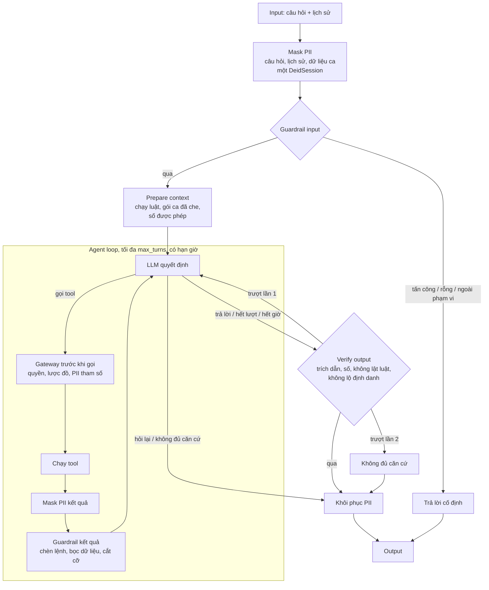

# Plan 1.9 – Agentic RAG cho ô hỏi đáp: công cụ, dữ liệu, phân quyền, chốt an toàn

Ngày viết lại: 21/11/2026, thay toàn bộ bản 18/11. Trạng thái: **bản nháp, chờ người dùng duyệt.**

Bám:
- plan 1.1 (kiến trúc);
- plan 1.5 (bảo mật);
- plan 1.10 (tiến trình AI minh bạch, đã xong);
- `docs/du-lieu/erd-db-hien-tai.md` (ERD đọc trực tiếp từ DB ngày 21/11).

## 1. Quyết định đã chốt

| # | Quyết định | Lý do |
| :--- | :--- | :--- |
| Q1 | **Chỉ ô hỏi đáp (chat) chuyển sang agent.** Thẩm định 7 yếu tố giữ luồng cố định | Thẩm định cần ổn định và tái lập được; câu hỏi tự do của dược sĩ mới cần tra linh hoạt |
| Q2 | **Không làm GraphRAG theo kiểu LLM trích xuất đồ thị.** "Đồ thị" là các bảng có cấu trúc sẵn trong `tri_thuc`, tra bằng SQL qua tool | Cạnh do LLM trích ra không kiểm chứng được, trái nguyên tắc "LLM không tự tạo căn cứ"; dữ liệu quan hệ (thuốc, nhóm, tương tác) đã có cấu trúc |
| Q3 | **Chia tool theo cách tra, không theo nguồn.** Nguồn là bộ lọc | Thêm Dược thư, BYT, phác đồ thì chỉ thêm giá trị lọc, không thêm tool |
| Q4 | **Dữ liệu có cấu trúc ở SQL, văn bản dài ở vector** (mục 4.3) | SQL trả lời chính xác có/không; vector chỉ để tìm đoạn văn để trích |
| Q5 | **Gói ca vẫn nằm sẵn trong prompt.** Tool đọc hồ sơ chỉ bật khi gói bị cắt | Ít tool thì mô hình chọn đúng hơn, ít lượt hơn, ít đường rò PII hơn |
| Q6 | **Dựng khung agent trước, 0 tool; luồng cũ không là tool mà là đường lui ở mức engine** (`ask.engine: co_dinh`). Từ 22/11 mặc định chạy `agentic` (người dùng chốt 21–22/11) | Có luồng cơ bản chạy được ngay; tool được duyệt cắm vào dần mà không sửa đồ thị. Bọc luồng cũ thành tool (thử 21/11) làm agent gọi LLM 3–4 lần, chậm gấp đôi mà không tốt hơn, nên đã bỏ (mục 6.6) |

## 2. Hiện trạng (đã kiểm mã và DB ngày 21/11)

### 2.1. Luồng hỏi đáp hiện nay: tuyến tính, cứng

Mã: `app/orchestration/ask.py`. LLM không chọn bước nào; thứ tự do code quyết định.

```
Câu hỏi + lịch sử (tối đa 6 tin)
 → 1. Chuẩn bị: che PII câu hỏi và lịch sử; chạy bộ luật (hoặc dùng kết quả có sẵn);
      dựng gói ca (y lệnh, xét nghiệm, chỉ số tính sẵn, phát hiện luật, nhận định AI,
      nhận định được bấm hỏi đặt lên đầu); lập danh sách số được phép dùng
 → 2. Truy xuất: lấy MỌI hoạt chất của ca (y lệnh chờ duyệt + thuốc đang dùng),
      tạo 2 truy vấn (câu hỏi + tên Việt, câu hỏi + tên INN),
      BM25 + vector + RRF + rerank, lọc theo hoạt chất → tối đa 6 đoạn
 → 3. Gọi LLM một lần (DeepSeek, JSON theo lược đồ)
 → 4. Kiểm chứng: câu trích khớp nguyên văn đoạn nguồn; số liệu nằm trong danh sách
      được phép; chặn đầu ra lật hoặc hạ phát hiện của luật
      → trượt thì gửi lỗi vào prompt, lặp 3–4 thêm 1 lần → vẫn trượt: "Không đủ căn cứ"
```

`ask_global` (hỏi chung, không gắn ca) đi đúng bốn bước, bước 1 tổng hợp danh sách y lệnh. Mỗi bước đã phát sự kiện tiến trình qua `ghi_buoc` (plan 1.10).

### 2.2. Điểm yếu của luồng cứng

1. **Truy xuất theo phạm vi cả ca, không theo câu hỏi.** Ca 12 thuốc mà hỏi về vancomycin thì 6 đoạn vẫn chia cho thuốc khác.
2. **Chỉ tra một lần.** Thiếu căn cứ thì không tra thêm, đi thẳng tới "Không đủ căn cứ".
3. **Không viết lại hay tách câu hỏi.** Câu so sánh hai tình huống chỉ được tìm một lượt.
4. **Không có tra cấu trúc.** LLM không hỏi được "A với B có tương tác không" nếu luật chưa nêu.
5. **`cong_cu_da_goi` chỉ là nhãn cố định** (`du_lieu_ca`, `bo_luat`, `truy_xuat`), không phải tool calling.
6. **Lần thử lại chỉ sửa đầu ra,** không lấy thêm bằng chứng.

### 2.3. RAG đang chạy kém hơn mức đo được

| Việc | Hiện trạng |
| :--- | :--- |
| Cấu hình tìm | Vẫn là đường lai BM25 + vector + RRF. T64 đo đây là cấu hình kém nhất: top-1 câu Việt 0,28, so với chỉ dùng vector 0,68 |
| Rerank | `config/settings.yaml` trỏ `cohere/rerank-v3.5` qua OpenRouter. T64 ghi lỗi 402; khi lỗi, code âm thầm dùng thứ tự RRF. **Cần kiểm log production** |
| Nơi tìm vector | App nạp cả 3730 vector lên bộ nhớ rồi tìm tại đó. DB đã có chỉ mục HNSW `doan_trich_embedding_hnsw` nhưng không dùng. `vector_store.provider: pgvector` không có cài đặt tương ứng |
| Khoá OpenRouter | Code chỉ đọc `OPENROUTER_API_KEY` và `_2`; người dùng muốn `_1` → `_4` tự chuyển khi hết hạn mức |

### 2.4. Các thành phần khác

| Thành phần | Hiện tại |
| :--- | :--- |
| Gọi LLM | `complete_json(messages, schema)` trong `app/providers/deepseek_llm.py`, chưa truyền danh sách tool. Mô hình `deepseek-flash`, còn `deepseek-v4-pro` |
| Che PII | T48: che theo trường và mẫu, mã tạm `R1…`, `[TEN_1]`, khôi phục sau kiểm chứng |
| Vai trò | `duoc_si_ls`, `admin` (`app/auth/roles.py`); `Principal` truyền xuống dịch vụ |
| Cấu hình sẵn | `agent.max_turns: 5`, `agent.max_synthesis_attempts: 2`, chưa dùng như vòng lặp tool |
| Tiến trình | `TienTrinh` và `ghi_buoc` (`app/core/progress.py`) thêm bước dần; giao diện dòng thời gian, thu gọn trên câu trả lời |
| Nguồn ca | `DbReviewService` đọc `nghiep_vu` trên RDS `bvienx-pharm-db` |

## 3. Nguyên tắc bất biến (không được nới khi chuyển)

1. **LLM không tự tính.** Mọi con số lâm sàng do code tính (`app/calc`); LLM chỉ đọc kết quả.
2. **LLM không sửa kết quả luật.** Phát hiện của luật không bị xoá hay hạ mức.
3. **Mọi câu trả lời qua kiểm chứng:** trích dẫn khớp nguồn, số liệu kiểm được, bất kể căn cứ đến từ tool nào.
4. **Chỉ đọc.** Không tool nào ghi DB, duyệt đơn, gửi tin, ghi OH/EMR.
5. **PII không ra khỏi hệ thống.** Tool trả dữ liệu ca đã che; tham số tool do LLM sinh được quét PII trước khi chạy, nhất là tool gọi ra ngoài.
6. **Đầu ra tool là dữ liệu, không phải chỉ thị.** Bọc trong dấu đánh dấu, quét chèn lệnh, không bao giờ nối vào system prompt.
7. **Có đường lui.** Cờ `ask.engine` quay về luồng cứng hiện tại; agent lỗi thì vẫn còn luồng cứng và kết quả luật.

## 4. Dữ liệu: DB hiện tại và nguyên tắc lưu trữ

ERD đầy đủ, khoá chính, khoá ngoại, số dòng: `docs/du-lieu/erd-db-hien-tai.md`.

### 4.1. Tóm tắt hai lược đồ

**`nghiep_vu` (24 bảng): bệnh án giả lập và kết quả hệ thống**

```
nguoi_benh (67) ─┬─ di_ung (6)
                 └─ dot_dieu_tri (94) ─┬─ chan_doan (127), sinh_hieu (442), ket_qua_xet_nghiem (228)
                                       ├─ vi_sinh (8) ── khang_sinh_do (16)
                                       ├─ dien_bien (228)            [văn bản tự do]
                                       ├─ phieu_dieu_tri (333)       [văn bản tự do] ── phieu_y_lenh (625)
                                       └─ y_lenh (229, 67 ca_id) ── chi_tiet_y_lenh (240) ── lich_dung (217)
                                                                        └─ thuoc (74) ── thuoc_hoat_chat (82)
Đáp án mẫu:  lan_tham_dinh (67) ── nhan_dinh (55) ── nhan_dinh_thuoc (55), can_cu (0)
Hệ thống ghi: ket_qua_tham_dinh (264) ── ket_qua_nhan_dinh (2599); phan_hoi (2); hoi_thoai (12)
```

**`tri_thuc` (39 bảng): tri thức thuốc**

| Nhóm | Bảng (dòng) |
| :--- | :--- |
| Văn bản có vector | `tai_lieu` (50), `doan_trich` (3730) |
| Từ điển và phân giải tên | `tra_cuu_hoat_chat` (1255, danh mục gốc), `tra_cuu_dong_nghia` (4543), `tra_cuu_thuoc` (54910 sản phẩm Cục QLD), `tra_cuu_thuoc_thanh_phan` (46360), `tra_cuu_chuyen_ma_ca` (50), `hoat_chat` (58), `ten_thuoc` (187), `danh_muc_hoat_chat_demo` (54) |
| Tương tác | `ddinter_cap` (291876), `ddinter_thuoc` (1971), `ddinter_thuc_an` (805), `tuong_tac_benh` (300), `anh_xa_benh_icd` (119), `tuong_tac_benh_khop_ca` (13) |
| Bảng luật | `lieu_toi_da` (40), `quy_tac_lieu_than_v2` (18), `quy_tac_lieu_than_khong_nguong` (28), `quy_tac_gan` (24), `nguong_xet_nghiem` (15), `canh_bao_doc_tinh` (90), `duong_dung_hop_le` (62), `chuan_hoa_duong_dung` (94), `nhom_di_ung_cheo` (26), `nhom_dieu_tri_trung` (8), `khang_sinh_han_che` (32), `doi_tuong_dinh_nghia` (21)… |
| Rỗng hoặc gần rỗng | `tuong_tac_sang_loc` (0), `atc_bo_sung` (1), `quy_tac_lieu_than` bản cũ (4) |

### 4.2. Phần đang lưu dạng vector

**Chỉ một cột:** `tri_thuc.doan_trich.embedding`.

- 3730/3730 đoạn đã nhúng, mô hình `gemini-embedding-2`, 2048 chiều, chỉ mục HNSW halfvec cosine.
- **Toàn bộ là nhãn openFDA, tiếng Anh,** từ 50 tài liệu: 3483 đoạn văn và 247 đoạn bảng.
- Cột nhúng: `noi_dung_nhung`. Cột trích nguyên văn: `noi_dung_goc`.
- Cột lọc: `hoat_chat_ids`, `muc`, `nhom_nguon`, `nguon`, `tang_tin_cay`, `ngon_ngu`, `muc_cha_id`.
- Phân bố mục: `canh_bao` 819, `duoc_ly` 599, `tac_dung_phu` 481, `lieu` 404, `khac` 362 (nhãn còn nhiễu), `tuong_tac` 276, `thai_ky_cho_bu` 237, `chi_dinh` 195, `nhi_cao_tuoi` 113, `lieu_than` 81, `qua_lieu` 73, `chong_chi_dinh` 65, `lieu_gan` 25.

Mọi thứ khác (DDInter, liều, hồ sơ) không có vector, chỉ tra bằng SQL.

### 4.3. Nguyên tắc: SQL hay vector

Tiêu chí là **hình dạng dữ liệu và kiểu câu hỏi**, không phải dữ liệu ít hay nhiều thay đổi.

| | SQL | Vector |
| :--- | :--- | :--- |
| Dữ liệu | Dòng có trường rõ: cặp A–B, mức độ, ngưỡng số | Văn bản dài, ý nằm trong câu chữ |
| Câu hỏi | "Có hay không, bao nhiêu" | "Đoạn nào nói về chuyện này" |
| Kết quả | Chính xác, tái lập, kiểm được | Gần đúng, xếp theo độ giống |
| Khi sai | Trả "không có", và biết chắc là không có | Trả đoạn gần giống nhưng sai, khó phát hiện |

Áp dụng:

| Dữ liệu | Lưu và tra | Ghi chú |
| :--- | :--- | :--- |
| DDInter, liều, thận, gan, dị ứng chéo, đường dùng, kháng sinh hạn chế, từ điển tên | **SQL** là nguồn sự thật | Không nhúng |
| Nhãn thuốc, Dược thư, văn bản BYT, phác đồ, văn bản quy định gốc | **Vector**, có cột lọc | Trích nguyên văn từ `noi_dung_goc` |
| Trường văn bản trong bảng có cấu trúc (DDInter `hau_qua`, `xu_tri`; `tuong_tac_benh.noi_dung`) | SQL; **chỉ nhúng khi cần hỏi ngược** ("thuốc nào gây hội chứng serotonin") | Vector chỉ để tìm ra dòng; câu trả lời và trích dẫn luôn lấy từ dòng SQL. Chưa làm |
| Hồ sơ người bệnh (`dien_bien`, `phieu_dieu_tri`, `dot_dieu_tri.benh_su/tien_su`) | **Không nhúng.** Đọc theo ca bằng SQL, lọc theo ngày, che PII | Mỗi ca chỉ vài trang. Nhúng nghĩa là gửi bệnh án sang dịch vụ nhúng bên ngoài |
| Tên thuốc gõ tự do, sai chính tả | Khớp mờ tên (`tra_cuu_dong_nghia` + `pg_trgm` + bỏ dấu), **không dùng vector** | Xem 4.4 |

### 4.4. Phân giải tên thuốc khi có dữ liệu thật

`tra_cuu_dong_nghia` **không phải dữ liệu bệnh viện**. Đó là từ điển nhóm tự dựng ở plan 1.8:
- chỉ gồm tên hoạt chất dưới nhiều cách viết (INN, tên Việt, dạng muối);
- lấy từ RxNav cộng quy tắc biến đổi;
- **không có tên thương mại, không có tên viết tắt.**

Tên thương mại giải qua `tra_cuu_thuoc` (Cục QLD) → `tra_cuu_thuoc_thanh_phan`.

Chuỗi phân giải, theo độ tin cậy giảm dần:

| Bước | Cách | Độ chắc | Bảng |
| :--- | :--- | :--- | :--- |
| 1 | Mã thuốc nội viện → hoạt chất (ánh xạ một lần cho danh mục viện, dược sĩ duyệt) | Chắc chắn | `nghiep_vu.thuoc` + `thuoc_hoat_chat` |
| 2 | Số đăng ký → Cục QLD | Rất cao | `tra_cuu_thuoc.so_dang_ky` |
| 3 | Tên thương mại → Cục QLD → hoạt chất | Cao, có thể nhiều kết quả | `tra_cuu_thuoc` |
| 4 | Tên hoạt chất viết kiểu khác | Cao | `tra_cuu_dong_nghia` |
| 5 | Khớp mờ (sai chính tả, thiếu dấu) | Trung bình, **trả danh sách ứng viên** | Chưa có (`pg_trgm`) |
| 6 | Viết tắt nội bộ ("vanco", "pip-tazo") | Không có nguồn công khai | Chưa có: bảng viết tắt nội viện do dược sĩ duyệt |

Với dữ liệu thật, gần như mọi dòng y lệnh được giải ở bước 1. Bước 3–6 phục vụ hai chỗ:
- dòng ghi tự do: hiện 81/240 dòng `chi_tiet_y_lenh` không có `thuoc_id`, chỉ có `ten_tu_do`;
- câu hỏi chat của dược sĩ.

LLM được **đề xuất** tên đầy đủ cho viết tắt, nhưng phải qua `tra_thuoc` xác nhận. Nhiều khả năng thì hỏi lại dược sĩ, không tự chọn.

### 4.5. Việc dọn DB trước khi viết tool (giai đoạn P1)

1. **Một danh mục hoạt chất gốc.** Kiểm ngày 21/11: toàn DB dùng chung một không gian mã dạng tên INN. `hoat_chat` (58) có 57/58 mã nằm trong `tra_cuu_hoat_chat`; `danh_muc_hoat_chat_demo` 54/54; mọi bảng luật đều khớp. Việc cần làm:
   - lấy `tra_cuu_hoat_chat` làm gốc;
   - thêm kiểm toàn vẹn cho các bảng luật;
   - xử lý mã lệch duy nhất;
   - gộp hoặc bỏ `hoat_chat`, `danh_muc_hoat_chat_demo`.
2. **Sửa khoá ngoại chéo lược đồ.** `nghiep_vu.thuoc_hoat_chat`, `di_ung`, `khang_sinh_do` đang trỏ `tri_thuc.hoat_chat` (58 mã); dữ liệu thật sẽ bị chặn. Trỏ sang danh mục gốc.
3. **Bỏ bảng chết:** `tuong_tac_sang_loc` (0), `atc_bo_sung` (1), `quy_tac_lieu_than` bản cũ, sau khi chắc không còn code đọc.
4. **Tách cột JSON hay lọc** thành cột hoặc bảng phụ: mã ATC (`ma_atc_json`) để `tra_nhom_thuoc` lọc được bằng SQL.
5. **Bảo toàn kiểm toán:** thay đổi lược đồ đi qua migration có phiên bản; không xoá dữ liệu nguồn.

## 5. Danh mục tool

### 5.1. Hai lớp

- **Hàm bên trong:** mỗi bảng hoặc nhóm bảng một hàm, kiểm thử riêng.
- **Tool đưa cho LLM:** ít, gộp theo cách tra. Mục 5.2–5.6 là danh mục đầy đủ; mục 5.7 là bộ rút gọn cho P2.

Mỗi tool là một lớp có: `ten`, `mo_ta` (cho LLM), `LuocDoThamSo` (pydantic, `extra="forbid"`, giới hạn độ dài), `LuocDoKetQua`, `che_do` (`ca` / `chung`), `muc_nhay_cam`, `chi_doc=True`, `goi_ra_ngoai`, `thoi_gian_toi_da`, `so_dong_toi_da`.

### 5.2. A – Tri thức dạng văn bản (vector, trả đoạn để trích nguyên văn)

| # | Tool | Tham số | Trả về | Nguồn | Chế độ |
| :--- | :--- | :--- | :--- | :--- | :--- |
| A1 | `tim_doan_nguon` | `cau_hoi`; `hoat_chat?` (danh sách mã đã phân giải); `muc?` (lieu, lieu_than, chong_chi_dinh, tuong_tac…); `nhom_nguon?`; `so_doan?` (≤ 8) | Đoạn kèm mã, nhãn nguồn, tầng tin cậy, mục, điểm | `doan_trich` | ca, chung |
| A2 | `doc_doan_mo_rong` | `doan_trich_id` (chỉ đoạn đã trả trong lượt này) | Cả mục cha khi đoạn bị cắt giữa chừng, ví dụ bảng liều chia đôi | `doan_trich.muc_cha_id` | ca, chung |

`tra_phac_do` của bản cũ bỏ. Phác đồ, Dược thư, văn bản BYT vào `doan_trich` với `nhom_nguon` riêng.

### 5.3. B – Tri thức có cấu trúc (SQL, trả dòng bảng)

| # | Tool | Tham số | Trả về | Bảng | Chế độ |
| :--- | :--- | :--- | :--- | :--- | :--- |
| B1 | `tra_thuoc` | `ten` (thương mại, Việt, INN, viết tắt) | Hoạt chất, INN, ATC, dạng bào chế, sản phẩm Cục QLD, **mức chắc chắn theo bước phân giải** (mục 4.4); mơ hồ thì trả danh sách ứng viên | `tra_cuu_*`, `ten_thuoc` | ca, chung |
| B2 | `tra_nhom_thuoc` | `hoat_chat` hoặc `nhom` (ATC, tên nhóm) | Hai chiều: hoạt chất → nhóm; nhóm → các hoạt chất. Phần "đồ thị" thay GraphRAG | `tra_cuu_hoat_chat.ma_atc_json`, `nhom_dieu_tri_trung` | ca, chung |
| B3 | `tra_tuong_tac` | `hoat_chat` (2–10) | Mọi cặp có tương tác: mức độ, cơ chế tóm tắt, hậu quả, xử trí. **Thuốc không có mã DDInter thì báo riêng, không trả "không có tương tác"** | `ddinter_cap`, nối qua `tra_cuu_hoat_chat.ddinter_id` | ca, chung |
| B4 | `tra_tuong_tac_benh` | `hoat_chat`, `benh` (tên hoặc ICD-10) | Cặp thuốc–bệnh | `tuong_tac_benh`, `anh_xa_benh_icd` | ca, chung |
| B5 | `tra_tuong_tac_thuc_an` | `hoat_chat` | Thuốc–thức ăn, đồ uống | `ddinter_thuc_an` | ca, chung |
| B6 | `tra_lieu` | `hoat_chat`, `loai` (toi_da / than / gan), `duong_dung?` | Ngưỡng liều; bậc chỉnh theo CrCl hoặc phân loại gan. **Chỉ trả ngưỡng, không áp vào ca** | `lieu_toi_da*`, `quy_tac_lieu_than_v2`, `quy_tac_gan` | ca, chung |
| B7 | `tra_di_ung_cheo` | `hoat_chat` hoặc `nhom_di_ung` | Nhóm dị ứng chéo, cơ sở | `nhom_di_ung_cheo`, `nhom_di_ung_anh_xa` | ca, chung |
| B8 | `tra_khang_sinh_han_che` | `hoat_chat` | Có thuộc danh mục cần duyệt không, nhóm, yêu cầu | `khang_sinh_han_che*` | ca, chung |
| B9 | `tra_duong_dung` | `hoat_chat`, `duong` | Đường dùng có hợp lệ không, tên chuẩn hoá | `duong_dung_hop_le`, `chuan_hoa_duong_dung` | ca, chung |
| B10 | `tra_canh_bao_xet_nghiem` | `hoat_chat` | Độc tính cần theo dõi, ngưỡng xét nghiệm | `canh_bao_doc_tinh`, `nguong_xet_nghiem` | ca, chung |

### 5.4. C – Ca bệnh (chỉ chế độ ca; `ca_id` lấy từ `ToolContext`, không bao giờ từ LLM)

| # | Tool | Tham số | Trả về | Ghi chú |
| :--- | :--- | :--- | :--- | :--- |
| C1 | `doc_ho_so` | `muc`: chan_doan, di_ung, sinh_hieu, xet_nghiem, vi_sinh, dien_bien, phieu_dieu_tri, benh_su, y_lenh_cho_duyet, thuoc_dang_dung, lich_su_y_lenh; `tu_ngay?`, `den_ngay?` | Phần hồ sơ đã che PII, có mã bản ghi `R1…` | Chỉ bật khi gói ca bị cắt vì vượt `case_context.max_chars` (16000). Văn bản tự do qua quét chèn lệnh. **Không bao giờ trả** họ tên, ngày sinh, địa chỉ, BHYT |
| C2 | `xem_xu_huong_xet_nghiem` | `chi_so` (creatinin, kali, INR…), `so_ngay?` | Chuỗi giá trị theo thời gian; xu hướng do code tính | Gói ca thường chỉ có giá trị mới nhất |
| C3 | `tinh_chi_so` | `cong_thuc` (CrCl, eGFR, BMI, BSA, QTc…), `gia_dinh?` (cân nặng thực / lý tưởng / hiệu chỉnh) | Kết quả, công thức, đầu vào đã dùng | Cho câu "nếu dùng cân nặng lý tưởng thì sao". **LLM chỉ chọn công thức và giả định từ danh sách cố định, không truyền số.** Đầu vào lấy từ hồ sơ |
| C4 | `xem_ket_qua_luat` | `yeu_to?` | Phát hiện của luật | Đã có trong prompt; chỉ cần khi gói bị cắt |

### 5.5. D – Điều khiển luồng

| # | Tool | Tác dụng |
| :--- | :--- | :--- |
| D1 | `tra_loi` | Kết thúc vòng, đưa câu trả lời sang bộ kiểm chứng |
| D2 | `hoi_lai_duoc_si` | Câu hỏi mơ hồ (tên thuốc khớp nhiều hoạt chất, không rõ hỏi thuốc nào): hỏi lại, không đoán |
| D3 | `bao_khong_du_can_cu` | Tra hết mà không thấy: dừng sớm và báo thiếu, thay vì tra vòng vo đến hết lượt |

Tiến trình trên giao diện **không phải tool**: ToolGateway tự gọi `ghi_buoc` cho mỗi lần gọi.

### 5.6. E – Nguồn ngoài (để sau, mặc định tắt)

| # | Tool | Ghi chú |
| :--- | :--- | :--- |
| E1 | `tra_openfda` | Kho hiện chỉ có khoảng 50 nhãn, trong khi phân giải tên phủ 1255 hoạt chất. Tham số chỉ là mã hoạt chất đã phân giải, nên không có đường cho PII đi ra. Kết quả gắn nhãn "nguồn ngoài, chưa nạp kho" |
| E2 | `tra_cuc_qld` | Tra trực tuyến sản phẩm mới khi `tra_cuu_thuoc` không có |
| E3 | `tim_web` | Chờ nhóm quyết. Kết quả tầng 3 không bao giờ cho kết luận "đạt" |

### 5.7. Cố ý không có

- SQL tự do do LLM viết.
- Tìm hồ sơ theo tên người bệnh, hoặc đọc ca khác.
- Mọi việc ghi: duyệt y lệnh, lưu phản hồi, gửi tin, ghi OH/EMR.
- Tool tự tính liều cho ca. B6 trả ngưỡng; áp vào ca là việc của code (C3 + B6), so sánh do code làm.

### 5.8. Bộ rút gọn cho P2: 8 tool đưa cho LLM

| Tool cho LLM | Gộp từ | Chế độ |
| :--- | :--- | :--- |
| `tim_doan_nguon` | A1 | ca, chung |
| `doc_doan_mo_rong` | A2 | ca, chung |
| `tra_thuoc` | B1 + B9 | ca, chung |
| `tra_nhom_thuoc` | B2 + B7 | ca, chung |
| `tra_tuong_tac` | B3 + B4 + B5 (tham số `loai`) | ca, chung |
| `tra_quy_dinh` | B6 + B8 + B10 (tham số `loai`) | ca, chung |
| `tinh_chi_so` | C3 | chỉ ca |
| `hoi_lai_duoc_si` | D2 | ca, chung |

`tra_loi` và `bao_khong_du_can_cu` nằm trong định dạng đầu ra. C1, C2, C4 bật sau, khi có ca dài thật sự cần.

### 5.9. Mã trích dẫn theo loại căn cứ

Bộ kiểm chứng hiện chỉ chấp nhận câu trích khớp nguyên văn một đoạn văn. Mở rộng để chấp nhận bốn loại:

| Loại | Mã | Kiểm chứng |
| :--- | :--- | :--- |
| Đoạn văn | `doan:<doan_trich_id>` | Câu trích khớp nguyên văn `noi_dung_goc` (như hiện nay) |
| Dòng bảng | `bang:<ten_bang>:<khoa>` | Dòng phải nằm trong kết quả tool của lượt này; giá trị nhắc tới (mức độ, ngưỡng) phải khớp trường của dòng |
| Phép tính | `tinh:<cong_thuc>` | Số phải trùng kết quả code đã trả |
| Bản ghi ca | `ca:R<n>` | Như kiểm mã bản ghi hiện nay |

Chỉ căn cứ do tool trả **trong lượt này** mới được trích.

## 6. Kiến trúc

### 6.1. Ba lớp

```
LLM (chỉ thấy tên, mô tả, lược đồ các tool được phép theo vai trò và chế độ)
   │  đề xuất gọi tool (tên, tham số JSON)
   ▼
ToolGateway  ← chốt an toàn duy nhất
   • có trong danh mục? vai trò được phép? đúng chế độ (ca/chung)?
   • tham số đúng lược đồ; quét PII; quét chèn lệnh
   • ngân sách: số lượt, thời gian, số dòng/đoạn trả về
   • gọi ghi_buoc (tiến trình) và ghi nhật ký kiểm toán (không ghi nội dung)
   ▼
Tool: lớp mỏng bọc dịch vụ có sẵn (retriever, DrugResolver, InteractionStore, app/calc, lookup), chỉ đọc
```

### 6.2. Luồng agent cho ô hỏi đáp (đồ thị LangGraph)

Sơ đồ người dùng duyệt ngày 21/11:



Hai thứ chạy xuyên suốt, không vẽ thành ô: `ghi_buoc` cho giao diện tiến trình (mỗi nút một bước), nhật ký kiểm toán của Gateway.

| Nút | Việc | Dùng lại từ mã hiện có |
| :--- | :--- | :--- |
| `nhan_dau_vao` | Kiểm độ dài câu hỏi (1–1000 ký tự), chế độ `ca` / `chung`, nạp ca | `CaseAsker.ask` |
| `che_pii` | Mở `DeidSession` từ định danh của ca; che câu hỏi và lịch sử (tối đa 6 tin). Từ đây LLM chỉ thấy mã tạm | `open_deid_session`, `_scrub_history_and_question` |
| `chan_dau_vao` | Guardrail vào: chỉ thị vượt quyền, ép duyệt đơn, chèn khối dữ liệu → trả lời cố định, không gọi LLM | `_has_injection_directive`, `OUT_OF_SCOPE_MESSAGE` |
| `chuan_bi_ngu_canh` | Chạy luật (hoặc dùng kết quả có sẵn), dựng gói ca đã che, danh sách mã bản ghi và số được phép | `build_case_bundle`, `_collect_case_numbers`, `_format_priority_finding`, `_format_ai_section` |
| `tac_tu` | Một lần gọi LLM theo lược đồ "kế hoạch JSON" (6.3): gọi tool / trả lời / không đủ căn cứ / hỏi lại | `complete_json` |
| `goi_cong_cu` | Qua `ToolGateway`; che PII và guardrail kết quả; thêm căn cứ; quay lại `tac_tu` | mới |
| `kiem_chung` | Trích dẫn, số liệu, không lật luật, không lộ định danh. Trượt lần 1 quay lại `tac_tu` kèm lỗi; lần 2 thì "Không đủ căn cứ" | `_verify_and_build_reply` |
| `khoi_phuc_pii`, `hoan_tat` | Thay mã tạm bằng giá trị thật chỉ để hiển thị; dựng `AskResult` giống hệt luồng cứng | `restore_text`, `RecordIdMap` |

- Hết lượt, hết giờ hoặc lỗi không mong muốn: sang đường lui (6.6).
- Tool độc lập trong cùng một vòng chạy song song (sau khung, khi có nhiều tool).
- Đồ thị biên dịch **không có checkpointer**: trạng thái chứa dữ liệu ca không được lưu ở đâu.
- Cờ `ask.engine: co_dinh | agentic`, mặc định `co_dinh` cho đến khi qua đánh giá (mục 10).

### 6.3. Tool calling gốc hay "kế hoạch JSON" (quyết định ở P0)

| Cách | Mô tả | Ưu | Nhược |
| :--- | :--- | :--- | :--- |
| Tool calling gốc | Truyền danh sách tool cho DeepSeek, mô hình trả `tool_calls` | Chuẩn, linh hoạt | Chưa thử độ ổn định của `deepseek-flash`; phải sửa lớp gọi LLM |
| Kế hoạch JSON | Mỗi vòng LLM trả `{"goi": [{"tool":…, "tham_so":…}], "xong": false}` theo lược đồ; code thực thi | Dùng ngay `complete_json`; dễ kiểm và dễ ghi nhật ký; không phụ thuộc nhà cung cấp | Tự viết vòng lặp; lược đồ dài hơn |

Khuyến nghị: thử cả hai ở P0. Nếu tool calling gốc không vượt trội rõ thì dùng **kế hoạch JSON**.

### 6.4. ToolContext

Mỗi lượt có một `ToolContext` bất biến:
- `principal` (vai trò);
- `che_do` (`ca` + `ca_id`, hoặc `chung`);
- `deid_session` (T48);
- ngân sách còn lại;
- tập căn cứ đã cấp (đoạn, dòng bảng, phép tính), dùng cho kiểm chứng.

Tool **không nhận `ca_id` từ LLM**, nên LLM không thể nhảy sang hồ sơ người bệnh khác.

### 6.5. Tiến trình trên giao diện (nối plan 1.10)

Mỗi lần gọi tool sinh một bước, tên do Gateway đặt từ danh mục, không do LLM viết:

| Bước ví dụ | Chi tiết hiển thị |
| :--- | :--- |
| "Phân giải tên thuốc" | "3 tên → 3 hoạt chất" |
| "Tra tương tác" | "4 hoạt chất, 2 cặp có tương tác" |
| "Tìm đoạn nguồn" | "Nhãn FDA, 5 đoạn" |
| "Hỏi lại dược sĩ" | (không có) |

Chi tiết chỉ gồm số đếm, nhãn nguồn công khai và mã lỗi đã lọc. Không có nội dung câu hỏi, câu trả lời hay hồ sơ, đúng quy tắc của plan 1.10. Giới hạn 40 bước mỗi lượt đã có sẵn.

### 6.6. Khung agent 0 tool và tool `luong_cu_cung`

**Khung** là toàn bộ đồ thị 6.2 cùng lớp tool (`Tool`, danh mục, `ToolGateway`, `ToolContext`, chính sách), nhưng danh mục **chưa có tool chuyên biệt nào** của mục 5. Mỗi tool được duyệt về sau chỉ cần:
1. một lớp trong `app/agent/tools/`;
2. một dòng đăng ký vào danh mục;
3. một dòng trong `config/tool_policy.yaml`.

Không sửa đồ thị.

**Luồng cũ (`CaseAsker`) không phải tool của agent** (người dùng chốt 22/11). Bản 21/11 từng bọc nó thành tool `luong_cu_cung`. Khi chạy thật, agent gọi tool, luồng cũ tự gọi LLM và kiểm chứng, rồi agent soạn lại và kiểm chứng lần nữa: 3–4 lần LLM, 34 giây so với 15–20 giây, câu trả lời không tốt hơn. Đã xoá tool.

**Đường lui**

| Lớp | Khi nào | Hành vi |
| :--- | :--- | :--- |
| 1. Cờ engine | `ask.engine: co_dinh` (đổi tay trong `config/settings.yaml`) | Dịch vụ gọi thẳng `CaseAsker` như trước plan 1.9; không chạy đồ thị. Mặc định từ 22/11 là `agentic`; profile test giữ `co_dinh` |
| 2. Nút `du_phong` trong đồ thị | Agent lỗi, hết lượt, hết giờ, không đủ căn cứ, hoặc kiểm chứng trượt lần 2 | Kết thúc an toàn: "Không đủ căn cứ" hoặc thông báo lỗi. Không gọi luồng cũ |
| 3. Git | Khung làm hỏng hành vi | Tag `neo/truoc-khung-agent`; lùi bằng `git revert` các commit của khung |

Chế độ hỏi chung (`__global__`) chưa có đồ thị riêng. `AgenticAsker.ask_global` chuyển thẳng cho `CaseAsker.ask_global`; đây là định tuyến ở mức engine, không phải tool.

**Marker test `luong_cu_cung`:** các test dựng `CaseAsker` trực tiếp mang marker này. Biến môi trường `CDSS_LUONG_CU_CUNG=0` tắt luồng cũ: các test đó được skip thay vì báo trượt, và `ask.engine: co_dinh` khi đó là lỗi cấu hình, báo ngay lúc khởi động.

**Cấu trúc mã của khung**

```
app/agent/
  state.py          HoiDapState (TypedDict)
  graph.py          dung_do_thi_hoi_dap(): nút + cạnh điều kiện, không checkpointer
  nodes.py          các nút của 6.2 và du_phong
  asker.py          AgenticAsker: cùng giao diện AskRunner (ask, ask_global), trả AskResult
  tools/
    base.py         Tool, ToolContext, KetQuaCongCu, CanCu
    registry.py     DanhMucCongCu
    gateway.py      ToolGateway: chính sách, lược đồ, ngân sách, PII tham số, nhật ký, ghi_buoc
    policy.py       đọc config/tool_policy.yaml, mặc định từ chối
config/tool_policy.yaml
config/prompts/tac_tu.v1.md
```

API, hợp đồng và giao diện web không đổi: `AgenticAsker` và `CaseAsker` trả cùng `AskResult`.

**Giao việc:** T101 (lớp tool, chính sách, Gateway, `luong_cu_cung`, marker test), rồi T102 (đồ thị, nút, `AgenticAsker`, nối dịch vụ theo cờ). Agent: agy `gemini-4-hydrogen-high`; trượt review thì giao lại bằng `gemini-4-hydrogen-xhigh`.

## 7. Phân quyền theo tool

### 7.1. Chính sách khai báo (`config/tool_policy.yaml`)

```yaml
vai_tro:
  duoc_si_ls:
    cho_phep: [tim_doan_nguon, doc_doan_mo_rong, tra_thuoc, tra_nhom_thuoc,
               tra_tuong_tac, tra_quy_dinh, tinh_chi_so, hoi_lai_duoc_si]
  admin:
    cho_phep: [tim_doan_nguon, doc_doan_mo_rong, tra_thuoc, tra_nhom_thuoc,
               tra_tuong_tac, tra_quy_dinh]          # không có tool ca bệnh
che_do:
  chung:
    cam: [tinh_chi_so, doc_ho_so, xem_xu_huong_xet_nghiem, xem_ket_qua_luat]
mac_dinh: tu_choi                                    # không khai báo = không được gọi
cong_cu_ra_ngoai:
  tra_openfda: { bat: false }
  tim_web:     { bat: false, can_duoc_si_bam: true }
```

### 7.2. Hai lần chặn

1. **Trước khi gọi LLM:** chỉ đưa vào prompt các tool vai trò và chế độ được phép. LLM không biết tool bị cấm tồn tại.
2. **Tại ToolGateway:** kiểm lại vai trò, chế độ, giới hạn tham số. Từ chối thì trả lỗi có cấu trúc cho LLM và ghi nhật ký kiểm toán.

Mặc định từ chối. Thêm vai trò mới chỉ cần sửa chính sách, không sửa mã tool.

## 8. Bảo mật

| Rủi ro | Chốt | Kiểm thử chạy được |
| :--- | :--- | :--- |
| Gọi tool không được phép | Danh mục theo vai trò và chế độ + kiểm tại Gateway, mặc định từ chối | Ma trận vai trò × tool × chế độ; tool cấm không xuất hiện trong prompt |
| Đọc hồ sơ người bệnh khác | `ca_id` chỉ lấy từ `ToolContext`; lược đồ tham số không có trường `ca_id` | Tham số lạ bị `extra="forbid"` từ chối; truy cập chéo vẫn 404 ở API |
| Vòng lặp vô hạn, tốn chi phí | `max_turns` 5, hạn thời gian mỗi lượt và tổng, trần số dòng/đoạn mỗi tool; vẫn chịu giới hạn 429 hiện có | Dừng đúng ở lượt 5 và đúng hạn thời gian |
| Chèn lệnh qua đầu ra tool (diễn biến, phiếu điều trị, văn bản nguồn) | Bọc dữ liệu, quét chèn lệnh, không bao giờ nối vào system prompt; đọc cả ký tự rộng 0 và dòng ẩn | HS-056..060 + ca tấn công mới đặt trong `phieu_dieu_tri` và trong đoạn nguồn giả |
| Rò PII ra ngoài | Dữ liệu ca đã che; C1 không bao giờ trả cột định danh của `nguoi_benh`; tham số tool ra ngoài phải qua bộ che, có định danh thì từ chối; không nhúng vector hồ sơ | Quét tham số mọi tool trên 66 ca: không có định danh |
| Bịa nguồn, bịa số | Kiểm chứng theo mục 5.9; chỉ căn cứ của lượt này | Câu trả lời trích mã không có trong lượt bị chặn |
| Hạ mức cảnh báo luật | Giữ chốt hiện có (chặn đầu ra lật luật) | Bộ ca hiện có vẫn qua |
| Kết luận chắc chắn từ dữ liệu thiếu | B3 báo "không có trong DDInter" khác "không có tương tác"; B1 trả mức chắc chắn | Test với thuốc không có mã DDInter |
| Kết luận "đạt" từ nguồn yếu | Nguồn tầng 3 không bao giờ cho "đạt" | Test với kết quả `tim_web` giả |
| SQL injection | Tool chỉ dùng câu SQL tham số hoá, không f-string; không có tool SQL tự do | `ruff` + rà diff tìm f-string trong SQL |
| Khó truy vết | Nhật ký kiểm toán: tool, vai trò, mã ca băm, thời gian, cho phép/từ chối, số dòng trả; không ghi nội dung | Log không chứa câu hỏi hay nội dung hồ sơ |

## 9. Lộ trình

| Giai đoạn | Nội dung | Đầu ra | Cổng |
| :--- | :--- | :--- | :--- |
| P0 – thử mô hình | Thử `deepseek-flash` và `deepseek-v4-pro`: tool calling gốc so với kế hoạch JSON, trên 20 câu mẫu; đo độ đúng tên tool, tham số, độ trễ | Báo cáo ngắn, chọn cách gọi (6.3) | Người dùng duyệt |
| P1a – sửa RAG | Chỉ vector trong bộ lọc hoạt chất (đề xuất T64); kiểm log rerank; ngưỡng "không có nguồn"; tìm qua HNSW trên DB thay vì bộ nhớ; khoá OpenRouter `_1`→`_4` | Đo lại bộ 50 câu T64: không kém "chỉ vector" | recall@5, top-1 |
| P1b – dọn DB | Mục 4.5: danh mục gốc, khoá ngoại, bảng chết, cột ATC | Migration có phiên bản; 66 ca cho kết quả luật giống hệt | Kết quả luật không đổi |
| P1c – khung agent | ✅ 22/11. Mục 6.6: đồ thị 6.2, lớp tool, Gateway, chính sách, đường lui, marker test (T101, T102, bỏ tool luồng cũ). `ask.engine` mặc định `agentic` | Khung chạy với 0 tool | Toàn bộ test xanh; thử trên trình duyệt |
| P2 – cắm tool | Lần lượt 8 tool của mục 5.8 theo thứ tự người dùng duyệt; kiểm chứng mở rộng 5.9; tiến trình theo 6.5 | Đối chiếu với luồng cứng trên bộ câu hỏi (mục 10) | Không kém luồng cứng ở mọi chỉ số |
| P3 – làm dày văn bản | Nạp Dược thư, văn bản BYT, phác đồ được duyệt vào `doan_trich` với `nhom_nguon` riêng; mở rộng openFDA | Độ phủ hoạt chất có văn bản tăng | Có nguồn được Khoa Dược chấp nhận |
| P4 – tool ca bệnh mở rộng | C1, C2, C4 khi có ca dài; bảng viết tắt nội viện | | Khi có dữ liệu thật |
| P5 – nguồn ngoài | E1 `tra_openfda`, rồi E2, E3 theo quyết định nhóm; E3 có dược sĩ bấm xác nhận | | Sau P2 |

P1a, P1b, P1c độc lập nhau, làm song song được. P1c làm trước (người dùng chốt 21/11). Tool nào của P2 đọc danh mục hoạt chất thì cần P1b xong phần danh mục gốc.

## 10. Đánh giá

- **Bộ câu hỏi chat có đáp án** (chưa có; điều kiện để bật P2):
  - khoảng 60 câu chế độ ca, trên các ca có sẵn;
  - khoảng 40 câu chế độ chung;
  - chia theo loại: liều, thận/gan, tương tác, dị ứng chéo, kháng sinh hạn chế, câu mơ hồ, câu ngoài phạm vi, câu tấn công;
  - dược sĩ duyệt đáp án.
- **Chỉ số, so luồng cứng với agent:**
  - tỷ lệ trả lời đúng;
  - tỷ lệ qua kiểm chứng;
  - tỷ lệ "Không đủ căn cứ" sai (có căn cứ mà không tìm ra);
  - số trích dẫn đúng;
  - độ trễ trung vị và p90;
  - số lần gọi LLM và chi phí mỗi câu.
- **Bất biến:** kết quả luật của 66 ca giống hệt; không câu trả lời nào hiển thị mà chưa qua kiểm chứng.
- **Bảo mật:** các test ở mục 8 chạy trong CI.

## 11. Rủi ro

| Rủi ro | Mức | Giảm thiểu |
| :--- | :--- | :--- |
| DeepSeek tool calling không ổn định | Cao | P0; dự phòng kế hoạch JSON |
| Agent chậm hơn luồng cứng | Trung bình | Trần lượt; chạy song song tool độc lập; cache kết quả tra; tiến trình hiển thị để dược sĩ không thấy hệ thống im lặng |
| Kho văn bản quá mỏng (khoảng 50 thuốc) làm agent tra nhiều mà vẫn trắng tay | Cao | P3, E1; D3 dừng sớm; tool có cấu trúc (B1–B10) trả lời được phần lớn câu hỏi không cần đoạn văn |
| Kết quả kém ổn định giữa các lần | Trung bình | Nhiệt độ 0; cờ quay về luồng cứng; đánh giá trên bộ cố định trước khi bật |
| Chính sách quyền sai | Trung bình | Mặc định từ chối; test ma trận; chính sách một chỗ |
| Dữ liệu thật khác dữ liệu giả lập (danh mục viện, viết tắt) | Trung bình | Tool bọc qua lớp dịch vụ; khi có dữ liệu thật chỉ chỉnh lớp dịch vụ và chuỗi phân giải (mục 4.4) |

## 12. Câu hỏi mở

1. **C3 `tinh_chi_so`:** dược sĩ có hay hỏi kiểu "nếu tính theo cân nặng khác thì sao" không? Nếu không, bỏ khỏi bộ P2.
2. **E1 `tra_openfda`:** có kéo lên sớm (trước P3) vì kho văn bản đang thiếu thuốc không?
3. **Khoa Dược:** danh mục thuốc trong HIS có những cột nào (mã nội viện, hoạt chất, số đăng ký)? Có bảng viết tắt quen dùng không?
4. Ngoài `duoc_si_ls`, `admin`, sẽ có vai trò nào (bác sĩ, học viên, dược sĩ trưởng)? Mỗi vai trò được dùng tool nào?
5. Phác đồ và Dược thư lấy từ đâu, ai duyệt, giấy phép thế nào (cho P3)?
6. Tầng 3 (`tim_web`): có dùng không, điều khoản lưu dữ liệu, danh sách hạng nguồn.
7. Nhật ký kiểm toán lưu bao lâu, ai được xem?
8. Ai soạn và duyệt bộ câu hỏi chat ở mục 10?

## Phụ lục A. Số đo RAG và ứng viên rerank (giữ từ bản 19/11)

Chi tiết: `docs/du-lieu/openfda-rag.md`, `plan/reports/T62.md`, `plan/reports/T64.md`.

**T64, 50 câu:**

| Cấu hình | recall@5 (Việt / Anh) | top-1 (Việt / Anh) |
| :--- | :-: | :-: |
| Chỉ vector | 0,96 / 1,00 | 0,68 / 0,76 |
| Lai của app (RRF, rerank lỗi) | 0,86 / 0,92 | 0,28 / 0,62 |

- Rerank Nemotron, chỉ đo được 29 câu: top-1 Việt 0,69 → 0,83; recall@5 không đổi.
- Hai câu vector sai đều đúng thuốc nhưng sai mục; 362 đoạn mục `khac` còn nhiễu.
- Đường lai sai câu "ceftriaxon chống chỉ định trẻ sơ sinh dùng canxi", vì từ khoá tiếng Việt khớp kém với nhãn tiếng Anh.

**Thứ tự sửa ở P1a:**
1. Lọc siêu dữ liệu trước khi tìm.
2. Bỏ BM25 khỏi đường chính, chỉ giữ làm đường lui.
3. Ngưỡng "không có nguồn".
4. Bộ câu hỏi có dược sĩ duyệt.
5. Rerank, chỉ khi bước 1–3 vẫn còn câu sai.

**Ứng viên rerank** (so trên cùng bộ câu):

| Loại | Mô hình | Ghi chú |
| :--- | :--- | :--- |
| Chạy trên máy | `BAAI/bge-reranker-v2-m3` (~570M) | Đa ngôn ngữ; CPU 1–3 s / 20 đoạn; máy API `t3.small` không đủ |
| Chạy trên máy | `Qwen3-Reranker-0.6B` / `4B` | Bản 4B nên có GPU |
| Chạy trên máy | `jina-reranker-v2-base-multilingual` (~280M) | Nhẹ |
| API | Cohere `rerank-v3.5` gọi thẳng, Voyage `rerank-2.5`, Jina | Mốc so sánh |
| LLM | DeepSeek chấm danh sách đoạn | Chậm hơn, hiểu câu dài nhiều thuốc |

Phần "kiểm chỉ định" của D5 (yếu tố 3, dời từ plan 1.8) làm sau P1a.
